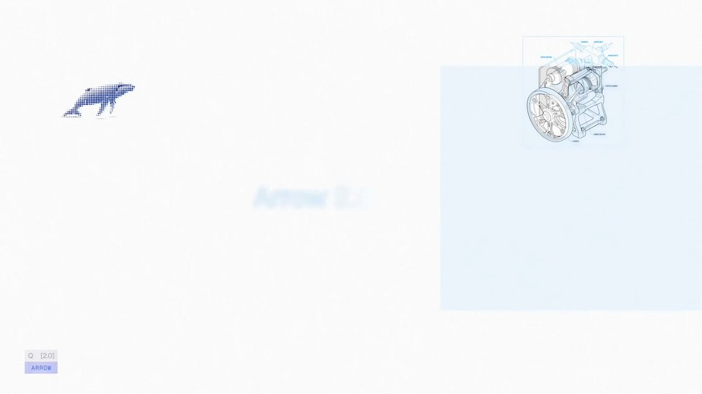

# Introducing Arrow 2 Our latest and most advanced models for generating precise, editable vector graphics. Higher

> Source: https://x.com/QuiverAI/status/2100295136261349802 — QuiverAI (@QuiverAI) — Posted: Wed Sep 16 18:45:56 +0000 2026 — Stats (at capture): 2,166,218 views · 11,059 likes · 168 replies · 829 reposts · 14,099 bookmarks · 236 quotes · Buffer — Captured: 2026-09-21T13:29:16Z

## Post

**Author:** QuiverAI (@QuiverAI)
**URL:** https://x.com/QuiverAI/status/2100295136261349802
**Bio:** Frontier AI for Design.
Get started at http://app.quiver.ai

Introducing Arrow 2

Our latest and most advanced models for generating precise, editable vector graphics.

Higher quality. Faster outputs. Available now in App and API.

## Media

[media/media_0.mp4](media/media_0.mp4) —  — Original: https://video.twimg.com/ext_tw_video/2100295069764919296/pu/vid/avc1/1280x720/AqN3yPJDeqSWxpJo.mp4?tag=12 (1920×1080, 43.84s) — Poster: https://pbs.twimg.com/ext_tw_video_thumb/2100295069764919296/pu/img/gZzRgwxRQGmd8cHw.jpg

## Thread

168 replies counted; no author self-replies visible in rendered conversation at capture.

## Comments

### Diya ([@thejbro1](https://x.com/thejbro1)) — [2100548186159174075](https://x.com/thejbro1/status/2100548186159174075)

> Bros u need to change ur  logo , it resembles cursor

### konstantinpaulus ([@konstipaulus](https://x.com/konstipaulus)) — [2100485121849671688](https://x.com/konstipaulus/status/2100485121849671688)

> Can’t wait to make some motion graphics with this

### ℒ ([@Ottahen](https://x.com/Ottahen)) — [2100379533421793462](https://x.com/Ottahen/status/2100379533421793462)

> It is 2. zero(O) not 2.o

### Nguyen Le ([@newincreative](https://x.com/newincreative)) — [2100869608236585166](https://x.com/newincreative/status/2100869608236585166)

> This is looking dope

### Deepraj ([@deeprajO1](https://x.com/deeprajO1)) — [2100311967005294638](https://x.com/deeprajO1/status/2100311967005294638)

> Precise plus editable vectors. This is huge

### Chaitanya ([@chaitanyajongra](https://x.com/chaitanyajongra)) — [2100321771031589006](https://x.com/chaitanyajongra/status/2100321771031589006)

> How fast can it do that?

### Aaron ([@aaronmahlke](https://x.com/aaronmahlke)) — [2100469319360553361](https://x.com/aaronmahlke/status/2100469319360553361)

> congrats! this is huge

### Ramy Wafaa ([@RamyWafaa](https://x.com/RamyWafaa)) — [2100599356944687276](https://x.com/RamyWafaa/status/2100599356944687276)

> COngrats, this is incredible!

### Francisco Moretti ([@franmoretti_](https://x.com/franmoretti_)) — [2100654169631694892](https://x.com/franmoretti_/status/2100654169631694892)

> Huge congrats!

### Spadassin ([@Spadassin1](https://x.com/Spadassin1)) — [2100413088331620755](https://x.com/Spadassin1/status/2100413088331620755)

> Tried it and it’s literally shit most generic thing ever

### Ibelick ([@Ibelick](https://x.com/Ibelick)) — [2100306538740974017](https://x.com/Ibelick/status/2100306538740974017)

> let’s go!!!

### boyblah ([@boyblahdev](https://x.com/boyblahdev)) — [2100478351635071286](https://x.com/boyblahdev/status/2100478351635071286)

> OHHHHHH BECAUSE AN ARROW IS WHAT YOU PUT QUIVERS IN OMG

### ElonBald ([@ElonBaldMusk](https://x.com/ElonBaldMusk)) — [2100309033349448129](https://x.com/ElonBaldMusk/status/2100309033349448129)

> No more free credits?

### Samuel Spitz ([@samuel_spitz](https://x.com/samuel_spitz)) — [2100308327129632897](https://x.com/samuel_spitz/status/2100308327129632897)

> So cool! Congrats!

### Guli Moreno ([@GuliMoreno](https://x.com/GuliMoreno)) — [2100343605038596116](https://x.com/GuliMoreno/status/2100343605038596116)

> Sweet launch video

## Links

None.
