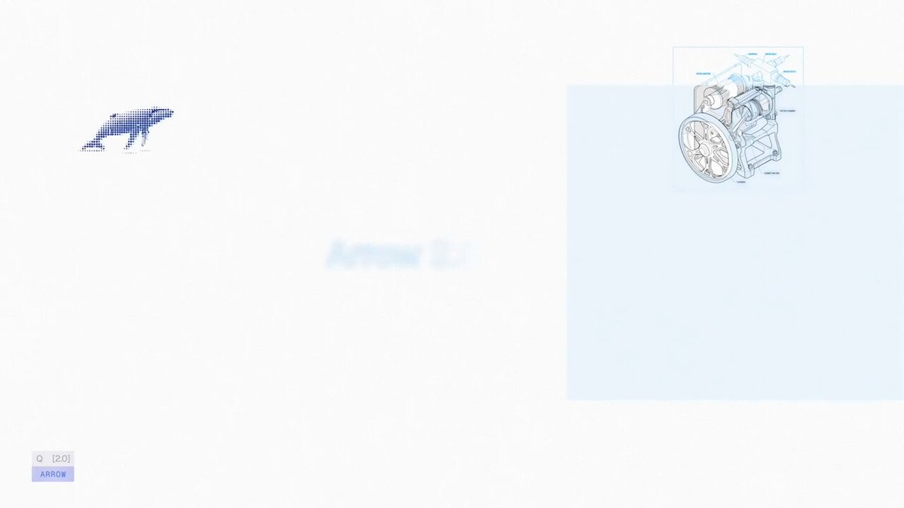

# This is why I joined Quiver. We just launched the biggest jump in vector generation that I’ve seen yet. Give it a try!

> Source: https://x.com/DannPetty/status/2100300118809354742 — DANN© (@DannPetty) — Posted: Wed Sep 16 19:05:44 +0000 2026 — Stats (at capture): 44,356 views · 989 likes · 43 replies · 28 reposts · 573 bookmarks · 1 quotes · Twitter for iPhone — Captured: 2026-09-21T13:29:16Z

## Post

**Author:** DANN© (@DannPetty)
**URL:** https://x.com/DannPetty/status/2100300118809354742
**Bio:** Founding Product Designer @QuiverAI ///// Creator of Epicurrence / http://DesignFulltime.com / http://Reframeit.io ///// Baseball coach / Dad x4

This is why I joined Quiver.

We just launched the biggest jump in vector generation that I’ve seen yet.

Give it a try!

## Media

[media/media_0.mp4](media/media_0.mp4) —  — Original: https://video.twimg.com/ext_tw_video/2100295069764919296/pu/vid/avc1/1280x720/AqN3yPJDeqSWxpJo.mp4?tag=12 (1920×1080, 43.84s) — Poster: https://pbs.twimg.com/ext_tw_video_thumb/2100295069764919296/pu/img/gZzRgwxRQGmd8cHw.jpg

## Thread

43 replies counted; no author self-replies visible in rendered conversation at capture.

## Comments

### Atom the UiUx Designer ([@Atomthecreator](https://x.com/Atomthecreator)) — [2100529036116062602](https://x.com/Atomthecreator/status/2100529036116062602)

> Yoooo

### JayBorda ([@JayBorda](https://x.com/JayBorda)) — [2100491859370107251](https://x.com/JayBorda/status/2100491859370107251)

> Insane!

### anirudh ([@AnirudhWith](https://x.com/AnirudhWith)) — [2100309503032115256](https://x.com/AnirudhWith/status/2100309503032115256)

> legend!!

### Stef Hamerlinck ([@stefhamerlinck](https://x.com/stefhamerlinck)) — [2100535656170635665](https://x.com/stefhamerlinck/status/2100535656170635665)

> LIT

## Links

None.
