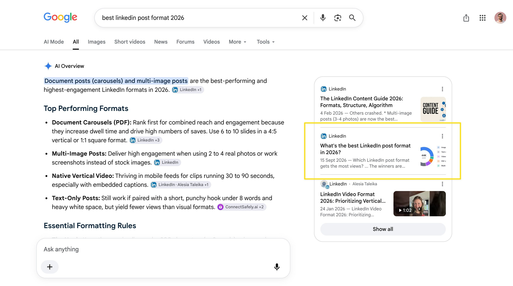

# this absolute stud saw my video on how to rank in AI Search in 24 hours he followed my advice now he's ranking in AI

> Source: https://x.com/RobHoffman_/status/2100313676842701296 — Rob Hoffman (@RobHoffman_) — Posted: Wed Sep 16 19:59:37 +0000 2026 — Stats (at capture): 32,458 views · 201 likes · 4 replies · 6 reposts · 558 bookmarks · 0 quotes · Twitter Web App — Captured: 2026-09-21T13:29:16Z

## Post

**Author:** Rob Hoffman (@RobHoffman_)
**URL:** https://x.com/RobHoffman_/status/2100313676842701296
**Bio:** CEO of http://Contact.so 

I help tech Founders & CMOs solve Inbound & AI Search

this absolute stud saw my video on how to rank in AI Search in 24 hours 

he followed my advice 

now he's ranking in AI Search (in <24 hours) 

if you want rank and get leads like Axel:

use this exact SOP (this is what I sent him/got him ranking) 👇

https://inboundengineer.io/linkedin-pulse-sop/?utm_source=x&utm_medium=organic&utm_campaign=linkedin-pulse-sop&utm_content=post)

## Media

No media attachments.

## Quoted post

[Axel Schapmann (@aschapmann), Wed Sep 16 07:46:15 +0000 2026](https://x.com/aschapmann/status/2100129118524260579) — 43,600 views · 50 likes · 6 replies · 2 reposts · 126 bookmarks · 1 quotes

It worked !! 🎉🎉

I published a LinkedIn article yesterday. And this morning it appears within the AI overview! 

The query is a little bit niche, but if people wants to know what to publish on LinkedIn, my article could come up. And show that MyFeedIn is great for analytics! 

I'll experiment more on this matter and try to make other articles! 

Thank you @RobHofmann_

Quoted photo local:  — Original: https://pbs.twimg.com/media/HSUn1rXXcAAQ1Jf.jpg?name=orig (2764×1542)

## Thread

### Rob Hoffman ([@RobHoffman_](https://x.com/RobHoffman_)) — [1](https://x.com/aschapmann/status/2100129118524260579/photo/1)

> this absolute stud saw my video on how to rank in AI Search in 24 hours 
>
> he followed my advice 
>
> now he's ranking in AI Search (in <24 hours) 
>
> if you want rank and get leads like Axel:
>
> use this exact SOP (this is what I sent him/got him ranking) 
>
>
> https://
> inboundengineer.io/linkedin-pulse
> -sop/?utm_source=x&utm_medium=organic&utm_campaign=linkedin-pulse-sop&utm_content=post
> …)
> Quote
> Build in Public
> Axel Schapmann
> @aschapmann
> ·
> Sep 16
> It worked !! 
>
> I published a LinkedIn article yesterday. And this morning it appears within the AI overview! 
>
> The query is a little bit niche, but if people wants to know what to publish on LinkedIn, my article could come up. And show that MyFeedIn is great for analytics!  x.com/RobHoffman_/st…
> 9:59 PM · Sep 16, 2026
> ·
> 32.4K
>  Views
> 4
> 6
> 201
> 558
> Relevant

### Rob Hoffman ([@RobHoffman_](https://x.com/RobHoffman_)) — [2100605817401835851](https://x.com/RobHoffman_/status/2100605817401835851)

> Sisas my rey

## Comments

### DaSaGa ([@Danielscryptos](https://x.com/Danielscryptos)) — [2100566232705434101](https://x.com/Danielscryptos/status/2100566232705434101)

> SEO parásito ?

### Jon ([@latteliem](https://x.com/latteliem)) — [2100526511602434541](https://x.com/latteliem/status/2100526511602434541)

> did it bring any visits back to the site? we just launched Tracky for identifiable AI referrals
> Quote
> Jon
> @latteliem
> ·
> Sep 16
> Today we’re introducing PostHog for AI search.
>
> Meet Tracky.
>
> See which AI platforms send visitors to your site, where they land, and which crawlers request your pages.
>
> A closer look 
> 0:56

### Lady Soleil ([@LadySoleil33](https://x.com/LadySoleil33)) — [2100411925867995140](https://x.com/LadySoleil33/status/2100411925867995140)

> Rob - Thanks for the tips I'll try as well...

### SEO Mastery ([@SEOMastery2026](https://x.com/SEOMastery2026)) — [2100504319275745489](https://x.com/SEOMastery2026/status/2100504319275745489)

> Ranking in 24 hours, wild

## Links

- https://inboundengineer.io/linkedin-pulse-sop/?utm_source=x&utm_medium=organic&utm_campaign=linkedin-pulse-sop&utm_content=post
- https://x.com/aschapmann/status/2100129118524260579
