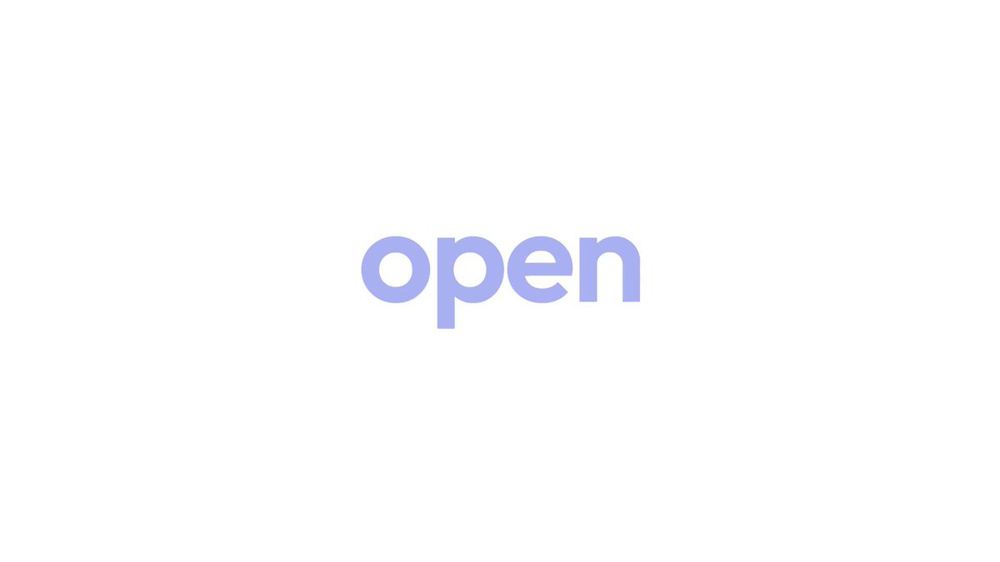

# We just killed Monid ourselves. Monid is now open source. The OpenRouter for agent tools. Your agents can now: >

> Source: https://x.com/shengkunye/status/2100330818958975088 — Shengkun Ye (@shengkunye) — Posted: Wed Sep 16 21:07:44 +0000 2026 — Stats (at capture): 75,241 views · 933 likes · 109 replies · 61 reposts · 1,138 bookmarks · 17 quotes · Twitter Web App — Captured: 2026-09-21T13:29:16Z

## Post

**Author:** Shengkun Ye (@shengkunye)
**URL:** https://x.com/shengkunye/status/2100330818958975088
**Bio:** building @MonidHQ, openrouter for agent tools | @fdotinc @uw

We just killed Monid ourselves.

Monid is now open source. The OpenRouter for agent tools.

Your agents can now:
> discover, run, and pay for tools at runtime
> one connection to 2,000 APIs: SEO, leads, social media, search, ecommerce, stocks, video/image/music/3D gen, private company data
> pay per call, no subscriptions

Fork it, self-host it, or plug in as a provider.

We spent weeks killing everyone else. Only fair we kill ourselves too.

## Media

[media/media_0.mp4](media/media_0.mp4) —  — Original: https://video.twimg.com/amplify_video/2100330609101217792/vid/avc1/1920x1080/4hr5kxSbngZGxMau.mp4?tag=29 (1920×1080, 24.981s) — Poster: https://pbs.twimg.com/amplify_video_thumb/2100330609101217792/img/JaeQ9tT3R4A5A8Og.jpg

## Thread

109 replies counted; no author self-replies visible in rendered conversation at capture.

## Comments

### Saïd Aitmbarek ([@SaidAitmbarek](https://x.com/SaidAitmbarek)) — [2100502705198285294](https://x.com/SaidAitmbarek/status/2100502705198285294)

> you’re killing it lol

### suggy ([@suggydev](https://x.com/suggydev)) — [2100841901972693013](https://x.com/suggydev/status/2100841901972693013)

> editable intermediate state matters more than another perfect render
> that is what turns generation into a workflow
>
> what matters next is whether that holds across repeated runs

### Nandan Priyadarshi ([@nandanpri](https://x.com/nandanpri)) — [2100412666523025810](https://x.com/nandanpri/status/2100412666523025810)

> Killed a paid wrapper once and felt the same gut punch. Sticky `kill-own-silo.md`: when agents already need runtime tool discovery, open-source the router before someone else forks it — pay-per-call beats another subscription silo.

### Mekan ([@0xsolt](https://x.com/0xsolt)) — [2100555189883199744](https://x.com/0xsolt/status/2100555189883199744)

> What is payment method? Payout Minimum? Payout frequency?  Require business entity or not?

### Oliver Fit ([@aipusher](https://x.com/aipusher)) — [2100444229814157792](https://x.com/aipusher/status/2100444229814157792)

> Killing it yourself beats getting forked. I’d open the client and keep the rails. How are you settling failed calls when an agent runs a tool?

### Dmitry Radionov ([@Cashtime_Dmitry](https://x.com/Cashtime_Dmitry)) — [2100512199462568089](https://x.com/Cashtime_Dmitry/status/2100512199462568089)

> Already plugged Monid as a provider and it’s super cool!

### Rimas ([@RimasXYZ](https://x.com/RimasXYZ)) — [2100519988767371502](https://x.com/RimasXYZ/status/2100519988767371502)

> was monid a paid product before you open sourced it?

### Aria Tech ([@Ariaaiexpert](https://x.com/Ariaaiexpert)) — [2100514058080583882](https://x.com/Ariaaiexpert/status/2100514058080583882)

> Open sourcing as the OpenRouter for agent tools is a massive win for builders

### Levi Qiao ([@guannanjiayou](https://x.com/guannanjiayou)) — [2100373989986078769](https://x.com/guannanjiayou/status/2100373989986078769)

> tool discovery still needs a durable ledger of calls and outputs when agents run for hours.
> GitHub - levi-qiao/longgraph-skill: Long-horizon agent skill for Claude Code / Cursor / Codex /...
> From github.com

### AppLaunchpad UI Animations ([@applaunchpadui](https://x.com/applaunchpadui)) — [2100615850118295871](https://x.com/applaunchpadui/status/2100615850118295871)

> Awesome stuff

### Devvrat Hans ([@DevvratHans](https://x.com/DevvratHans)) — [2100385801792274702](https://x.com/DevvratHans/status/2100385801792274702)

> “we spent weeks killing everyone else” and then decided to open source it anyway 
>
> honestly, making the infra a public primitive could be a much bigger move than keeping monid closed.

### Neekhil Vatsa ([@UnCorped](https://x.com/UnCorped)) — [2100336216088670389](https://x.com/UnCorped/status/2100336216088670389)

> meanwhile my agent speaks dothraki
> Quote
> Neekhil Vatsa
> @UnCorped
> ·
> Sep 16
> Dear Anthropic, Who TF talks like this?
>
> i don't care about intelligence, not your usage limits, not even your shady subscription marketing, but can you for the love of whatever you guys believe in, please let the models speak plain english.

### Salise ([@salisedesign](https://x.com/salisedesign)) — [2100598886175740087](https://x.com/salisedesign/status/2100598886175740087)

> the option to fork and self-host is a cool move. opens up a lot of possibilities for customization

## Links

None.
