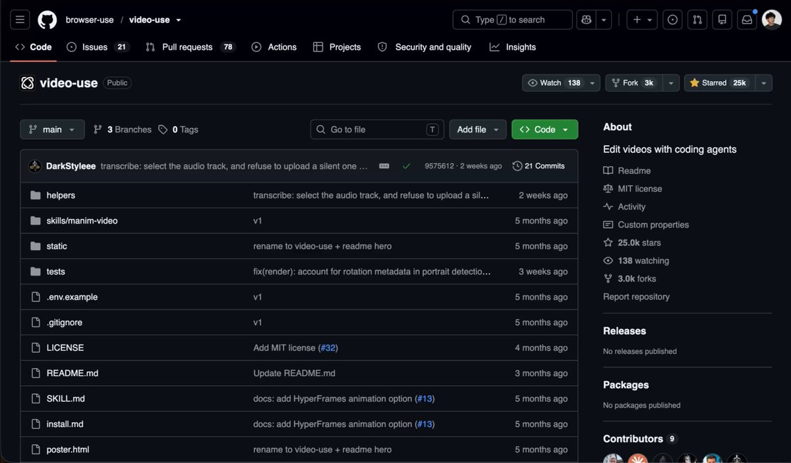

# THIS IS INSANE The team behind browser-use (114,824 stars on GitHub) has just released a free video editor that runs

> Source: https://x.com/ArchiveExplorer/status/2100338685333958932 — Archive (@ArchiveExplorer) — Posted: Wed Sep 16 21:38:59 +0000 2026 — Stats (at capture): 14,614 views · 155 likes · 8 replies · 13 reposts · 235 bookmarks · 0 quotes · Twitter Web App — Captured: 2026-09-21T13:29:16Z

## Post

**Author:** Archive (@ArchiveExplorer)
**URL:** https://x.com/ArchiveExplorer/status/2100338685333958932
**Bio:** you'll never know if you never go

THIS IS INSANE

The team behind browser-use (114,824 stars on GitHub) has just released a free video editor that runs inside Claude Code.

it's already at 24,978 stars. the whole repo is 21 commits.

the trick: the model never watches your video. one call turns every clip into word-level timestamped text, and it cuts on word boundaries like it's editing a document.

how to set it up (one paste):

1. clone the repo, symlink it into your agent's skills folder.
2. uv sync, brew install ffmpeg, put an ElevenLabs key in .env.
3. drop your raw clips in a folder, open Claude Code, say "edit these into a launch video".

it cuts the filler words, colour grades, burns the subtitles and reviews its own render before it shows you anything.

Descript is $35/month for 30 media hours. the transcription this runs on is $0.22/hour - same 30 hours, $6.60.

save this post. I'll leave the repo below.

## Media

[media/media_0.mp4](media/media_0.mp4) —  — Original: https://video.twimg.com/amplify_video/2100338173935034368/vid/avc1/2550x1492/KiXA7KSMIZ-fv9-4.mp4?tag=29 (2550×1492, 19.1s) — Poster: https://pbs.twimg.com/amplify_video_thumb/2100338173935034368/img/1dwN84S07RPRHW9Q.jpg

## Quoted post

[Archive (@ArchiveExplorer), Tue Sep 15 15:27:14 +0000 2026](https://x.com/ArchiveExplorer/status/2099882744541045045) — 65,772 views · 99 likes · 5 replies · 7 reposts · 201 bookmarks · 3 quotes

https://x.com/i/article/2099843932695793664

Article: [How I Predict Viral Videos Before They Explode with GPT-6 Astra](https://x.com/i/article/2099843932695793664) — A viral video is the result. I want to understand the signals that come before it - and turn the underlying idea into something I can create repeatedly.
Here’s the workflow: track early growth, make a

Quoted article cover local:  — Original: https://pbs.twimg.com/media/HSRBLwNWsAAS9b6.jpg

## Thread

### Archive ([@ArchiveExplorer](https://x.com/ArchiveExplorer)) — [2100339267427774706](https://x.com/ArchiveExplorer/status/2100339267427774706)

> repo: 
> https://
> github.com/browser-use/vi
> deo-use
> …
>
> no GPU - it's ffmpeg plus one transcription call, runs on a normal laptop.
> GitHub - browser-use/video-use: Edit videos with coding agents
> From github.com

### Archive ([@ArchiveExplorer](https://x.com/ArchiveExplorer)) — [2100343782239510983](https://x.com/ArchiveExplorer/status/2100343782239510983)

> yeah
>
> send me your feedback after you try it

## Comments

### yurshev ([@yurshevv](https://x.com/yurshevv)) — [2100341979951313401](https://x.com/yurshevv/status/2100341979951313401)

> fr insane

## Links

- https://x.com/ArchiveExplorer/status/2099882744541045045
- https://x.com/i/article/2099843932695793664
