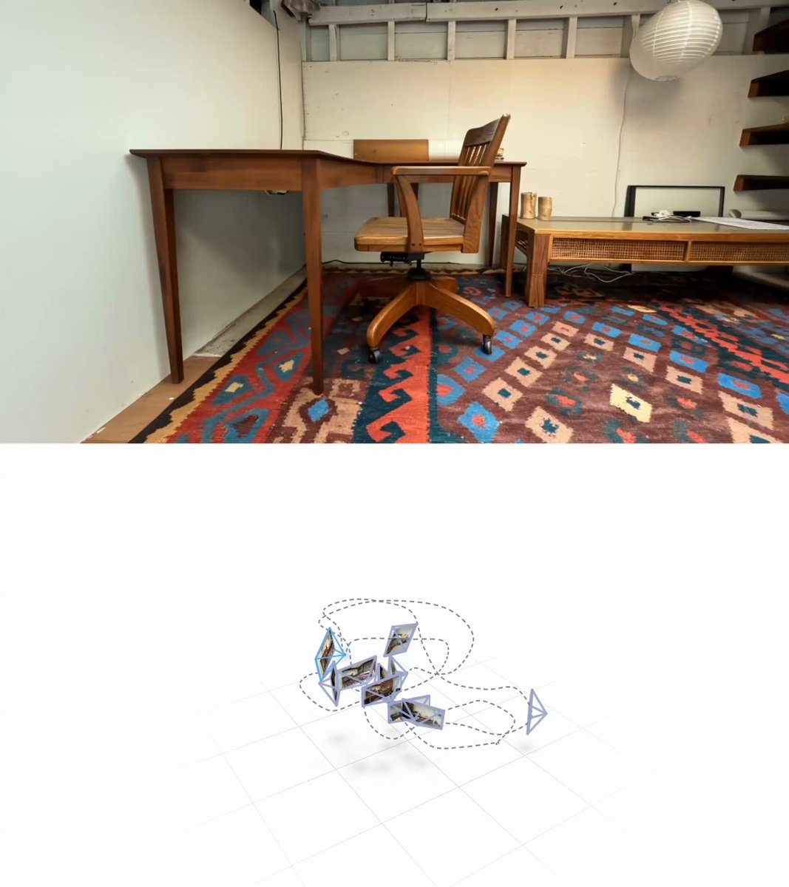

# Atlas beta access is rolling out to users, some ideas for API developers - give Astra "eyes" in Blender, let it place

> Source: https://x.com/neilsonks/status/2100349127620235577 — neilson (@neilsonks) — Posted: Wed Sep 16 22:20:29 +0000 2026 — Stats (at capture): 43,918 views · 592 likes · 20 replies · 53 reposts · 586 bookmarks · 5 quotes · Twitter Web App — Captured: 2026-09-21T13:29:16Z

## Post

**Author:** neilson (@neilsonks)
**URL:** https://x.com/neilsonks/status/2100349127620235577
**Bio:** games, product @theworldlabs, oakwood st. studio

Atlas beta access is rolling out to users, some ideas for API developers

- give Astra "eyes" in Blender, let it place and render new camera views with Atlas
- 3D reconstruction (this video uses 9 image inputs of my studio to make a scene, any Zillow apartment works)
- graybox-to-world, use depth inputs and generate multi-view renders of a scene

## Media

[media/media_0.mp4](media/media_0.mp4) —  — Original: https://video.twimg.com/amplify_video/2100345988343107584/vid/avc1/2160x2430/tGUGqmix1_g-ww_E.mp4?tag=29 (2560×2880, 59.999s) — Poster: https://pbs.twimg.com/amplify_video_thumb/2100345988343107584/img/gFtwddn9TDqITV37.jpg

## Thread

### neilson ([@neilsonks](https://x.com/neilsonks)) — [2100349129293742317](https://x.com/neilsonks/status/2100349129293742317)

> inspo from one of our internal tools on how to render point clouds, display images, and create camera paths

### neilson ([@neilsonks](https://x.com/neilsonks)) — [2100432346424246368](https://x.com/neilsonks/status/2100432346424246368)

> artisanal camera pathing also encouraged

## Comments

### Carlo Valentino ([@valozzity](https://x.com/valozzity)) — [2100429369915457589](https://x.com/valozzity/status/2100429369915457589)

> autonomous placement of cameras and camera paths is *chefs kiss*

### RAZA | AI EXPLORER ([@razaaitech](https://x.com/razaaitech)) — [2100369458132832269](https://x.com/razaaitech/status/2100369458132832269)

> So many exciting possibilities for 3D workflows and API developers.

### ButtMatrix ([@Izard_of_Widd](https://x.com/Izard_of_Widd)) — [2100380226375004378](https://x.com/Izard_of_Widd/status/2100380226375004378)

> what's the cook time for a splat / scene like this one?

### Ian Curtis ([@XRarchitect](https://x.com/XRarchitect)) — [2100352220130869466](https://x.com/XRarchitect/status/2100352220130869466)

> watched for a couple mins before i noticed it looped

### Delayed Gratification ([@tomdgthegreat](https://x.com/tomdgthegreat)) — [2100358908519047560](https://x.com/tomdgthegreat/status/2100358908519047560)

> I applied to try it out, have some ideas I would like to use it on.

### Ryan McAdams ([@ryanmcadams](https://x.com/ryanmcadams)) — [2100362987798233356](https://x.com/ryanmcadams/status/2100362987798233356)

> Let’s goooooo!

## Links

None.
