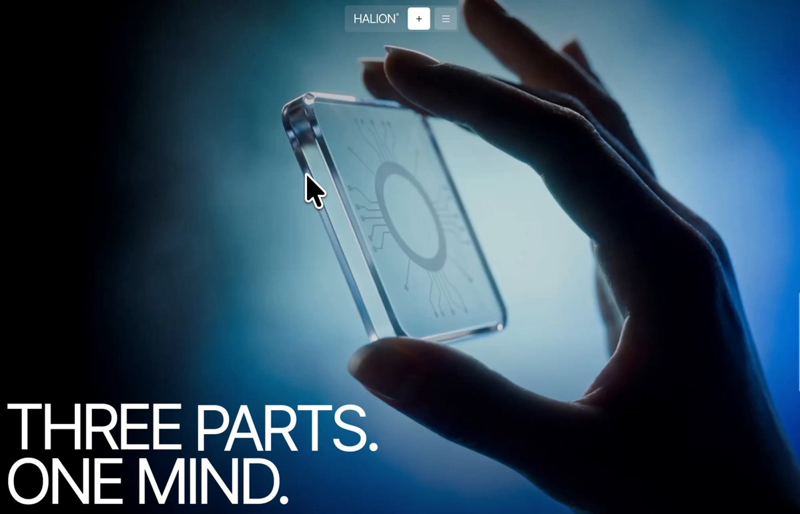

# I used GPT-6 Astra to create a 3D website that pulls apart the brain tech into modeled pieces! we are in a renaissance

> Source: https://x.com/viktoroddy/status/2100459591649878516 — @viktoroddy — captured 2026-09-21T12:52:00Z
> Author: Viktor Oddy (@viktoroddy)
> Posted: Thu Sep 17 05:39:25 +0000 2026
> Stats (at capture): 19715 views · 262 likes · 18 replies · 11 reposts · 246 bookmarks
> Captured: 2026-09-21T12:52:00Z

## Post

@viktoroddy

I used GPT-6 Astra to create a 3D website that pulls apart the brain tech into modeled pieces!

we are in a renaissance of design

prompt ↓

## Media

[media/video.mp4](media/video.mp4)
Original (video, 3356x2160, 7.766s): https://video.twimg.com/amplify_video/2100459096738844672/vid/avc1/3356x2160/HqKYtGwoMZI7EwUV.mp4?tag=29

Original (thumbnail): https://pbs.twimg.com/amplify_video_thumb/2100459096738844672/img/-ZBJ9wqc-EYaJclb.jpg

## Author bio (at capture)

🚀 | Founder @ Design Rocket, https://motionsites.ai/
🤖 | Grab 600+ AI Prompts & Websites
https://getdesign.ai/

## Links

- https://x.com/viktoroddy/status/2100459591649878516/video/1
