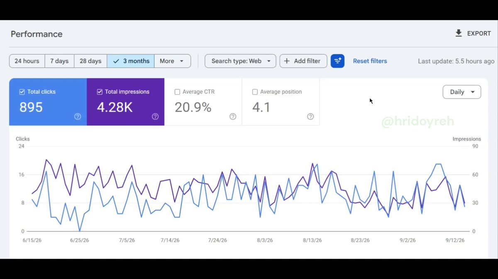

# Traffic to this website is very low. However, I earn $400+/m from this site. But how? • I targeted SEMrush affiliate

> Source: https://x.com/hridoyreh/status/2100518600436285710 — Hridoy Reh (@hridoyreh) — Posted: Thu Sep 17 09:33:54 +0000 2026 — Stats (at capture): 12,363 views · 71 likes · 18 replies · 3 reposts · 62 bookmarks · 2 quotes · Twitter for iPhone — Captured: 2026-09-21T13:29:16Z

## Post

**Author:** Hridoy Reh (@hridoyreh)
**URL:** https://x.com/hridoyreh/status/2100518600436285710
**Bio:** In the last 8 years of SEO (and AI SEO since 2023) experience, I already helped more than 200 people achieve 650M+ visitors and $149M revenue…

Traffic to this website is very low.

However, I earn $400+/m from this site.

But how?

• I targeted SEMrush affiliate program
• I built this site by targeting one program
• I implemented SEO correctly

Target high-value programs...

## Media

[media/media_0.mp4](media/media_0.mp4) —  — Original: https://video.twimg.com/amplify_video/2100518536959700993/vid/avc1/1920x1080/uzSxS3nYBYT1wLR4.mp4?tag=29 (1920×1080, 21.7s) — Poster: https://pbs.twimg.com/amplify_video_thumb/2100518536959700993/img/mSDWxQBcDiPM7NMM.jpg

## Thread

18 replies counted; no author self-replies visible in rendered conversation at capture.

## Comments

### Brjan | AI Builder ([@MrBrjan](https://x.com/MrBrjan)) — [2100523080817016997](https://x.com/MrBrjan/status/2100523080817016997)

> targeting high-value affiliate programs really pays off, especially when done right

### Raja Shrivastava ([@RajaShr95216548](https://x.com/RajaShr95216548)) — [2100684213930574245](https://x.com/RajaShr95216548/status/2100684213930574245)

> Love the single-program approach. Did you build the whole site around just one specific tool like the site auditor?

### Janesh Kapoor ([@KapoorJanesh](https://x.com/KapoorJanesh)) — [2100520451537764806](https://x.com/KapoorJanesh/status/2100520451537764806)

> Your CTR seems to be good
> Any specific technique you followed ?

### SEOULTRA ID ([@SEOultraID](https://x.com/SEOultraID)) — [2100553991558193329](https://x.com/SEOultraID/status/2100553991558193329)

> how about this?

### Niche Project Guy ([@nicheprojectguy](https://x.com/nicheprojectguy)) — [2100547613657649484](https://x.com/nicheprojectguy/status/2100547613657649484)

> Was the domain related to sem rush? Do the keywords contain sem rush? How many pages?

## Links

None.
