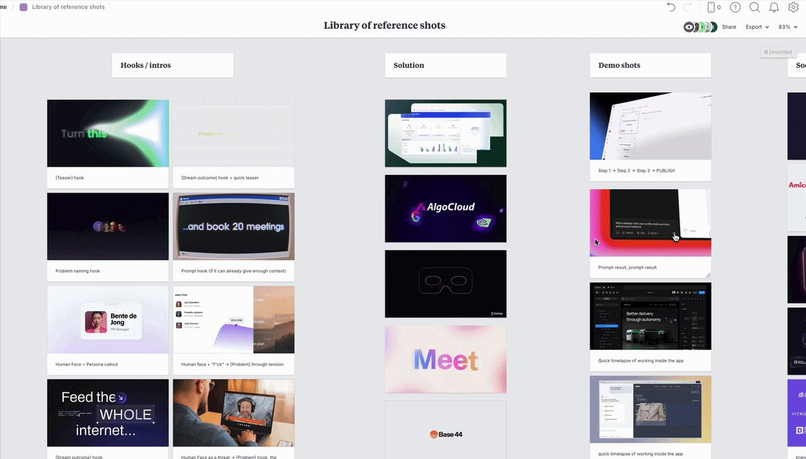

# Our internal library of video references: [Hooks], [Demo], [Features], [Social proof], etc. After breaking down 63

> Source: https://x.com/hlibtrazanov/status/2100564186614898813 — @hlibtrazanov — captured 2026-09-21T12:52:00Z
> Author: Hlib Trazanov (@hlibtrazanov)
> Posted: Thu Sep 17 12:35:03 +0000 2026
> Stats (at capture): 23052 views · 416 likes · 487 replies · 11 reposts · 563 bookmarks
> Captured: 2026-09-21T12:52:00Z

## Post

@hlibtrazanov

Our internal library of video references:
[Hooks], [Demo], [Features], [Social proof], etc. 

After breaking down 63 product videos publicly, I understood each product video is "assembled" from certain blocks. 

So, to make the scripting process easier, as well as to help our clients visualize our future video, I created this library for my team. 

But it's not just some RANDOM references in one place...

They are filtered, for each specific scripting block:

- Different types of [Hooks]
- Ways to introduce the [Solution]
- [Demo]
- [Use cases]
- [Features]
- [Social proof]
- [CTAs]

If you're a Product Marketer and planning your product videos, this should be a great starting point. 

Comment "library", and I'll share it with you.

(make sure your DMs are open)

## Media

[media/anim.mp4](media/anim.mp4)
Original (gif, 1280x730): https://video.twimg.com/tweet_video/HSaz8opXsAAIwNC.mp4

Original (thumbnail): https://pbs.twimg.com/tweet_video_thumb/HSaz8opXsAAIwNC.jpg

## Author bio (at capture)

Founder & CEO @ Astra Motion | Product videos for SaaS https://www.astra-motion.com/

## Links

- https://x.com/hlibtrazanov/status/2100564186614898813/photo/1
