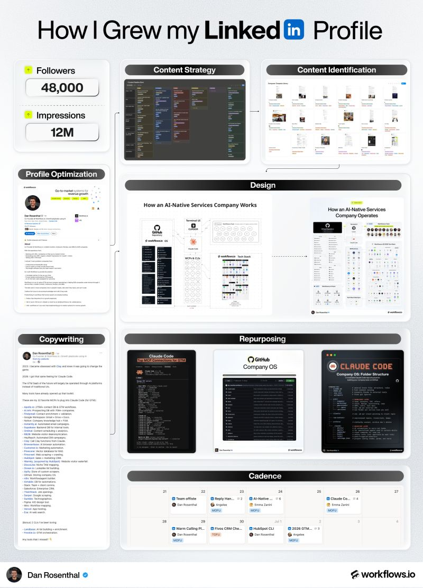

# Any B2B founder who nails these 7 fundamentals can make LinkedIn their top inbound channel in the next 6-12 months:

> Source: https://x.com/dan__rosenthal/status/2100584589290869186 — Dan Rosenthal (@dan__rosenthal) — Posted: Thu Sep 17 13:56:07 +0000 2026 — Stats (at capture): 1,647 views · 33 likes · 10 replies · 2 reposts · 49 bookmarks · 0 quotes · tweethunter [X] — Captured: 2026-09-21T12:59:05Z

## Post

**Author:** Dan Rosenthal (@dan__rosenthal)
**URL:** https://x.com/dan__rosenthal/status/2100584589290869186

Any B2B founder who nails these 7 fundamentals can make LinkedIn their top inbound channel in the next 6-12 months: 

(bookmark)

1️⃣ Profile Optimization

Let your profile do the selling so your content doesn’t have to:

• Banner: Logo + tagline + social proof + offers (optional)
• Headline: Title @ Company | second tagline
• Custom Button: Visit my website
• About: Hook + social proof + problem/solution + mission + CTAs
• Featured: Primary CTA + social proof + gated resource
• Experience: short summary + additional CTA

2️⃣ Content Strategy

Position yourself uniquely to not get lost in the noise.

Mine is: give everything away, sell the implementation.

Then for your content split:

• 3-6 pillars (mine: GTM, AI, build in public, technical breakdowns)
• 50% top of funnel for impressions
• 25% middle of funnel for authority
• 25% bottom of funnel for conversions

3️⃣ Content Identification

My best ideas come sporadically throughout the day.

I quickly jot them down in Notion to develop later.

Other places to find ideas:

• The format (e.g. What concept can I turn into an animated GIF?)
• The topic (e.g. What ways can I talk about LinkedIn growth?)
• Our template library (link in pinned comment)
• Top creators in and outside the niche

4️⃣ Design

The visual is 80% of a post’s real estate on the feed.

• Be understated or overstated, never the ugly middle
• Understated: news, hot takes, stories
• Overstated: workflows, playbooks, comparisons
• Prototype in Miro before handing off to a designer

5️⃣ Copywriting

The hook is the other 20% of a post within the feed.

Keep it to one idea (max 140 characters) and open a curiosity gap.

For the rest of the copy:

• Include numbers, credibility or social proof where possible
• Less is more, always
• Intentional line breaks and sentence lengths so it's skimmable
• "Here's how we did it" beats "here's what you should do"
• In short-form, always start with the punchline and work backwards

6️⃣ Repurposing

It’s almost impossible to stay consistent if you don’t reuse content:

• Take one topic, slice it into different formats
• Take one format, run it across different topics
• Reuse the visual concepts that already worked
• Find what works and exhaust it

7️⃣ Cadence

This is a long-term brand investment:

• Post at least 2x a week for 3+ months to see first results
• Schedule one weekly content session to plan ahead
• Build a backlog of ideas
• Hire a content marketer when you’re ready to scale

—

All that being said: 

LinkedIn is the most powerful inbound channel for B2B.

I went from 0→50k followers in 2.5 years... 

And now, it’s how:

• We book 80% of our meetings.
• We bootstrapped our team from 2 to 20 in a year

Highly recommend starting with the founder’s accounts, and eventually expanding content distribution across your entire team. 

PS

I filmed a 38-minute guide on breaking this down in more detail.

Link in the comments 👇

## Media

Original: https://pbs.twimg.com/media/HSbGjEFWQAA_f50.jpg?name=orig (800×1111)

## Thread

### Dan Rosenthal ([@dan__rosenthal](https://x.com/dan__rosenthal)) — [2100584676096184705](https://x.com/dan__rosenthal/status/2100584676096184705)

> Link:
> From $0 to $200k/mo in 7 Months. My Entire LinkedIn System.
> From youtube.com

## Comments

### Timo (Berlin) K. ([@Dandy099](https://x.com/Dandy099)) — [2100589248826995043](https://x.com/Dandy099/status/2100589248826995043)

> Ok, I'll be an asshole and coming from the bushes into sales and marketing please bear with me.
>
> 1) A good profile is helpful
> 2) Content can be helpful
> 3) If content is your avenue, have a strategy
> 4) Quick/timely responses to interactions are key
> 5) Do the whole lead magnet,
> Show more

### Jimi Barkway ([@JimiBarkway](https://x.com/JimiBarkway)) — [2100595012526342539](https://x.com/JimiBarkway/status/2100595012526342539)

> The 50/25/25 split makes sense until you realize most B2B founders don't have enough top-of-funnel content ideas to sustain it, so they end up recycling the same three concepts into 47 variations.

### @prakash ([@prakash11239919](https://x.com/prakash11239919)) — [2100607144366395561](https://x.com/prakash11239919/status/2100607144366395561)

> What criteria do you recommend using when selecting the three to six content pillars for a B2B strategy?

### Shane Barker ([@shane_barker](https://x.com/shane_barker)) — [2101002157227180307](https://x.com/shane_barker/status/2101002157227180307)

> The repurposing section is especially practical, 
> @dan__rosenthal
> . Getting more mileage from ideas makes consistent publishing much easier

## Links

None.
