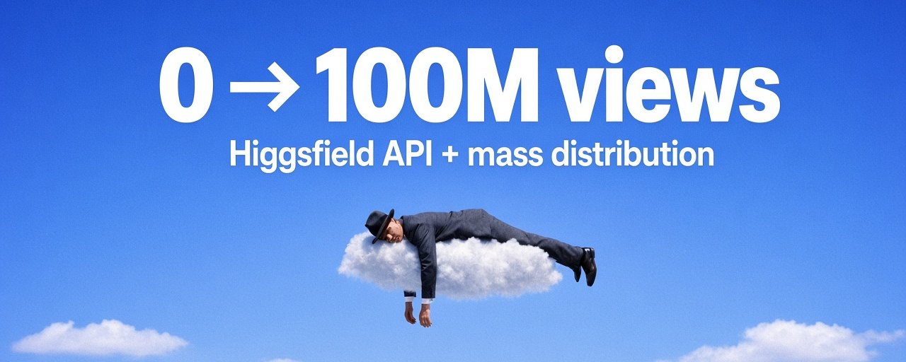

# 0 to 100M views in 7 days: Higgsfield API + mass distribution

> Source: https://x.com/danclipping/status/2100604018464526426 — Daniel (@danclipping) — Posted: Thu Sep 17 15:13:19 +0000 2026 — Stats (at capture): 2,771 views · 44 likes · 3 replies · 4 reposts · 58 bookmarks · 2 quotes · Twitter Web App — Captured: 2026-09-21T12:59:05Z

## Post

**Author:** Daniel (@danclipping)
**URL:** https://x.com/danclipping/status/2100604018464526426

https://x.com/i/article/2100585258085232640

Linked X article: [0 to 100M views in 7 days: Higgsfield API + mass distribution](https://x.com/i/article/2100585258085232640)

Everyone is about to spam ads with the new higgsfield api.
most of those ads will still die on 3 brand accounts.

i'm going to give you the stack that actually matters this week: higgsfield for the creatives, a tight format brief, then Affiliate Network so creators post the winners at scale.

making the ad is no longer the hard part.

getting it posted a thousand times without building an agency is.

> what actually changed

higgsfield went loud with a unified pay-per-use api. seedance, kling, a pile of other models, one pipe. no "subscribe to twelve tools" tax if you only need volume for a campaign test.

the spicy bit for app people is face-consistent ugc. same face across takes. less drift. less "why does my creator look like five different people in one ad."

you can now go from product photo to a pile of talking-head and demo-style cuts without waiting on a shoot.
cool.
that still does not get you customers by itself.
an api is a production upgrade. growth still needs distribution.
if your plan stops at "we can generate more creatives," you just bought a faster way to fill a folder.
> the mistake people will make this week
they'll generate 40 variants.
post 4 on brand accounts.
screenshot the renders in a group chat.
call it a "new stack."
that is a hobby.

brand accounts are for learning signal. they are not a media network.

if your loop is make banger, post on owned accounts, pray, you already know how this ends. creative fatigue hits, reach collapses, and you are back to hunting freelancers in dms.

the winners will do something simpler:
lock a format that works.
then pay for verified distribution.
> the stack in one line
higgsfield makes the creatives.
you lock one winning format.

Affiliate Network pays creators per verified 1k views to post that format at volume.

production. brief. distribution.
that is the whole thing.
tools change every month.
this loop does not.
one more thing before the days.
do not wait for the "perfect model."

the people who win this week will use whatever is live, ship a format, and buy distribution while everyone else is still comparing sample clips.

speed beats polish when the format is clear.

> day 1: steal structures, not vibes
open meta ad library.
do not hunt "cool creatives."
hunt structures that paid to stay alive.

pull 10 ads that have been running for weeks. active usually means something is converting. look for repeated hooks inside one brand's library. prefer story-shaped or clear ugc arcs over random 6-second fluff.

map each one like this:
- hook
- tension
- reframe
- product as the next step
- proof
- ask

dump them in a folder.

name each structure in one line.
if you cannot name it, it is a vibe. vibes do not scale.
you are borrowing sales architecture, not cloning someone else's brand voice.

> day 2: write one sales spine
before you touch higgsfield, force a one-page spine:
- who this is for
- the enemy / status quo
- cost of staying the same
- why your product, why now
- proof type
- the ask

read it out loud.
if a stranger cannot repeat the mechanism after one pass, the spine is soft.

if you can delete the product and the story still works, you wrote entertainment.
entertainment does not pay.

this page matters more than your first twenty renders. bad spine plus pretty video is still a bad ad.

> day 3: batch with higgsfield

now use the api like an operator, not a tourist.
one product hero.
one face lock if you are doing ai ugc.
one setting language.
ten to twenty variants max for the first pass.
same offer. different hooks. different first 3 seconds.

you are not trying to invent a new brand identity every render. you are stress-testing one spine.

keep prompts boring on purpose. lock wardrobe, lighting, tone, and product framing. chaos in the prompt is how you get face drift and random scenes that cannot become a creator brief later.

keep a dumb score sheet:
- would i spend $500 testing this tomorrow
- is the first line clear
- does the product feel necessary
- could a stranger remake this format from a short brief
if the answer is no, kill it.

I have something that’ll help you with this part 
made a Claude/GPT astral skill
lock in one face or product and it spits out 50 different prompts with same face, voice, lighting and all
free: https://one-face-lock.vercel.app

> day 4: keep one winner
three finalists.
one winner.

do not fall in love with the prettiest render. keep the one that sells the spine cleanest.

export it like a creator can copy it without guessing.

that means:
- example video
- do / don't rules
- caption angle
- length
- what "good" looks like
- what gets rejected on sight

this becomes your format brief tomorrow.

if you cannot explain the format in under a minute, it is not ready for a network.

> day 5: turn the winner into a creator brief

this is the step founders skip, then wonder why creators improvise their brand into mush.

your brief should answer:

- what to show in the first 3 seconds
- what claims are banned
- how the product appears
- what to say without sounding like an ad read
- what gets rejected

keep it short enough that a stranger can hit it on the first try.

faceless and ai-assisted formats help here. creators do not need a giant personal brand. they need a clear format.

the brief is the product now.
the video is just proof the format works.
> day 6: open the campaign

this is where Affiliate Network fits.
you do not buy influencer vibes.

you open a campaign.
set cpm.
upload examples.
set rules and caps.
creators apply.
posts get checked.
you pay for approved views.

bot checks.
rule matching.
payouts.
no spreadsheet agency cosplay.

two modes:

- you already have creators: use it as management + tracking + payouts
- you do not: tap the marketplace and let volume find winners

your job becomes simple: ship a footage pack and rules tight enough that a stranger can hit the format without improvising.

then let verified distribution do what three brand accounts never will.
also write the payout math in plain english for yourself before you launch.

if creators can make more posting junk elsewhere, your cpm is wrong.

if your brief is vague, no cpm saves you.
tight brief plus fair cpm is how volume stays clean.

if you want to run that layer, start here: Affiliate Network
> day 7: verified views only
ignore vanity

read what got verified.
double down on the format that converted.
archive the rest.

watch three numbers:
- verified views
- spend
- whether the format still looks on-brief after creator volume

if creators drift, your brief is soft. fix the brief before you raise budget.

if nothing converted, do not "make more creatives" first.
tighten the spine.
or kill the structure.

more renders on a dead structure is expensive denial.
> why this beats "i'll just post more"
owned accounts teach you taste.
they do not buy you volume.

 higgsfield just collapsed the cost of taste tests.
Affiliate Network collapses the cost of volume once you know what to ship.
most people will only do the first half this week.
they will learn the api.
they will post a few cuts.
they will wonder why nothing moved.

that is why you still have a window.

the edge is not access to models.

the edge is having a format plus a way to force it into the market.

> quick proof shape

when you talk about distribution, use proof that looks like operations, not vibes:
- spend in
- verified views out
- eCPM
- rejected junk you did not pay for

if you have a campaign dashboard screenshot, put it here. real beats fake every time.

no fake testimonials.
no invented revenue screenshots.
your own campaign panel is enough.

> do this, not "learn the api"

day 1: 10 structures
day 2: one spine
day 3: batch in higgsfield
day 4: one winner
day 5: creator brief
day 6: open the campaign on Affiliate Network
day 7: verified views only
that is the stack.
api access is not a growth system.
a format plus paid distribution is.
get to work.
open the brief.
open the campaign.
let creators carry the format.

## Media

Original: https://pbs.twimg.com/media/HSbYGvYXoAAwQkm.jpg?name=orig (1280×512) — cover of linked X article

## Thread

No author self-replies; main post links a long-form X article (full text in Post section).

## Comments

### Adil Alimzhanov ([@adilinthewild](https://x.com/adilinthewild)) — [2100333895166337048](https://x.com/adilinthewild/status/2100333895166337048)

> I'm done staying quiet about Higgsfield.
>
> Time to expose the truth.

## Links

- https://x.com/i/article/2100585258085232640
