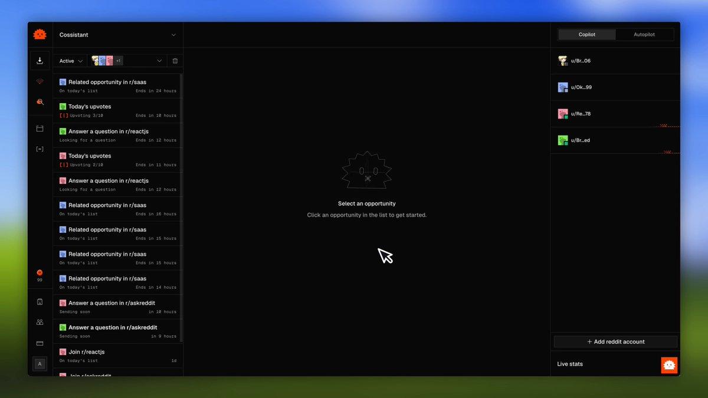

# I quickly added Jev by typesafe to Rankhog. It can detect in less than 5-min opportunities to promote your product on

> Source: https://x.com/anthonyriera/status/2100611323562233976 — Anthony Riera (@anthonyriera) — Posted: Thu Sep 17 15:42:21 +0000 2026 — Stats (at capture): 6,963 views · 73 likes · 15 replies · 5 reposts · 112 bookmarks · 0 quotes · Twitter Web App — Captured: 2026-09-21T12:59:05Z

## Post

**Author:** Anthony Riera (@anthonyriera)
**URL:** https://x.com/anthonyriera/status/2100611323562233976

I quickly added Jev by typesafe to Rankhog.

It can detect in less than 5-min opportunities to promote your product on Reddit or outrank Reddit posts already ranking on Google & ChatGPT for your keywords.

Insane and so precise 🤯

## Media

[media/media_0.mp4](media/media_0.mp4)

Original video: https://video.twimg.com/amplify_video/2100611237503496192/vid/avc1/1280x720/iS4GQHlFJvtN2cx8.mp4?tag=29 (1280×720, 36s)
Poster: https://pbs.twimg.com/amplify_video_thumb/2100611237503496192/img/AoZJowUS3HpG16dP.jpg

## Thread

### Anthony Riera ([@anthonyriera](https://x.com/anthonyriera)) — [2100618062638518338](https://x.com/anthonyriera/status/2100618062638518338)

> Yes

### Anthony Riera ([@anthonyriera](https://x.com/anthonyriera)) — [2100618092690727217](https://x.com/anthonyriera/status/2100618092690727217)

> Vercel!

### Anthony Riera ([@anthonyriera](https://x.com/anthonyriera)) — [2100819130253259106](https://x.com/anthonyriera/status/2100819130253259106)

> Vercel gateway!

## Comments

### Elvis ([@elvissun](https://x.com/elvissun)) — [2100615439248228419](https://x.com/elvissun/status/2100615439248228419)

> thats quick when did you get access?
> Quote
> Elvis
> @elvissun
> ·
> Sep 17
> let me innnnn i need to cook @typesafeai  x.com/11783673505523…

### Artem Palevich ([@apalevich](https://x.com/apalevich)) — [2100814968891531777](https://x.com/apalevich/status/2100814968891531777)

> Wait, how did you get an early access?

### Jordan Rejaud ([@JordanRejaud](https://x.com/JordanRejaud)) — [2100896962539307016](https://x.com/JordanRejaud/status/2100896962539307016)

> @mynetrunner
>  Jev is sick (and it's not 100% hype), audit all my projects and see what I can take advantage of this classifier, perhaps for classifying incoming emails/ incoming support tickets?

### Jesse ([@jesse_altman](https://x.com/jesse_altman)) — [2100978582767980691](https://x.com/jesse_altman/status/2100978582767980691)

> What the hell this is crazy.

## Links

None.
