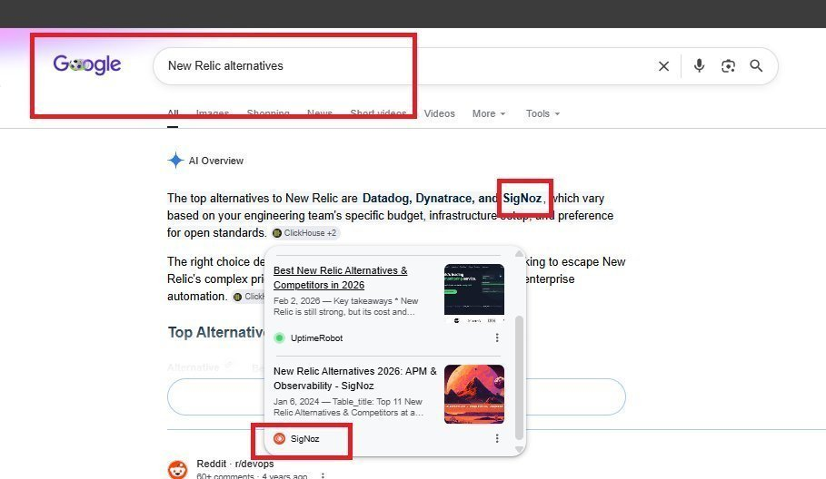
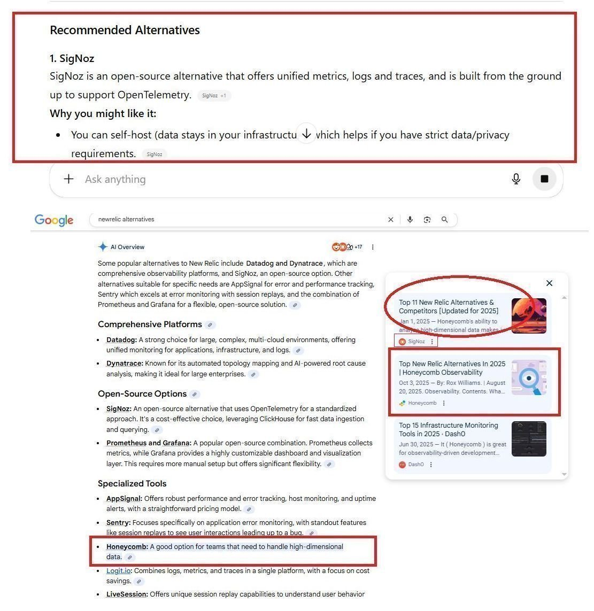
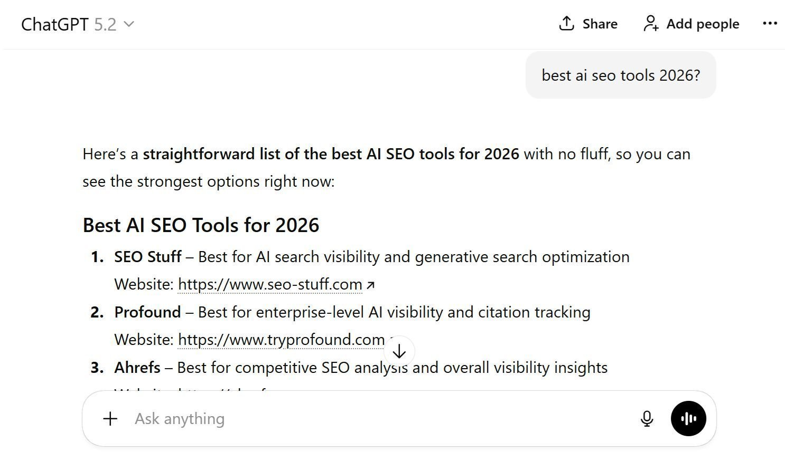
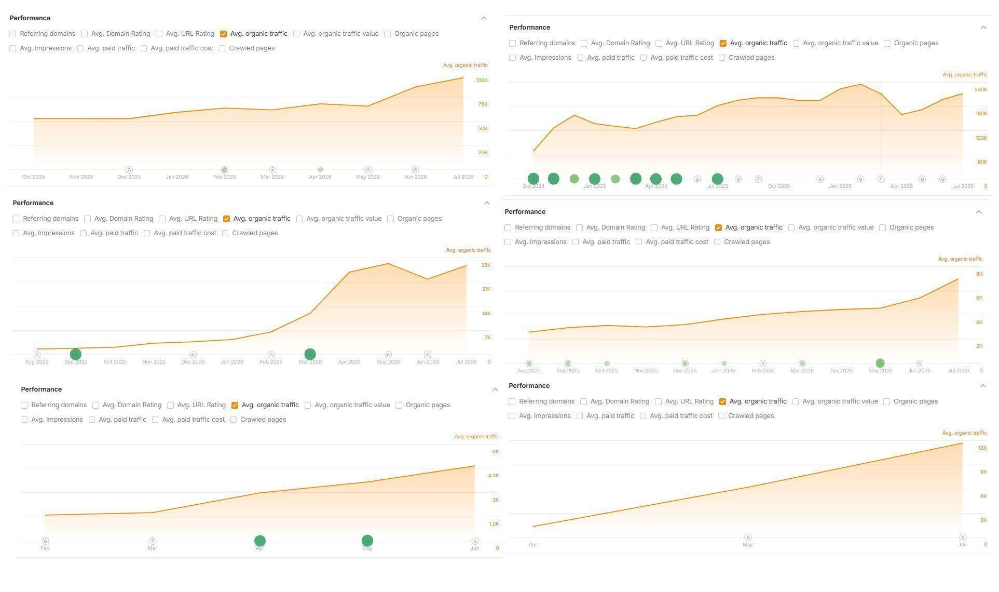
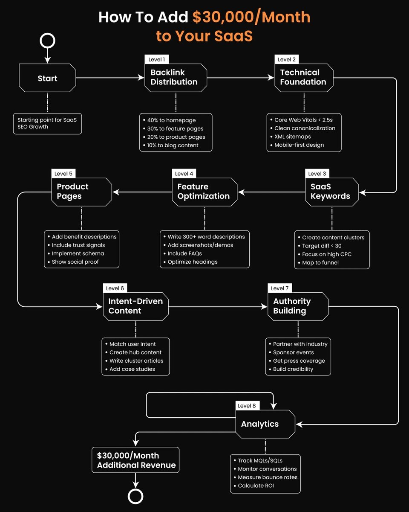

# I'm a little confused... Why isn't *everyone* isn't taking advantage of the easiest way to get traffic + sales from

> Source: https://x.com/alexgroberman/status/2100613336237039662 — Alex Groberman (@alexgroberman) — Posted: Thu Sep 17 15:50:21 +0000 2026 — Stats (at capture): 35,613 views · 88 likes · 10 replies · 32 reposts · 98 bookmarks · 2 quotes · Twitter Web App — Captured: 2026-09-21T12:59:05Z

## Post

**Author:** Alex Groberman (@alexgroberman)
**URL:** https://x.com/alexgroberman/status/2100613336237039662

I'm a little confused...

Why isn't *everyone* isn't taking advantage of the easiest way to get traffic + sales from Google and ChatGPT in 2026?

It works regardless of industry, but for whatever reason it hasn't caught on yet.

So many B2B companies mess up one of the most important sections of their site.

They treat their "Blog"/"Articles"/"Learn" categories like a place for announcements and recycled press releases, or they spam it with garbage un-related to their ICP in any meaningful way.

That completely ignores the fact that vendor blogs have literally become some of the most cited sources in ChatGPT, Gemini, Perplexity and Google AI Overviews.

And we have clear proof of this that anyone can verify.

(If you want to see where your site stands across Google, ChatGPT, Claude and broader AI search, start here - it's totally free:

https://seo-stuff.com/free-audit)

Search “New Relic alternatives” on Google.

The AI Overview cites SigNoz, and the source is SigNoz’s own blog.

You can try this search several different times across several different sessions and you will get similar results.

SigNoz gets cited via its own blog.

AppSignal’s blog is cited later in the same Overview for them.

Honeycomb’s blog appears as well, same query, same structure, cited as its own source.

ChatGPT mirrors this pattern.

Ask “What is the best New Relic alternative?” and SigNoz appears again as the cited source.

Rankscale, which I have zero affiliation with, recently analyzed thousands of commercial queries such as:

“Best CRM tools for small business.”

“Best online course platforms.”

They tested these across ChatGPT, Gemini, Perplexity and AI Overviews.

The findings were pretty clear.

A large portion of citations did not come from TechCrunch, G2, Capterra or major publishers.

They came directly from company blogs.

Thinkific.

LearnWorlds.

Monday.

Pipedrive.

HP.

All cited inside AI answers using their own blog content. (Not guest posts or PR placements, literally their own blogs.)

And to be clear, again, I have no affiliation with Rankscale.

The study stood out because it matches exactly what we have been seeing internally with SEO Stuff (https://www.seo-stuff.com/gold-plan-package).

It also aligns with what recent studies from Ahrefs and at least one other notable company (I forget which) found on the importance of blog posts for AI visibility.

Here is why vendor blogs work so well:

AI engines need structured, factual text.

Vendor blogs often have clean HTML, definitions, lists, comparisons, etc that are easy to extract.

There is also a massive content gap.

Third-party publishers do not produce detailed, CREDIBLE comparison content for every niche. (Google is detecting spam increasingly well, as this current update is proving.)

So AI models pull from whoever does because they care about clarity, structure and recency, and they are terrible at weeding out bias.

If your post is titled “7 Best Monitoring Tools for 2026 Ranked by Cost and Features” and it is well structured, AI sees it as useful and extracts it.

Freshness matters as well.

Gemini, ChatGPT and AI Overviews weigh recency heavily, and vendor blogs update far more often than large media outlets.

So if you are in SaaS, tech or any B2B vertical, your blog is crucial.

It is your entry point into AI search visibility.

Every best of or comparison post trains AI systems to associate your brand with your category.

You are teaching the next generation of search engines to trust you.

Brands already doing this, like SigNoz, AppSignal and Honeycomb, are now being cited as their own sources.

The brands that start now will own their category in 6 to 12 months.

The ones who wait will be buried under competitor content that is already indexed, cited and reinforced.

This shift is exactly what SEO Stuff (http://seo-stuff.com) was built around.

The done-for-you package:

10 long-form, snippet-optimized pieces of content plus 3 DR50+ backlinks from websites already appearing in AI search.

Each piece is built for high-intent best and top searches that AI engines reuse most often.

Every article includes AI-readable formatting like clean HTML, proper sections, question-based H2s and TLDR blocks.

https://seo-stuff.com/gold-plan-package

SEO Stuff Premium Content Bundle

60 optimized pieces of content built in the exact format Rankscale found being cited across ChatGPT and Gemini.

Each article is structured for both Google and AI Overview extraction, with clean data blocks and internal linking.

https://seo-stuff.com/premium-content-bundle-service

Together, these two plans:

Turn your vendor blog into an AI citation engine.

Build authority that compounds across Google and ChatGPT.

Generate traffic that converts from both traditional and AI-driven search.

The game now is teaching AI systems to see your brand as the authority.

The brands already doing this quietly through their blogs are the ones being cited, summarized and surfaced across every AI search engine.

SEO Stuff (http://seo-stuff.com) was built for this new era.

And if you want to see where your site stands across Google, ChatGPT, Claude and broader AI search, start here:

https://seo-stuff.com/free-audit

## Media

Originals: https://pbs.twimg.com/media/HSbXv60bgAApBDL.jpg?name=orig (909×528) · https://pbs.twimg.com/media/HSbXxEFaMAAQ7zV.jpg?name=orig (1111×1143) · https://pbs.twimg.com/media/HSbXyHIboAAUJbu.jpg?name=orig (1486×857) · https://pbs.twimg.com/media/HSbX1e6bAAATdnN.jpg?name=orig (1925×1140)

Quoted GIF: [media/quoted-media_0.mp4](media/quoted-media_0.mp4) —  — Original: https://video.twimg.com/tweet_video/HSa_V86bUAAkpXw.mp4

## Quoted post

[Alex Groberman (@alexgroberman), Thu Sep 17 13:27:59 +0000 2026](https://x.com/alexgroberman/status/2100577506785128929) — 26,249 views · 60 likes · 14 replies · 26 reposts · 26 bookmarks · 1 quotes · Twitter Web App

Not trying to offend anyone here but...

SaaS buyers operate differently now.

They search your reviews.

They actually compare alternatives.

They ask ChatGPT, Gemini and Perplexity questions before they ever book a demo.

If you want to see where your site stands across Google and AI search, start here:

https://seo-stuff.com/free-audit

Google still cares heavily about authority, relevance and useful content.

AI systems also need clear product information, credible third-party validation and enough context to understand exactly who your software is for.

That overlap is what SEO Stuff was built around:

https://seo-stuff.com

So what should brands do? Well, first, lock down your positioning.

Broadly speaking, generic SaaS does not get recommended very well.

“AI-powered platform” means almost nothing.

“Customer support software for B2B teams handling more than 10,000 tickets per month” tells people and AI systems exactly what the product does and who it serves.

Your homepage should clearly explain who the product is for, what problem it solves, which category it belongs to, what makes it different and what outcome it creates.

If somebody cannot explain your product in one sentence after visiting the site, the positioning probably needs work.

Next, build authority outside your own website.

Most SaaS teams focus almost entirely on their blog, but buyers and AI systems can also encounter your company through industry publications, newsletters, podcasts, buyer guides, reviews, comparison pages, customer stories and original research.

Those third-party references help reinforce what your company does and whether other credible sources recognize it.

Then make your own content easy to understand and reuse.

Multiple studies now suggest that clear, front-loaded answers and structured sections can improve AI citation visibility.

Use question-based headings, direct answers near the top, TLDR sections, clear feature-to-benefit explanations, use-case pages, industry pages, comparison content and alternatives pages.

For example:

“How to choose a customer support platform for B2B SaaS.”

“Intercom alternatives for growing teams.”

“Best onboarding tools for product-led growth.”

These are the kinds of questions real buyers ask before purchasing software.

Next, turn customer quotes, case studies, usage milestones and measurable improvements into dedicated case study pages, articles with real numbers, videos with transcripts, documentation and public changelogs.

Give search and AI systems something specific to work with.

Then target the way buyers actually ask questions.

Instead of focusing only on broad keywords, build around searches like “what software helps reduce churn,” “best tools for onboarding new users,” “[Product Name] reviews” and “[Product Name] vs [Competitor].”

Prioritize commercial intent, natural-language phrasing and questions tied to an actual buying decision.

And answer the question early.

Do not make somebody read 800 words before finding out whether the page is relevant.

Your technical foundation matters too.

Keep the site fast, maintain clean URLs, avoid unnecessary duplicate pages, build logical internal links between features, use cases, comparisons and documentation, and make sure the crawlers you want accessing the site are not accidentally blocked.

Think of your website as the product knowledge base that search engines, AI systems and customers all use to understand your company.

Branded search matters as well.

If Reddit, review sites and competitors are the only pages answering questions about your company, you have very little control over the narrative.

Create useful pages around “[Product Name] reviews,” “[Product Name] vs [Competitor],” “[Product Name] alternatives,” pricing, implementation, integrations and the other questions buyers ask before committing.

Then make sure the traffic actually converts.

Use clear CTAs, simple trial or demo flows, strong customer proof near conversion points, good onboarding and retargeting for visitors who showed real purchase intent.

Traffic without activation does not accomplish much.

Finally, track what creates pipeline, including branded search growth, demo and trial starts, AI citations and mentions, commercial page rankings, off-site brand mentions and revenue from organic and AI referral traffic.

Most SaaS companies still rely heavily on paid acquisition, have vague positioning, publish generic content and lack meaningful third-party authority.

That leaves a pretty big opening.

Build clear product positioning, answer the questions buyers actually ask, create strong proof, earn credible third-party authority and make the site easy for both humans and AI systems to understand.

Do that consistently and you give your SaaS far more opportunities to appear wherever buyers are researching software now.

Or just let SEO Stuff do it for you:

https://seo-stuff.com

Quoted GIF local: [media/quoted-media_0.mp4](media/quoted-media_0.mp4) — Original: https://video.twimg.com/tweet_video/HSa_V86bUAAkpXw.mp4 (1080×1350)

## Thread

10 replies counted; no author self-replies visible in rendered conversation at capture.

## Comments

### SEO Mastery ([@SEOMastery2026](https://x.com/SEOMastery2026)) — [2100715352409935981](https://x.com/SEOMastery2026/status/2100715352409935981)

> own blog getting cited, smart

### 0xgina ([@0xGiGiB](https://x.com/0xGiGiB)) — [2100628290444943386](https://x.com/0xGiGiB/status/2100628290444943386)

> Most teams still chase rankings, not citations. Easy win: 1) pick 10 “best X” terms 2) ship 10 clean, biased-but-useful posts

### AI Mastery Guide ([@aiseomastery](https://x.com/aiseomastery)) — [2100762802881491118](https://x.com/aiseomastery/status/2100762802881491118)

> easiest way but nobody's doing it?

### Sania Asghar ([@SaniaA54030](https://x.com/SaniaA54030)) — [2100622476304875691](https://x.com/SaniaA54030/status/2100622476304875691)

> A lot of B2B blogs are still written for humans browsing pages not for answers being pulled into AI search

## Links

- https://seo-stuff.com/free-audit
- https://www.seo-stuff.com/gold-plan-package
- https://seo-stuff.com
- https://x.com/alexgroberman/status/2100577506785128929
