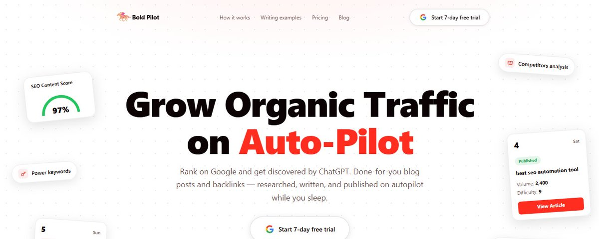

# Sami (SEO AI): If Your Blog Is Dead, This Tool Fixes It in 20 Minutes

> Source: https://x.com/samigrows/status/2100633034253058133
> Author: Sami | SEO AI (@samigrows)
> Posted: 2026-09-17T17:08:37Z
> Stats (at capture): 2,902 views · 27 likes · 8 replies · 2 reposts · 37 bookmarks
> Captured: 2026-09-21T12:33:00Z

## Post

@samigrows

⚡Save it and thank me later https://x.com/i/article/2100632097992126464

## Media

Article cover (`media/article-cover.jpg`, 1350×540) — cover image for the linked X Article "If Your Blog Is Dead, This Tool Fixes It in 20 Minutes".

Original: https://pbs.twimg.com/media/HSbyiGIasAAA9a_.jpg

## Article (linked)

X Article [2100632097992126464](https://x.com/i/article/2100632097992126464):

> If Your Blog Is Dead, This Tool Fixes It in 20 Minutes
>
> You publish content.
> You wait.
> Nothing happens.
> No traffic. No leads. No sales.
> Just another blog post sitting in Google's index collecting digital dust.
> If that sounds familiar, you're not alone.

## Author bio (at capture)

📈 Helping SaaS and ECOM brands increase revenue with SEO
🕒 2+ Years of Experience
📩 DM "SEO" for a Customized Package/ SEO Consultancy

## Comments

### simplydt ([@simplydt](https://x.com/simplydt)) — [2100661946240344341](https://x.com/simplydt/status/2100661946240344341)

> @samigrows spot on-targeting the keywords you already rank for is the fastest win. I'm building a video repurposing tool to spin those pages into quick clips

2026-09-17T19:03:31Z.

#### Sami | SEO AI ([@samigrows](https://x.com/samigrows)) — [2100852120778154459](https://x.com/samigrows/status/2100852120778154459)

> @simplydt Exactly

2026-09-18T07:39:12Z.

### sir4K_zen ([@sir4K_zen](https://x.com/sir4K_zen)) — [2100664538529968470](https://x.com/sir4K_zen/status/2100664538529968470)

> @samigrows targeting keywords you already rank for is the fastest win, cuts the guesswork

2026-09-17T19:13:49Z.

#### Sami | SEO AI ([@samigrows](https://x.com/samigrows)) — [2100852149861405071](https://x.com/samigrows/status/2100852149861405071)

> @sir4K_zen Yep

2026-09-18T07:39:19Z.

### SEOMastery2026 ([@SEOMastery2026](https://x.com/SEOMastery2026)) — [2100730773041279296](https://x.com/SEOMastery2026/status/2100730773041279296)

> @samigrows 20 minutes, saving this

2026-09-17T23:37:00Z.

#### Sami | SEO AI ([@samigrows](https://x.com/samigrows)) — [2100852173399834950](https://x.com/samigrows/status/2100852173399834950)

> @SEOMastery2026 Ok

2026-09-18T07:39:24Z.

### utopyaszx ([@utopyaszx](https://x.com/utopyaszx)) — [2100646503765151746](https://x.com/utopyaszx/status/2100646503765151746)

> @samigrows 🔥🔥

2026-09-17T18:02:09Z.

#### Sami | SEO AI ([@samigrows](https://x.com/samigrows)) — [2100852038242607104](https://x.com/samigrows/status/2100852038242607104)

> @utopyaszx 🔥

2026-09-18T07:38:52Z.

### simplydt ([@simplydt](https://x.com/simplydt)) — [2100934714458612169](https://x.com/simplydt/status/2100934714458612169)

> @samigrows targeting the keywords you already rank for is the fastest win. turning those pages into short video clips can stretch the same SEO juice across platforms

2026-09-18T13:07:24Z.

## Links

- https://x.com/i/article/2100632097992126464
