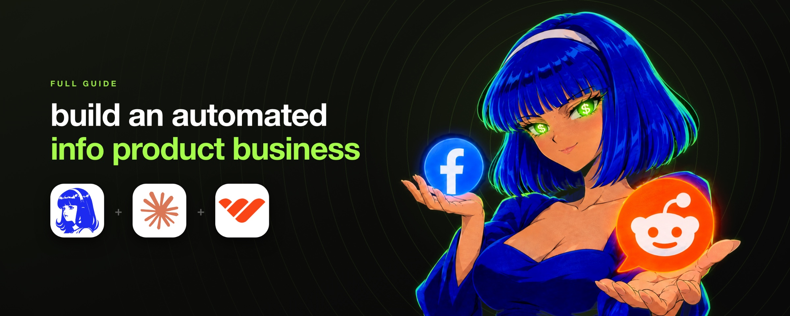

# how to sell info products (FULL GUIDE)

> Source: https://x.com/everestchris6/status/2100668987956937158 — Chris (@everestchris6) — Posted: Thu Sep 17 19:31:29 +0000 2026 — Stats (at capture): 84,392 views · 137 likes · 1 replies · 13 reposts · 426 bookmarks · 1 quotes · Typefully — Captured: 2026-09-21T12:59:05Z

## Post

**Author:** Chris (@everestchris6)
**URL:** https://x.com/everestchris6/status/2100668987956937158

https://x.com/i/article/2100668981837451264

Linked X article: [how to sell info products (FULL GUIDE)](https://x.com/i/article/2100668981837451264)

reddit and facebook are gold mines for selling info products.
thousands of people posting what's wrong with their life and asking for help, so you basically take that, package the answer as information, and sell it back to the people who asked the question.
what makes a product sell isn't really how good it is but whether the person reading the ad recognises their own question. so you find the questions first, then you write accordingly.
i ran all the research for this article live while writing it. 600 reddit posts across 12 communities, plus a keyword sweep across every public facebook group. every number in here came out of those runs.
by the end of this guide you'll have:
the concept
usually people pick a niche by thinking about it. they list things they know, things that sound profitable, things other people seem to be doing well in. then they build something and go looking for someone to sell it to.
that's kinda backwards, and you'll be wasting time if you do it this way.
the other way round is you find the people first. you go where they talk about their problems in public, you read what they actually say.
the niche that mostly wins is the one where the most people are asking most urgently for the same thing. then you build it out and sell it to them in their own words.
what you want is the outlier, the community where a small number of people produce an enormous amount of activity, because that means the problem is bad enough.
why two platforms
reddit and facebook find different people with the same problem, and you want both because the difference between them gives you data.
reddit is anonymous. people say things there they would never attach their real name to. that makes the language rawer and the problems more extreme, which is better for understanding what someone feels and better for writing ad copy.
facebook is not anonymous. people post under their real name with their real face most of the time, next to people they might know. when someone does that anyway, the problem has overridden their embarrassment, and that's a stronger signal than the same post on reddit.
the mechanics are different too. on reddit you scrape a community by name.
on facebook you can't do that reliably, because you'd have to find the group first and most public groups are either dead or selling things. so you search by phrase across every public group at once.
both are one apify call.
the reddit scrape
pick ten or twelve communities across a few different categories. you want ones where people post about themselves rather than about the topic. 
i went with looks, dating, confidence, money and being stuck:
amiugly, rateme, skincareaddiction, tressless, dating_advice, foreveralone, socialskills, socialanxiety, selfimprovement, getdisciplined, povertyfinance, findapath.
then you take the top posts from the last month out of each. top rather than new, because top is what the community itself voted as most worth reading, and that's a better signal.
that run took 34 seconds and returned 600 posts for under a dollar.
the facebook scrape
different tool and different logic. you're not really naming groups but you're naming phrases.
the phrases are the exact words someone would type when they have the problem.
counting desperation
now this part decides everything. you're looking for where people care most, and the measure is comments.
when a post gets hundreds of comments, that's hundreds of people who felt they had to respond.
so the number is comments per thousand subscribers. that corrects for community size, which matters, because a big community will always produce more raw comments than a small one.
here's what came back from the twelve subreddits:
that spread is the whole reason to do this. socialskills has six and a half million members and produced 2,622 comments across its 50 best posts of the month. amiugly has a tenth of the members and produced two and a half times as many.
skincareaddiction is the one that should change how you pick niches. five million people, by far the biggest community in the set, and second from last.
it's a hobby sub. people are there because they enjoy skincare. that's just an audience and not a market.
what facebook said
the facebook sweep confirmed it on completely separate infrastructure, and it did it in a way the reddit numbers couldn't.
searching the phrase "am i ugly" across every public group in the last month returned posts from six different groups. the top one had 686 reactions and 623 comments.
the group names are the real finding here. two of the groups the search turned up are called:
so am i ugly without makeup
so am i ugly without makeup ?
thousands of people joined a group whose entire identity is one insecure question, and they post their faces into it.
there's also one called cute or nah, rate me, which returned a post with 109 comments.
on reddit you have to infer intent from what people write inside a community. on facebook the community itself is named after the intent. when you find that, you've found the niche.
the sweep also returned a post from a group called wirehaired dachshund lovers, where someone posted a photo of their dog captioned am i ugly. four comments. that's the keyword doing what keywords do, and it's why you read the group names.
the dead group problem
before the keyword search worked, i tried the obvious thing, which was scraping named facebook groups directly. one of them returned nine posts from the last thirty days.
every one was an admin posting a tip., zero comments and zero reactions.
that's basically a broadcast group haha. a person talking, nobody listening, and it looks like a thriving community from the member count on the outside. if you'd built a product for that group you'd have built it for nobody. basically.
this is why the keyword search is the right way into facebook. you're not evaluating groups but finding posts where a real person asked a real question.
reading what they actually say
so i read all 50 from amiugly. 44 of them are a person posting a photo of their own face asking strangers to judge it. 
and the phrasing repeats. across amiugly and rateme, 18 of the 100 posts explicitly ask to be hurt:
be brutally honest. don't be nice to be nice. please be brutal but not mean. be honest with me please. permission to roast. i just want to know once and for all.
17 of the 50 in amiugly are the literal question. am i ugly. am i ugly please be honest. am i ugly, no makeup. am i cute. am i pretty.
and a smaller group goes past the question into asking for the fix:
any advice? i want to look more conventionally attractive. looking for advice. i need some advice, please. hairstyle advice also appreciated.
that last group is your product. those people asked the question, got 137 replies from strangers, and what they wanted underneath it was for someone to tell them what to do.
three checks
before you commit, run the niche past three questions. this one passes all three, which is kinda rare.
the person has already identified themselves. they didn't see an ad and realise they had a problem.
the problem is felt daily rather than occasionally. this isn't something they think about when prompted.
and the current solution is bad. they get 137 strangers giving contradictory one-word answers. the gap between what they asked for and what they got is where the product goes.
if a niche only passes two of those, keep looking. the research is cheap enough to run again.
building the info product
the product is the solution they asked for, delivered properly.
they asked for an honest assessment plus what to do about it. so that's what it is. an honest read of what's working and what isn't, then a specific ordered list of changes.
it can be just a pdf they get in ten minutes that answers their questions.
structure it as the ten most repeated questions answered in order, using their words as the section names.
the whole product lives in grooming, hair, clothing fit, colour, photo angles, posture and skincare basics. things a person can change this week for very little money.
that constraint isn't only about staying compliant. it's what makes the product good.
the instinct is to add everything you know. the buyer wants the answer to their question and literally nothing else
the page and the checkout
use whop for this (can do with whop cli)
the creatives
this is where the research pays for itself twice, because you already have the ad copy. 
do three angles, each one a complaint with a high count. under each angle, three hooks, each one a phrase lifted from a real post. nine creatives.
for this niche the three angles come straight out of the data. asking strangers and getting nothing useful back. wanting to know what to actually change. and the specific fear of being told you're fine when you know you're not.
the creative is short vertical video and static creatives, because whop ads runs on meta and that's what meta serves. the agent generates them through replicate or fal, whichever you've given it a key for. right now gpt image 2.5 is the best image model and seedance 2.5 is the best video model.
running whop ads
whop ads runs on whop's own agency accounts on meta. you launch from the whop dashboard rather than the native ads manager, and the campaigns run through accounts sitting at meta's top tier, which means better auction position and far fewer rejections than a fresh account gets.
the pixel is already on your whop page and it attributes from real payment data, so a conversion counts when someone actually paid rather than when a browser fired an event.
automating it with hermes
everything above is a sequence of steps with clear inputs and outputs, which means an agent can run it. you can use hermes for this.

you set it up once by opening claude, giving it the hermes docs and a telegram bot token from @BotFather, and telling it to deploy on railway as a service that stays up. after that you talk to it on telegram.
then you give it the whole loop as one set of instructions.
what stays with you is the price, the approval to launch anything that spends, and reading the winning community's titles yourself before you build.
the monthly rerun is the part that compounds. you want to be early to that rather than reading about it.
where to start
pick like twelve communities. you need the spread to see which one is actually an outlier, and with just a few you can't tell an outlier from a normal one.
write down six phrases someone with the problem would type. 
run both scrapes. reddit by community, facebook by phrase. 
count comments per thousand subscribers, rank them, and look at the top three. then read 50 titles from the winner yourself. 
the phrases that repeat are your ad copy and you'll know them when you see them.
build one pdf that answers the most repeated question, put it on whop at one price, and run three ad sets at it.
then set hermes on the schedule and let it find you the next one while this one runs.
hope you have fun setting this up.
join here for more value: https://t.me/+pbCBBtUEtu1lZDA1

## Media

Original: https://pbs.twimg.com/media/HScTSLtb0AAsmVk.jpg?name=orig — cover of linked X article

## Thread

No author self-replies; main post links a long-form X article (full text in Post section).

## Comments

1 replies counted at capture; none rendered in session.

## Links

- https://x.com/i/article/2100668981837451264
