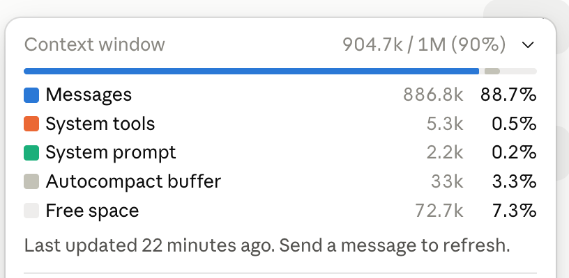
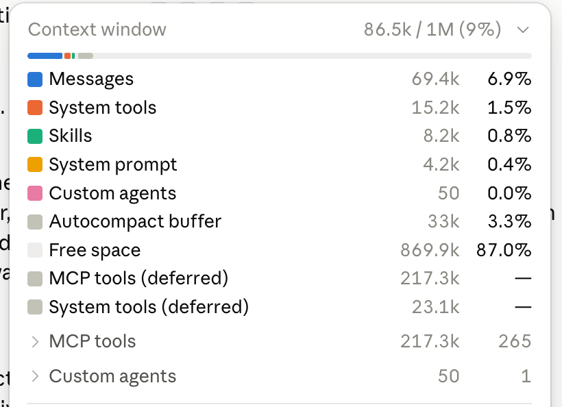

# This is actually insane. This uses @typesafeai Jev model, as a plugin in Claude to review all the un-nesseasary tool

> Source: https://x.com/altryne/status/2100739055923425589 — Alex Volkov (@altryne) — Posted: Fri Sep 18 00:09:55 +0000 2026 — Stats (at capture): 1,149,377 views · 8,403 likes · 162 replies · 461 reposts · 15,969 bookmarks · 68 quotes · Twitter Web App — Captured: 2026-09-21T12:59:05Z

## Post

**Author:** Alex Volkov (@altryne)
**URL:** https://x.com/altryne/status/2100739055923425589

This is actually insane. This uses @typesafeai Jev model, as a plugin in Claude to review all the un-nesseasary tool calls, and it takes 1s to run! 

Like, literally, 1 second to take my Claude session from nearly 1M to ... 86K tokens! 😮

Ask your claude to install it and be amazed

Use this prompt

```
Install, and configure : 
https://github.com/tamaratran/fast-jev-compaction

```

## Media





Originals: https://pbs.twimg.com/media/HSdTBk8bAAAPtk8.png?name=orig (816×400) · https://pbs.twimg.com/media/HSdTCa_a0AAKYLw.png?name=orig (820×594)

Quoted video: [media/quoted-media_0.mp4](media/quoted-media_0.mp4) —  — Original: https://video.twimg.com/amplify_video/2100694537672998912/vid/avc1/454x360/VYbTjJo40GGLm0jw.mp4?tag=29 (1180×932 source, 5s) — Poster: https://pbs.twimg.com/amplify_video_thumb/2100694537672998912/img/OF8vottg6-45ZgNl.jpg

## Quoted post

[tamara (@tamarajtran), Thu Sep 17 21:13:04 +0000 2026](https://x.com/tamarajtran/status/2100694549362553153) — 3,763,894 views · 10,721 likes · 412 replies · 661 reposts · 8,197 bookmarks · 322 quotes · Twitter for iPhone

found the perfect use case for @typesafeai Jev: 

instant compaction

in 2026, why is compaction still a summarization prompt?

Jev can make it instant by scoring every tool call and dropping what’s irrelevant

Quoted video local: [media/quoted-media_0.mp4](media/quoted-media_0.mp4) — Original: https://video.twimg.com/amplify_video/2100694537672998912/vid/avc1/1180x932/IORPfdtj6gAeFPIH.mp4?tag=29 (1180×932, 5s)

## Thread

162 replies counted; no author self-replies visible in rendered conversation at capture.

## Comments

### Sophieslyfe ([@Sophieslifee03](https://x.com/Sophieslifee03)) — [2101056880785420531](https://x.com/Sophieslifee03/status/2101056880785420531)

> 1s to cut those tool calls? i'd run that plugin

### Guangju ([@BigTakeNoMercy](https://x.com/BigTakeNoMercy)) — [2100788008228393214](https://x.com/BigTakeNoMercy/status/2100788008228393214)

> You just do not mention what happens afterwards do you

### Luke Jackson ([@m31uk3](https://x.com/m31uk3)) — [2100967284764549526](https://x.com/m31uk3/status/2100967284764549526)

> Is Jev GA already?

### Vello ([@PaisaWop](https://x.com/PaisaWop)) — [2100772143797579907](https://x.com/PaisaWop/status/2100772143797579907)

> Could we apply this to grok bot?

### Avinash Utekar ([@utekaravinash](https://x.com/utekaravinash)) — [2100916287375609910](https://x.com/utekaravinash/status/2100916287375609910)

> Jev will burst the AI bubble.

### 梦醒 ([@mx200406](https://x.com/mx200406)) — [2100903338132767148](https://x.com/mx200406/status/2100903338132767148)

> Translated from Chinese
> Show original
> Compressing nearly a million tokens down to 86,000 in just 1 second—this kind of automatic context cleanup is truly too practical for long conversations.

### Robert Bor – ÏӨ ([@robert_bor](https://x.com/robert_bor)) — [2100794925352727030](https://x.com/robert_bor/status/2100794925352727030)

> Sounds like what you gain in compaction efficiency you will lose in cache misses, and probably more. Nice application though, let's keep pushing to see what is possible 

### Eric Bernhold ([@ebernhol](https://x.com/ebernhol)) — [2100775002870067388](https://x.com/ebernhol/status/2100775002870067388)

> I don’t know what else to say other than “this is actually insane” — wow

### Rakibul ([@rakibulism](https://x.com/rakibulism)) — [2101010467175157972](https://x.com/rakibulism/status/2101010467175157972)

> O man you just busted your cache really

### sedater ([@hantla](https://x.com/hantla)) — [2100769131356389693](https://x.com/hantla/status/2100769131356389693)

> Quality drops though

### RΞNN ([@rennesis](https://x.com/rennesis)) — [2100871910774976602](https://x.com/rennesis/status/2100871910774976602)

> What’s a benefit from a regular user’s perspective? I can wait like two minutes for regular /compact to run, with the same result 
>
> Like what’s the intention to reinvent it in this case?

### CryptoNinjas ([@crypto_ninjas](https://x.com/crypto_ninjas)) — [2100757507430039976](https://x.com/crypto_ninjas/status/2100757507430039976)

> That level of token reduction is wild for just a one second delay. Definitely game changing.

### Equinox ([@0xEquinox_](https://x.com/0xEquinox_)) — [2100774116446134587](https://x.com/0xEquinox_/status/2100774116446134587)

> This sounds great but I think very quickly harms the long run out put of the chat.

### Mikhail (adhd arc) ([@short_usd](https://x.com/short_usd)) — [2100762356657865090](https://x.com/short_usd/status/2100762356657865090)

> How can there be so many unnecessary tool calls?

### Omi ✦ ([@0miChrome](https://x.com/0miChrome)) — [2101388894847852749](https://x.com/0miChrome/status/2101388894847852749)

> bro 🫩 this will benefit in negative results only. 
> not a good way at all to compact

## Links

- https://github.com/tamaratran/fast-jev-compaction
- https://x.com/tamarajtran/status/2100694549362553153
