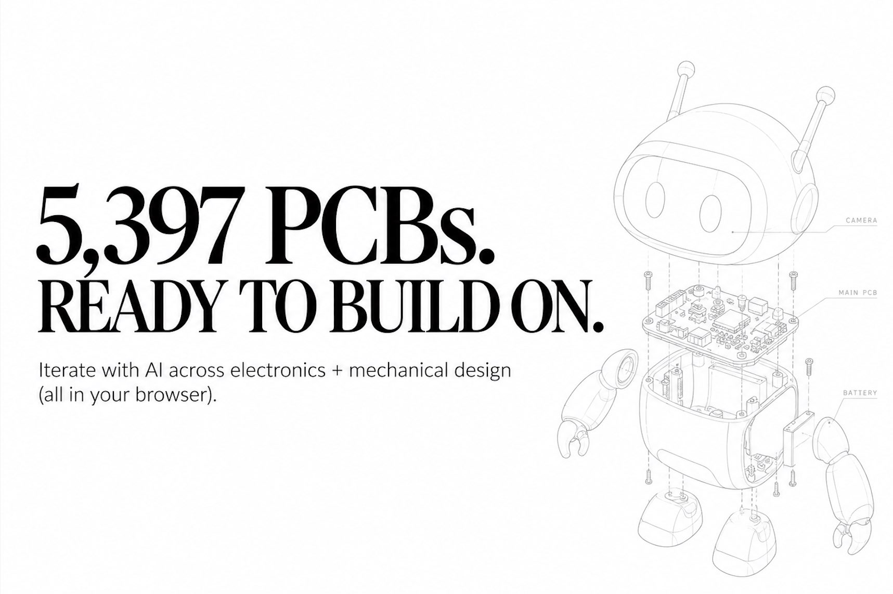

# Don't design hardware from scratch anymore — Circuit World has 5,397+ PCB designs

> Source: https://x.com/justinplaygame/status/2100774037408592269
> Author: Justin Kim (@justinplaygame)
> Posted: 2026-09-18T02:28:55Z
> Stats (at capture): 15,067 views · 225 likes · 2 replies · 31 reposts · 316 bookmarks
> Captured: 2026-09-21T12:33:00Z

## Post

@justinplaygame

Don't design hardware from scratch anymore. Circuit World has 5,397+ PCB designs ready to build on.

Start with an existing design. Iterate with Al across the electronics and mechanical design. Make it yours. Then manufacture it.

All in your browser.
https://heypcb.ai/world

## Media

Product still (`media/photo.jpg`, 1717×1143) — Circuit World / HeyPCB screenshot attached to the post.

Original: https://pbs.twimg.com/media/HSdy2nRbgAA-I89.jpg?name=orig

## Author bio (at capture)

Open Sourcing Hardware

Building HeyPCB
@fdotinc
@1517fund

## Thread

### Justin Kim ([@justinplaygame](https://x.com/justinplaygame)) — [2101087290974220730](https://x.com/justinplaygame/status/2101087290974220730)

> open-sourcing all of this for free :)

2026-09-18T23:13:41Z.

### Justin Kim ([@justinplaygame](https://x.com/justinplaygame)) — [2101705443949384000](https://x.com/justinplaygame/status/2101705443949384000)

> Open-source hardware finally has a homepage.
>
> 7,600+ designs you can actually browse.
>
> 1) Browse by hardware: robotics, RF, power, IoT, keyboards...
> 2) Browse by platform: ESP32, Arduino, STM32, Raspberry Pi, RP2040, FPGA...
> 3) Open any project directly in our browser EDA + MCAD
>
> But finding the design is only the start.
>
> AI lives right next to the editor and understands the project you have open.
>
> Ask how the circuit works. Ask why a component is there. Explore the PCB + mechanical design. Then fork it, change it, and make it yours.
>
> http://heypcb.ai/world
>
> p.s. we're not trying to make another place to store hardware files. we're trying to make hardware searchable, understandable, and editable.

## Comments

### CosmicDude3000 ([@CosmicDude3000](https://x.com/CosmicDude3000)) — [2101114441236668731](https://x.com/CosmicDude3000/status/2101114441236668731)

> @justinplaygame Is there an MCP?

2026-09-19T01:01:34Z.

#### Justin Kim ([@justinplaygame](https://x.com/justinplaygame)) — [2101176381141123332](https://x.com/justinplaygame/status/2101176381141123332)

> @CosmicDude3000 Oh, I haven’t thought about that. What kind of angle would you recommend for MCP?

2026-09-19T05:07:41Z.

## Links

- https://heypcb.ai/world
- http://heypcb.ai/world
- https://x.com/justinplaygame/status/2101087290974220730
- https://x.com/justinplaygame/status/2101176381141123332
- https://x.com/justinplaygame/status/2101705443949384000
