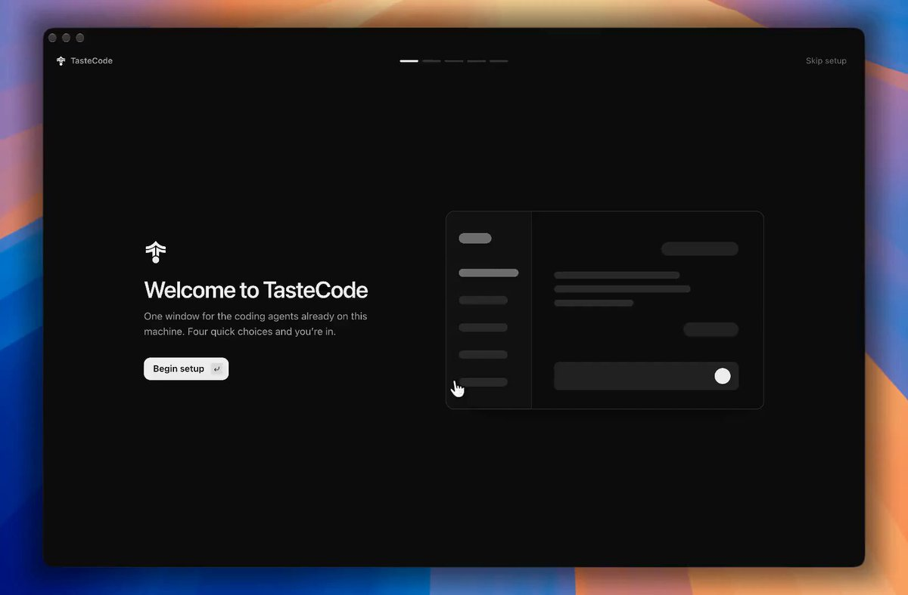

# Introducing TasteCode — open-source ADE with a design agent (Codex, Claude, Grok)

> Source: https://x.com/blueemi99/status/2100842260455981535
> Author: bluedev (@blueemi99)
> Posted: 2026-09-18T07:00:01Z
> Stats (at capture): 44,875 views · 658 likes · 56 replies · 36 reposts · 734 bookmarks
> Captured: 2026-09-21T12:33:00Z

## Post

@blueemi99

Introducing TasteCode

A few months, when we released TasteSkill, we wanted to fix frontend issues with models. With TasteCode, we’re moving closer to AI making great, production-ready design.

Its an open-source ADE, focused on great design and UX, being easy to use, and the best - our design agent.

TasteCode supports Codex, Claude and Grok. You can use your existing subscriptions, with no extra cost.

## Media

Video still (`media/thumb.jpg`) + full clip (`media/video.mp4`, 1644×1080, 32.5s) — TasteCode launch demo attached to the post.

Originals:
- https://pbs.twimg.com/amplify_video_thumb/2100744968155418625/img/AzY3ViaaUYxIzqqF.jpg
- https://video.twimg.com/amplify_video/2100744968155418625/vid/avc1/1644x1080/WJG3V9IfgT57Bg14.mp4?tag=29

## Author bio (at capture)

biggest openai fan ever

## Thread

### bluedev ([@blueemi99](https://x.com/blueemi99)) — [2100842261177336092](https://x.com/blueemi99/status/2100842261177336092)

> This website was made with Astra using TasteCode Design Agent, one-shot:
>
> We will keep improving the Design Agent.
> It's still a beta version, so expect it to get better with every update!

2026-09-18T07:00:01Z. Attached demo clip: `media/thread-video.mp4` (1776×1080, 20.4s, still `media/thread-thumb.jpg`).

Originals:
- https://video.twimg.com/amplify_video/2100744968142741504/vid/avc1/1776x1080/Y6AhwWKHKoG7EbXe.mp4?tag=29
- https://pbs.twimg.com/amplify_video_thumb/2100744968142741504/img/FphHDAtgo6ZtQ2sA.jpg

### bluedev ([@blueemi99](https://x.com/blueemi99)) — [2100842261919772841](https://x.com/blueemi99/status/2100842261919772841)

> TasteCode is our submission to Product Hunt x OpenAI Astra Challenge
>
> If you want to help us, upvote here: https://www.producthunt.com/products/tastecode?launch=tastecode
>
> GitHub, contributions welcome!: https://github.com/Leonxlnx/tastecode

2026-09-18T07:00:01Z.

### bluedev ([@blueemi99](https://x.com/blueemi99)) — [2101079656023691744](https://x.com/blueemi99/status/2101079656023691744)

> @diablovoxx *design agent*

2026-09-18T22:43:20Z.

### bluedev ([@blueemi99](https://x.com/blueemi99)) — [2100945143838724354](https://x.com/blueemi99/status/2100945143838724354)

> @tereza_tizkova @droid were adding a few more harnesses soon

2026-09-18T13:48:50Z.

### bluedev ([@blueemi99](https://x.com/blueemi99)) — [2101221398534353283](https://x.com/blueemi99/status/2101221398534353283)

> @natanpimentels we dont use it, and it doesnt seem to have many users compared to codex/cc/pi/opencode etc so were bringing it later

2026-09-19T08:06:34Z.

## Comments

### mason50x ([@mason50x](https://x.com/mason50x))

> This feels like Cursor but with the Codex agent, (amazing design)

### omni1896837 ([@omni1896837](https://x.com/omni1896837))

> This is so cool well done guys!   I’m not sure if there already is but i would l […]

### leodev ([@leodev](https://x.com/leodev))

> the onboarding looks so smooth

### natanpimentels ([@natanpimentels](https://x.com/natanpimentels))

> No agy?

(author answered in thread: harnesses beyond Codex/Claude/Grok come later.)

### tereza_tizkova ([@tereza_tizkova](https://x.com/tereza_tizkova))

> When does it support @droid

(author answered in thread: more harnesses soon.)

### vaaanitas23 ([@vaaanitas23](https://x.com/vaaanitas23))

> So it's like CommandCode but can support diff harnesses.... Damn! Now that's coo […]

### LiteEagle262 ([@LiteEagle262](https://x.com/LiteEagle262))

> you guys should add opencode support would be sick

### byte_the_dev ([@byte_the_dev](https://x.com/byte_the_dev))

> @blueemi99 welp gotta try it NOW. I have t3 code, monocode and zed delta. new o […]

### aiseomastery ([@aiseomastery](https://x.com/aiseomastery))

> Open source design tool is nice to see

### kollivenkatsai ([@kollivenkatsai](https://x.com/kollivenkatsai))

> Awesome for designers

56 replies counted on the original; 10 author self-replies and 51 community replies visible at capture, top picks above. Bracketed tails mark browser-truncated text, not author edits.

## Links

- https://github.com/Leonxlnx/tastecode
- https://www.producthunt.com/products/tastecode?launch=tastecode
- https://x.com/blueemi99/status/2100842261177336092
- https://x.com/blueemi99/status/2100842261919772841
- https://x.com/blueemi99/status/2101079656023691744
- https://x.com/blueemi99/status/2100945143838724354
- https://x.com/blueemi99/status/2101221398534353283
