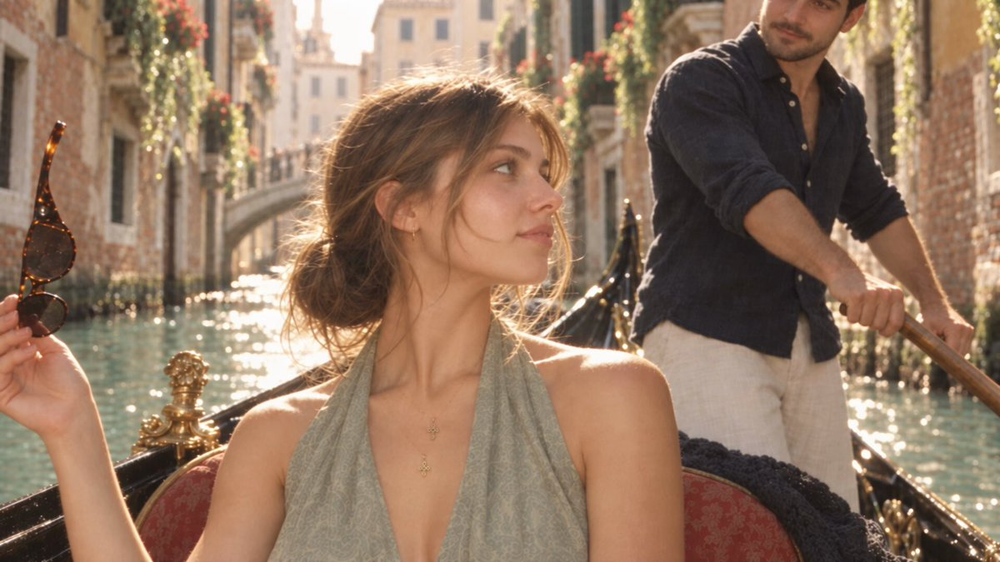
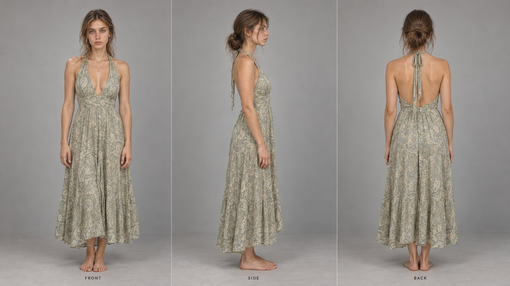
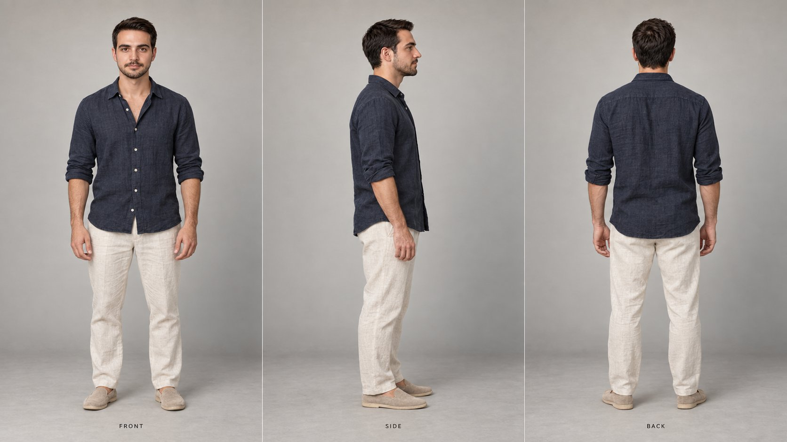
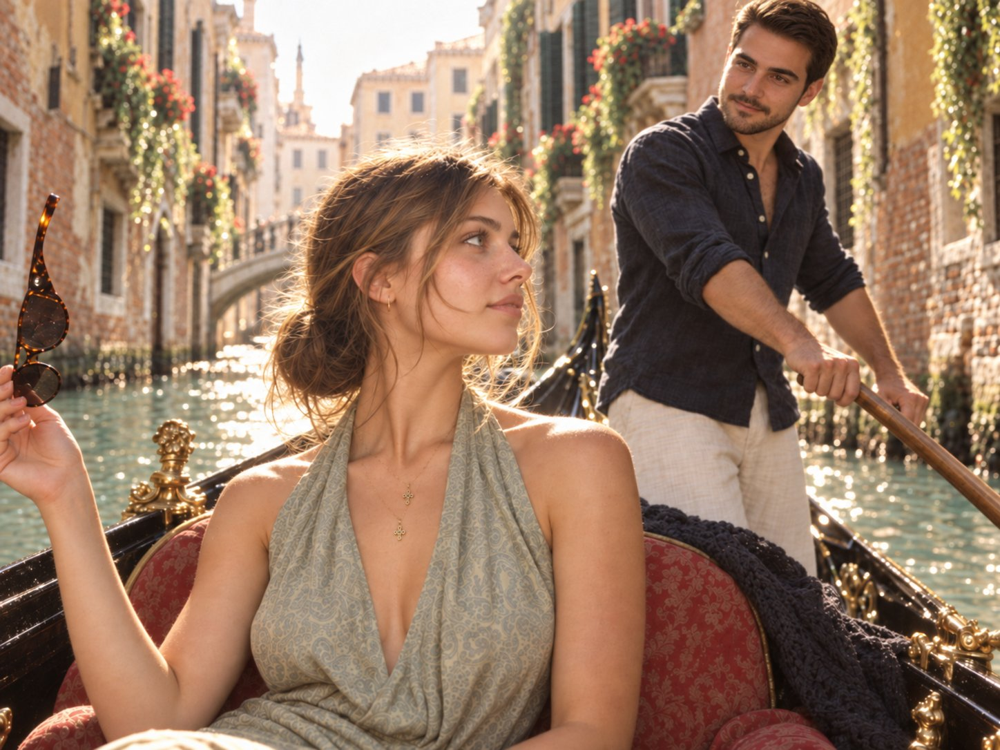
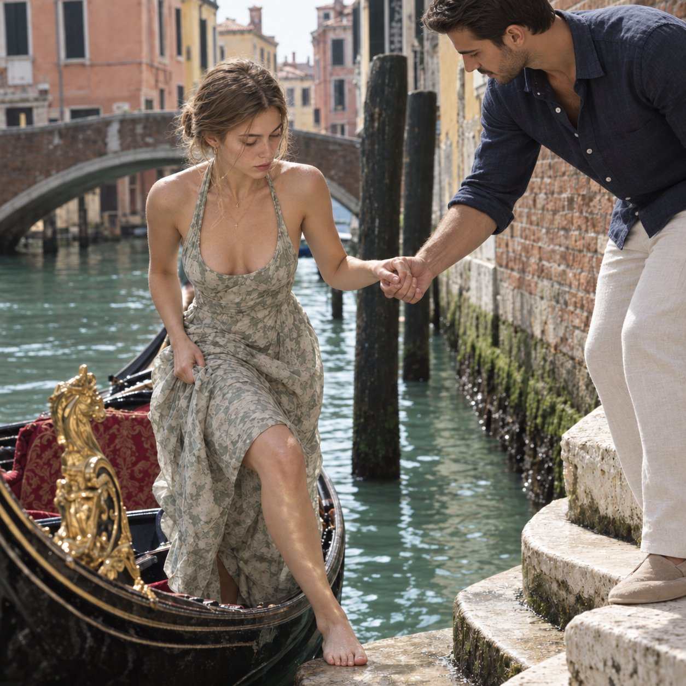

# How to make AI video that doesn't look like AI — prompt the mistakes a real person makes

> Source: https://x.com/abxxai/status/2100964451243712830
> Author: Abdul Shakoor (@abxxai)
> Posted: 2026-09-18T15:05:33Z
> Stats (at capture): 91,592 views · 681 likes · 57 replies · 106 reposts · 1,027 bookmarks
> Captured: 2026-09-21T12:33:00Z

## Post

@abxxai

how to make AI video that doesn't look like AI

stop asking for perfect.. prompt the mistakes a real person makes with a phone

full breakdown, every prompt included 👇

## Media

Video still (`media/thumb.jpg`) + full clip (`media/video.mp4`, 3840×2160, 20.1s) — the finished Venice AI video attached to the post.

Originals:
- https://pbs.twimg.com/amplify_video_thumb/2100964395895693312/img/ESwz0yFwQ-1nAOqm.jpg
- https://video.twimg.com/amplify_video/2100964395895693312/vid/avc1/1920x1080/1Gk9PU-CyzB2uQau.mp4?tag=16

## Author bio (at capture)

Content Creator | AI Artist & AI Engineer | CEO @ Elegance | Follow for easy to digest content on AI and technology.

## Thread

### Abdul Shakoor ([@abxxai](https://x.com/abxxai)) — [2100964472513048874](https://x.com/abxxai/status/2100964472513048874)

> Character sheet:
>
> Prompt:
> Professional character reference sheet, three full-body panels side by side on one wide 16:9 canvas, same woman in all three, identical scale, identical lighting, feet aligned on the same ground line, each panel labeled small at the bottom: FRONT, SIDE, BACK.
>
> IDENTITY (lock exactly from Image 4): woman in her early 20s, fair warm skin with a natural sun-kissed tone, soft oval face with high cheekbones and a gently defined jaw, striking light green-grey eyes, straight softly arched brown brows, straight refined nose, full natural pink lips, a light dusting of freckles across her nose and cheeks, small gold hoop earrings. Long wavy light-brown hair with sun-bleached golden-caramel strands, pulled back into a loose, messy low bun at the nape, with long face-framing curtain strands and soft wispy flyaways falling past her cheeks. No fringe or bangs. Calm, neutral, relaxed expression. Preserve her exact facial structure, eye colour, freckles and proportions, no beautification, no changes.
>
> BODY: slim, natural feminine build, average height, relaxed natural posture, soft natural shoulders and arms.
>
> WARDROBE (lock from Images 2 and 3): light sage-green paisley halter dress in a soft silky fabric, cream and olive paisley print, a deep V neckline, fabric ties gathered at the back of the neck, fitted softly at the waist, falling in a loose flowing A-line skirt to mid-calf with natural drape and movement. Open back, bare from the shoulder blades to the waist. Two thin delicate gold chains layered at the neck, each with a tiny gold cross pendant. Barefoot, natural bare feet. No belt, no rings, no bag, no sunglasses, no logos.
>
> PANELS:
> FRONT: facing camera straight on, arms relaxed at her sides, weight even on both feet, looking directly into the lens, V neckline, necklaces and hoop earrings clearly readable.
> SIDE: full 90-degree right profile, arms relaxed, clean silhouette showing the halter neckline, the drape of the skirt, the low bun and the line of her nose and lips.
> BACK: facing directly away, arms relaxed, showing the halter tie at the back of the neck, the open back, the messy low bun with loose strands, and the flow of the skirt to the hem.
>
> LIGHTING AND BACKGROUND: plain seamless warm light-grey studio backdrop, soft even diffused key light from the front with gentle fill, very soft shadow at the feet, no harsh contrast. Slightly warm natural colour, subtle fine film grain for realism.
>
> REALISM: photorealistic, visible skin texture and pores, natural freckles on face and shoulders, individual flyaway hairs, real silky paisley fabric with natural folds and weight, fine gold chain detail, sharp focus across all three panels, 8K, true-to-life proportions, no stylisation.
>
> Avoid: changing her face between panels, fringe or bangs, different outfits per panel, shoes, extra accessories, cartoon or 3D render look, dramatic or fashion poses, cropped feet or head, text other than the three small labels.

Attached:  (`media/thread-charsheet-woman.jpg`, original https://pbs.twimg.com/media/HSggDZnaIAAPkdO.jpg?name=orig).

### Abdul Shakoor ([@abxxai](https://x.com/abxxai)) — [2100964491500699709](https://x.com/abxxai/status/2100964491500699709)

> Men charcter sheet
>
> Prompt:
> Photorealistic male character reference sheet, wide 16:9 layout with three equal full-body panels: FRONT, SIDE, BACK. Same man in every view, identical proportions and outfit. Young adult with light olive skin, short dark brown hair, thick brows, trimmed beard and moustache. Wearing a dark navy linen button-up shirt with sleeves rolled to the forearms, cream linen trousers, and beige suede loafers. Neutral relaxed posture, arms at sides. Plain warm light-grey studio background, soft even lighting, realistic skin and fabric texture, clean production reference style, no pose variation, no character drift.

Attached:  (`media/thread-charsheet-man.jpg`, original https://pbs.twimg.com/media/HSggEhCbAAAOG-L.jpg?name=orig).

### Abdul Shakoor ([@abxxai](https://x.com/abxxai)) — [2100964511788511448](https://x.com/abxxai/status/2100964511788511448)

> First frame image:
>
> upload both character sheet and use this prompt
>
> Prompt:
> REFERENCE MAP: Image 1 = the man's exact face, hair, build and wardrobe. Image 2 = the woman's exact face, eyes, freckles, hair colour and texture. Image 3 = composition, light, colour and film look. Preserve both identities exactly, no beautification, no face changes. Only these two people in the frame.
>
> A candid, sun-drenched travel photograph taken from inside a gondola gliding down a narrow Venetian side canal, shot on an old compact 35mm film camera, eye-level and slightly low, a real summer memory caught mid-moment.
>
> THE WOMAN (identity from Image 2): early 20s, soft oval face, light green-grey eyes, straight defined brows, full natural lips, light freckles across her nose and cheeks, small gold hoop earrings. Long wavy light-brown hair with sun-bleached golden-caramel strands pulled back in a loose messy low bun, long face-framing curtain strands and flyaways falling across her cheek and lifting in the breeze. She sits alone on the red brocade gondola seat in the left and centre of the frame, body facing camera, head turned over her right shoulder in near-profile, chin lifted, eyes drifting toward the canal ahead, a soft private half-smile, unaware of the lens. Light sage-green paisley halter dress with a deep neckline and silky drape, two thin gold chains with tiny gold cross pendants. Her left hand raised near her shoulder holding dark tortoiseshell sunglasses by the temple arm, dangling from two fingers and catching the sun. A dark knitted shawl draped behind her on the seat.
>
> THE MAN ROWING (identity and wardrobe from Image 1): late 20s, light olive skin, short dark brown hair with a soft side-swept quiff, thick dark brows, warm brown eyes, short trimmed dark beard and moustache. Washed dark navy linen shirt, top two buttons open, sleeves rolled to the forearm, pale cream linen trousers. He is the one rowing: standing at the stern on the right side of the frame, both sun-tanned hands gripping the long wooden oar mid-stroke, forearm tendons visible, the oar cutting diagonally across the right of the composition. Seen from the waist up, face visible near the top right, head tilted slightly down, eyes resting on her with a quiet warm half-smile, slightly softer in focus than her so she stays the hero.
>
> ENVIRONMENT: a breathtaking narrow canal, honey-ochre and faded peach plaster facades, sun-warmed exposed brick, dark green shutters, balconies spilling red geraniums and trailing ivy, a small white stone footbridge arching over the water in the distance, a sliver of bright hazy sky above. Clear jade-turquoise water glittering with golden sparkles, ripples throwing dancing reflections up the walls. Gilded brass gondola ornaments glowing warm in the foreground.
>
> LIGHT: bright late-morning sun streaming down the canal from behind, warm golden backlight rimming her hair, flyaways, cheekbone and shoulders, and edging his hair, beard, shoulders and forearms. Soft warm bounce from the water onto both faces. Airy and luminous, highlights softly blooming, sky washing to creamy haze, no harsh shadows.
>
> FILM LOOK: warm nostalgic film snapshot, scanned Kodak Gold 200 feel, sun-kissed peach and honey cast, palette of ochre, terracotta, dusty rose, sage, cream, navy and turquoise. Lifted soft shadows, gentle contrast, soft halation, subtle vignette, fine organic grain, slight corner softness.
>
> REALISM: photorealistic, visible skin texture and pores, natural freckles, dewy sheen on her collarbone, glowing individual hairs, silky paisley drape, real linen creasing on his shirt, brocade and velvet texture, wood grain on the oar, water droplets on the black lacquered hull. Shallow depth of field, background melting into warm blur. Unposed, intimate, beautiful documentary feel.
>
> Avoid: a seated man, a gondolier in a striped shirt, any third person, changing either face, fringe or bangs on her, him looking at the camera, cold blue tones, digital HDR, plastic skin, oversaturation.

Attached:  (`media/thread-frame1.jpg`, original https://pbs.twimg.com/media/HSggFpaaEAAcHV7.jpg?name=orig).

### Abdul Shakoor ([@abxxai](https://x.com/abxxai)) — [2100964532613181919](https://x.com/abxxai/status/2100964532613181919)

> Second frame Image:
>
> Uploade both charcters sheet with this
>
> Prompt:
> REFERENCE MAP: Image 1 = the man's exact face, hair, build and wardrobe. Image 2 = the woman's exact face, eyes, freckles, hair colour and texture. Image 3 (the gondola photo) = her dress, necklaces, the gondola, the canal location, light, colour and film look. Preserve both identities exactly, no beautification, no face changes.
>
> A spontaneous, unposed moment at a quiet Venice canal landing, a real summer memory caught half a second before anyone noticed the camera. The black lacquered gondola has just pulled up alongside worn, curved travertine steps rising out of clear jade-turquoise water. Weathered sun-warmed brick embankment, soft green moss along the waterline, dark wooden mooring poles, a low white stone arched bridge behind, and honey-ochre and faded peach plaster facades with dark green shutters and red geraniums spilling from the balconies, all softening into a warm creamy haze.
>
> THE MAN (identity and wardrobe from Image 1): late 20s, light olive skin, short dark brown hair with a soft side-swept quiff, thick dark brows, warm brown eyes, short trimmed dark beard and moustache. Washed dark navy linen shirt, top two buttons open, sleeves rolled to the forearm, pale cream linen trousers, beige suede loafers. He stands on the second step above the water, leaning forward with his weight on his front foot, his right hand extended down toward the boat, sun-tanned forearm with tendons visible. His eyes are on her feet and the step, a quiet attentive half-smile, protective and easy, not posing.
>
> THE WOMAN (identity from Image 2): early 20s, soft oval face, light green-grey eyes, straight defined brows, full natural lips, a light dusting of freckles, small gold hoop earrings. Long wavy light-brown hair with sun-bleached golden-caramel strands pulled back in a loose messy low bun, long face-framing curtain strands and wispy flyaways falling across her cheek. She wears the same light sage-green paisley halter dress with a deep neckline and soft silky drape, and two thin gold chains with tiny gold cross pendants. She is rising from the gondola's red brocade seat mid-step, one bare foot reaching toward the sunlit stone, her right hand resting lightly in his, fingers relaxed and elegant, her left hand gathering her skirt clear of the water. Head tilted down, eyes lowered to the step below, lips softly parted, completely absorbed in the movement and unaware of the camera.
>
> In the background at the stern, the gondolier stands soft and out of focus, cropped at the shoulders, navy-and-white striped shirt, one hand on the long wooden oar.
>
> CAMERA: shot from the opposite bank on an old 50mm film camera at f/2.2, eye-level, slightly loose handheld framing, the gilded brass bow ornament and a glittering sliver of canal soft in the foreground, both figures sitting in the right two thirds of the frame, their joined hands the quiet centre of the image.
>
> LIGHT: bright, warm late-morning Venetian sun streaming in from behind-left, golden rim light along her hair, flyaways, cheekbone, shoulders and bare legs, and along the edge of his shoulder, forearm and beard. Sunlight bouncing off the water into rippling gold-green reflections that dance across the stone steps and up onto her legs and jaw. Soft gentle shadows beneath the dress folds and the joined arms, cool soft fill in the shaded brick, highlights blooming gently, sky washing out to creamy white.
>
> FILM LOOK (match Image 3): warm nostalgic film snapshot, scanned Kodak Gold 200 feel, sun-kissed peach and honey cast, palette of ochre, terracotta, dusty rose, sage, cream, navy and turquoise. Slightly lifted soft shadows, gentle contrast, soft halation around the highlights, subtle vignette, fine organic grain, natural lens falloff and slight corner softness.
>
> REALISM: photorealistic, visible skin texture and pores, natural freckles, a faint dewy sheen on her collarbone, individual glowing hairs catching the light, real linen creasing and wrinkles across his shirt and trousers, suede texture on his loafers, the natural weight of the silky dress draping over her hand, damp dark stone at the waterline, velvet and brocade texture on the seat. Slight motion softness in her trailing foot. Unretouched, intimate candid documentary feel, tender and beautiful.
>
> Avoid: changing either face, fringe or bangs on the woman, the man holding the oar or wearing stripes, both looking at the camera, cold blue tones, crisp digital HDR, plastic skin, oversaturation, extra people on the steps.

Attached:  (`media/thread-frame2.jpg`, original https://pbs.twimg.com/media/HSggG4aaoAIdI1v.jpg?name=orig).

### Abdul Shakoor ([@abxxai](https://x.com/abxxai)) — [2100964546194427976](https://x.com/abxxai/status/2100964546194427976)

> Seedance 2.5 shoot 1
>
> use the first frame image and the both charcters sheet and the prompt
>
> Prompt:
> IMAGE MAP: = exact first frame, composition, environment, light and colour grade. @[Image 1](image_1) = the woman: exact face, green-grey eyes, freckles, light-brown hair in a loose messy low bun with face-framing strands, sage paisley halter dress, two thin gold cross necklaces, small gold hoop earrings. @[Image 2](image_2) = the man: exact face, short dark brown side-swept hair, trimmed dark beard, washed navy linen shirt with sleeves rolled, pale cream linen trousers. Keep both identities and outfits locked and identical in every frame. Only these two people in the video.
> LOOK LOCK (all frames, match ): warm late-morning Venetian sun streaming down the canal from behind, golden backlight rimming her hair, flyaways, cheek and shoulders, and edging his hair, beard and forearms. Sky washed to a hazy cream, honey-ochre and peach facades, red geraniums and ivy on the balconies, white stone footbridge in the distance, jade-turquoise water glittering gold. Warm nostalgic film grade: peach and honey cast, lifted soft shadows, gentle contrast, soft halation on highlights, subtle vignette, fine organic grain, slight corner softness. Real skin texture, pores, freckles, dewy sheen on her collarbone, real linen creasing, silky paisley drape.
> SECTION 1: TIMELINE. One continuous handheld shot, 8s, no cuts, the gondola gliding forward the whole time.
> 0.0-3.2s: COLD OPEN, MID-GESTURE. "Nobody actually shows you how to make your AI visuals look like this"
> Starts on the exact frame, already in motion. She sits on the red brocade seat, body toward camera, head turned over her right shoulder toward the man. Her raised left hand is ALREADY lowering the tortoiseshell sunglasses from frame-left, mid-flight, no hold. She is already speaking, the first syllable partly caught. Deep, slightly raspy American voice, low and dry.
> EYELINE: the turn to camera IS the first movement. On frame one her head is already rotating away from the man toward the lens, eyes on the lens by ~0.2s on "Nobody," held for the rest of her line. The glasses go down by feel, never looked at, and exit lower-left at ~0.9s, set aside off-screen without breaking eye contact. Shoulder drops, torso leans in slightly. The loose bun shifts, face-framing strands lift in the breeze and glow gold. Open-palm gesture near her collarbone on "look like this."
> Behind her, the man stands at the stern at frame-right, rowing continuously, soft in focus.
> Camera: loose phone grip inside a moving boat, three shake layers: hand tremor, 2-4 degree roll drifting every ~1.5s, body overcorrections. Horizon never level, framing off-centre. Walls drift past leftward, near brick and flowers faster than far facades. Camera reacts late: drifts down-right into too much headroom, wanders off-line, corrects softly.
> 3.3-5.4s: "Raw, grainy, perfectly imperfect..."
> EFFECT: unreduced shake + micro push-in (3-4%)
> Three landed points with real air between. "Raw." beat. "Grainy." beat. "Perfectly imperfect..." Small soft hand taps on the first two.
> SIGNATURE MOMENT: on "perfectly imperfect" a smirk pulls her left mouth corner, head tilts ~15 degrees up and right, and her eyes leave the lens toward the man behind her, pleased with her line, checking it landed. Camera never calms: full shake, two roll corrections, one overcorrecting.
> 5.5-6.4s: NATURAL HANDHELD SHIFT UP AND RIGHT
> EFFECT: soft drift up-right + gentle zoom (~10%) + light focus hunt. NOT A WHIP.
> The operator just follows her glance. The camera lifts up and right in a loose, unhurried ~0.9s drift, phone speed, no snap, no locked path. Shake continues underneath so the move reads as part of the wobble. Focus hunts briefly, then settles on him. He lands in a loose off-centre medium close-up: head, shoulders, navy linen shirt, both hands on the oar at the lower edge, her hair and shoulder soft at the lower-left edge of frame. Background melts to warm blur. He is mid-stroke on arrival, sun rimming his hair and beard.
> 6.4-8.0s: "But I will"
> EFFECT: vertical bounce shake + continuous rowing + delayed speech entry
> HE NEVER STOPS ROWING. No pause, no hitch, no pose. The stroke runs unbroken: oar pulling back, lifting, pushing forward, dropping in. Torso rotates, shoulders roll, weight shifts foot to foot, head rises and falls with the pull. He works the boat and talks at once.
> NO RUSH. Half a second passes after the camera arrives. Mid-stroke, he glances toward the lens, then speaks at ~6.9s. Offhand aside, not a line to camera. Three words, unhurried and low, across ~1.0s. Slight British accent, slightly higher pitched, relaxed, almost muttered, thinking aloud. Subtle stress on "I": small pitch lift and a fraction of extra length, never hard. "will" settles as he leans into the next pull.
> Face natural and unforced: one natural blink, slight warmth around the eyes, small chin lift on "I," a faint half-smile. No exhale before speaking, no eyebrow movement, no twitching. Eye contact real but casual: looks at the lens, glances off down the canal, comes back.
> CUTS at 8.0s mid-pull, oar in the water. No fade, no wind-down.
> SECTION 2: EFFECTS INVENTORY
> CONTINUOUS: three-layer shake that never calms, boat glide + lateral sway, parallax on the walls, soft wake along the hull, phone-in-hand rendering, film grain, warm golden backlight, hazy cream sky, gold water sparkle and bounce, soft highlight bloom, off-centre framing, unbroken rowing cycle.
> CAMERA: reframe miss (3x), soft drift-up reveal, micro push-in, gentle zoom, focus hunt, hard cut on motion.
> PERFORMANCE: prop already moving on frame one, eyeline lock by 0.2s, smirk + head tilt toward him, unbroken rowing through his line, delayed speech entry, subtle stress on "I," casual drifting eye contact, cut on the stroke.
> SECTION 3: DENSITY
> 0.0-3.2s = MED-HIGH (8) | 3.3-5.4s = MED (6) | 5.5-6.4s = MED (5) | 6.4-8.0s = LOW (4, calm)
> SECTION 4: MOTION FLOW
> Opening: everything already underway. Boat gliding, hand dropping, voice mid-line, eyes on the lens within a fifth of a second. The shake is a phone in a swaying boat, not stylised roll.
> Build: her delivery tightens while the camera stays loose. Her glance cues the operator, who drifts the frame up to the man casually, just someone turning to look at the other person.
> Resolution: the camera finds him still working the oar. He takes a beat, tosses off three easy words without breaking rhythm, and it's gone. Cuts mid-stroke, early.
> AUDIO: her voice and his voice only, clear and close, plus soft water lapping against the hull, the oar dipping and pulling, faint distant canal ambience. No music, no extra dialogue.
> NEGATIVE: no identity drift between frames, no outfit changes, no striped gondolier, no third person, no fringe or bangs on her, no ponytail, no curls on him, no stable tripod feel, no whip pan, no cold blue grade, no crisp digital HDR, no plastic skin, no subtitles or text.

### Abdul Shakoor ([@abxxai](https://x.com/abxxai)) — [2100964559289004448](https://x.com/abxxai/status/2100964559289004448)

> Seedance 2.5 Shoot 2
>
> use the second frame image and the both character sheets
>
> Prompts:
> IMAGE MAP: @[Image 1](image_1) = exact first frame + environment/grade. @[Image 2](image_2) = woman face/hair/wardrobe: green-grey eyes, freckles, light-brown hair in a loose messy low bun with face-framing strands, sage paisley halter dress with open back, two thin gold cross necklaces, small gold hoop earrings, barefoot. = man face/body/wardrobe: short dark brown side-swept hair, trimmed dark beard, washed navy linen shirt with sleeves rolled, pale cream linen trousers, beige suede loafers. Both identities and outfits locked in every frame. Only these two people.
> SECTION 1: TIMELINE. One continuous handheld shot, 11s, no cuts. Very amateur filming: everything is moving, nothing is composed.
> 0.0-1.0s: OFF THE LAST STEP
> EFFECT: three-layer handheld shake + phone-lens rendering + walking operator
> Begins on the exact reference frame, already in motion. She is mid-descent behind him, weight transferring onto the final step, right hand gathering the paisley dress at her thigh, eyes down on her footing. At ~0.5s her bare foot meets the flat stone and she settles through the knees, dress released. The dark-haired man in the navy linen shirt is a stride ahead at frame-left, already on the level, walking. Loose easy gait, arms swinging, shirt moving with him. Venice late morning: bright warm sun from behind-left, golden rim light on both of them, sun-warmed stone, soft shadow on the left wall, jade-turquoise canal at right with a moored gondola. Highlights blooming softly, warm bounce off stonework, hazy cream sky. Warm nostalgic film grade, peach and honey cast, lifted soft shadows, soft halation, fine organic grain.
> Camera: loose phone grip, operator walking backward. Hand tremor, step-bounce on every footfall, irregular late corrections, occasional tilt the operator doesn't fix. Horizon never level, framing off-centre and drifting, subjects sometimes crowded to one edge. Grain, corner softness, mild fringing.
> 1.0-2.3s: HE PICKS UP THE LENS
> EFFECT: shake + backward-tracking drift + parallax
> Both walk toward camera at real pace. At ~1.1s his head turns and his eyes find the lens, casual, unannounced, like he's just clocked the person filming. Speech starts almost immediately. Natural speaking gestures throughout: an open hand lifts at chest height on the first phrase, tips over as he talks, drops back to his side. Shoulders roll with the walk, head bobs slightly on stressed words, eyebrows move with the sense of the sentence, not on a beat. Camera drifts back and right, loses him briefly, hikes back. Stone steps recede, the gondola slides across frame right.
> 1.15-4.4s: "First rule is it should never look too perfect"
> EFFECT: shake + subject passing camera + over-the-shoulder eyeline hold
> Slight British accent, slightly higher pitch, light and easy. Delivered as a STATEMENT: declarative, landed, falling intonation at the end. Not monotone, pitch moves naturally across the sentence. Shape of the read: small lift on "First rule is," a fractional pause, then "it should never look" runs quicker and lower, and "too perfect" comes out slower and flatter with a downward close. Warm and matter-of-fact, like passing on something obvious.
> At ~2.4s he passes the lens on its left side, briefly filling more of frame; the camera swings to keep him and doesn't quite manage it. From ~2.6s his head turns back over his shoulder, eyes returning to the lens while his body keeps walking away. He holds that backward look through the rest of the line, with a small half-shrug on "too perfect." Slight amused pull at one corner of his mouth. No wink, no punchline face. She stays behind and to his right, in and out of frame, glancing forward, not addressing camera.
> 4.4-5.2s: THE CAMERA LOSES HIM, FINDS HER
> EFFECT: loose swing back + reframe miss + focus hunt
> He faces forward again and keeps walking down the dock. The operator, still bouncing, swings back right and nearly misses her. She's right there, much closer than expected, walking past the lens in a soft blur of paisley and gold light.
> 5.2-5.7s: SHE CLOCKS THE PHONE
> EFFECT: shake + backward-walking subject
> She notices the phone, stops, turns to face it and steps backward two paces as the operator keeps coming. Focus hunts, lands on her face. Breeze lifts the face-framing strands, sun glowing through them.
> 5.7-8.6s: "Rule two... film it like nobody's in charge of the camera"
> EFFECT: shake + accidental punch-in + snap back out
> Deep, slightly raspy American voice, low, dry and amused. "Rule two..." then a real beat with a tiny smirk, eyes locked on the lens. "film it like nobody's in charge" runs quicker and playful. On "of the camera" she reaches out with two fingers and casually taps the phone.
> SIGNATURE MOMENT: the tap jolts the frame. It tilts hard ~15 degrees, jumps into an accidental 1.6x digital punch-in (her eye, freckles and a strand of hair filling frame, grain heavy, focus soft), holds ~0.4s, then the operator fumbles and it snaps back out to wide with an overcorrecting roll. Motion blur on the jolt. She laughs silently and turns away, pleased with herself.
> 8.6-9.3s: RECOVERY
> EFFECT: slow zoom out (~15%) + drifting reframe
> The operator steadies badly and slowly pulls wider. She walks off to catch up. He has stopped a few steps ahead on the dock, half-turned back, waiting for her, the canal glittering beside him.
> 9.3-10.6s: "Follow for rule three"
> EFFECT: shake + step-bounce + over-the-shoulder look
> Same slight British accent, offhand and easy, over his shoulder to the lens, a small knowing lift on "three," a tiny backward nod on "Follow." As she reaches him he holds his hand back without looking, she takes it, and they turn and walk away together down the dock.
> 10.6-11.0s: CUT
> Both walking away hand in hand, camera still bouncing, framing off. CUTS at 11.0s mid-step. No fade, no settle.
> SECTION 2: EFFECTS INVENTORY
> CONTINUOUS: three-layer handheld shake, walking-operator step bounce, backward tracking, parallax, phone-lens rendering, grain, warm golden Venice sun, soft blooming highlights, canal bounce, off-centre drifting framing.
> CAMERA: reframe miss (4x), unfixed tilt, swing-to-follow on his pass, swing back to find her, focus hunt (2x), accidental 1.6x punch-in with snap back out, motion blur on the tap, slow zoom out, subject-scale change, hard cut on motion.
> PERFORMANCE: her step-down settle, his unannounced eyeline pickup, walking delivery with natural hand gestures, head bob on stressed words, over-the-shoulder eyeline hold, half-shrug, amused mouth pull, her backward walk and smirk, the phone tap, her silent laugh, his offhand CTA, the blind hand-hold, walking away together.
> SECTION 3: DENSITY
> 0.0-1.0s = MED (5) | 1.0-2.3s = MED (5) | 2.3-2.9s = HIGH (6, the pass) | 2.9-4.4s = MED (4) | 4.4-5.7s = MED (5) | 5.7-8.6s = HIGH (8, the tap) | 8.6-9.3s = LOW (3) | 9.3-11.0s = MED (4)
> SECTION 4: MOTION FLOW
> Opening: already descending, already walking, no establishing beat. It feels caught rather than staged, the operator just happens to be there as they come off the steps.
> Build: the walk closes distance fast and his eyeline pickup lands mid-approach. The pass is messy: too close, camera late, framing wrong. The camera swings back and stumbles onto her, and rule two gets proved live when she knocks the phone. That jolt is the peak.
> Resolution: the camera recovers and pulls out, he waits, drops the CTA over his shoulder, reaches back for her hand without looking. The last thing you get is them walking away together. Cuts mid-step, before the moment resolves.
> AUDIO: both voices clear and close to the phone mic, footsteps on stone, water lapping the steps, the gondola knocking gently against its mooring, a small mic bump on her tap, faint canal ambience. No music.
> NEGATIVE: no identity drift, no outfit changes, no sandals on her, no curls or blonde hair on him, no third person, no tripod stability, no gimbal smoothness, no clean whip pan, no cold blue grade, no crisp digital HDR, no plastic skin, no subtitles or on-screen text.

## Comments

### codewithhajra ([@codewithhajra](https://x.com/codewithhajra))

> Great workflow

#### Abdul Shakoor ([@abxxai](https://x.com/abxxai)) — [2101283210676314335](https://x.com/abxxai/status/2101283210676314335)

> Thanks, Hajra

### dasepmochly ([@dasepmochly](https://x.com/dasepmochly))

> Adding slight autofocus hunting, lens smudges, and rolling shutter jitter does 90% of the […] (text truncated at capture)

### RajaForge ([@RajaForge](https://x.com/RajaForge))

> But does sedance allows more than 10sec cideo generation?

### ugccharley ([@ugccharley](https://x.com/ugccharley))

> Perfectly imperfect!

### dpeyton86 ([@dpeyton86](https://x.com/dpeyton86))

> Still looks AI generated to me. But not for long I guess... getting harder to distinguish […]

### aiseomastery ([@aiseomastery](https://x.com/aiseomastery))

> Prompting mistakes on purpose is genius honestly

### SonOfJihoz_real ([@SonOfJihoz_real](https://x.com/SonOfJihoz_real))

> Will this be ok for google flow? Or only seedance?

### teffo_ME ([@teffo_ME](https://x.com/teffo_ME))

> I just need to know which webpage I can use yo create

### itsnathanhirsch ([@itsnathanhirsch](https://x.com/itsnathanhirsch))

> Love this. When you go for perfection it really looks odd. Humans aren't perfect, and that […] (text truncated at capture)

### socialwithaayan ([@socialwithaayan](https://x.com/socialwithaayan))

> make it worse

### agentpriscillia ([@agentpriscillia](https://x.com/agentpriscillia))

> This is so beautiful. Time for me to activate my long form content again.

57 replies counted on the original; author prompt thread plus top community picks above. "(text truncated at capture)" marks browser-truncated text, not author edits.

## Links

- https://x.com/abxxai/status/2100964472513048874
- https://x.com/abxxai/status/2100964491500699709
- https://x.com/abxxai/status/2100964511788511448
- https://x.com/abxxai/status/2100964532613181919
- https://x.com/abxxai/status/2100964546194427976
- https://x.com/abxxai/status/2100964559289004448
