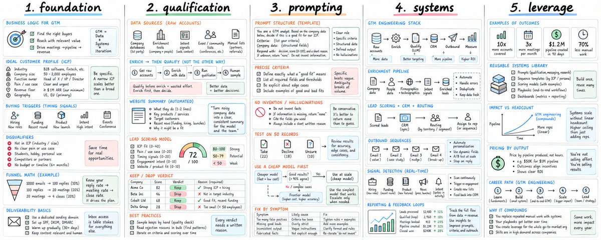

# How To Master GTM Engineering (FULL COURSE) — Christian / pipeline.tech

> Source: https://x.com/coldemailchris/status/2101014272021008735
> Author: Christian (@coldemailchris)
> Posted: 2026-09-18T18:23:32Z
> Stats (at capture): 164,877 views · 245 likes · 7 replies · 17 reposts · 904 bookmarks
> Captured: 2026-09-21T12:33:00Z

## Post

@coldemailchris

https://x.com/i/article/2099222803580907520

## Media

Article cover (`media/article-cover.jpg`, 1983×793) — cover image for the linked X Article "How To Master GTM Engineering (FULL COURSE)".

Original: https://pbs.twimg.com/media/HShMy-6WQAEixXF.jpg

## Article (linked)

X Article [2099222803580907520](https://x.com/i/article/2099222803580907520):

> How To Master GTM Engineering (FULL COURSE)
>
> GTM engineering emerged around 2024, when companies started looking for alternatives to growing revenue through headcount.
> Job postings for the role grew 205% year over year.
> Vercel pays $252k.
> [… preview truncated at capture]

## Author bio (at capture)

Founder/CEO @ http://pipeline.tech — Building AI-native outbound systems for the most innovative B2B brands. Teaching GTM @ http://gtmu.io. ✝️ Jesus is King.

## Comments

7 replies counted on the original; replies behind X login at capture — none rendered in the logged-in bridge session. Only the post and its article card were visible.

## Links

- https://x.com/i/article/2099222803580907520
