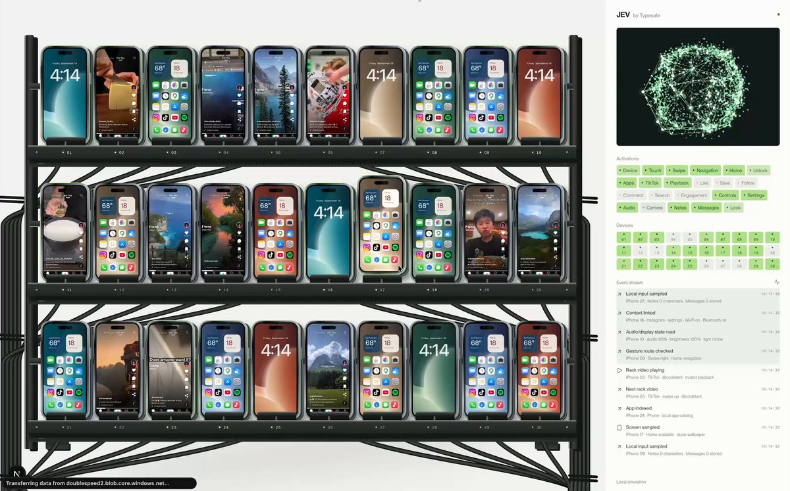
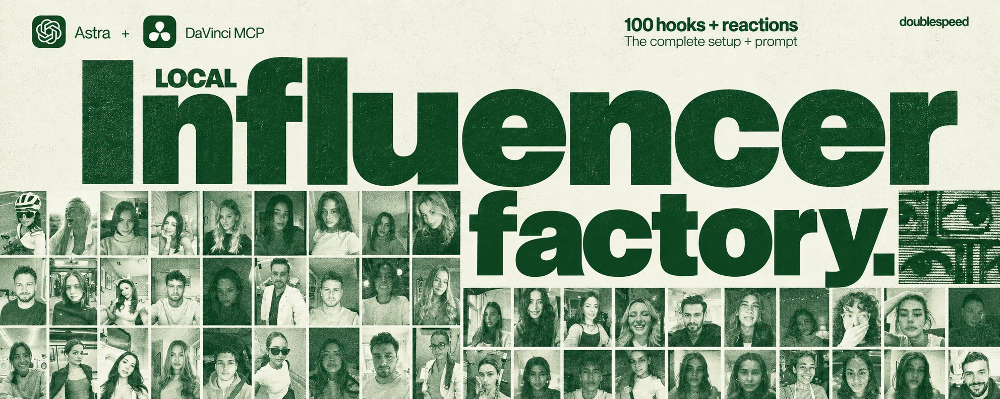

# Jev has finally unlocked truly sovereign distribution stack: - WDA + iphones + Jev for phone farm - DaVinci MCP + Astra

> Source: https://x.com/type_tjay/status/2101090899652460680 — Tjay (@type_tjay) — Posted: 2026-09-18T23:28:01Z — Stats (at capture): 56,377 views · 497 likes · 17 replies · 44 reposts · 1,203 bookmarks · 1 quotes · Twitter Web App — Captured: 2026-09-21T12:44:36Z

## Post

**Author:** Tjay (@type_tjay)
**URL:** https://x.com/type_tjay/status/2101090899652460680

Jev has finally unlocked truly sovereign distribution stack:

- WDA + iphones + Jev for phone farm
- DaVinci MCP + Astra for video editing
- Skills for Hook writing

Btw if you don't want to waste $$ on video generation just download 1000s of them from here for free: https://doublespeed.ai/video-bucket

## Media

[media/media_0.mp4](media/media_0.mp4)

Original video: https://video.twimg.com/amplify_video/2101090866001768448/vid/avc1/1156x720/v8SRn7JDRI2Zduah.mp4?tag=29 (1156×720, 10.9s)
Poster: https://pbs.twimg.com/amplify_video_thumb/2101090866001768448/img/_RSrls4Ob1GVx9Gi.jpg

## Quoted post

[Zuhair Lakhani (@rareZuhair), 2026-09-15T18:31:56Z](https://x.com/rareZuhair/status/2099929225683972134) — 134,471 views · 255 likes · 9 replies · 28 reposts · 800 bookmarks · 3 quotes · Twitter Web App

> Astra + AI Influencers is literally the modern day gold rush. https://x.com/i/article/2099580987076460544

Quoted X article: [DaVinci MCP + Astra + Skills - How to setup a local influencer factory](https://x.com/i/article/2099580987076460544)

If you're reading this you've been chosen by the algorithm gods. Use this knowledge wisely.

Here is  DaVinci MCP + Astra one shotting 100 Hook + Reaction style UGC videos in 8 seconds:

As you know, Astra has lived up to it's hype and is insane at content creation/world building. Here's a diagram it made about our ai influencers:

It coordinates work and write hooks (custom skill trained on our hook library) + combines with the reaction library (which I am open sourcing - download 1000+ reaction videos for free from here ), and DaVinci MCP handles the edits. Here's how to use it:

1. Grab the free reaction videos bucket

We put 1,000+ reaction templates in the doublespeed video bucket. This is the raw material for the factory: different faces, expressions, settings, and motions you can pair with your own hooks.

You can browse the raw clips and download the ones you want to work with locally. Put all of them in a working folder, lets call it "BOMBACLAT" for this tutorial.

2. Set up DaVinci MCP (if you want to do it manually)

Download the latest DaVinci Studio 21.1. Then under file -> Setup AI Assistants.

Assuming you have the ChatGPT desktop app - upon clicking this "Setup AI Assistants" it would automatically installed the DaVinci MCP with ChatGPT.

Restart Codex after that confirmation. Keep Resolve open while you work.

Double check installation on ChatGPT app. Open Plugins → MCPs and enable davinci_resolve.

3. Install the hook-writing skill

Well this is the secret sauce, we at doublespeed have made 150k+ creative assets for various consumer brands in the past year. So we a know a thing or two about hook writing, here I am spilling it all, this is the exact prompt we use in our internal systems.

This skill has been created by painstakingly noting and collecting all hook trends in the past year.

PS: Remember to give Astra context about your product if you need it to also subtly plug your product in the hooks.

Codex discovers skills in .agents/skills. You can also save a personal skill under ~/.agents/skills. If it doesn't appear, restart the app. Official skill documentation or just paste this into ChatGPT and ask it do it for you.

Pro Tip: This paired with stop slop + humanizer skills is even better, this is to get rid of the AI smell and claudish english.

4. Additional context to provide Astra

Use TikTok Sans Bold, white text with a black outline, centered within the middle 80% of the frame width.

The short-hook font size is 6.6% of frame width. Walls use 5.4%. The second line uses 5%, with a gap of 0.3 times that secondary font size. Line height is 1.2.

At 1080 pixels wide, those sizes are approximately 71, 58, and 54 pixels. Treat these as visual targets when mapping them into Resolve's Text+ controls; its units differ from CSS.

The original browser stroke is 12.5% of the font size, painted behind the fill, leaving roughly half that width visible. Match the visible result in the export.

For a top caption, start the block at 11% of frame height. For a bottom caption, end the block at 71%. Check several frames before choosing the band because the person moves. Keep the hook on screen throughout the clip.

If the font is missing, install TikTok Sans before rendering or explicitly choose a substitute and recheck the wrapping. Font substitution can move an entire line onto someone's face.

One more Resolve trap: exporting "individual clips" from a timeline can behave differently from rendering a composition with its title layers. A separate timeline per finished reaction is an easy structure to inspect.

Whatever structure the agent chooses, check the exported MP4 itself.

5. Time to post

Now you have 1,000 different combinations of face, situation, and hook to test. You can try to use your phone to post but you'll reach the limitation of 8 accounts/device on tiktok + when you go to do this you'll probably get banned too.

At doublespeed, we've been tackling this problem for the last 1.5yrs and provide account infrastructure with AI agents doing the posting for you on physical devices.

Here's what it looks like (old image from back when we were in an apartment):

That's how you setup around-the-clock influencer factory: reusable reaction footage, a repeatable writing and editing workflow, and a posting schedule with account automation

Literally no possible excuse can save you now.

If you have something people want and are hard stuck on distribution - nothing is stopping you from running 100s of TikTok accounts with AI influencers.

It's literally free money. Some brands are driving <$0.10 CPMs on doublespeed with this exact strategy...

Quoted article cover original: https://pbs.twimg.com/media/HSM7ourawAAF9uJ.jpg?name=orig (1983×793)

## Thread

17 replies counted; no author self-replies visible in rendered conversation at capture.

## Comments

### @korzhov_dm, 2026-09-19T22:27:43.000Z ([link](https://x.com/korzhov_dm/status/2101438112693948495))

> Jevmaxxing for marketers
> 
> Jev can speed up most marketing workflows 30x and do it for < $3:
> 
> 1/ Scan the whole Meta Ad Library
> -> It reads every live ad in your category and tags each one by hook, format, offer and days running
> 
> 2/ Find the ad patterns that survive
> -> It compares
> Jev dropped the price of SEO/GEO fixes by 90%
> 
> Agents that audit and fix a client's SEO/GEO used to cost us ~$250
> 
> Here's where the savings come from:
> 
> 1/ 30x faster reads of Search Console and PostHog/Mixpanel data
> 
> 2/ 30x faster checks of what ChatGPT searches on Bing
> 
> 3/ 30x

### @BurhanUsman, 2026-09-20T11:57:16.000Z ([link](https://x.com/BurhanUsman/status/2101641842441732297))

> Jev is a goldmine for clipping. 
> 
> I was able to clip this 90mins+ video under 2 seconds on any topic with under for like 2 cents. 
> 
> Let me know if you are interested in trying it out.

### @UseFastlane, 2026-09-20T02:51:03.000Z ([link](https://x.com/UseFastlane/status/2101504381682340332))

> Meet Jev for Marketing. 
> 
> Just enter your website URL, then Fastlane creates unlimited social media accounts and viral videos all promoting your product in seconds.  
> 
> This is actually insane.

## Links

- https://doublespeed.ai/video-bucket
- https://x.com/rareZuhair/status/2099929225683972134
- https://x.com/i/article/2099580987076460544
