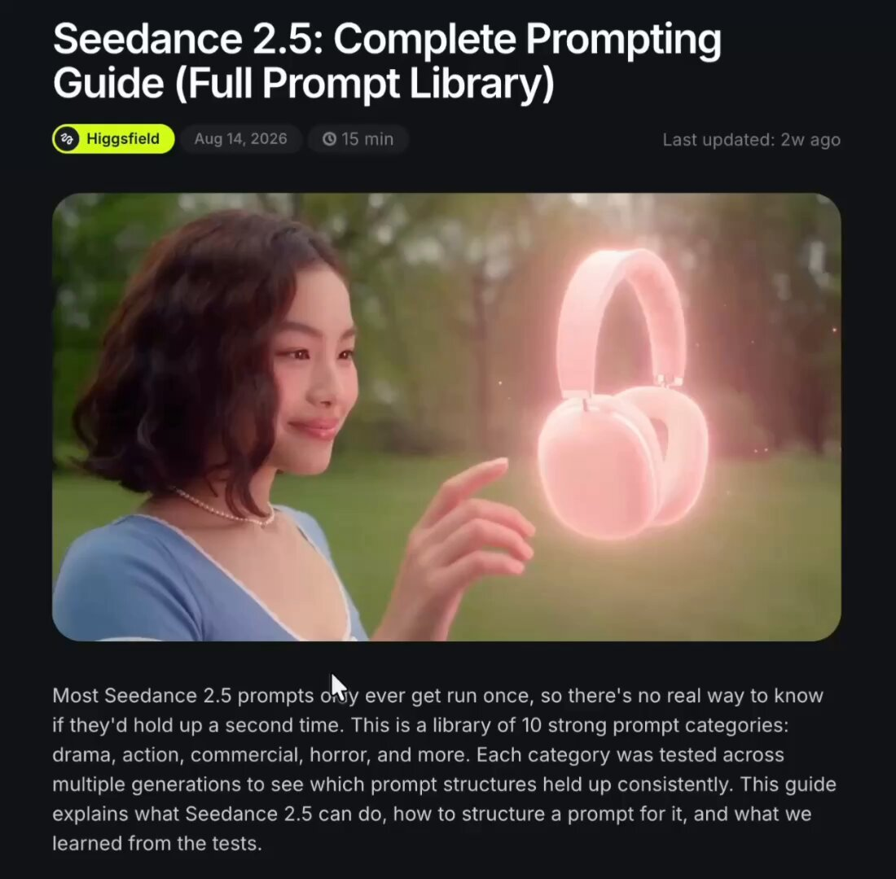

# 힉스필드가 Seedance 2.5 프롬프트 작성법과 장르별 예제 10개를 영상과 함께 정리해둠 핵심은 프롬프트를 ‘촬영 지시서’처럼 설계하는 것 전체 스타일 → 장면·인물·장소 → 시작 위치 → 컷별 행동 →

> Source: https://x.com/VibeEverything/status/2101262397172494576 — LOOPY (@VibeEverything) — Posted: 2026-09-19T10:49:29Z — Stats (at capture): 29,654 views · 557 likes · 27 replies · 108 reposts · 922 bookmarks · 1 quotes · Twitter Web App — Captured: 2026-09-21T12:44:36Z

## Post

**Author:** LOOPY (@VibeEverything)
**URL:** https://x.com/VibeEverything/status/2101262397172494576

힉스필드가 Seedance 2.5 프롬프트 작성법과
장르별 예제 10개를 영상과 함께 정리해둠

핵심은 프롬프트를 ‘촬영 지시서’처럼 설계하는 것

전체 스타일 → 장면·인물·장소 → 시작 위치 
→ 컷별 행동 → 카메라·조명·소리 순으로 구체화함

드라마·액션·광고·UGC 등 예제마다
설정 이유와 실제 사용한 프롬프트까지 있음

이 가이드의 구조를 스킬화하거나
템플릿으로 만들어 사용하면 아이디어와 소재를 바꿔도
필요한 설정을 놓치지 않고 프롬프트를 짤 수 있음

X-provided English translation (as displayed on x.com):

Higgsfield has compiled Seedance 2.5 prompt writing techniques and 10 genre-specific examples with videos.

The key is designing prompts like a 'shooting directive.'

Overall style → Scene·Characters·Location → Starting position → Cut-by-cut actions → Camera·Lighting·Sound, specified in that order.

For examples in drama·action·advertising·UGC, etc., it includes the reasoning behind the settings and the actual prompts used.

If you turn this guide's structure into a skill or make it into a template for use, even if you swap out ideas and materials, you can craft prompts without missing the necessary settings.

## Media

[media/media_0.mp4](media/media_0.mp4)

Original video: https://video.twimg.com/amplify_video/2101260625313992704/vid/avc1/732x720/LbkYexEJxBdAxvug.mp4?tag=29 (732×720, 30.5s)
Poster: https://pbs.twimg.com/amplify_video_thumb/2101260625313992704/img/nW1ytWpuRzh-28nK.jpg

## Thread

27 replies counted; no author self-replies visible in rendered conversation at capture.

## Comments

### @OluchiiCreates, 2026-09-21T08:32:10.000Z ([link](https://x.com/OluchiiCreates/status/2101952615978266717))

> This is cool. Once you think in terms of a shooting directive, you’re designing the visual logic of the scene, not just describing what you want the model to generate.

### @Viniai_, 2026-09-19T14:57:21.000Z ([link](https://x.com/Viniai_/status/2101324772433117314))

> Prompts as a shooting directive, lovely way to frame it.

### @Convergence_SH, 2026-09-19T11:35:47.000Z ([link](https://x.com/Convergence_SH/status/2101274049754304880))

> 꿀꿀팁

### @ByJULES282563, 2026-09-19T20:08:16.000Z ([link](https://x.com/ByJULES282563/status/2101403019480817697))

> Cool

### @afrinxai, 2026-09-19T11:48:52.000Z ([link](https://x.com/afrinxai/status/2101277339258880067))

> shooting directive is smart approach for video generation.

### @aiseomastery, 2026-09-19T23:52:55.000Z ([link](https://x.com/aiseomastery/status/2101459555641385269))

> Shooting directive is a smart way to think about prompts.

### @SubrotaCB, 2026-09-20T10:50:58.000Z ([link](https://x.com/SubrotaCB/status/2101625159530778961))

> Give me illustration prompt

