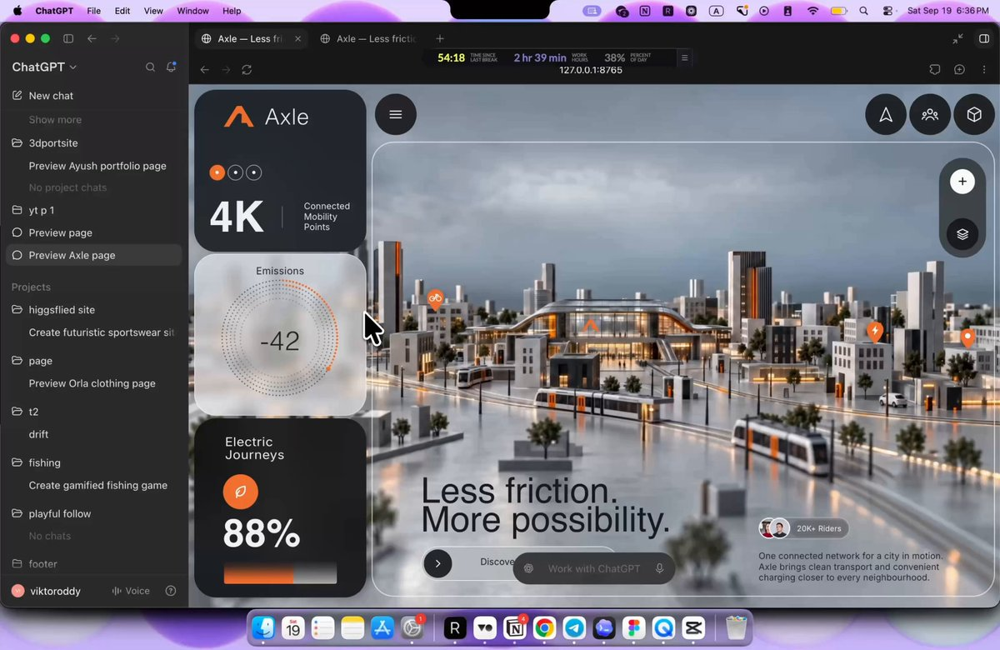

# GPT-6 Astra is by far the best 3D design model today. & this is THE Complete Tutorial Guide to Design in Codex. FULL

> Source: https://x.com/viktoroddy/status/2101275801660662058 — Viktor Oddy (@viktoroddy) — Posted: 2026-09-19T11:42:45Z — Stats (at capture): 138,058 views · 1,829 likes · 60 replies · 196 reposts · 2,067 bookmarks · 5 quotes · Twitter Web App — Captured: 2026-09-21T12:44:36Z

## Post

**Author:** Viktor Oddy (@viktoroddy)
**URL:** https://x.com/viktoroddy/status/2101275801660662058

GPT-6 Astra is by far the best 3D design model today.
& this is THE Complete Tutorial Guide to Design in Codex.

FULL guide you need to know about Codex and GPT-6 to start using it for design work and 3D creative work.

## Media

[media/media_0.mp4](media/media_0.mp4)

Original video (360p archive of 577s tutorial; full-res 3324×2160 original): https://video.twimg.com/amplify_video/2101275314928467968/vid/avc1/554x360/zAnFYiMTK77MROrS.mp4?tag=29 (554×360, 577s)
Poster: https://pbs.twimg.com/amplify_video_thumb/2101275314928467968/img/lN1AnooC_EN9mhEY.jpg

## Thread

60 replies counted; no author self-replies visible in rendered conversation at capture.

## Comments

### @TECHNOLOGY51931, 2026-09-19T13:24:12.000Z ([link](https://x.com/TECHNOLOGY51931/status/2101301330992075226))

> Yes I think so!
> 
> But today the costs are very high!
> 
> The next AI which give to consumers quality and 5-6 days of continuus work, will be the winner.
> 
> 'Destroying' all others.

### @Mas_simooo, 2026-09-19T15:50:51.000Z ([link](https://x.com/Mas_simooo/status/2101338239231492412))

> Ok the "-42 emissions / 88% electric journeys" dashboard detail is a nice touch, feels like an actual product not just a render

### @delx369, 2026-09-19T12:06:58.000Z ([link](https://x.com/delx369/status/2101281893631287473))

> GPT-6 Astra as the best 3D design model is a loud claim. the quieter receipt is a Codex tutorial longer than most people's actual design brief.

### @NextGenByGreg, 2026-09-19T15:59:27.000Z ([link](https://x.com/NextGenByGreg/status/2101340403316220074))

> The jump is real.

### @itsthedonhashim, 2026-09-19T17:15:00.000Z ([link](https://x.com/itsthedonhashim/status/2101359412929511846))

> @viktoroddy
>  diving into Codex for 3D design was a game-changer for me. at first, I thought I'd need more traditional tools, but it's crazy how intuitive it gets once you start.

### @camilocarlone, 2026-09-19T12:13:34.000Z ([link](https://x.com/camilocarlone/status/2101283558329295170))

> Looks great !

### @Timur_Yessenov, 2026-09-19T13:03:56.000Z ([link](https://x.com/Timur_Yessenov/status/2101296233293959576))

> The first 3D render is the easy sell. What happens on revision 3 when you move one object without the rest of the scene drifting?

### @ZoeWang001, 2026-09-20T06:37:04.000Z ([link](https://x.com/ZoeWang001/status/2101561263499116849))

> The exciting part is that 3D creation is becoming more conversational and iterative. The real advantage goes to designers who can turn taste and direction into a clear workflow with these tools.

### @I_Rohsni, 2026-09-19T15:43:45.000Z ([link](https://x.com/I_Rohsni/status/2101336451212587460))

> The quality on this 3D generation is insane! Saving this tutorial for later.

### @OWilson_bee, 2026-09-20T09:11:23.000Z ([link](https://x.com/OWilson_bee/status/2101600097452912732))

> This really opens up exciting possibilities for 3D creators.

### @liboar, 2026-09-20T11:54:55.000Z ([link](https://x.com/liboar/status/2101641252441608577))

> Slop

