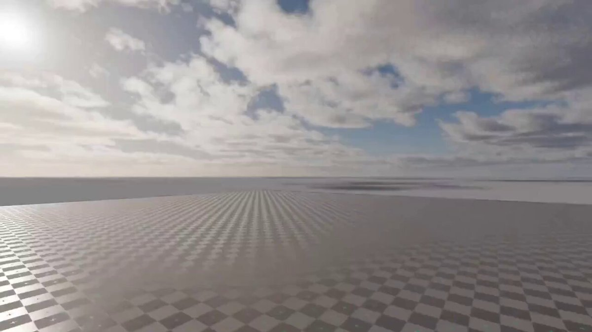

# Is physically accurate spectral atmosphere in 3D renders actually worth the extra computation cost?

> Source: https://x.com/3DxDEV7/status/2101276870423576600 — 3DxDEV (@3DxDEV7) — Posted: 2026-09-19T11:47:00Z — Stats (at capture): 7,922 views · 188 likes · 1 replies · 9 reposts · 116 bookmarks · 0 quotes · Twitter Web Client — Captured: 2026-09-21T12:44:36Z

## Post

**Author:** 3DxDEV (@3DxDEV7)
**URL:** https://x.com/3DxDEV7/status/2101276870423576600

Is physically accurate spectral atmosphere in 3D renders actually worth the extra computation cost?

Physical Addons released Physical Atmosphere² for Blender—a complete rebuild of their hugely popular Physical Starlight and Atmosphere add-on.

Instead of simple sky domes or static HDRI maps, it calculates true spectral atmospheres with multiple light scattering, realistic ozone absorption, and customizable air pollution levels. It even works at orbital scale, allowing seamless transitions from ground level all the way to outer space.

Do you prefer physically calculated spectral skies in Blender, or do you still rely on traditional HDRI environment maps?

🔗 https://superhivemarket.com/products/physical-atmosphere/?ref=8235

## Media

[media/media_0.mp4](media/media_0.mp4)

Original video: https://video.twimg.com/amplify_video/2101186043621883904/vid/avc1/1280x720/5Z3l5jB3LrWChI67.mp4?tag=29 (1280×720, 16.1s)
Poster: https://pbs.twimg.com/amplify_video_thumb/2101186043621883904/img/RVWqsBuda3w_sJxg.jpg

## Thread

1 reply counted; no author self-replies visible in rendered conversation at capture.

## Comments

1 reply counted at capture; the reply itself did not render in session — page showed only suggested posts.

## Links

- https://superhivemarket.com/products/physical-atmosphere/?ref=8235
