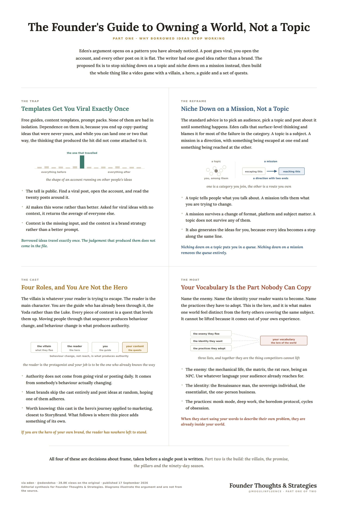
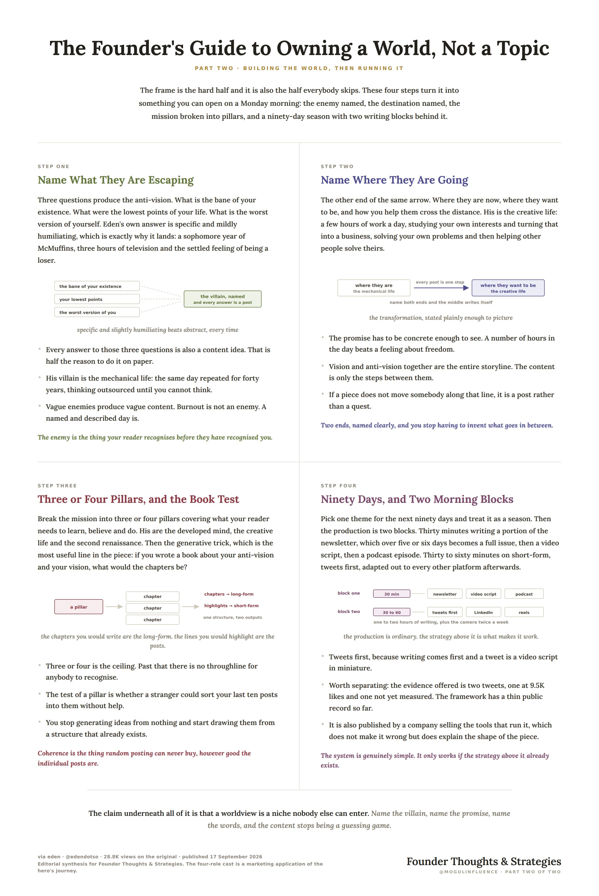
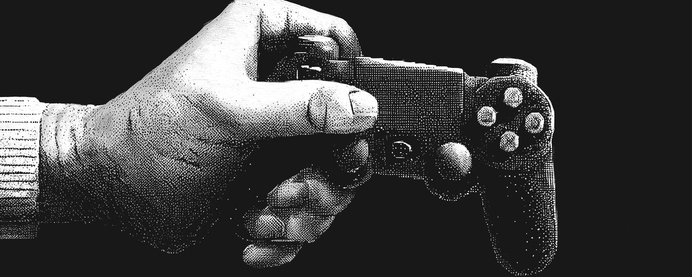

# The entrepreneur’s ultimate 5-step branding masterclass for building a monopoly NO competitor can copy:

> Source: https://x.com/mogulinfluence/status/2101312653792624710 — Founder Thoughts & Strategies (@mogulinfluence) — Posted: 2026-09-19T14:09:11Z — Stats (at capture): 16,464 views · 200 likes · 1 replies · 17 reposts · 345 bookmarks · 1 quotes · Twitter Web App — Captured: 2026-09-21T12:44:36Z

## Post

**Author:** Founder Thoughts & Strategies (@mogulinfluence)
**URL:** https://x.com/mogulinfluence/status/2101312653792624710

The entrepreneur’s ultimate 5-step branding masterclass for building a monopoly NO competitor can copy:

## Media

Originals: https://pbs.twimg.com/media/HSlclUyXQAAy3O9.jpg?name=orig (2480×3710), https://pbs.twimg.com/media/HSlclsZW4AAe3Tt.jpg?name=orig (2480×3710)
Quoted article cover: https://pbs.twimg.com/media/HSbd4MLWoAA6tH5.jpg?name=orig (1920×768)

## Quoted post

[eden (@edendotso), 2026-09-17T15:39:37Z](https://x.com/edendotso/status/2100610633125314975) — 48,122 views · 409 likes · 13 replies · 31 reposts · 826 bookmarks · 4 quotes · Twitter Web App

> Create an Uncopyable Personal Brand in 90 Days https://x.com/i/article/2100609878062493697

Quoted X article: [Turn Your Brand Into a Video Game That People Can't Stop Playing](https://x.com/i/article/2100609878062493697)

Most creators, especially beginners, fall into the same trap.

They download free guides, content templates, Claude skills, and they don’t really learn or internalize the fundamentals of branding and content.

Templates aren’t a bad thing, but when you become dependent on them, when you’re copy-pasting viral ideas that aren’t yours, you might go viral once or twice but you won’t be able to sustain it.

There isn’t a day that goes by where I don’t see a viral post (a reel, tweet, Substack note, anything), then go check the account that posted it and see that the rest of their content has abysmal engagement.

That’s not a dig at them. I’m pointing it out to say that this doesn’t have to happen.

AI makes this specific problem worse, not better.

People treat it like Google and ask it for “viral ideas” with zero context.

That’s not how AI works, you need context, the right context.

And that context is your brand strategy.

Once you have a brand strategy, you can go back to it time and time again. It becomes the filter, the umbrella for every content idea you generate for YouTube, Substack, Twitter/X, Instagram threads, everything.

And if you have a very good brand strategy document, you can feed it to AI and it will come up with content ideas that nobody else can come up with. Because they’re just treating AI like a search engine while you’re giving it an entire world to work inside.

The goal of this newsletter is simple.

I’m going to show you how to turn your brand into a video game that your audience can step inside of.

A game with a villain, a main character, a guide, and quests.

When you build this right, it makes your brand stand out from everyone else and makes you very hard to compete with.

Stop Niching Down On A Topic. Niche Down On A Mission.

The common advice is to niche down.

Pick a target audience.

Pick a specific topic.

Post about that topic over and over.

That’s surface-level thinking, and it’s why most creators fail.

What actually works is niching down on a mission. A clear frame for everything inside your brand.

If you understand branding at all, you know you need a brand enemy, you need a brand vision, and you need everything in between. When you look at it through the lens of a video game, it clicks.

The villain is the enemy of your brand. The thing your reader is trying to escape.

The reader is the main character. Your content guides them through the storyline of avoiding the villain and reaching their ideal life.

You are the guide. Like Yoda in Star Wars or the Oracle in The Matrix. You’ve been through it. You’re showing them the way.

Your content is the quests. Each piece helps them level up. Put points in their skill tree. Adopt new beliefs, new skills, new habits.

Moving people through that process creates behavior change. Behavior change is what makes you the authority. Not going viral or posting every day. Helping people change their life is what makes them remember you, trust you, and want to buy from you.

Most brands just don’t have this. They post random ideas and hope something sticks.

For me, the villain of my brand is the mechanical life.

Repeating the same day for 40 to 60 years. Outsourcing your thinking to AI until you can’t think. Specializing into a silo until a machine replaces you. Waking up bored, anxious, and vaguely guilty with no idea why.

The promise on the other side is the creative life. Working 2 to 4 hours a day. Studying your interests and turning that into a business.

All of my content just helps people get from one to the other.

And we created Eden to help make it as easy as possible for people to get from one to the other.

But here’s the thing that makes you uncopyable.

Brand vocabulary.

You name the enemy so people can relate it to your brand every time they see it.

The mechanical life.

The matrix.

The rat race.

Being an NPC.

Whatever language fits your audience.

You name the character or the identity your reader wants to become.

The Renaissance man.

The sovereign individual.

The essentialist.

The one-person business evolving into the one-human business.

You name the practices they need to adopt.

Monk mode.

Deep work.

The boredom protocol.

Cycles of obsession.

This is the lore of your game, it’s what makes your world feel real and distinct from everyone else’s. Nobody else has your vocabulary, your concepts become the language your audience speaks. And when they start using your words to describe their problems, they’re already inside your world.

Think about it this way, the best brands don’t just post content.

They create a worldview.

A world for people to come in and explore.

You’re not trying to go viral, you’re trying to create a micro cinematic universe for people to dive into.

The movies are your long-form content. The YouTube videos, the newsletters, the articles.

The spin-off shows are your short-form content. The tweets, the Instagram posts, the LinkedIn posts.

The action figures are your products and services.

Nobody buys an action figure from Marvel unless they’ve watched the movies and understand the universe. If you create this bingeable set of content, people are much more likely to buy what you’re selling. Because they already live inside your world.

How To Build Your Brand’s Video Game In 5 Steps

You can write all of this down manually, and I do recommend trying it.

You can also get a first draft flowing by using AI to brainstorm.

I’ve also conveniently made a couple of free Custom AIs that walk you through this whole process in Eden.

One for your brand strategy and one for world-building.

These are like prompts on steroids.

They have everything we’re talking about in this article loaded into them.

So you can just put them in your workspace, chat with them back and forth, and they’ll build everything out for you. Or run them in Claude, ChatGPT, or your AI of choice using the Eden MCP.

In any case treat the output as a prototype/first draft.

AI does not hurt your thinking unless you stop thinking.

You have to question the default output to make it better, to make it yours, and to understand it.

Step 1: Name Your Villain (Define The Anti-Vision)

Ask yourself three questions:

What is the bane of your existence? Paint a picture of the life you do not want to live.

What were the lowest points of your life? For me, it was sophomore year of college. I’d wake up at 9 a.m., drive to McDonald’s, get two sausage and egg McMuffins and an iced coffee. I’d come home, eat it, feel terrible, watch The Office for 3 hours, then do my online classes. I felt like a loser. It was horrible. And I never want to experience that again.

What is the worst version of yourself?

Here’s what most people don’t realize: all of your answers to these questions are content ideas. You just have to learn how to structure them as a post that will do well.

The enemy you name becomes the thing your reader relates to instantly. When I say “the mechanical life,” it sticks in their head. They come back to my content because that’s the world they want to escape from.

Step 2: Name The Promise (Define The Vision)

What does your reader’s ideal life look like? What’s the transformation?

This is the before and after. Where are they now, where do they want to be, and how are you helping them get there?

For me, the promise is the creative life. Working a few hours a day. Studying your interests. Turning that into a business. Being a creator in the truest sense, which means you improve yourself and then you help improve others. You solve your own problems and then you help solve other people’s problems. That is a meaningful way to live.

This becomes the destination your content guides them toward. Every piece of content should move them one step closer.

Step 3: Name Your Character And Your Lore (Build Your Brand Vocabulary)

This is where you stand out.

Name the identity your reader wants to become. The Renaissance man. The sovereign individual. The essentialist.

Name the enemy they’re escaping. The mechanical life. The matrix. The rat race. Being an NPC.

Name the practices they need to adopt. Monk mode. Deep work. The boredom protocol. Cycles of obsession.

This applies to everything. If you’re a creator who talks about finances and budgeting, create a process people can run through to get results and put a name on it. If you don’t know what name to use, that’s what AI helps you brainstorm. Then you pick the best one based on what fits your brand.

Your vocabulary is your moat. Nobody else can copy it because it comes from your experience, your philosophy, your worldview.

Step 4: Build Your Content Pillars

Break your mission into 3 to 4 pillars that cover what your reader needs to learn, believe, and do.

Mine are:

The developed mind (human potential)

The creative life (the ideal outcome)

The second renaissance (the big idea that ties it all together)

Here’s a useful frame for generating ideas from your pillars. If you were to write a book about your anti-vision and vision, what would the chapters be?

Those chapters become your long-form content ideas, and the quotes you’d highlight from those chapters become your short-form posts.

You’re no longer shooting out random posts hoping they work. You have coherence. A throughline. Every piece of content falls under your brand umbrella.

Step 5: Turn It Into A Content System

Pick a theme for the next 90 days.

Think of it like a season in a video game.

A specific theme for what’s going on in the game. All your content for the next 3 months falls under this umbrella.

My theme is the second renaissance. The next 90 days of my content are based around getting that idea across and helping people become the second Renaissance man. That’s the main character. That’s who my audience wants to become.

The system itself is simple:

Morning block 1 (30 minutes): Write a portion of your newsletter. Over 5 to 6 days, you have a full newsletter. That newsletter becomes your YouTube script. That video goes to all podcast platforms. One piece of content, written once, published everywhere.

Morning block 2 (30 to 60 minutes): Write short-form posts. Write tweets first, because writing comes first. A tweet is essentially a video script in miniature. Then adapt those posts for every platform. LinkedIn gets the Justin Welsh template treatment. Instagram gets an image post. Reels get recorded by looking at a tweet on screen, reading it, and riffing a bit more on camera.

That’s 1 to 2 hours of writing every morning, first thing, time-blocked. Plus turning the camera on twice a week for a YouTube video and reels.

It really is that simple. But the brand strategy has to be in place first. Because you can’t just be posting random ideas.

When it’s time to write, you open your brand strategy, look at your content ideas, pick one, and turn it into something you think will do well. The ideas are starting points. You still do the thinking. You still apply your taste.

And the results speak for themselves. I posted two tweets based on this strategy. One got 9.5K likes. The other is going to beat that by a long shot.

The most important thing I can leave you with is this. Don’t niche down on a topic, niche down on a mission.

Figure out your anti-vision and your vision.

Figure out the transformation you’re helping people achieve.

Name your enemy.

Name your character.

Name your practices.

Build the world.

Then every piece of content you create for the next 90 days filters through that frame. And that itself is a niche. That is a personal monopoly that nobody else can compete with, because they’re not even thinking on the same level.

Check out Eden

Custom AIs:

Personal Brand Strategist

World-Builder

## Thread

1 reply counted; no author self-replies visible in rendered conversation at capture.

## Comments

1 reply counted at capture; the reply itself did not render in session — page showed only suggested posts.

## Links

- https://x.com/edendotso/status/2100610633125314975
- https://x.com/i/article/2100609878062493697
