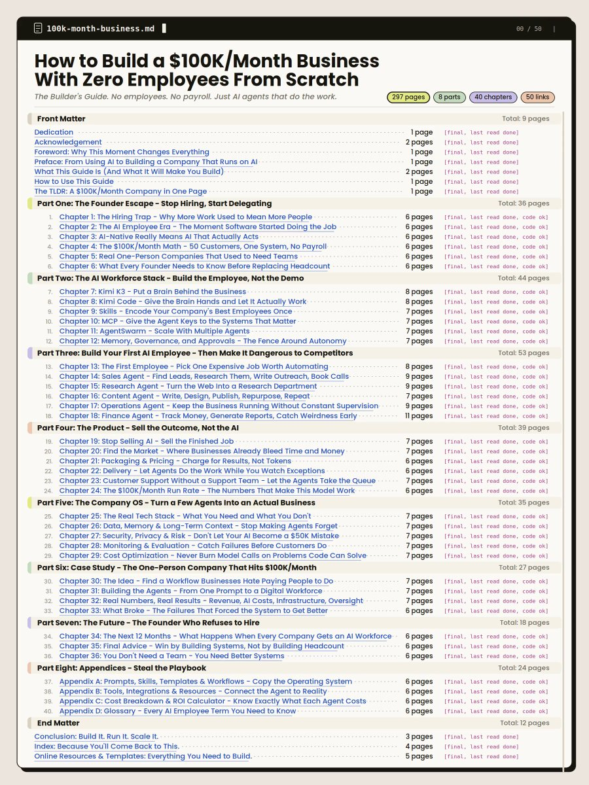
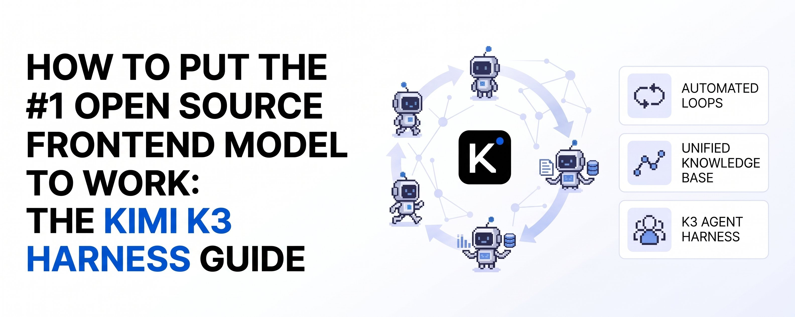

# this is straight f*cking gold 297 pages on building a $100K/month business with zero employees. 8 parts, 40 chapters,

> Source: https://x.com/polydao/status/2101564766812786894 — Mr. Buzzoni (@polydao) — Posted: 2026-09-20T06:51:00Z — Stats (at capture): 21,269 views · 245 likes · 17 replies · 34 reposts · 360 bookmarks · 1 quotes · Twitter Web Client — Captured: 2026-09-21T12:44:36Z

## Post

**Author:** Mr. Buzzoni (@polydao)
**URL:** https://x.com/polydao/status/2101564766812786894

this is straight f*cking gold

297 pages on building a $100K/month business with zero employees. 8 parts, 40 chapters, 50 links

founders are still paying people to research leads, update CRMs and write reports while the AI sits off to the side handing out suggestions

the stack it walks you through:

> Kimi K3 - the brain running the business
> Kimi Code - the hands doing the work
> Skills - encode your best employee once, reuse them forever
> MCP - keys to the systems that actually matter
> AgentSwarm - turn one agent into a workforce

there's a full case study inside: the idea, the agents, real revenue and infra numbers, plus everything that broke along the way

growth used to scale with payroll

now it scales with how many expensive workflows you can pull out without breaking anything

one founder + the right systems = $100K/month, minus the payroll that always came with it

## Media

[media/media_0.mp4](media/media_0.mp4)

Original video: https://video.twimg.com/amplify_video/2101462736433508352/vid/avc1/720x960/qB_JsAbW84K5JRw7.mp4?tag=29 (720×960, 16s)
Poster: https://pbs.twimg.com/amplify_video_thumb/2101462736433508352/img/0LGwH1DkWJuYyYLH.jpg
Quoted article cover: https://pbs.twimg.com/media/HSYfZ7mXkAA3kjH.jpg?name=orig (3168×1267)

## Quoted post

[Mr. Buzzoni (@polydao), 2026-09-17T11:06:45Z](https://x.com/polydao/status/2100541964747747661) — 390,928 views · 136 likes · 17 replies · 21 reposts · 273 bookmarks · 14 quotes · Twitter Web App

> https://x.com/i/article/2100348544183869440

Quoted X article: [How to Put the #1 Open Source Frontend Model to Work: The Kimi K3 Harness Guide](https://x.com/i/article/2100348544183869440)

Prompt, context, loop and graph engineering each turned out to be one piece of the same machine. The harness is where they finally live together.

Every stretch of building with AI got its own job title. Prompt engineering came first, back when the whole craft was finding the right sentence.

Context engineering followed, once it became obvious the sentence mattered less than everything loaded around it. This summer it was loops, and a few weeks later, graphs.

The name spreading now is harness engineering, and it's the first one that explains all the others.

A harness is everything around the model: the tools it can call, the files it reads before anything else, the directories it may write to, the check its output has to pass, the schedule that wakes it up and the rule that ends the run.

Each discipline before this one turns out to be a single component of that frame, built separately and given its own name.

I started paying attention for a practical reason. The model underneath keeps changing, sometimes by seventeen leaderboard places in a single update, and the harness is the only part of the system that stays yours.

1/ Seven Engineerings, One Machine

Read the table top to bottom and it's a history. Read it bottom to top and it's an architecture: harness engineering is the job of deciding where each of the other six lives, so that none of them ends up hiding in a prompt.

That last point carries most of the weight. 
A prompt is the easiest place to put anything, so everything drifts into it: the output format, the stopping rule, last week's corrections, the list of things the agent must never touch. It works beautifully on the model you wrote it for, and then the next model reads the same paragraph differently.

2/ Anatomy of a Harness

The most useful habit I've picked up is writing the whole harness down as one config file, so nothing important stays implicit:

Three lines in that file do most of the work.

model: is one line on purpose. Everything else is written so it doesn't care what that line says. That is the whole portability story.

permissions: matters more than tools:, even though it sits lower in the file. Writing down what the agent may change and what it has to ask about first is what separates a system you leave running overnight from one you sit and watch.

verify: has two entries for a reason. The script costs nothing and catches anything mechanical. The reviewer is a second agent that never saw the first one work, because an agent grading its own output finds every reason to approve it.

On disk, the harness is one folder, and every engineering from the table gets its own address in it.

3/ Why Kimi K3 Is the Engine I'd Put in It

The first row matters more than it looks. Almost every homemade harness grows a hand-built orchestrator at some point, and it's usually the most fragile file in the folder. With the swarm, fan-out becomes a budget line, agents: 300, and the harness only has to handle what comes back.

The second row matters because a harness is mostly code the model writes for you: hook scripts, schema checks, the small dashboard that reads 40-runs. An engine that leads the frontend arena gets those right on the first pass far more often.

The third row is the case for harness engineering in one data point. When a model climbs seventeen places overnight, a harness puts that climb to work the same day, because the only line that has to change is model.

4/ Hooks: The Reflexes

A hook is a short script the harness runs at a fixed moment, whatever the model decides to do. Hooks are where a harness stops being a folder layout and starts behaving like a safety system.

The pre_tool hook from the first row fits in five lines:

The on_fail hook alone changes the economics of a loop. A retry that carries the reason the last attempt failed is a correction. Without that reason, the loop pays for the same mistake a second time.

5/ What a Night Looks Like

Put every piece together and the harness behaves like a night shift that follows rules. At 02:00 the trigger fires and the launch query picks every node that needs work. The swarm fans out, one agent per node.

Returns that miss the schema get rejected by post_tool before they reach the graph, and each rejected node retries once with its failure reason attached. When one agent tries to write outside its folder, pre_tool stops it without waking anyone.

Merged nodes and typed edges land in 20-graph. A drafted email reaches pre_send and waits. post_run appends the record, and the loop stops on its own condition, well inside the 45-minute budget from the config.

At 07:30 you read one file and make two decisions. That is the entire morning cost of running loop engineering and graph engineering this way, and it's the whole point of the harness: everything that could run without you did, and the few things that needed you are waiting in one place.

6/ The Swap Test

The fastest audit of any agent setup: change the model line and run it again. Whatever breaks was harness living in the wrong place.

A setup that passes the swap test is portable, and portable is what makes it worth money.

What It Costs and What It Pays

Companies put whole quarters into internal agent platforms. A working harness is one folder, one config file and five short scripts, and it runs on a Kimi subscription. That gap is the opportunity.

The second channel is the one I'd build first. Every major release reshuffles the leaderboard, K3 alone moved seventeen places in one update, and every team with a harness needs someone whose job is to run the swap test on release day.

The Short Version

Prompt, context, tool, loop, graph and eval engineering all turn out to be components of one machine, and harness engineering is deciding where each of them lives.

Put the model behind one line, permissions ahead of tools and the verifier outside the agent. Then the next leaderboard jump is a config change instead of a rebuild.

And if you found this useful:

Bookmark this article. The links change and new repos pop up weekly, you'll need this as a reference

For weekly deep dives into AI architecture, quant trading, and the agent economy, follow me: @polydao

Join the TG Channel: Buzzoni Notes - here I share my raw prompts, custom skills, and alpha that's too early for X

## Thread

17 replies counted; no author self-replies visible in rendered conversation at capture.

## Comments

### @thorbjornron, 2026-09-20T09:18:08.000Z ([link](https://x.com/thorbjornron/status/2101601795231695210))

> Systems replace headcount fast.

### @agentpilled_xyz, 2026-09-20T11:38:25.000Z ([link](https://x.com/agentpilled_xyz/status/2101637097740268005))

> yeah, crowd-source the whole economy

### @aiseomastery, 2026-09-21T02:17:06.000Z ([link](https://x.com/aiseomastery/status/2101858225889128617))

> Is zero employees actually possible?

### @G_rantChen, 2026-09-21T10:56:02.000Z ([link](https://x.com/G_rantChen/status/2101988820984180997))

> Link to repo?

### @knowixbuilds, 2026-09-20T23:58:30.000Z ([link](https://x.com/knowixbuilds/status/2101823348543991939))

> I’ve been thinking about this a lot lately, because AI doesn’t need to replace an entire employee for the numbers to change
> 
> taking five or six recurring workflows off someone’s plate can already make a huge difference

### @kocer_eth, 2026-09-20T13:39:50.000Z ([link](https://x.com/kocer_eth/status/2101667652531794264))

> this is actually one of the cleaner breakdowns ive seen on running stuff with agents

## Links

- https://x.com/polydao/status/2100541964747747661
- https://x.com/i/article/2100348544183869440
