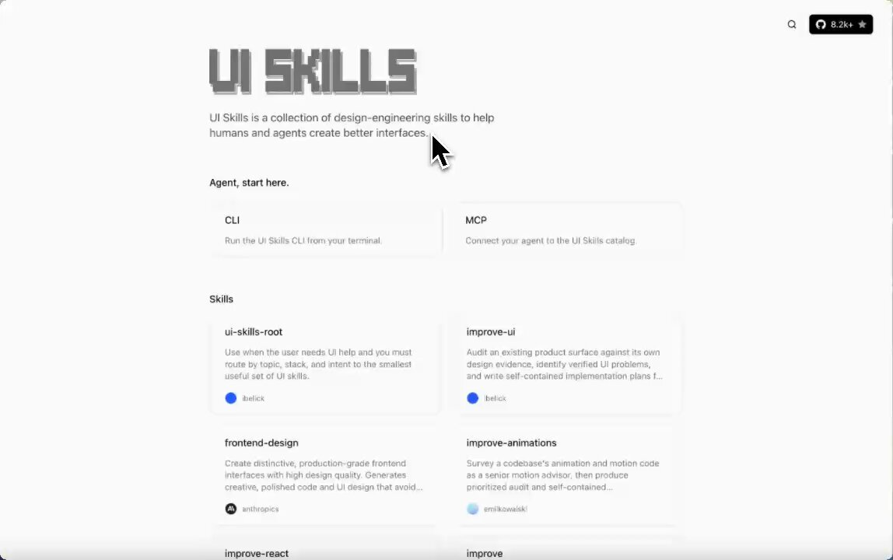

# 7 UI skills every design engineer should know when building with AI agents:

> Source: https://x.com/neropursue/status/2101613613949542838 — Nero (@neropursue) — Posted: 2026-09-20T10:05:06Z — Stats (at capture): 38,378 views · 905 likes · 26 replies · 114 reposts · 1,312 bookmarks · 3 quotes · Twitter Web App — Captured: 2026-09-21T12:44:36Z

## Post

**Author:** Nero (@neropursue)
**URL:** https://x.com/neropursue/status/2101613613949542838

7 UI skills every design engineer should know when building with AI agents:

1. emil-design-eng
https://www.ui-skills.com/skills/emilkowalski/emil-design-eng
2. make-interfaces-feel-better
https://www.ui-skills.com/skills/jakubkrehel/make-interfaces-feel-better
3. playwright-cli
https://www.ui-skills.com/skills/microsoft/playwright-cli
4. react-doctor
https://www.ui-skills.com/skills/millionco/react-doctor
5. fixing-accessibility
https://www.ui-skills.com/skills/ibelick/fixing-accessibility
6. 12-principles-of-animation
https://www.ui-skills.com/skills/raphaelsalaja/12-principles-of-animation
7. shadcn
https://www.ui-skills.com/skills/shadcn-ui/shadcn

## Media

[media/media_0.mp4](media/media_0.mp4)

Original video: https://video.twimg.com/amplify_video/2101613025752936448/vid/avc1/1148x720/CI2PZJ-8f1mi8NYW.mp4?tag=29 (1148×720, 34.7s)
Poster: https://pbs.twimg.com/amplify_video_thumb/2101613025752936448/img/2KIxbGNOg83BevpL.jpg

## Thread

26 replies counted; no author self-replies visible in rendered conversation at capture.

## Comments

### @lokidotdev, 2026-09-20T12:00:16.000Z ([link](https://x.com/lokidotdev/status/2101642595629953238))

> Adding these to

### @RobinHill85, 2026-09-20T17:36:22.000Z ([link](https://x.com/RobinHill85/status/2101727181260935251))

> shadcn UI is a solid addition, the animation principles keep agents from feeling static

### @_mmdsharifi, 2026-09-20T20:00:10.000Z ([link](https://x.com/_mmdsharifi/status/2101763366867923064))

> Great skills, thanks for sharing.
> Also chrome mcp is awesome for automating browser testing

## Links

- https://www.ui-skills.com/skills/emilkowalski/emil-design-eng
- https://www.ui-skills.com/skills/jakubkrehel/make-interfaces-feel-better
- https://www.ui-skills.com/skills/microsoft/playwright-cli
- https://www.ui-skills.com/skills/millionco/react-doctor
- https://www.ui-skills.com/skills/ibelick/fixing-accessibility
- https://www.ui-skills.com/skills/raphaelsalaja/12-principles-of-animation
- https://www.ui-skills.com/skills/shadcn-ui/shadcn
