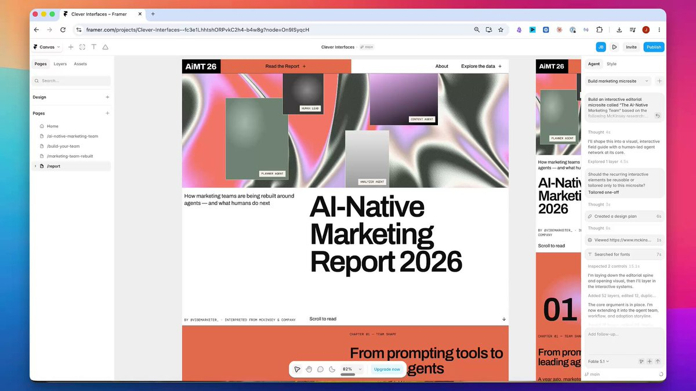

# McKinsey wrote a whole report about the AI-native marketing team. most good research gets consumed once and then

> Source: https://x.com/VibeMarketer_/status/2101675727473025297 — J.B. (@VibeMarketer_) — Posted: Sun Sep 20 14:11:55 +0000 2026 — Stats (at capture): 12,252 views · 169 likes · 41 replies · 62 reposts · 52 bookmarks · 0 quotes · Twitter Web App — Captured: 2026-09-21T13:29:16Z

## Post

**Author:** J.B. (@VibeMarketer_)
**URL:** https://x.com/VibeMarketer_/status/2101675727473025297
**Bio:** ai systems for content, media, and growth

McKinsey wrote a whole report about the AI-native marketing team.

most good research gets consumed once and then disappears into the content void.

for growth marketers, that feels like a waste. the same idea can travel a lot further when you rethink the format, not just the message.

so I gave it to @framer's Agent and asked it to make the report interactive.

it turned the research into a visual field guide for what an agentic marketing org could actually look like

all built + iterated directly inside Framer

feels like a much more interesting way to consume research than another 20-page PDF

## Media

[media/media_0.mp4](media/media_0.mp4) —  — Original: https://video.twimg.com/amplify_video/2101675495980986368/vid/avc1/1920x1080/WfRDr8ZtvsxZHzwn.mp4?tag=29 (1920×1080, 54.592s) — Poster: https://pbs.twimg.com/amplify_video_thumb/2101675495980986368/img/6wMBTRuDU7YJ3J7g.jpg

## Thread

41 replies counted; no author self-replies visible in rendered conversation at capture.

## Comments

### Kami ([@hassnainmhr](https://x.com/hassnainmhr)) — [2101688495542878521](https://x.com/hassnainmhr/status/2101688495542878521)

> The vid looks good Gonna try it out thx

### Tibro ([@sharmatibro](https://x.com/sharmatibro)) — [2101697445826871714](https://x.com/sharmatibro/status/2101697445826871714)

> Im definitely stealing this setup for my own projects lol

### micha 𖹭 ([@heyitsahcim](https://x.com/heyitsahcim)) — [2101688987803160995](https://x.com/heyitsahcim/status/2101688987803160995)

> Parody account
> already imagining how much faster my proposals would be with this

### Earning ZoneUXLINK $XAGE ([@0xEarning_Zone](https://x.com/0xEarning_Zone)) — [2101830270404170066](https://x.com/0xEarning_Zone/status/2101830270404170066)

> the visual field guide concept beats static docs every time

### Billycrypt ([@Billlymkk](https://x.com/Billlymkk)) — [2101702946689794169](https://x.com/Billlymkk/status/2101702946689794169)

> already thinking about which project to start with here

### lg ([@LaneyGrey11](https://x.com/LaneyGrey11)) — [2101693080835420638](https://x.com/LaneyGrey11/status/2101693080835420638)

> gonna test this with my content backlog this weekend

### meri ⋆ ᡣ𐭩 ([@chaeyoungz__](https://x.com/chaeyoungz__)) — [2101891720611033373](https://x.com/chaeyoungz__/status/2101891720611033373)

> pulling customer conversations into proposals automatically is HUGE

### David T Kramaley ([@simplydt](https://x.com/simplydt)) — [2101711527753474224](https://x.com/simplydt/status/2101711527753474224)

> nice work, the interactive format turns a one‑off read into a reusable tool, keeps research alive longer

### Lev Ichansky ([@Lev200200](https://x.com/Lev200200)) — [2101687299490607603](https://x.com/Lev200200/status/2101687299490607603)

> The format is the message. A 20-page PDF dies in a tab. A page people can stay on - lives longer, feels different.

### postAA ([@Btcholderr](https://x.com/Btcholderr)) — [2102020027700642013](https://x.com/Btcholderr/status/2102020027700642013)

> Making research interactive instead of static changes everything

### Drop_X ([@anikraj420](https://x.com/anikraj420)) — [2101914310176125399](https://x.com/anikraj420/status/2101914310176125399)

> The great

## Links

None.
