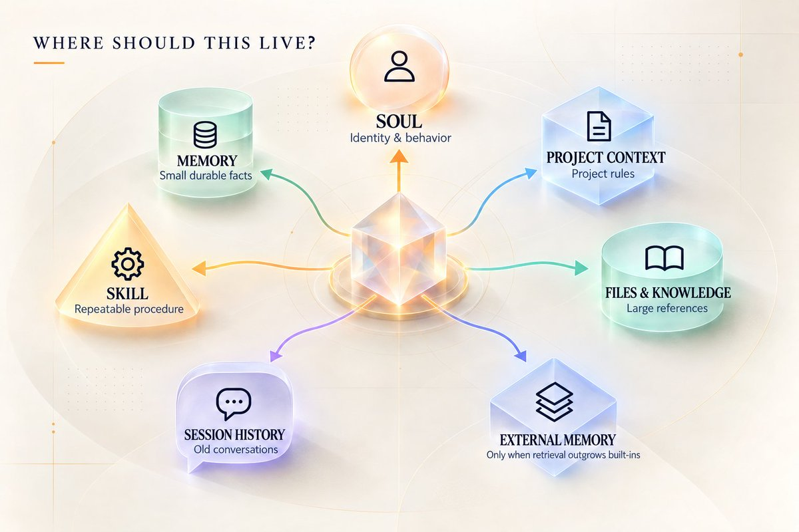
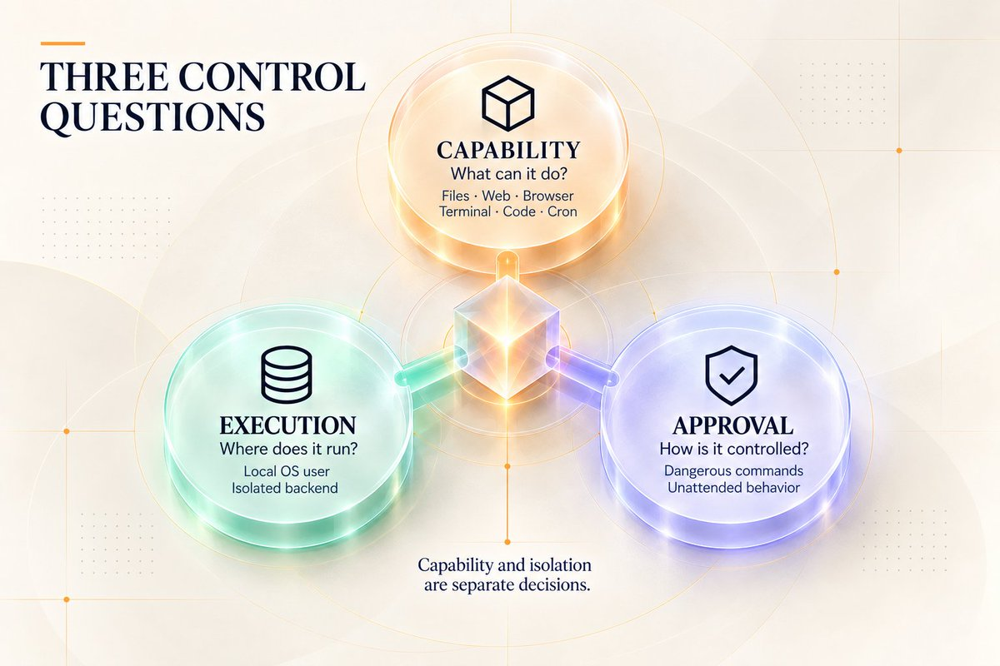
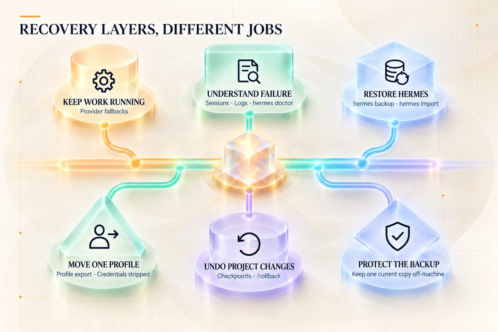
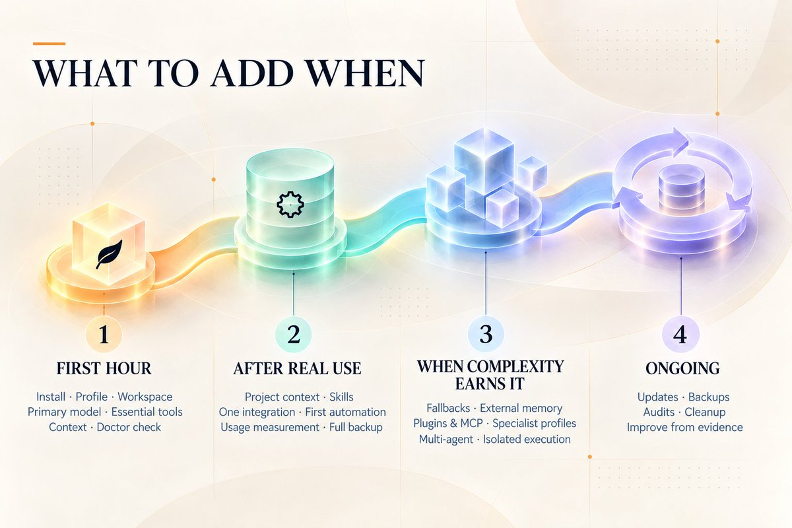
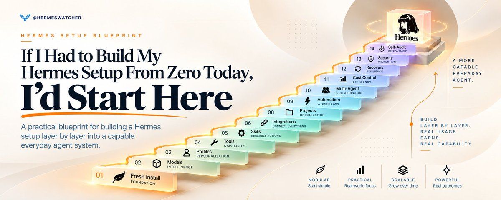

# If I Had to Build My Hermes Setup From Zero Today, I’d Start Here
> Source: https://x.com/HermesWatcher/status/2101884812189684015
> Author: Hermes Release Watch (@HermesWatcher)
> Posted: 2026-09-21T04:02:45+00:00
> Captured: 2026-10-15T09:02:28+00:00
> Stats at capture: 146,974 views · 574 likes · 18 replies · 48 reposts · 1,425 bookmarks · 7 quotes

## Post

https://x.com/i/article/2101881415273164800

## Article: If I Had to Build My Hermes Setup From Zero Today, I’d Start Here

If my Hermes setup disappeared tomorrow and I had to rebuild it from a clean install, I would not start by reinstalling every Skill I know, creating a dozen profiles, or reconnecting every service.

Installation gets Hermes running. The harder part is deciding what deserves to exist around it.

I want a setup that is organized, connected, cost-aware, recoverable, maintainable, and able to help inspect itself after real use.

So I would rebuild Hermes in layers.

Not every feature. Not every integration. Not maximum complexity on day one.

These are the 14 areas I would make decisions about before I called the setup done:

1. Foundation: stable base

1. Models: primary intelligence and routing

1. Memory & Context: where information belongs

1. Agent Structure: who owns the work

1. Tools & Permissions: what Hermes may do

1. Skills: reusable procedures

1. Plugins, MCP & Integrations: external capability

1. Projects & Knowledge: durable workspaces

1. Automation: work that runs again

1. Multi-Agent Workflows: independent reasoning and coordination

1. Cost & Token Optimization: where intelligence is being spent

1. Reliability & Recovery: inspection and restoration

1. Security & Maintenance: boundaries and upkeep

1. Make Hermes Audit Itself: improve from real usage

You do not need to max out all 14.

The useful question is simpler: what belongs now, what should wait, and what signal tells you the next layer has earned its place?

## Stage 1: Build the base

### 1. Foundation: get one clean Hermes setup working

Before memory, multi-agent workflows, MCP, or automation, I would make sure the boring foundation is solid.

Start with:

- one working Hermes install

- one main profile

- one known working directory

- one provider and model that can complete a normal conversation

- a basic understanding of where configuration and credentials live

That is enough.

Profiles matter too, but I would not multiply them early. A [Hermes profile](https://hermes-agent.nousresearch.com/docs/user-guide/profiles/) separates Hermes-managed state such as configuration, memory, sessions, Skills, cron jobs, logs, and related profile data.

It does not automatically turn that profile into a filesystem sandbox.

That distinction matters later when terminal and file access enter the picture.

My starting rule:

One primary profile until something genuinely needs its own long-lived state.

Also know the working directory Hermes is operating from. Profile identity and working directory are separate decisions. A profile can own the agent state while terminal work starts somewhere completely different.

Useful first checks:

- hermes setup

- hermes config

- hermes status

- hermes doctor

Do not build the rest of the system around a foundation you do not understand.

### 2. Models: choose one brain first

Hermes separates the model handling the main agent conversation from auxiliary model jobs that support things like compression, vision, approvals, routing, titles, Skill search, and other background tasks.

Start with one primary model you trust for the main work.

Let auxiliary slots stay on their default automatic behavior until cost, latency, or task quality gives you a reason to change them.

Hermes can also maintain [fallback provider and model routes](https://hermes-agent.nousresearch.com/docs/user-guide/features/fallback-providers/). Those become worth configuring when a rate limit, provider outage, credential issue, or another qualifying failure should not stop the whole workflow.

Local versus cloud is a tradeoff, not a hierarchy. Use local when the hardware and workflow justify local inference. Use cloud when capability, convenience, or hardware limits matter more.

My order:

Primary model first.

Cheap or fast auxiliary routing later.

Fallbacks when continuity matters.

Local when there is a real reason for local.

Choose one brain first. Route later.

## Stage 2: Put information in the right place

### 3. Memory & Context: stop putting everything into “memory”

This is one of the first areas I would get right because it affects almost everything that follows.

Hermes has several places information can live, and they are not interchangeable.

I think about them like this:

SOUL: who the agent is and how it should generally behave.

Built-in memory: small durable facts and preferences worth carrying across sessions.

Project context: rules, conventions, and information that belong to a specific project or workspace.

Session history: the actual record of a conversation that can be resumed and searched later.

External memory: an optional retrieval layer when the built-in system no longer performs the job you need.

Hermes supports project context files including HERMES.md, .hermes.md, AGENTS.md, and other compatible formats. [Context files](https://hermes-agent.nousresearch.com/docs/user-guide/features/context-files) are where I would put instructions that belong to the work rather than the person.

A preference like “keep my summaries short” may belong in durable memory.

A rule like “all reports in this repository must cite primary sources” belongs much closer to the project.

A detailed procedure for producing that report probably belongs in a Skill.

And the 200-message conversation where you figured all of this out is still a session, not permanent memory.

Hermes also supports [external memory providers](https://hermes-agent.nousresearch.com/docs/user-guide/features/memory-providers), but I would not install one just to make the setup feel more advanced.

Start with built-in memory and good project context.

Add external memory only when you can clearly explain the missing job, such as larger semantic retrieval, deliberate shared memory between agents, or another provider-specific behavior you actually need.

### 4. Agent Structure: one agent until another one earns a permanent job

A fresh Hermes setup does not need an org chart.

Start with one primary profile and let it own the system.

When that agent needs temporary independent help, Hermes already has delegation. A delegated subagent gets a fresh conversation and its own working context, completes the bounded job, then returns the result to the parent.

That is different from creating another permanent profile.

Delegation makes sense for things like:

- parallel research

- an independent review

- separate coding or investigation branches

- work that would flood the main conversation with too much context

Create another permanent profile or Bot when the specialist needs a durable operating life of its own:

Separate memory.

Separate Skills.

Separate schedules.

Separate credentials.

Separate model or configuration.

A role it will still own tomorrow.

The rule is simple:

Temporary independence gets delegated. Durable state gets separated.

Bot Mode, nested delegation, Kanban, and persistent specialist teams belong later, when there is a real coordination problem to solve.

## Stage 3: Add capability deliberately

### 5. Tools & Permissions: decide what Hermes can actually touch

Tools are what turn model capability into action.

Hermes can be configured with capabilities for files, web search, browser automation, terminal commands, code execution, memory, cron, delegation, projects, and more.

Do not enable everything because you might use it someday.

Ask:

What does this workflow need to read?

What does it need to change?

Does it need shell or code execution?

Where will those commands run?

Which actions should stop for approval?

The execution question matters.

Hermes running commands through the local terminal is running with the permissions of your OS user. That is not the same thing as running inside an isolated sandbox.

Hermes supports more isolated backends when the workflow needs that stronger boundary.

Capability and isolation are separate decisions.

The same is true for approvals. Hermes has approval controls for dangerous commands and separate behavior for unattended work such as cron or other non-interactive runs.

A useful check here is hermes tools --summary.

If you cannot explain why a capability is enabled, question whether it belongs in the setup.

### 6. Skills: use what Hermes already ships with before collecting more

Skills are probably the easiest layer to overbuild because they are fun.

Hermes already ships with a [large bundled Skill library](https://hermes-agent.nousresearch.com/docs/reference/skills-catalog).

Learn what is already there before installing external packs.

A few current examples:

- hermes-agent for using, configuring, extending, and orchestrating Hermes

- grounded-citations for research that needs verifiable sourcing

- google-workspace and notion for productivity workflows when those services are part of the job

- github plus software-development Skills for coding workflows

- humanizer for cleaning public writing

Those are examples, not a universal starter pack.

The other important part is how Skills load.

Normal installed Skills use progressive disclosure. Hermes sees a compact index, then loads the full Skill when the task calls for it.

That is what I want most of the time.

Hermes also gives you stronger preload options.

For one CLI session, you can preload a Skill with --skills.

For a profile where a procedure truly belongs in every new session, Hermes supports persistent skills.auto_load configuration.

Use that sparingly.

Auto-loading a Skill puts its full instructions into the session from the start. That can be useful for a profile with one very consistent job, but it also gives up some of the context advantage of task-specific loading.

My Skill progression:

Use bundled Skills first.

Add an external Skill when a real capability is missing.

Create a custom Skill when Hermes learns a repeatable procedure specific to your work.

Auto-load only procedures that genuinely belong in almost everything that profile does.

Then periodically inspect what is installed instead of letting the Skill folder become a junk drawer.

### 7. Plugins, MCP & Integrations: add the smallest layer that solves the job

Use the smallest extension layer that solves the problem.

Built-in or direct integration first: if Hermes already supports the capability cleanly, use it.

Skill: if Hermes already has the tools and mainly needs a reusable procedure.

MCP: if an external MCP server already exposes the tools you need.

Plugin: if you need something more native to Hermes, such as custom tools, hooks, commands, providers, integration behavior, or Desktop functionality.

[MCP](https://hermes-agent.nousresearch.com/docs/user-guide/features/mcp) is useful when external tool servers already expose the capability, and Hermes lets those tools be filtered rather than automatically exposing everything a server offers.

[Plugins](https://hermes-agent.nousresearch.com/docs/user-guide/features/plugins) can go deeper into Hermes itself, which is exactly why I would review what a plugin is asking permission to do.

Then there are normal integrations such as email, calendar, GitHub, Notion, browser tooling, and cloud storage.

Connect the service when it enters a real workflow.

If Hermes never touches your calendar, your calendar does not need to be part of the setup just because a connector exists.

## Stage 4: Give real work somewhere to live

### 8. Projects & Knowledge: give serious work somewhere permanent to live

Serious recurring work gets a project or workspace.

That project gets durable instructions.

Hermes supports project context through files such as AGENTS.md and other supported context formats. That lets the workspace explain its own rules instead of making you repeat them every time you open a new conversation.

Keep those files tight.

Project context is for the information Hermes should consistently have when working there.

It is not where I would paste the entire knowledge base.

Big reference documents, source files, datasets, notes, and other material can stay as normal files or knowledge sources that Hermes reads when the task needs them.

That keeps always-loaded context smaller and the project easier to maintain.

The rule:

Keep instructions close to the work. Keep references available to the work. Do not force every reference into the prompt.

Hermes also has named Projects and multi-folder workspace support when stronger project organization, Desktop grouping, Kanban, or worktree conventions become useful.

### What this looks like when the layers work together

Take a recurring research brief.

The primary profile owns the job.

Project context defines the subject, source rules, output format, and where the brief should be saved.

Memory carries a few durable preferences, such as how concise the brief should be.

A Skill stores the repeatable research and verification procedure.

The enabled tools provide web research and file access.

Once the workflow works reliably from a fresh session, cron runs it every morning.

If three independent research branches would overload the main context, delegation handles those branches and returns the findings.

A provider fallback can keep the model route from depending on one provider.

A full Hermes backup protects the accumulated setup.

Later, the self-audit checks whether the Skill is still useful, whether the cron job is healthy, whether unused tools are adding weight, and whether any part of the workflow should be simplified.

That is the point of the layers.

They are not fourteen separate features.

They are different jobs inside one operating system.

## Stage 5: Make stable work repeatable

### 9. Automation: do not schedule a workflow that still needs babysitting

Hermes [scheduled jobs](https://hermes-agent.nousresearch.com/docs/user-guide/features/cron) run in fresh agent sessions.

That means tomorrow’s cron job does not get to depend on hidden context sitting in the conversation you had today.

That is useful pressure.

It forces the workflow to become durable.

Before scheduling anything, run it manually until the instructions, project context, Skill, inputs, output location, and failure conditions make sense from a fresh session.

Then choose the lightest path.

If the job needs research, judgment, writing, or tool use, an agent cron job can make sense.

If the job is purely mechanical, Hermes supports no-agent cron jobs that run a script and deliver its output without waking an LLM.

If an outside system can already tell Hermes when something changed, use webhooks or event-driven activation instead of polling forever.

My automation rule:

Automate the stable part, not the confusion.

One good recurring workflow is worth more than twenty scheduled jobs you no longer remember creating.

### 10. Multi-Agent Workflows: use more agents when independence actually helps

Do not ask, “How many agents should I have?”

Ask, “Which parts of this work benefit from independent context or parallel reasoning?”

That can produce useful patterns:

Supervisor and worker: one agent owns the outcome and delegates bounded work.

Researcher and writer: research happens separately so source collection does not overwhelm the writing context.

Maker and reviewer: one agent creates, another looks at the result with fresh eyes.

Parallel specialists: multiple agents investigate genuinely independent parts at the same time.

Those are workflow patterns, not special Hermes modes.

And sometimes the answer is not another agent.

Mechanical processing is often better handled with code or normal tools than by spawning another reasoning loop.

Human judgment belongs in the design too.

If an action is public, expensive, destructive, sensitive, or genuinely preference-dependent, keep a human approval point instead of burying the decision somewhere inside a worker chain.

More agents can increase capability.

They can also increase coordination cost.

Add them when the independent work is worth the extra system.

## Stage 6: Make the system cheaper and easier to operate

### 11. Cost & Token Optimization: measure before you start deleting things

Optimize from measurement, not instinct.

hermes prompt-size shows the fixed prompt budget of a fresh session before the conversation starts.

That baseline can include things such as:

- the Skills index

- memory and profile material

- project context

- enabled tool schemas

Then /usage shows what the current session has consumed.

And /compress can reduce older conversational history when a long session grows too large.

Those views tell you more than “Hermes feels expensive.”

Then look for architectural waste.

Is the main model doing side jobs that could use a faster auxiliary model?

Are unused toolsets adding schema weight?

Did you install far more Skills than you use?

Did you auto-load procedures that should stay task-specific?

Is an LLM performing a deterministic check that should be a no-agent script?

Is one giant conversation carrying work that should have moved into a project, Skill, fresh session, or delegation?

The cheapest token is often the one the workflow never needed to spend.

Measure first. Optimize second.

## Stage 7: Make it survive problems

### 12. Reliability & Recovery: know how to get the system back

This is the part I would refuse to leave until “later.”

A serious Hermes setup accumulates things you care about: configuration, credentials, memory, Skills, sessions, profiles, schedules, integrations, and operating history.

You want a recovery plan before you need one.

Hermes gives you several recovery layers, and they solve different problems.

Provider fallbacks help when the primary inference route fails under qualifying conditions.

Sessions and logs help inspect what actually happened.

hermes doctor helps diagnose setup and dependency problems.

hermes backup creates a full Hermes-home backup that includes the broader setup, including credentials.

hermes import restores that full backup.

A profile export is narrower. It is useful for moving or sharing one profile and strips credentials rather than behaving like a full machine backup.

Checkpoints and /rollback are another separate layer. They are for restoring supported project or file changes, not replacing a full Hermes backup.

Those are different recovery jobs.

I would also keep at least one current full backup somewhere outside the machine or storage failure I am trying to protect against.

A backup living only on the same dying drive is not much of a recovery plan.

### 13. Security & Maintenance: keep the moving parts understandable

You do not need a security engineering project, but you should know what has access to what.

Secrets belong in supported secret or authentication stores, not scattered through prompts and project instructions.

Approval behavior should be intentional.

The execution backend should be understood.

Third-party Skills, plugins, and MCP servers should be installed because they have a job, then maintained like third-party software.

Useful maintenance surfaces include:

- hermes update

- hermes config check

- hermes config migrate

- hermes security audit

- Skill update and audit commands

- Plugin and MCP inspection tools

The security audit is useful, but treat it for what it is: a bounded supply-chain scan of supported dependency surfaces, not a certificate that the whole setup is secure.

Approvals and file-write protections work the same way.

They reduce risk.

They do not turn host-local execution into a complete sandbox.

If you cannot remember why a plugin is installed, which MCP server owns a tool, where a credential came from, or what a recurring job is doing, the system is already asking for maintenance.

## Stage 8: Let usage improve the setup

### 14. The final layer: make Hermes audit itself

I would finish by making the system help inspect itself, not by adding another feature.

Hermes exposes enough read-oriented information to do a meaningful audit of its own environment.

A useful audit can look at:

- current profile and configuration

- primary and auxiliary model routing

- fallback setup

- prompt-size baseline

- memory and project-context placement

- installed and auto-loaded Skills

- enabled toolsets

- plugins and MCP servers

- cron jobs and failures

- logs and doctor findings

- backup and recovery state

- update and security status

The goal is not to let the agent silently rewrite the whole system.

The goal is to make Hermes show you what real usage has revealed.

I would give it an instruction like this:

> Audit this Hermes setup without changing anything. Inspect the current profile, model routing, prompt-size baseline, memory and project context, installed and auto-loaded Skills, enabled tools, plugins, MCP servers, cron jobs, recent failures, logs, backup posture, approval settings, and update/security state. Tell me what looks unused, duplicated, stale, unnecessarily expensive, missing, or in the wrong layer. Separate facts you can verify from recommendations. Rank the changes by practical impact, then wait for approval before modifying anything.

Build the setup.

Use it for real work.

Then let the evidence tell you what deserves to change.

## What I would actually build first

The full map matters, but I still would not configure all of it at once.

### First hour

Focus on:

- one working Hermes install

- one primary profile

- one known workspace

- one primary model

- basic SOUL, memory, and project-context decisions

- only the tools needed for the first real job

- a hermes doctor check with material issues resolved

Then stop configuring and use Hermes.

### After a week of real work

Add what real usage has earned:

- cleaner project context

- custom or external Skills for repeated procedures

- one useful integration

- the first stable automation

- prompt and usage measurement

- a real full backup

### When the setup earns more complexity

Then consider:

- auxiliary model routing

- fallback chains

- external memory

- persistent Skill auto-load

- more plugins and MCP

- specialist profiles

- deeper multi-agent coordination

- isolated or remote execution

- event-driven automation

- stronger checkpoint and recovery routines

### Ongoing

Maintain the system:

- updates

- backups

- audits

- cleanup

- improvements based on actual use

That is the rebuild I would trust.

Not the setup with the most models.

Not the one with the most agents.

Not the one with the biggest Skill folder.

A strong Hermes setup is the one where every layer has a job, useful work survives the chat, recovery is possible, and you can tell exactly why the next piece deserves to be added.

## Media

 — Direct article media. Source media: https://pbs.twimg.com/media/HStk51qa4AAsOzc.jpg
 — Direct article media. Source media: https://pbs.twimg.com/media/HStioiyasAAyzo6.jpg
 — Direct article media. Source media: https://pbs.twimg.com/media/HStizNEbsAA_gyF.jpg
 — Direct article media. Source media: https://pbs.twimg.com/media/HSti8tybcAAJh97.jpg
 — Direct article media. Source media: https://pbs.twimg.com/media/HStjF2CaQAAkoMy.jpg
 — Reply 2110634494046687357 media 1. Source media: https://pbs.twimg.com/media/HUH1uCaWIAARd_i.jpg

## Thread

### Hermes Release Watch ([@HermesWatcher](https://x.com/HermesWatcher/status/2102066578233958853)) — 2026-09-21T16:05:01+00:00

@FarikoBrainiac Very cool 🚀
### Hermes Release Watch ([@HermesWatcher](https://x.com/HermesWatcher/status/2102042818051297780)) — 2026-09-21T14:30:36+00:00

@justinbrock Let’s get it 🚀
### Hermes Release Watch ([@HermesWatcher](https://x.com/HermesWatcher/status/2101893438295908480)) — 2026-09-21T04:37:01+00:00

@progged TY 🫡

## Comments

### Alexander Korf 🐲⛩️☯ ([@FarikoBrainiac](https://x.com/FarikoBrainiac/status/2102063381947576537)) — 2026-09-21T15:52:19+00:00

@HermesWatcher I copied the blog post and fed it to my Hermes setup and asked it to compare mine to the blog items and give me actionable insights. 👌🏻
### Justin Brock (e/acc) ([@justinbrock](https://x.com/justinbrock/status/2101997203539570880)) — 2026-09-21T11:29:21+00:00

@HermesWatcher This is helpful, I'm about to be doing this on purpose
### Progged ([@progged](https://x.com/progged/status/2101892861256241550)) — 2026-09-21T04:34:44+00:00

@HermesWatcher THAT is a good looking graphic!
### dan0mad ([@dan0madpro](https://x.com/dan0madpro/status/2101934636435906832)) — 2026-09-21T07:20:44+00:00

@HermesWatcher Great stuff; a lot of sensible advice here. Personally I would lean away from MCPs (not all are good, and a lot are actively negative in cost/benefit) but that’s just my experience
### Aina Ai | Tools & Updates ([@AinaAiTech](https://x.com/AinaAiTech/status/2101926982149943574)) — 2026-09-21T06:50:19+00:00

@HermesWatcher Awesome
### Timothy LeGendre ([@timthecpa](https://x.com/timthecpa/status/2102941718752432135)) — 2026-09-24T02:02:31+00:00

@HermesWatcher Thank you for this. I just got Hermes today, and have no idea what to use it for.
### Robert Corbin | Shadowfetch Studio | USASIHQ ([@Shadowfetch](https://x.com/Shadowfetch/status/2104317487307497502)) — 2026-09-27T21:09:19+00:00

@HermesWatcher Good rule of thumb. If a script can handle it, let the script handle it.
### (((Cazador-de-Chimba))) 🇦🇺 ([@Cazador_Chimba](https://x.com/Cazador_Chimba/status/2104096260085240200)) — 2026-09-27T06:30:15+00:00

@HermesWatcher Very good, I didn't read an article like this, just a lot of X before I jumped right in.  I've got most of this going now.  The only thing I would add is that Hermes crashed once and I found it was a lot easier to just get Codex to inspect and repair the issues rather than Hermes
### ZenithAi ([@ZenithAiLab](https://x.com/ZenithAiLab/status/2102069119193616799)) — 2026-09-21T16:15:07+00:00

@HermesWatcher Hey
### Cody B. Doyle ([@codydoyle](https://x.com/codydoyle/status/2105321750984839656)) — 2026-09-30T15:39:55+00:00

@HermesWatcher @threadreaderapp
### Private Carpark ([@privatecarpark](https://x.com/privatecarpark/status/2103495606912344518)) — 2026-09-25T14:43:28+00:00

@HermesWatcher Nous Research seems to have some interesting promos at the moment. I wish you had posted your referal link here so I can use it. If anybody wants to use mine its https://t.co/Le5ct4LOXt
### The Vision ([@NewAgePolymath](https://x.com/NewAgePolymath/status/2102891586959126641)) — 2026-09-23T22:43:18+00:00

@HermesWatcher So, uh, @NousResearch, @Teknium, @witcheer, complete newb here👋

Is it possible to have hermes on-board me, configure itself, and make on-demand "back-end" adjustments using prompts and *ai-driven* interviews?

Think a system that can configure itself would be less intimidating.
### AI Mastery Guide ([@aiseomastery](https://x.com/aiseomastery/status/2102217540391043178)) — 2026-09-22T02:04:53+00:00

@HermesWatcher layer by layer, smart approach
### Ryan Bot Builder ([@RyanBotBuilder](https://x.com/RyanBotBuilder/status/2102823984974708895)) — 2026-09-23T18:14:41+00:00

@HermesWatcher Fantastic job! This actually answered a few questions that I was starting to have with Hermes.

## Other returned timeline records

> The CLI did not expose reply relationships. These records do not start with a reply mention and were authored by someone other than the saved-post author. They may include recommendations or promoted posts; they are retained as source context, not verified replies.

### Ethan Caldwell ([@EthanCalFounder](https://x.com/EthanCalFounder/status/2110634494046687357)) — 2026-10-15T07:30:51+00:00

i'm sorry, Claude can WHAT?

it can take your website link, find people who need your product, email them and book the calls?

since when?? i've been doing this by hand for a YEAR.

ok. testing it: $30 free 👇

https://t.co/l0hylb6vAM https://t.co/xYw8Syj56Y
 — Source media: https://pbs.twimg.com/media/HUH1uCaWIAARd_i.jpg
### Chris Pred ([@ChrisPred](https://x.com/ChrisPred/status/2101988176776548443)) — 2026-09-21T10:53:29+00:00

The start simple approach is the right way. Build out when needed. I would only suggest what I did is start with a main profile and a local profile. That way if you use a local LLM for security or something else, it’s done with a specific profile and not in the context of the cloud

## Links

- https://x.com/i/article/2101881415273164800
- https://hermes-agent.nousresearch.com/docs/user-guide/features/plugins
- https://hermes-agent.nousresearch.com/docs/user-guide/features/cron
- https://hermes-agent.nousresearch.com/docs/reference/skills-catalog
- https://hermes-agent.nousresearch.com/docs/user-guide/features/fallback-providers/
- https://hermes-agent.nousresearch.com/docs/user-guide/profiles/
- https://hermes-agent.nousresearch.com/docs/user-guide/features/context-files
- https://hermes-agent.nousresearch.com/docs/user-guide/features/mcp
- https://hermes-agent.nousresearch.com/docs/user-guide/features/memory-providers
