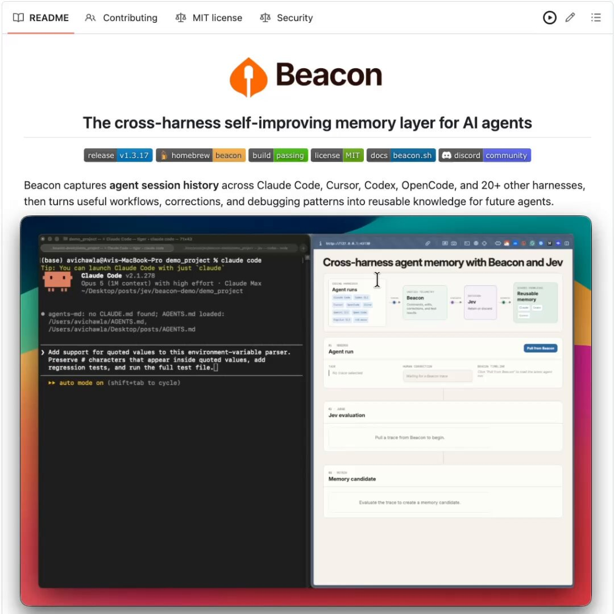

# Another insane Jev use case! Jev is making it dramatically cheaper to evaluate what actually happened inside an agent

> Source: https://x.com/_avichawla/status/2101966536798040332 — @_avichawla — captured 2026-09-21T12:14:45Z

## Post

@_avichawla (Avi Chawla — Daily tutorials and insights on DS, ML, LLMs, and RAGs • Co-founder @dailydoseofds_ • IIT Varanasi • ex-AI Engineer @ MastercardAI)

Mon Sep 21 09:27:29 +0000 2026 — 23 replies, 34 reposts, 310 likes, 499 bookmarks, 31473 views

Another insane Jev use case!

Jev is making it dramatically cheaper to evaluate what actually happened inside an agent run.

And finally, someone open-sourced a self-improving memory layer that can put that signal to work across agent harnesses:

- Claude Code
- Codex
- Cursor
- OpenCode, and 20+ more

Beacon by @asymptotelabs continuously captures your agent history across harnesses and uses Jev to identify which runs are actually worth learning from.

It then turns the highest-signal workflows, corrections, and debugging patterns into reusable skills.

GitHub repo: http://github.com/Asymptote-Labs/agent-beacon

(don’t forget to star it ⭐ )

Beacon preserves the complete session history. But preserving a run and learning from it are two different things.

Most coding-agent sessions contain routine exploration, failed commands, and fixes that only apply to one task. The trace can remain available for inspection without turning every detail into guidance for future agents.

Jev scores each run for evidence, reuse potential, and human correction signals. An application policy then decides whether to promote, review, or discard it.

The recording shows this in action.

Claude receives a coding task, modifies the implementation, and runs the tests. I then provide an edge-case correction, so Claude updates the code and adds regression coverage.

Beacon automatically captures the complete session. Jev evaluates whether the correction contains a reusable engineering lesson.

Once approved, that lesson becomes available to other coding agents working on the project.

Since it works across harnesses:
- Claude Code sessions can teach Codex.
- Cursor debugging can improve OpenCode.

So a problem solved by one agent should not need to be learned from scratch by another.

If you want to dive deeper into Jev, I also wrote a hands-on guide to building this Jev-style decision path with open models, entirely locally.

Read it below.

## Media

<video src="media/video-2101966502954196992-720p.mp4" controls></video>

Original: https://video.twimg.com/amplify_video/2101966502954196992/vid/avc1/1080x1080/PimIXyzR-AtKdVhm.mp4?tag=16 (31s screen recording demo, 1080x1080)

## Quoted post

**Avi Chawla @_avichawla** — https://x.com/_avichawla/status/2101563610644496464 (Sun Sep 20 06:46:24 +0000 2026 — 45 replies, 316 reposts, 2186 likes, 3924 bookmarks, 182957 views):

https://x.com/i/article/2101408350391136256

Article: "Build your own Jev (100% local)" — Everything you need to turn an open-source LLM into a fast, local decision engine without retraining it. It covers next-token scoring, fixed choices with probability distributions, SGLang, and a hands-on benchmark against standard text generation on the same model.

## Thread

**@_avichawla** — https://x.com/_avichawla/status/2101968207695540347 (Sep 21, replying to @trycaliber):

Yeah, and Jev is really good at making that decision.

## Comments

**Caliber @trycaliber** — https://x.com/trycaliber/status/2101967378187772181 (Sep 21):

the key is the promotion gate. agent memory gets worse fast if every successful command becomes doctrine. keep the full trace, but promote a lesson only when a human correction repeats or the pattern improves accepted work across tasks.

**晚晚 @An_yhl** — https://x.com/An_yhl/status/2102001197305721332 (Sep 21):

最后这个“Cursor -”像是故意留的悬念

**Eldar Dzhafarov ッ @edjafarov** — https://x.com/edjafarov/status/2101989223389655532 (Sep 21):

It’s like putting an imbecile as a judge on top of a bunch of Einsteins. Perfect substrate for enterprise.

**kepo @kepochnik** — https://x.com/kepochnik/status/2101988251145793776 (Sep 21):

So many guides about Jev right now

love it, appreciate for your work Avi

**R.Rari @ConfusedRari** — https://x.com/ConfusedRari/status/2101991763283947750 (Sep 21):

the cost for us wasn't the judging, it was access.

ran a review over my own numbers this morning and it came back cannot verify on everything that needed the database, because its sandbox couldn't reach it. the one thing it caught was a word i couldn't defend.

**Cyrbuzz @Cyrbuzz123** — https://x.com/Cyrbuzz123/status/2101980836119908527 (Sep 21, text truncated at source):

The hard part of evaluating an agent run is usually the trace, not the eval logic. Browser/UI steps especially: screenshots and DOM snapshots are huge, so people end up sampling frames and losing the exact state that caused the failure. Curious whether Jev captures full action se

**Juraj Ivan @ QikBuild @juraj_at_qik** — https://x.com/juraj_at_qik/status/2101980677545615787 (Sep 21):

Cool use case — Jev scoring which agent runs are worth learning from. On https://jev-use-cases.com

**Salise @salisedesign** — https://x.com/salisedesign/status/2102001515225321796 (Sep 21):

the idea of Claude teaching Codex is pretty cool. that could really streamline the learning process for agents

**Mahesh Yadav @maheshaipm** — https://x.com/maheshaipm/status/2101995881415504316 (Sep 21):

Jev is not a cheaper GPT. It is a typed function call that returns a probability in ~100ms. I wrote up where it actually belongs in an agent stack and where the “can’t hallucinate” line falls apart.

**Ahmad @asaridarr** — https://x.com/asaridarr/status/2101998865595465903 (Sep 21):

whats the actual cost gap against running an llm as the judge??

**Stephen @Imfulao** — https://x.com/Imfulao/status/2101988392389259547 (Sep 21):

Cross-harness is the key point — most memory tools lock you into one framework. How does Beacon handle conflicting memories from different agents: online updates during a session, or an offline consolidation pass?

**Asymptote Labs @asymptotelabs** — https://x.com/asymptotelabs/status/2101967697307111887 (Sep 21):

Thank you for the shoutout @_avichawla! Exciting times with Jev :)

**Alex | AI Systems @AVojtkov** — https://x.com/AVojtkov/status/2101971549326557291 (Sep 21):

Cross-harness learning is a great idea, but after Plugin4Shell I'd ask about the trust boundary. If a lesson from one agent becomes a skill for all the others, what stops a bad or poisoned lesson from spreading? Is the "approve" step always a human?

**Vernon Stinebaker @vernons** — https://x.com/vernons/status/2101987777038676146 (Sep 21):

This is the real problem: harnesses don’t share scars.
AGENTS.md gets you partway. Shared docs plus a common memory store that captures from Claude Code to Pi to Grok Build is what's needed. Session logs that are never shared is archaeology, not shared knowledge.

## Links

- http://github.com/Asymptote-Labs/agent-beacon
- https://x.com/_avichawla/status/2101563610644496464
- https://x.com/i/article/2101408350391136256
- https://jev-use-cases.com
- https://x.com/_avichawla/status/2101968207695540347
- https://x.com/trycaliber/status/2101967378187772181
- https://x.com/An_yhl/status/2102001197305721332
- https://x.com/edjafarov/status/2101989223389655532
- https://x.com/kepochnik/status/2101988251145793776
- https://x.com/ConfusedRari/status/2101991763283947750
- https://x.com/Cyrbuzz123/status/2101980836119908527
- https://x.com/juraj_at_qik/status/2101980677545615787
- https://x.com/salisedesign/status/2102001515225321796
- https://x.com/maheshaipm/status/2101995881415504316
- https://x.com/asaridarr/status/2101998865595465903
- https://x.com/Imfulao/status/2101988392389259547
- https://x.com/asymptotelabs/status/2101967697307111887
- https://x.com/AVojtkov/status/2101971549326557291
- https://x.com/vernons/status/2101987777038676146
