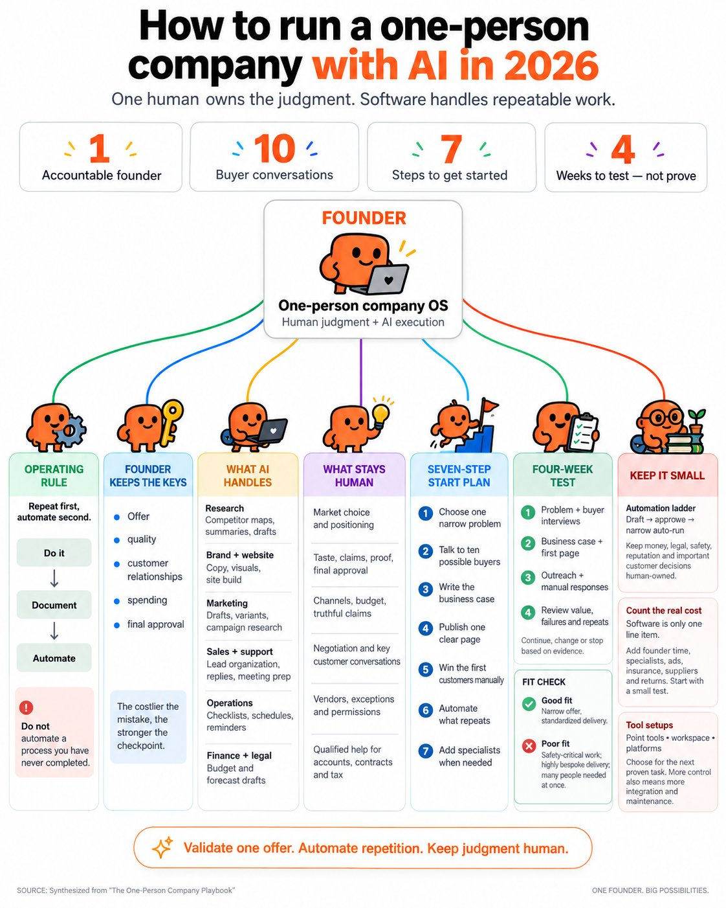
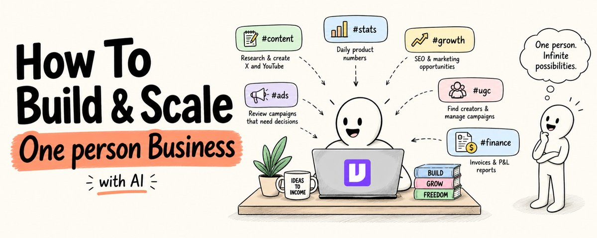

# this is f*cking gold. someone put the whole one-person company playbook on one page. - pick one narrow problem. - talk

> Source: https://x.com/sairahul1/status/2101999483295056107 — Rahul (@sairahul1) — Posted: Mon Sep 21 11:38:24 +0000 2026 — Stats (at capture): 4,725 views · 39 likes · 9 replies · 8 reposts · 71 bookmarks · 0 quotes · Twitter Web App — Captured: 2026-09-21T13:29:16Z

## Post

**Author:** Rahul (@sairahul1)
**URL:** https://x.com/sairahul1/status/2101999483295056107
**Bio:** Building with AI. Sharing what's wild, what's practical, and what's next.

this is f*cking gold.

someone put the whole one-person company playbook on one page.

- pick one narrow problem.
- talk to ten buyers.
- write the case.
- publish one page.
- win the first customers by hand.
- automate what repeats.

AI handles research, content, sales prep, support and ops.
human (YOU) keeps the judgment.

that's the first solo fortunes of this era.  

here's the exact guide to building the AI half ↓  

save this and start today

## Media

Originals: https://pbs.twimg.com/media/HSvNJWjaUAAKUVD.jpg?name=orig (1122×1402)

## Quoted post

[Rahul (@sairahul1), Mon Sep 21 09:31:08 +0000 2026](https://x.com/sairahul1/status/2101967454926930097) — 7,940 views · 32 likes · 7 replies · 2 reposts · 62 bookmarks · 2 quotes

https://x.com/i/article/2101967448711000064

Article: [How to Build & Scale One person Business with AI](https://x.com/i/article/2101967448711000064) — I build products. I create content. I run ads. I do support. I write sponsorships.
Many different jobs. One person.
For a long time, 60% of my day went to work that didn’t need my brain.
Checking

Quoted article cover local:  — Original: https://pbs.twimg.com/media/HSuwPqgbUAA2kLN.jpg

## Thread

9 replies counted; no author self-replies visible in rendered conversation at capture.

## Comments

### Genius ([@GeniusPothead](https://x.com/GeniusPothead)) — [2102016061864591684](https://x.com/GeniusPothead/status/2102016061864591684)

> Pick one narrow problem and automate what repeats, simple but actually works

### Joe Ward ([@joewardcb](https://x.com/joewardcb)) — [2102004891157778528](https://x.com/joewardcb/status/2102004891157778528)

> Very close to what a solopreneur should do without AI.

### Khairallah AL-Awady ([@eng_khairallah1](https://x.com/eng_khairallah1)) — [2102006753676132441](https://x.com/eng_khairallah1/status/2102006753676132441)

> great share bro

### Fakhr ([@iamfakhrealam](https://x.com/iamfakhrealam)) — [2102000547247321119](https://x.com/iamfakhrealam/status/2102000547247321119)

> A powerful guide

## Links

- https://x.com/sairahul1/status/2101967454926930097
- https://x.com/i/article/2101967448711000064
