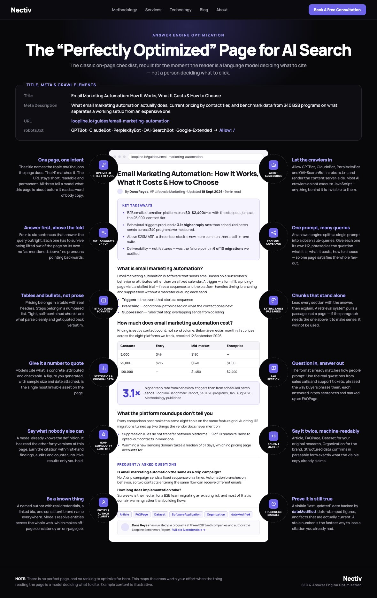
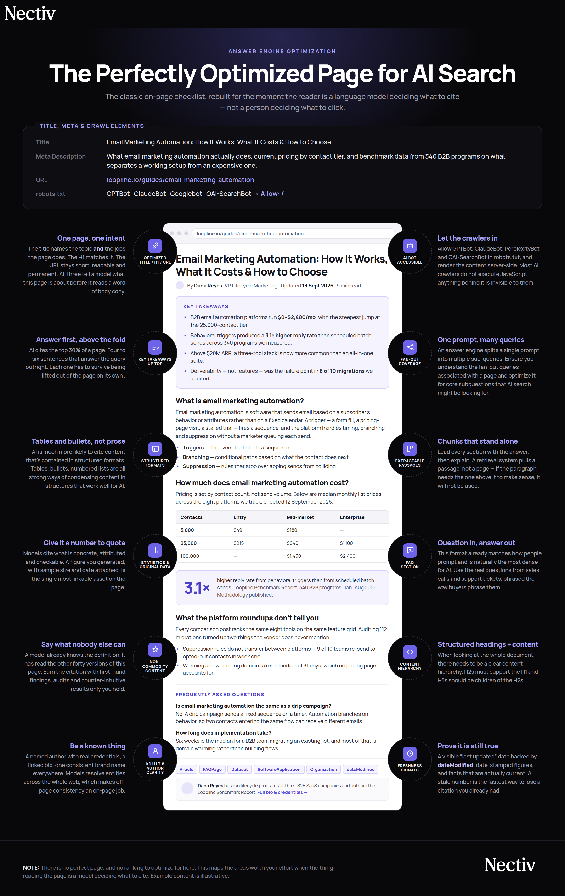

# Full article on the Nectiv blog can be found here: https://t.co/vqdTOCApdX
> Source: https://x.com/chris_nectiv/status/2102047124321939906
> Author: Chris Long (@chris_nectiv)
> Posted: 2026-09-21T14:47:43+00:00
> Captured: 2026-10-15T09:02:28+00:00
> Stats at capture: 3,068 views · 20 likes · 1 replies · 1 reposts · 68 bookmarks · 0 quotes

## Post

Full article on the Nectiv blog can be found here: https://nectivdigital.com/blog/the-perfectly-optimized-page-for-aeo-ai-search

## Comments

X reported 1 reply at capture. The authenticated thread request was unavailable because of X API rate limiting. The parent post and linked Nectiv article were recovered separately; other replies/comments remain unavailable.

## Thread

Parent post by Chris Long (@chris_nectiv) at Mon Sep 21 13:21:45 +0000 2026:

> The Perfectly Optimized Page For AEO: 
> 
> - Optimized Title / H1
> - Key Takeaways
> - Structured Content Formats
> - Freshness Updates
> - FAQs

 — Source media: https://pbs.twimg.com/media/HSvlCviWAAEcnG0.jpg?name=orig

## Article: The Perfectly Optimized Page For AEO

Source: https://nectivdigital.com/blog/the-perfectly-optimized-page-for-aeo-ai-search

# The Perfectly Optimized Page For AEO 

3 min read

OK so many of you might be familiar with the "Perfectly Optimized Page For SEO" page from Moz's Rand Fishkin awhile back. It was a pretty nice infographic that showed you how to structure a page for SEO. It was a great visual that showcased the important of key elements such as the title tag, headings so and so forth.

While we wanted to create a updated version of this, especially for AI search. So here you can find the perfectly optimized page for AEO:

 — Source media: https://firebasestorage.googleapis.com/v0/b/nectiv-website.firebasestorage.app/o/public%2Fmedia%2F1790003380972-Perfectly_Optimized_Page__Revised_.png?alt=media

**1\. AI Accessibility:** AI Accessibility is perceived as one of the most important factors for visibility. Allow GPTBot, ClaudeBot, PerplexityBot and OAI-SearchBot in robots.txt, and render the content server-side. Most AI crawlers do not execute JavaScript. Anything behind it is invisible to them. Source: [Google Top AI Ranking Factors](https://signal.zyppy.com/p/google-ai-ranking-factors), Cyrus Shepard

**2\. Key Takeaways:** AI cites the top 30% of a page. Four to six sentences that answer the query outright. Each one has to survive being lifted out of the page on its own. Source: [The Science Of How AI Pays Attention](https://www.growth-memo.com/p/the-science-of-how-ai-pays-attention), Kevin Indig

**3\. Leverage Tables, Bullets, Numbered Lists:** When looking at the whole document, there needs to be a clear content hierarchy. H2s must support the H1 and H3s should be children of the H2s. Source: [ChatGPT Citations Are 2.3x More Likely To Include A Table Than Google Search](https://nectivdigital.com/blog/new-data-study-chatgpt-citations-are-2-3x-more-likely-to-include-a-table-than-google-search), Nectiv

**4\. Content Freshness:** AI systems are 3x more likely to cite pages that's less than 3 months old. A visible “last updated” date backed by dateModified, date-stamped figures, and facts that are actually current. A stale number is the fastest way to lose a citation you already had. Source: [The 2026 State of AI Search: How Modern Brands Stay Visible, AirOps](https://www.airops.com/report/the-2026-state-of-ai-search)

**5\. Frequently Asked Questions:** This format already matches how people prompt and is naturally the most dense for AI. Use the real questions from sales calls and support tickets, phrased the way buyers phrase them. [How Content Structure Matters for AI Search,](https://www.chris-green.net/post/content-structure-for-ai-search) Chris Green

**6\. Fan-Out Query Coverage:** An answer engine splits a single prompt into multiple sub-queries. Ensure you understand the fan-out queries associated with a page and optimize it for core subquestions that AI search might be looking for. [Google AI Ranking Factors](https://signal.zyppy.com/p/google-ai-ranking-factors), Cyrus Shepard

Full transparency - I used Claude to help me create the image since I'm a terrible designer. However, this does reflect the actual page structure I think content needs to win in the AI era.

## Links

- https://nectivdigital.com/blog/the-perfectly-optimized-page-for-aeo-ai-search
- https://x.com/chris_nectiv/status/2102025492840739175 (reply parent)
