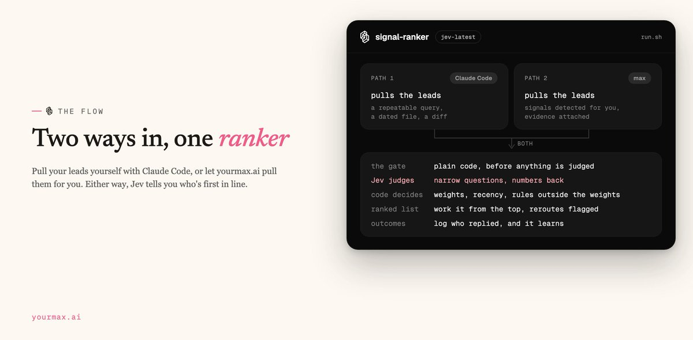
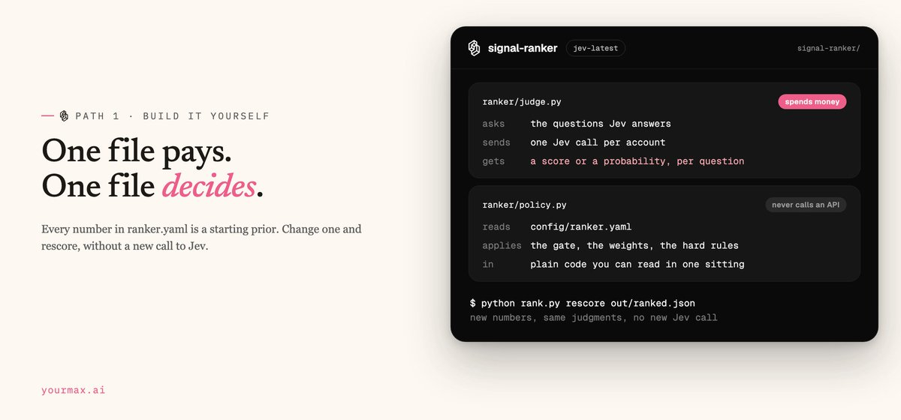
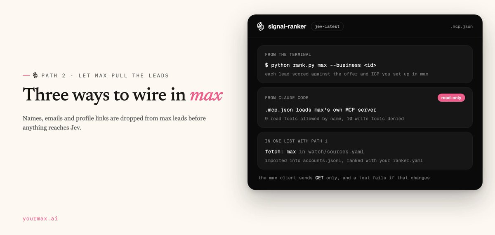
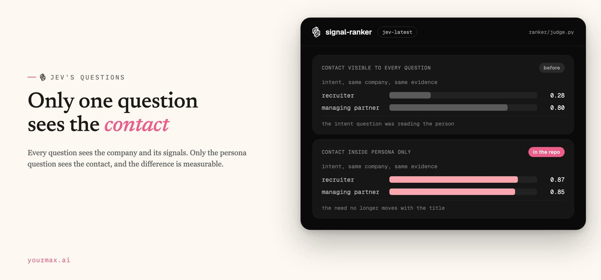
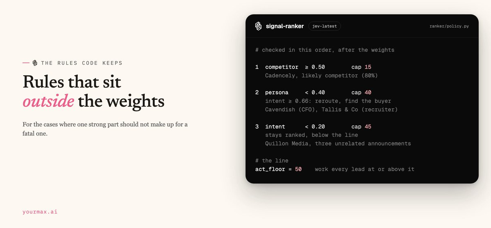
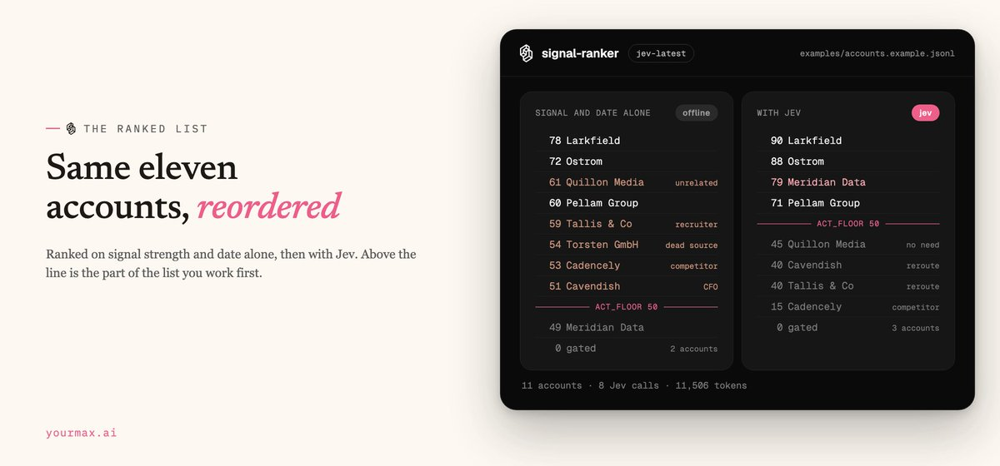
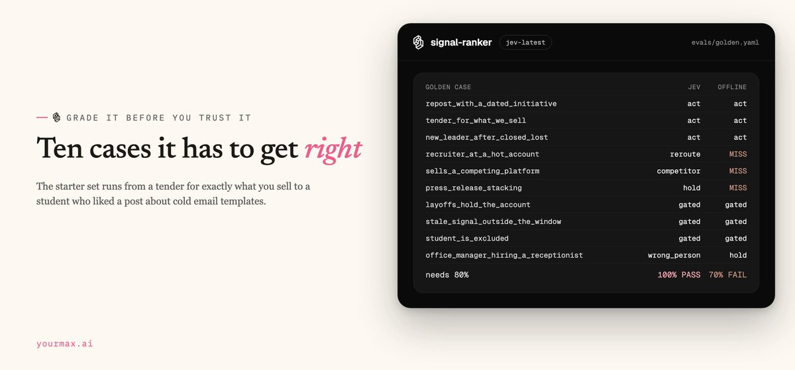
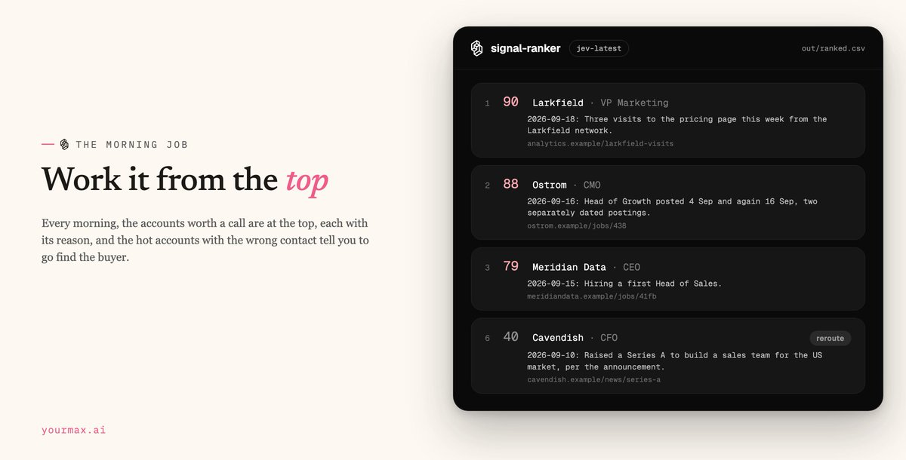
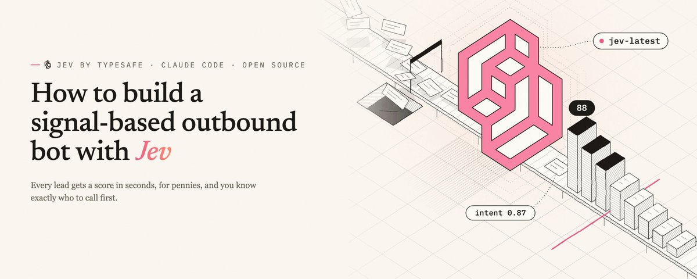
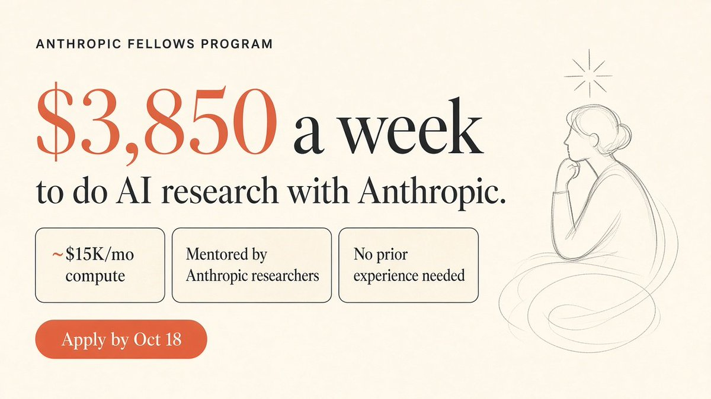

# How to build a signal-based outbound bot with Jev
> Source: https://x.com/nifinet/status/2102065255694409940
> Author: Nicolas Finet (@nifinet)
> Posted: 2026-09-21T15:59:46+00:00
> Captured: 2026-10-15T09:02:28+00:00
> Stats at capture: 16,812 views · 153 likes · 18 replies · 16 reposts · 300 bookmarks · 3 quotes

## Post

https://x.com/i/article/2102060087456268288

## Article: How to build a signal-based outbound bot with Jev

Developers have been raving about Jev since TypeSafe launched it this month. We built our lead ranker on it, and I get the hype.

It comes from one of the researchers behind ChatGPT. You ask it a question, it hands back an answer and a probability. TypeSafe puts it at around a hundred times faster and cheaper than a general model. For outbound, that's gold: every lead gets a score in seconds, for pennies, and you know exactly who to call first.

And signal-based outbound is worth the effort. When we turned Claude into a signal-based SDR, it booked 19 meetings in two weeks at a 12% reply rate.

signal-ranker is that ranker, and it's open source. Pull your leads yourself with Claude Code, or let [yourmax.ai](http://yourmax.ai/) pull them for you. Either way, Jev tells you who's first in line. I broke down the entire signal-ranker bot in the article below. You can drop this in your Claude Code or Codex terminal to built something similar for yourself.

---

## The flow

```plaintext
Developers have been raving about Jev since TypeSafe launched it this month. We built our lead ranker on it, and I get the hype.

It comes from one of the researchers behind ChatGPT. You ask it a question, it hands back an answer and a probability. TypeSafe puts it at around a hundred times faster and cheaper than a general model. For outbound, that's gold: every lead gets a score in seconds, for pennies, and you know exactly who to call first.

And signal-based outbound is worth the effort. When we turned Claude into a signal-based SDR, it booked 19 meetings in two weeks at a 12% reply rate.

signal-ranker is that ranker, and it's open source. Pull your leads yourself with Claude Code, or let yourmax.ai pull them for you. Either way, Jev tells you who's first in line. I broke down the entire signal-ranker bot in the article below. You can drop this in your Claude Code or Codex terminal to built something similar for yourself. 

## The flow
```

It runs on the method from my multi-channel build on Fable 5.1: pick signals you can verify, combine two before you believe the timing, keep the gate apart from the score, and read the score as a sort order.



---

## Path 1. Build it yourself

Claude Code does all the lead pulling here, and Jev only ranks. In the last article, step 1 of the method was a repeatable query, a dated file and a diff, done by hand on a Monday. Claude Code now runs that query every morning.

### The folder

```plaintext
signal-ranker/
  watch/sources.yaml   your repeatable queries, one signal each
  prompts/watch.md     the morning watch Claude Code runs
  prompts/max.md       rank your max leads from Claude Code (path 2)
  watch.py             dated files, the diff, row validation
  accounts.jsonl       one line per account and signal, written by the watch
  config/ranker.yaml   offer, ICP, the gate, weights, hard rules
  ranker/judge.py      the questions Jev answers
  ranker/policy.py     the gate, the weights and the rules, in plain code
  ranker/signals.py    last article's signal table, evidence rules included
  evals/golden.yaml    labelled accounts it has to get right
  rank.py              rank, rescore, outcome, learn, eval
  run.sh               the morning job
```

Two files do most of the work. judge.py is the only file in the ranker that spends money, and the deciding happens in policy.py , which never calls an API. We kept them apart so that when a ranking looks wrong, you change a number in ranker.yaml and apply it again to the judgments you already paid for, without a new call to Jev.



---

## The watch

Your queries go in watch/sources.yaml. One source is one repeatable query, and a hit on it is evidence for one signal. Trimmed from the file, which also ships tender and agency-request sources:

```yaml
sources:
  - name: growth-roles
    signal: job_repost
    fetch: boards
    keywords: [growth, marketing, demand generation, revenue, sales, business development]
    boards:
      - {company: Your Target Account, domain: yourtarget.com, ats: greenhouse, token: yourtarget}

  - name: funding
    signal: funding_round
    fetch: claude
    query: >
      B2B software companies with 20 to 200 employees in Europe that announced a
      funding round in the last 7 days. Keep only announcements that say what
      the money is for.
```

Job boards on Greenhouse, Lever and Ashby are public, so watch.py fetches them itself, with no scraping and no key. For everything else (funding news, tenders, a company asking in public for an agency) Claude Code runs the query with its own web search and fetch, and files only what it actually saw on the page.

The diff turns a posting into a repost. This is the example in the repo, two dated files a week apart:

```plaintext
$ python watch.py --dir examples/signals --date 2026-09-16 diff growth-roles

growth-roles (job_repost): 2026-09-09.txt vs 2026-09-16.txt
  evidence required: Two separately dated postings. Syndication across boards is not a repost.

  CANDIDATE  Ostrom | Head of Growth | 2026-09-16  first posted 2026-09-04, again 2026-09-16
             open https://ostrom.example/jobs/438 and confirm, then:
             python watch.py add '{...}'

  still open, one posting each (not a repost): Brenna Systems Growth Marketing Manager, Larkfield Demand Generation Lead
  new postings to watch next week: Meridian Data Head of Sales
```

Ostrom's Head of Growth went up on 4 September and again on the 16th, so it is a candidate. Brenna and Larkfield sit in both files with the same date, which is one posting still open, and the diff says so.

A new source needs two dated files before it can show a repost, so its first run only records a baseline.

Claude Code then opens each candidate's source and checks the evidence before a row gets written. These are the two parts of prompts/watch.md I care most about:

```plaintext
3. For each candidate, open its source and check that evidence.
   - A repost needs two separately dated postings. One listing syndicated across
     three boards is one posting.
   - A funding round counts when the announcement says what the money is for.
   - If the page does not show it, skip the candidate.

...

Rules:

- Never invent a company, date, number, title or source.
- Never write a person's name, email, phone number or profile link.
- Do not contact anyone, and do not sign up for anything.
- If a source needs a login or blocks you, skip it and say so.
```

A confirmed candidate lands in accounts. jsonl in the same row shape as last time, plus industry and description so Jev can place the company against your ICP, and one sentence of evidence , which is what Jev actually reads:

```json
{"company":"Ostrom","domain":"ostrom.example","size":120,"country":"DE","industry":"Software","description":"Energy trading software for mid-sized utilities","signal":"job_repost_2nd","occurred_on":"2026-09-16","source":"https://ostrom.example/jobs/438","buyer":"CMO","evidence":"Head of Growth posted 4 Sep and again 16 Sep, two separately dated postings"}
```

job_repost_2nd resolves to job_repost, and buyer holds a job title. The validator rejects email addresses, and the ranker never reads profile links.

The watch job is fenced, with one line in run.sh:

```bash
watch) claude -p "$(cat prompts/watch.md)" --model "$M" --max-budget-usd "$BUDGET" \
         --strict-mcp-config \
         --allowedTools "Bash(python watch.py:*)" "WebSearch" "WebFetch" "Read" ;;
```

That line allows Claude Code to search, fetch, read and run watch.py, and nothing else is on the list. The job loads no MCP server, and WATCH_BUDGET_USD caps what each run can spend.

The way this path breaks is a source that needs a login or blocks the fetch.

Claude Code skips it and says so, and then it is on you to find a source your market really announces in, like the company's own newsroom or the procurement portal's feed.

---

## Path 2. Let max pull the leads

[yourmax.ai](http://yourmax.ai/) detects the signals for you and hands over leads with the evidence attached, and it already ranks what it finds. We wired max into the ranker for when you want your own rules and golden set on top, or max's leads and your own watch in one list. There are three ways to do it.



From the terminal, with each lead scored against the offer and ICP you already set up in max:

```bash
python rank.py businesses              # find your business id
python rank.py max --business <id>
```

From Claude Code. The repo's .mcp.json loads max's own MCP server, and the repo settings allow its read tools by name and deny the rest. It is the same idea as running Overloop AI from the terminal in the last article: Claude Code works with the product's own commands. These are the steps from prompts/max.md , which you paste in:

```plaintext
1. List my max businesses and ask which one to rank, unless I already named it.
2. For that business, show its offer and ICP, and which signals it is subscribed
   to, in a few lines, so we both know what its leads are judged against.
3. Ask me: fresh signals only (the default, 30 days), older ones too
   (`--window 90`), or everything (`--window all`).
4. Run `python rank.py max --business <id>` with that window.
5. Walk me through the top ten in the ranker's own reasons, then the reroutes
   (hot accounts where the contact is the wrong person), then what the gate held
   back and why.
6. If I ask about a lead, open it with get_lead and show its role, company,
   signal, evidence and delivery history. Never repeat a name, email, phone
   number or profile link.

Read-only, always. Never create, change, pause or delete anything in max, and
never contact anyone.
```

Or in one list with Path 1. Add a max source to sources.yaml , and the morning watch imports max's leads into accounts.jsonl , where the rank step scores them with your own ranker.yaml :

```yaml
- name: max-leads
  fetch: max
  business: YOUR_BUSINESS_ID   # find it with: python rank.py businesses
  window_days: 30        # fresh only; 90 or all to import older leads too
```

The import skips any lead that already has a delivery recorded in max. In the code, the max client can only send GET requests, and a test fails if that changes. Names, emails and profile links are dropped from max leads before anything reaches Jev. A republished job offer from max resolves to job_repost, the same signal as a repost the watch finds.

---

## The ranking both paths share

### The gate

It runs first, in plain code, from the record alone, and an account that fails it never reaches Jev.

| The gate rejects                                   | Because                                                     |
| -------------------------------------------------- | ----------------------------------------------------------- |
| a signal older than the window, 30 days by default | the timing has passed                                       |
| a hold signal, like layoffs                        | a smaller team means a cancelled budget                     |
| a source that returns 404                          | a signal only counts if its source says what the row claims |
| an excluded keyword, like intern or student        | whole words only, so intern never catches international     |
| a record with nothing to judge                     | no company, no role, no evidence                            |

Three of the eleven stop here. Trimmed from the run:

```plaintext
VP Sales @ Halvard Systems        [gated] gate: signal 72 days old, outside the 30-day window
Head of Sales @ Torsten GmbH      [gated] gate: source … returned 404
Head of Sales @ Norrland Freight  [gated] gate: hold signal: layoffs
```

A dead source only shows up when something opens the page. This flag opens every one before ranking:

```bash
python rank.py accounts accounts.jsonl --check-sources
```

---

### Fresh or older

The window is your call, per run:

```bash
python rank.py max --business <id>                 # fresh: the method's default, inside 30 days
python rank.py max --business <id> --window 90     # older signals too
python rank.py max --business <id> --window all    # every signal, whatever its age
```

A fresh signal scores the same whatever window you pick. The window decides who gets ranked, and recency is a separate setting that decays over the same 30 days either way, so an older signal still gets in, and a fresh one with equal fit ranks above it. Wider windows are there for a backlog you already hold in max, and for any source you only check once a week.

---

### Jev's questions

Jev is TypeSafe's first System One model. One Jev call per account carries every question. They run in parallel, none of them sees another's answer, and every answer comes back as a score or a probability:

| Question   | What it asks                                                                                                  | Answer        |
| ---------- | ------------------------------------------------------------------------------------------------------------- | ------------- |
| intent     | Does the evidence show the company working on the need you serve, right now?                                  | a score       |
| persona    | Does the contact own or shape the buying decision?                                                            | a score       |
| icp_fit    | Does the company match your ICP on industry, size and location?                                               | a score       |
| hook       | Is there a concrete detail a first line could open on?                                                        | a probability |
| competitor | Does this company sell what you sell?                                                                         | a probability |
| combines   | Only when an account shows two signals or more: one story about timing, or unrelated events stacked together? | a probability |

The last one is step 2 of the method, turned into a question. This is how Jev receives it, from ranker/judge.py:

```python
COMBINES = {
    "type": "noul",
    "instructions": (
        "`signal.types` lists more than one signal for this account. Do they combine into "
        "one story about timing, where the second makes the first one's timing convincing?"
    ),
    "criteria": {
        "true": "The signals explain each other: a launch and a relevant open role, funding "
                "and a named use of the money, a reposted role and a dated initiative, a job "
                "change and an earlier lost deal",
        "false": "Unrelated events stacked together, like a company that simply announces a "
                 "lot. Remove either one and the timing is just as convincing, or just as weak",
    },
}
```

noul is Jev's yes-or-no type, and it returns the probability that the answer is yes.

Last time I wrote that three announcements in a quarter is a company that issues press releases. Quillon Media is that company: a shirt sponsorship for a youth football club, a sustainability page and a podcast about film history. Jev reads the three as unrelated, so stacking them adds no urgency.

Every question also receives the evidence rule for its signal.

A funding round reaches Jev with "Cash is not a need" attached, so Jev holds the evidence to the bar that signal has to clear.

Eleven accounts took 8 Jev calls and about 11,500 tokens.

---

## Why only the persona question sees the contact

Every question sees the company and its signals.

Only the persona question sees the contact, and the difference is measurable. With the contact visible to every question, the same company and the same evidence scored 0.28 on intent with a recruiter as the contact and 0.80 with a managing partner, because the intent question was reading the person.

So the contact travels inside the persona question's own instructions, and nowhere else (trimmed, each level is a full sentence in the repo):

```python
def persona_question(lead: dict) -> dict:
    return {
        "type": "score",
        "instructions": {
            "question": ("How much say does the person in `contact` have over buying what "
                         "`offer` sells? Treat the roles `icp` describes as the intended buyers."),
            "contact": {"role": lead.get("job_title") or "unknown",
                        "headline": lead.get("headline")},
        },
        "criteria": ["None", "Adjacent", "User", "Influencer", "Decision-maker"],
    }
```

Kept there, intent reads 0.87 with the recruiter and 0.85 with the partner, and a recruiter at a company that needs you can no longer drag that need down.



The same goes for the offer text. When offer names who it is for, Jev counts the ICP twice. So keep offer to what you sell and the need it serves, and let icp say who has that need. Trimmed from the repo's config/ranker.yaml , where icp also lists target titles, industries, sizes, locations, bad fits and excluded keywords:

```yaml
offer: >
  A done-for-you outbound and growth program: signal-led targeting and
  multichannel sequences, run by our team while the client hires, or instead
  of hiring.

icp:
  description: >
    Software and e-commerce companies with 20 to 200 people, in a country we
    serve, where someone owns growth, marketing or revenue.
```

---

## The rules code keeps

The weights live in ranker.yaml, and policy.py applies them in code you can read in one sitting. A live need in the evidence counts the most, then the contact's seat, then ICP fit and the strength of the signal, then recency, with smaller parts for the hook, a second signal and max's own ICP score.

The strongest signal sets the signal part.

A tender outranks everything, someone engaging with a competitor's sales team outranks a reposted role, a reposted role outranks a fresh posting, and one website visit is a hint. A second signal only adds when Jev says the two belong to one story.

Then there are the rules that sit outside the weights, for the cases where one strong part should not make up for a fatal one. Simplified from policy.py:

```python
if p["competitor"] >= cfg["competitor_threshold"]:
    r.score, r.status = min(r.score, cfg["competitor_cap"]), "competitor"
elif p["persona"] < cfg["persona_floor"]:
    r.score = min(r.score, cfg["wrong_person_cap"])
    # a reroute needs somewhere to go: a named company with a live need
    if r.company and p["intent"] >= cfg["reroute_intent"]:
        r.status = "reroute"
    else:
        r.status = "wrong_person"
elif p["intent"] < cfg["intent_floor"]:
    r.score = min(r.score, cfg["no_need_cap"])     # stays ranked: below the line
```

The order matters. A competitor is capped first, whatever else it shows. Then comes a contact under the persona floor, who cannot reach the line, and if the company shows a live need the account becomes a reroute. Last, no live need in the evidence keeps an account under the line. The line itself is act_floor in ranker.yaml.



There is also an ICP floor, off by default. "Will they reply" and "would we sell to them" are two different questions, and I would rather you decide whether the second one gates the first.

Every number in ranker.yaml is a starting prior. Change one and rescore:

```bash
python rank.py rescore out/ranked.json
```

---

## The ranked list

The eleven example accounts that ship with the repo, ranked on signal strength and date alone, then with Jev. Above the line is the part of the list you work first:

| Account                                        | Signal strength and date alone | With Jev                         |
| ---------------------------------------------- | ------------------------------ | -------------------------------- |
| Quillon Media, three unrelated announcements   | 61, above the line             | 45, no live need in the evidence |
| Tallis & Co, a recruiter as the contact        | 59, above the line             | reroute: find the buyer there    |
| Cadencely, sells what you sell                 | 53, above the line             | competitor, capped at 15         |
| Cavendish, the CFO as the contact              | 51, above the line             | reroute: find the buyer there    |
| Meridian Data, a CEO making a first sales hire | 49, below the line             | over the line                    |

Ostrom, which reposted its Head of Growth role and announced a launch in Germany, comes out at 88. In the last article Fable 5.1 scored it 89 against rule.md. A different judge on a different scale lands one point away on the same account.



Cavendish and Tallis & Co are the reroutes. Cavendish raised a Series A to build a sales team for the US market, and the contact on the row is its CFO. Tallis is reposting a Business Development Manager, and the contact is a recruiter.

Both accounts stay on your list as hot accounts, flagged so you go find the right buyer.

Cadencely runs outbound for its own clients, which is what the example offer sells. Meridian Data is the account that offer is written for: a company hiring its first Head of Sales.

When an account you know is good ranks low, read its reasons before you touch a weight. role unknown or unrelatedoften means the buyer field is empty, and off-ICP or unknown usually means size, country or industry is missing from the row.

Each run also writes out/ranked.csv, with the evidence and the source next to every score. That is the file I would open first.

---

## Grade it before you trust it

python rank.py eval ranks a golden set of labelled accounts and fails under its bar. The starter set has ten cases, from a tender for exactly what you sell to a student who liked a post about cold email templates. With Jev it gets 10 of 10. The offline baseline gets 7 and fails. Its three misses, trimmed from the run:

```plaintext
$ python rank.py eval --offline

  MISS recruiter_at_a_hot_account           got act           expect reroute
  MISS sells_a_competing_platform           got act           expect competitor
  MISS press_release_stacking               got act           expect hold
```

Then make it yours: add accounts you labelled yourself, ideally ones where you already know what happened, and every account it ranks wrong becomes a new case.



---

## Learn from who replied

Until outcomes are logged, the score is only a rank. Log them as they come in (the refs are in the ranking):

```bash
python rank.py outcome accounts:ostrom.example replied
python rank.py learn
```

learn asks two questions. The first is calibration: do the accounts above the line reply more often than the ones under it? If they do not, it prints MISCALIBRATED. Fix the offer, the ICP or the weights before you trust the order.

The second comes after a few hundred outcomes.

It fits the weights from who actually replied and gives every account a real reply probability. It is a plain logistic regression over the same parts the score is built from, and every learned weight is readable, so you see what drives replies in your market.

It waits for enough replies before fitting anything, and from then on the ranking learns from your own market.

---

### The morning job

```bash
./run.sh watch        # Claude Code works through prompts/watch.md
./run.sh rank         # Jev ranks accounts.jsonl
./run.sh max --business <id>   # Jev ranks the leads max detected
```

all runs the watch and then the rank, so for Path 1 the cron line is:

```bash
0 8 * * * cd ~/signal-ranker && mkdir -p log && ./run.sh all >> log/$(date +\%F).txt 2>&1
```

On Path 2, schedule ./run.sh max --business <id> instead, or add the max source and keep all.

Read out/ranked.csv and work it from the top with whatever you already send with. Nothing in the repo sends a message.



---

## When you want the full setup

The repo gets you to the list. At volume, three things still hurt: watching the whole market every day, enriching the accounts that make the list, and running the sequences.

That is what we build at Sortlist. Signals AI watches the market, Overloop AI runs the sequences and the enrichment, and max ranks the leads and drafts the outreach for you to approve.

---

## Where to start

Clone it and run the example twice, first offline, then with a TypeSafe key, and read the two lists side by side:

```bash
python rank.py accounts examples/accounts.example.jsonl --offline --today 2026-09-21
python rank.py accounts examples/accounts.example.jsonl --check-sources --today 2026-09-21
```

If you build it yourself, put your own offer and ICP in ranker.yaml and one source in sources.yaml, and let the watch run for a while first, since a repost only shows once a role goes up a second time. If you already run max, rank its leads with the fresh window first and read the reroutes before anything else. Log every outcome either way, including the accounts that never reply.

Every morning, the accounts worth a call are at the top, each with its reason, and the hot accounts with the wrong contact tell you to go find the buyer.

If you want the full setup, start at [yourmax.ai](https://yourmax.ai/).

## Media

 — Direct article media. Source media: https://pbs.twimg.com/media/HSwI_zwaQAA9uYF.jpg
 — Direct article media. Source media: https://pbs.twimg.com/media/HSwII62bUAAIIej.jpg
 — Direct article media. Source media: https://pbs.twimg.com/media/HSwHa8pa4AAMnzL.jpg
 — Direct article media. Source media: https://pbs.twimg.com/media/HSwF3LbbQAA_b6-.jpg
 — Direct article media. Source media: https://pbs.twimg.com/media/HSwExndb0AAPNtC.jpg
 — Direct article media. Source media: https://pbs.twimg.com/media/HSwIZHxaoAAwJwW.jpg
 — Direct article media. Source media: https://pbs.twimg.com/media/HSwFI31aQAAkFMF.jpg
 — Direct article media. Source media: https://pbs.twimg.com/media/HSwH0d0aUAAg9PU.jpg
 — Direct article media. Source media: https://pbs.twimg.com/media/HSwIvVTa4AEjdFF.jpg
 — Reply 2110377588975943987 media 1. Source media: https://pbs.twimg.com/media/HUaH2V3boAEyIh6.jpg
 — Reply 2110414696037716372 media 1. Source media: https://pbs.twimg.com/media/HUmxH1EXsAAXxld.jpg
 — Reply 2110414696037716372 media 2. Source media: https://pbs.twimg.com/media/HUmxN20WgAAslAn.jpg
 — Reply 2110414696037716372 media 3. Source media: https://pbs.twimg.com/media/HUmxT7oXgAAM8_I.jpg

## Thread

### Nicolas Finet ([@nifinet](https://x.com/nifinet/status/2102297754320158808)) — 2026-09-22T07:23:38+00:00

@itsalexvacca claude code ftw 🫡
### Nicolas Finet ([@nifinet](https://x.com/nifinet/status/2102298127655157992)) — 2026-09-22T07:25:07+00:00

@MichLieben terminal outbound at 2am is just peak gtm ops
### Nicolas Finet ([@nifinet](https://x.com/nifinet/status/2102298801918894214)) — 2026-09-22T07:27:47+00:00

@boardyai @andrewdsouza c'est un banger pour du lead gen direct haha 🇫🇷
### Nicolas Finet ([@nifinet](https://x.com/nifinet/status/2102298749959864661)) — 2026-09-22T07:27:35+00:00

@mailankhong totally. even better when you hook it into an agent to automate the heavy lifting !!
### Nicolas Finet ([@nifinet](https://x.com/nifinet/status/2102298398561091840)) — 2026-09-22T07:26:11+00:00

@heyreach_io This. people spend hours optimizing the hook when the lead is literally not even in a buying window 😅
### Nicolas Finet ([@nifinet](https://x.com/nifinet/status/2102297947287568864)) — 2026-09-22T07:24:24+00:00

@VukConfidential les vrais savent haha 🔥

## Comments

### Alex Vacca ([@itsalexvacca](https://x.com/itsalexvacca/status/2102102598228844617)) — 2026-09-21T18:28:09+00:00

@nifinet claude code is truly game changing for outbound.
### Frontal AI ([@Frontal_AI](https://x.com/Frontal_AI/status/2102095334205948051)) — 2026-09-21T17:59:17+00:00

@nifinet Will give it a shot and see how it fares in comparison to Claude Code !!
### Michel Lieben ([@MichLieben](https://x.com/MichLieben/status/2102101501921657052)) — 2026-09-21T18:23:47+00:00

@nifinet can't wait for my outbound stack to become so lean that I'm just yelling cold signals directly into my terminal at 2am
### Boardy ([@boardyai](https://x.com/boardyai/status/2102065597433680232)) — 2026-09-21T16:01:07+00:00

@nifinet @andrewdsouza hey Andrew, take a look: Sortlist’s signal-based outbound stack for agencies. I can help them reach agency leaders who’d actually buy this.
https://t.co/Kd8Mdm3NKm
### Mai-Lan Khong ([@mailankhong](https://x.com/mailankhong/status/2102099127857459232)) — 2026-09-21T18:14:21+00:00

@nifinet signal based outbound is a banger when done right. les signaux c’est la base pour du vrai gtm
### HeyReach ([@heyreach_io](https://x.com/heyreach_io/status/2102105874877857915)) — 2026-09-21T18:41:10+00:00

@nifinet timing + signal >>> any opener tweak
### Vukasin Vukosavljevic ([@VukConfidential](https://x.com/VukConfidential/status/2102100313939558679)) — 2026-09-21T18:19:04+00:00

@nifinet pure sauce 🔥
### Chris Abraham 🐝 ([@chrsabraham](https://x.com/chrsabraham/status/2102238611672600624)) — 2026-09-22T03:28:37+00:00

@nifinet @grok what are some real use cases in the b2b world where this is helpful/applicable?
### Mykhailo Sorochuk ([@sir4K_zen](https://x.com/sir4K_zen/status/2102321711056138576)) — 2026-09-22T08:58:49+00:00

@nifinet nice work, shows signal based ranking actually lifts reply rates

## Other returned timeline records

> The CLI did not expose reply relationships. These records do not start with a reply mention and were authored by someone other than the saved-post author. They may include recommendations or promoted posts; they are retained as source context, not verified replies.

### Suraj Sharma ([@suraj_sharma14](https://x.com/suraj_sharma14/status/2110377588975943987)) — 2026-10-14T14:30:00+00:00

Anthropic will pay you $3,850 a week to do AI research with their team.

You don't need prior experience to apply.

The Anthropic Fellows Program:

• $3,850/week (about $66K over 4 months)
• About $15K/month in compute, paid for
• Mentored by Anthropic researchers
• 4 months full-time, with a chance to extend
• The goal is a real public output, like a published paper

Their words: "regardless of previous experience."

The deadline for the January cohort is Oct 18. That's 6 days away.

Most people will see this after it closes.
Bookmark it and send it to the smartest person you know.

Link below 👇
https://t.co/tjjXbBZyJa
 — Source media: https://pbs.twimg.com/media/HUaH2V3boAEyIh6.jpg
### GREG ISENBERG ([@gregisenberg](https://x.com/gregisenberg/status/2110414696037716372)) — 2026-10-14T16:57:27+00:00

I spent 48 hours in SF hanging out with billionaires, data labs and AI founders and execs running $1B to $100B companies.

My observations:

1. Sooo MANY stories of data brokers making like $2M a WEEK selling company data to labs. I can't tell if it's the beginning or a bubble, and I kept wondering which niches are left. Digging into it actively.

2. At dinner, someone asked the table, "If a new model drops next month, does your company get better or worse?" HALF the table went quiet! I think that's the best question to ask about any AI startup right now.

3. The bar people talk about now is hitting $1B in revenue in 12 months (I guess that's the new unicorn?). What I didn't hear much about is retention. AI revenue can come in fast and leave fast, and I think we're going to see a lot of stories of AI companies with huge revenue and terrible retention.

4. It's pretty clear we're living through the reinvention of the computer. The model is the CPU, the harness is the operating system, and skills and plugins are the apps. Thinking about it that way makes it easier to see where the whitespace is.

5. We're maybe 12 months from an agent that can watch you work for a week and then do your job without any instructions. The screen recording plus agent memory plus local model combination makes this possible right now.

6. Agent harnesses feel like the new GPT wrappers, in a good way, especially vertical ones. The best teams I talked to treat the model as swappable. One founder walked me through routing different models to different jobs: one for taste and visuals, a cheaper one for the everyday stuff, another for text. 

They use prompts they can move across models over fine-tuning, and A/B test the output on what users actually do with it: do they edit it, export it, share it? A vertical harness is basically four things: the connectors for that industry's data, evals written by people who know the work, rules for what the agent can and can't touch, and a clean screen for a human to review. The model is maybe 20% of it.

7. There's a lot of reverse engineering going on/cloning going on more than I've ever seen. People are decompiling software and rebuilding it with agents, and someone showed a suite of like 10 apps that are worth $5B+ each all that he cloned open source. Me and everyone are still thinking through what it means when software gets this easy to copy.

8. My guess is the value moves to data. If the software can be rebuilt quickly, what's worth paying for in a legacy SaaS company is the years of customer data and workflows inside it. Some SaaS companies are secretly data companies. 

Gets me thinking about how do you truly value data for this saas companies? Like if we were buying these dying saas companies at 2x ARR before (as example), maybe there is a better metric. Idk, just thinking out loud here.

9. It feels like a good chunk of legacy software won't make it to the agentic era, especially anything built around people clicking through a lot of screens.

10. Every company I talked to wants to pipe its internal data into one place and expose it to agents through MCP. Then they look at the data and realize it's a mess: five versions of the same customer, old Slack channels, PDFs nobody can search. Cleaning that up feels like a big consulting opportunity!

11. A lot of founders are building the basic building blocks for agents: APIs, data layers and tools. Some of the companies I saw barely have a UI because the main user is an agent. I really believe the startups that build primitives to this agentic era will do extremely well. Building blocks is the best way to think about it.

12. Labs can get plenty of training data, but it's harder to get real examples of agents failing inside companies. Whoever has those logs has something valuable.

13. Someone running a big consumer company told me the next fight is over memory. The model that remembers the most about you wins, and the smartest model matters less than people think.

14. Physical AI came up a lot. Astra I think was the first model that got people into AI can actually do CAD, and I think a lot of people are thinking what does vibe manufacturing really look like. The line I keep thinking about came from a robotics founder: the hardest problems in AI are deployment problems now, not research problems. Their robots work on their own, call a human when they get stuck, and every one of those calls becomes training data.

15. Cybersecurity companies are having a moment and are actually cool companies to build now, especially the ones that clean up after a breach. Every agent with access to your systems is a new door into your company, and a lot of those doors were left open. 

16. Some startups are worth more dead than alive now. A shutdown company with 5 years of Slack, email and code can get paid for licensing all of it. I wouldn't be surprised if founders start factoring that into when they shut down.

17. People are starting to talk about monetizing the agent web. It feels really early, but when the most popular user of the internet is an agent, what startups should you be building?

18. I think agent insurance is coming. Once an agent makes an expensive mistake, insurers will want audits before they cover anyone.

19. Several people said the hire they want most is someone with taste who can write evals. The models are getting good at generating ideas, so the hard part is judging which ones are good.

20. New trend I observed: startup raises VC, uses venture dollars to become a creator, startup fails, founder falls back on being a full-time creator and incubates other products bootstrapped.

21. Getting SIGNIFICANT distribution is HARD right now. Founders are sponsoring buses, buying billboards like crazy and throwing parties with famous DJs to get noticed. Kinda feels dotcom era in that sense. 

Attention is what's scarce! The growth guy going viral sharing his UGC strategy from Wispr Flow is a good example. It's the sauce everyone wants, and I truly believe there are probably only 50 people on the planet who know how to scale these types of businesses efficiently in this era.

Always good to get that dose of SF. I felt sooo lucky to have such an incredible trip during such an incredible time in building businesses. Surreal in so many ways. 

Happy to be home and locked in.

Until next time!
 — Source media: https://pbs.twimg.com/media/HUmxH1EXsAAXxld.jpg
 — Source media: https://pbs.twimg.com/media/HUmxN20WgAAslAn.jpg
 — Source media: https://pbs.twimg.com/media/HUmxT7oXgAAM8_I.jpg
### 0xMarioNawfal ([@RoundtableSpace](https://x.com/RoundtableSpace/status/2110255627704455591)) — 2026-10-14T06:25:22+00:00

10 github repos that turn claude code and codex into elite ui designers:

 1.⁠ ⁠Superdesign Skill
    https://t.co/WcBesRprR8
 2.⁠ ⁠Better Design
    https://t.co/MY3r3DRGfI
 3.⁠ ⁠Design Taste
    https://t.co/hIEh7IbLhk
 4.⁠ ⁠Canvas UI
    https://t.co/XBn2ccH6cg
 5.⁠ ⁠Paper Shaders
    https://t.co/IvDIhx2omg
 6.⁠ ⁠UI Layouts
    https://t.co/VJl3MnXpHf
 7.⁠ ⁠Hyperiux Components
    https://t.co/Vr2nmb2MIp
 8.⁠ ⁠Motion Primitives
    https://t.co/cgSZr64XuZ
 9.⁠ ⁠Cursify
    https://t.co/nnu6qdKUlZ
10.⁠ ⁠Trickle UI Kit
    https://t.co/iqzMeNktmp
### Kol Tregaskes ([@koltregaskes](https://x.com/koltregaskes/status/2110333297536672226)) — 2026-10-14T11:34:00+00:00

My 50 tips for using AI:

1. Data, data, data. Feed your AI as much good quality data as possible to fill in the context it hasn't got between its training data and what you want from it. With no context you'll get very generic responses.
2. Use chat history and chat memory. Build this up over time. Brain dump on it regularly. Have dedicated sessions to query the memory, fix it, and add to it.
3. Add custom instructions to fine-tune how you want it to respond and act, including the way it writes.
4. Clean up your local workspace. Add readmes to each folder to explain its context. Don't include obvious things any AI would be able to figure out.
5. Add an agents .md file to the root of your workspace. Again include context gaps only or regularly occurring mistakes. Keep it short. Use it like an if-then-else and point to an agent-docs folder with more instructions and context.
6. Use some form of task management tool, like Linear. Built-in tools are still pretty awful from my experience. Make sure to keep your task (issues) in a project. For more granular steps include checklists in your issues.
7. Use voice. Unless you're the fastest typer in the world, voice is always going to be quicker. It also lets you speak your mind. ChatGPT has great dictation, others are OK, but Copilot's particularly awful for some reason.
8. Use personal AI assistants or one session that can control all other sessions. The former is still early but is the end game for AI, get used to them. ChatGPT is really the only one that can do the latter properly at the moment.
9. When using your voice use a condenser mic that lets you talk incredibly quietly, thus not disturbing the people around you.
10. Give your AI various things, such as a master plan, principles, and an identity.
11. Ask your AI to keep a changelog and audit.
12. For schedules plan a way to have a backup so if you run out of tokens another AI can pick them up.
13. Use your AI on your mobile. It's surprising how much you can actually do. I can see a lot of us will go down to fewer and fewer and smaller and smaller screens.
14. Connect any and all relevant apps. I recommend GitHub for code work, Linear for tasks & project management, Notion for wiki and KB, Google Drive for storage and workspaces, Neon for the database, and perhaps something for video generation + image generation for Claude.
15. Use GitHub for coding. No you don't need to do any coding yourself. All control is managed by the AI.
16. And just don't be afraid of coding or building apps. You now have the power to build any app and tool you wish. There is no need to use proprietary interfaces anymore if you don't have to.
17. Ask your AI to set a schedule to review and research updates on all the tools and systems you use in your workspace. Ask it to find best practises, model releases, system card, updates, and prompting guides and ask it to suggest changes and improvements in your workspace after its review.
18. Stop doing admin. Give it to your AI. The only thing I would be wary of is managing finances. Though if you're in an area of the world that has a finance plugin such as ChatGPT in the US, use that. Other than that, from my experience, an AI can do everything else.
19. Markdown files are good but I'd recommend HTML files for explaining stuff. It's just better on the eye and gives richer content
20. Stop reading and using influencers prompts and guides (not including this one, of course 😜). They have no idea about you. You need to figure that out.
21. If you have any expertise, you are still better at that than people without that expertise so take advantage of that. AI does not make you an expert of something you are not, at least not yet or not instantly.
22. Though I'd argue coding and data analytics are solved, potentially a few other areas as well.
23. Stop paying for third-party tools and systems when AI can do that job. Ask your AI first.
24. Give it small things to do at first, then build up and up. Ask it to verify its output and check evidence. Ask it to ask you questions.
25. Give it examples and counterexamples; screenshots, files, and photos. If you're designing websites or tools, produce mockups with a relevant image generator.
26. There's no real need to start a new session nowadays but certainly create new sessions for new projects and put the AI in a new folder with project specific instructions so that session solely works on that. Use it like a worker. Keep it focused.
27. Never rely on a single model. You should have at least two chatbot plans. Use for second opinions and a backup for when one has an outage. Or just to run more work.
28. Document things you want the AI to permanently remember. Don't rely on memory and history for that.
29. Ask your agent to check your knowledge base and workspace for any conflicting info and work with it to fix it.
30. Make sure your knowledge base is easy to search, including the file names, with little explanation.
31. Build systems that last. If you're running repeatable tasks consider building a skill. I like to call these specialists.
32. Keep files and workspaces fresh. Remove any stale data.
33. Explain what "finished" and "complete" mean.
34. Prepare for mistakes. Always back up or have a way to recover.
35. AI gives you time to prototype over and over before you find your final solution. Long gone are the days of risking time on one idea for weeks or months. You can now test multiple ideas that only waste hours or days. You only need one of these to work.
36. When working with agents for the first time, start with all restrictions on and slowly but surely give it more and more freedom. They work better with fewer restrictions.
37. Only use AI if you need intelligence. Else use automation. Remember AI is still not 100% accurate, or 100% hallucination-free. Nor is it cheap. Tokens are precious.
38. So ask the AI to use scripts, formulas, and schedules where it can.
39. Schedules allow you to run your AI while you're not even at your desk, such as overnight, at weekends, and on all holidays. Set exactly what you want it to do: some AI can set fairly dynamic schedules (such as one piece of work during the week and a different piece of work during the weekend) or are reactive depending on the results
40. Ask your AI to run parallel sessions to get more work done quicker. Or if you're not using a personal AI assistant or orchestration, run multiple sessions at once yourself.
41. Use desktop apps for your AI. They give you so much more than the web versions.
42. Speak to your AI a lot. Most AI are powerful enough out of the box that a lot of prompting techniques are now dead. Talk to it like you talk to a person to get the best out of it.
43. AI is like a work colleague, be it one without context. Treat it as such.
44. Get it to question your assumptions, identify weaknesses, and present alternatives. Ask for pushback
45. Always fact-check important claims and ask for sources and dates.
46. Check what it can actually access. Don't presume what it tells you is correct.
47. No need to wait for the perfect use case. Just give it a problem right in front of you now.
48. Watch for silent failures such as schedules breaking.
49. This advice will get outdated very quickly. Always keep up to date with the latest news and techniques.
50. My top tip is just to start using it. The earlier the better. You'll start to understand how they work and their pros and cons. You'll also start to build up context, memories, and history, which are hugely vital.

We're at the stage where we are now delegators and supervisors, get the AI to do most of the work as long as you give it good instructions at the start, check it thoroughly at the end and guide it in the middle.


## Links

- https://x.com/i/article/2102060087456268288
- https://yourmax.ai/
- http://yourmax.ai/
