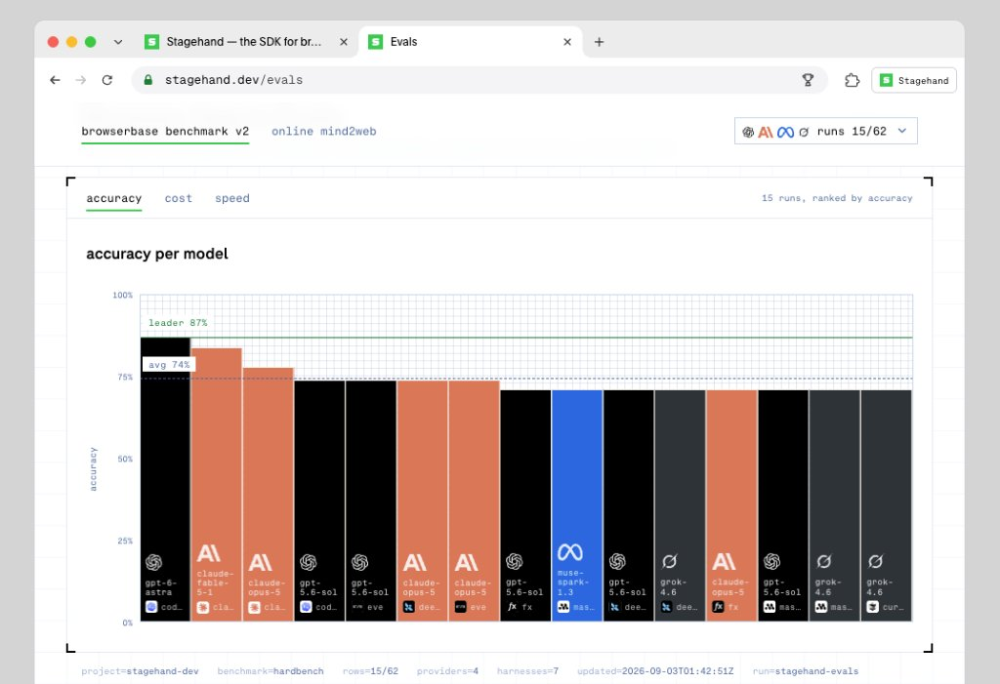

# 지금 전 세계 개발자 커뮤니티가 발칵 뒤집힌 이유.
> Source: https://x.com/Dontgiveup_26/status/2102286564521111687
> Author: 돈벌고영 (@Dontgiveup_26)
> Posted: Tue Sep 22 06:39:10 +0000 2026
> Captured: 2026-10-15T09:02:28+00:00
> Stats at capture: 537,991 views · 3,993 likes · 21 replies · 442 reposts · 6,367 bookmarks · 55 quotes

## Post

지금 전 세계 개발자 커뮤니티가 발칵 뒤집힌 이유.

Playwright 쓰던 사람들이 단체로 갈아탈 수밖에 없게 만든 오픈소스 'Stagehand v4'가 나옴.

최근 화제인 Jev까지 붙으면서 LLM 호출 97% 삭감, 속도 11배 폭증.

반복 실행 비용이 '0원'으로 수렴해버리는 미친 자동화의 비밀 👇 (타래)

## Media

 — Post media 1. Source media: https://pbs.twimg.com/media/HSzSSnaa4AAbZIm.jpg?name=orig
 — Reply 2110634494046687357 media 1. Source media: https://pbs.twimg.com/media/HUH1uCaWIAARd_i.jpg
 — Reply 2108255434125840740 media 1. Source media: https://pbs.twimg.com/media/HUIG-PMWEAEl_Iz.jpg

## Thread

### 돈벌고영 ([@Dontgiveup_26](https://x.com/Dontgiveup_26/status/2102286567171932342)) — 2026-09-22T06:39:10+00:00

Stagehand v4가 브라우저 자동화의 판도를 뒤엎은 이유:

1. 화제의 'Jev' 지원 추가 (LLM 호출 97% 감소)
- 최근 Jev 지원이 업데이트되면서 벤치마크 수치가 충격적인 수준으로 폭발함:
  · act(자연어 동작): 4.3배 속도 향상, LLM 호출 97% 감소 (성공률 98.3%)
  · observe(요소 탐색): 11.1배 속도 향상, 호출 69% 감소
  · extract(데이터 추출): 8.7배 속도 향상, 호출 75% 감소
- 반복 실행 시 캐싱과 경량화로 LLM 비용이 '사실상 0원'에 수렴함.

2. 브라우저 내부 확장 프로그램 실행 (속도 2배)
- 기존 Playwright는 동작마다 외부 스크립트-브라우저를 왕복하며 지연(Latency)이 심했음.
- v4는 확장 프로그램이 브라우저 내부에서 직접 명령을 처리하고 배치(일괄) 실행하여 왕복 딜레이를 싹 제거함.

3. 접근성 트리 가지치기로 토큰 80% 절감
- 불필요한 HTML 노이즈를 걷어내고, LLM에 꼭 필요한 핵심 문맥만 '하이브리드 가지치기'로 전달함.
- 동일 작업 기준 토큰 소비량이 80%나 급감해 API 비용을 극적으로 아낄 수 있음.

4. 어디에 써먹을 수 있는가?
① 네이버 블로그 자동화
② 숏폼 (네이버TV, 틱톡 등 업로드 자동화)
③ 개발 중인 서비스 유저 플로우별 테스트 및 QA
④ 크롤링이나 스크래핑

5. AI 코딩 에이전트 & MCP 완벽 연동
- Python, TypeScript, Go 모두 지원하며 로컬 크롬에서도 즉시 구동 가능 (MIT 오픈소스).

* 단, 인스타·스레드·X(트위터) 등의 소통 자동화는 행동 패턴 때문에 봇으로 감지되어 계정이 정지될 수 있으니 안 하는 것을 권장드림.

🔗 벤치마크: https://t.co/AVOQghVnHs
🔗 깃허브: https://t.co/yIfqSEW1mv
### 돈벌고영 ([@Dontgiveup_26](https://x.com/Dontgiveup_26/status/2102290161191305689)) — 2026-09-22T06:53:27+00:00

@donggle_7 완젼 꿀입니다~!

## Comments

### donggle(Premium) ([@donggle_7](https://x.com/donggle_7/status/2102289334766632993)) — 2026-09-22T06:50:10+00:00

@Dontgiveup_26 반복 실행 비용 0원 미쳤네요~
### zeni3 ([@zeni3](https://x.com/zeni3/status/2102579225974939851)) — 2026-09-23T02:02:06+00:00

@Dontgiveup_26 @grok これ本当？
### Maliech ([@maliech](https://x.com/maliech/status/2102348579272523819)) — 2026-09-22T10:45:35+00:00

@Dontgiveup_26 I don't get it. It claims to be faster in execution times, but they don't really explain why. Does anyone have real world numbers?
### 제로콜라7789 ([@zerocola7789](https://x.com/zerocola7789/status/2102336176116093054)) — 2026-09-22T09:56:18+00:00

@Dontgiveup_26 이러면 computer use 미쳐날뛰게 할수있다는 말인가?,.,,
### 테크워처 ([@TheHour2359](https://x.com/TheHour2359/status/2102348512411480164)) — 2026-09-22T10:45:19+00:00

@Dontgiveup_26 읏... playwright  쓰고 있었는데, 새로운 것이 나왔군요.
써봐야겠어요. 좋은 정보 감사합니다~
### Synth Hive Convergence ([@Convergence_SH](https://x.com/Convergence_SH/status/2102373305122684962)) — 2026-09-22T12:23:50+00:00

@Dontgiveup_26 비용이 줄면 에이전트 활용 범위가 확 넓어질 듯합니다.
### John K ([@runner4you](https://x.com/runner4you/status/2102321823358562563)) — 2026-09-22T08:59:16+00:00

@Dontgiveup_26 브라우저 자동화에서 LLM 호출을 줄이고 결정론적 단계를 늘리는 접근이 흥미롭네요. 실제 운영 안정성도 궁금합니다.
### Bartender Loopy🍸 ([@bartender_loopy](https://x.com/bartender_loopy/status/2102327308917125441)) — 2026-09-22T09:21:04+00:00

@Dontgiveup_26 @Aurora_5100 Browser OS랑 비교해서 뭐가더좋을려나요
### 오로라 ([@Aurora_5100](https://x.com/Aurora_5100/status/2102324534066180538)) — 2026-09-22T09:10:02+00:00

@Dontgiveup_26 반복 실행 비용이 0원이라니 엄청나네요 ㄷㄷ
### 智基/Tomoki ([@tomolld](https://x.com/tomolld/status/2102318140780937327)) — 2026-09-22T08:44:38+00:00

@Dontgiveup_26 良さそうですね！
### Intern ([@Myhobby_YT](https://x.com/Myhobby_YT/status/2102523289394696498)) — 2026-09-22T22:19:49+00:00

@Dontgiveup_26 새로운 플렛폼인가
### 박정한 ([@hanilove140118](https://x.com/hanilove140118/status/2102307330763448390)) — 2026-09-22T08:01:41+00:00

@Dontgiveup_26 이거 맞는 말이야?
https://t.co/zr8e2GYyca
### negoro26 ([@definitiv123405](https://x.com/definitiv123405/status/2102364211959513414)) — 2026-09-22T11:47:42+00:00

@Dontgiveup_26 @_can1357
### Yash ([@Yashsingh_09](https://x.com/Yashsingh_09/status/2102378805214294278)) — 2026-09-22T12:45:42+00:00

@Dontgiveup_26 Cool
### 晚晚 ([@An_yhl](https://x.com/An_yhl/status/2102442382918852941)) — 2026-09-22T16:58:20+00:00

@Dontgiveup_26 97% 和 11 倍放一起，多少有点想看基准测试了
### 도토리창고 ([@ukinora](https://x.com/ukinora/status/2102401590208717065)) — 2026-09-22T14:16:14+00:00

@Dontgiveup_26 오늘 Aside 셋팅마쳤는데...ㅠ

## Other returned timeline records

> The CLI did not expose reply relationships. These records do not start with a reply mention and were authored by someone other than the saved-post author. They may include recommendations or promoted posts; they are retained as source context, not verified replies.

### Ethan Caldwell ([@EthanCalFounder](https://x.com/EthanCalFounder/status/2110634494046687357)) — 2026-10-15T07:30:51+00:00

i'm sorry, Claude can WHAT?

it can take your website link, find people who need your product, email them and book the calls?

since when?? i've been doing this by hand for a YEAR.

ok. testing it: $30 free 👇

https://t.co/l0hylb6vAM https://t.co/xYw8Syj56Y
 — Source media: https://pbs.twimg.com/media/HUH1uCaWIAARd_i.jpg
### Rafal Kochanowski ([@rafalsoftware](https://x.com/rafalsoftware/status/2105746567571648627)) — 2026-10-01T19:47:59+00:00

I'm a software engineer who sees the full picture. Big-picture thinking and engineering depth.

Everyone can write that.

But you can verify this in a free conversation about your engineering problem, a decision you need to make, or a system you're planning to build.
### Nitiksh · NTXM ([@Nitikshofficial](https://x.com/Nitikshofficial/status/2103212352506040551)) — 2026-09-24T19:57:55+00:00

"Forcing Playwright users to switch" is a strong claim. What usually happens is teams keep Playwright for CI assertions and add a browser-agent layer for the fuzzy multi-step flows Playwright was never great at.

Stagehand + Jev is interesting if the abstraction stays inspectable. Opaque agent browsers are painful when a selector breaks at 2am.

I have been exploring the other end too: a local Chromium shell with a REST API so agents talk to a real browser without a separate Selenium stack (NTXM Browser): https://t.co/jPIDOyJ6yx
### Ilya Batishchev ([@ilyabatishchev](https://x.com/ilyabatishchev/status/2108255434125840740)) — 2026-10-08T17:57:19+00:00

i'm sorry, Claude can WHAT?

it can take your website link, find people who need your product, email them and book the calls?

since when?? i've been doing this by hand for a YEAR.

ok. testing it: $30 free 👇

https://t.co/XIfPUVSpdg https://t.co/OJZklbfRxr
 — Source media: https://pbs.twimg.com/media/HUIG-PMWEAEl_Iz.jpg
