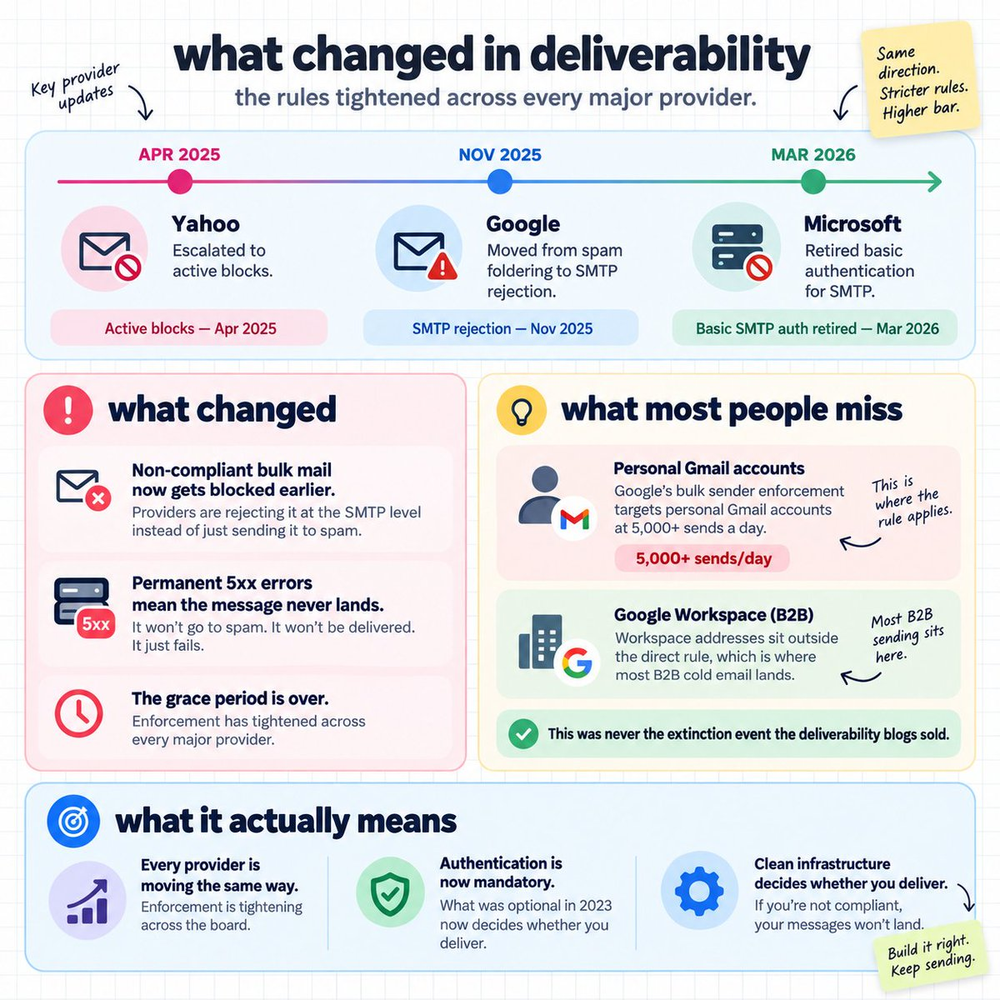
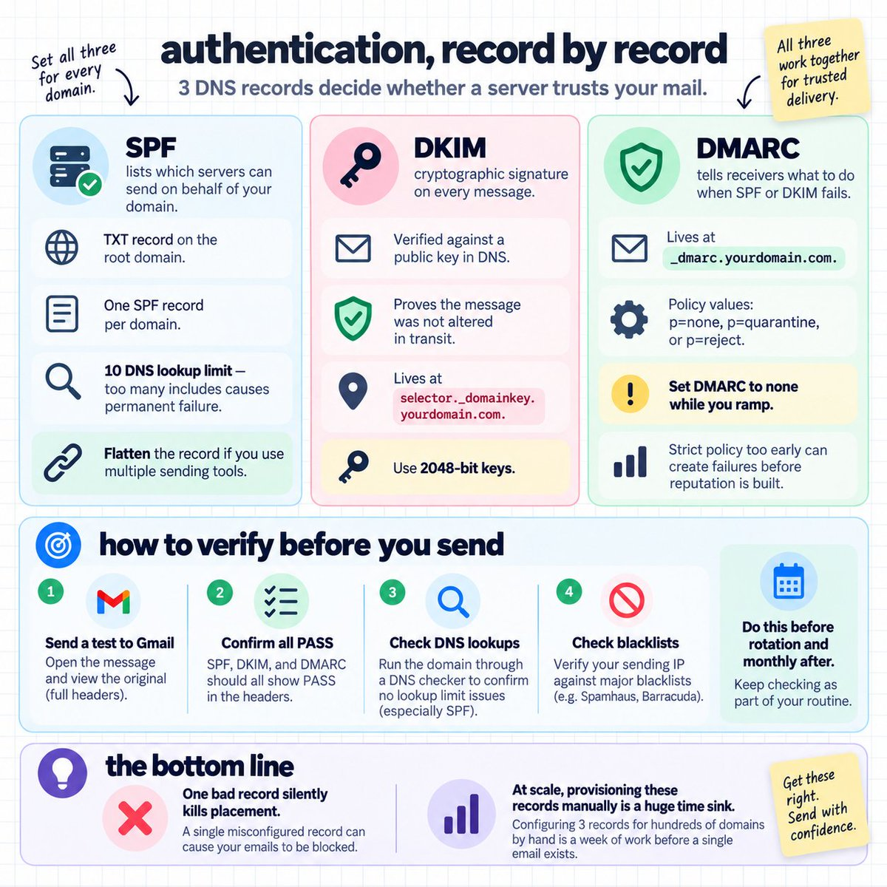
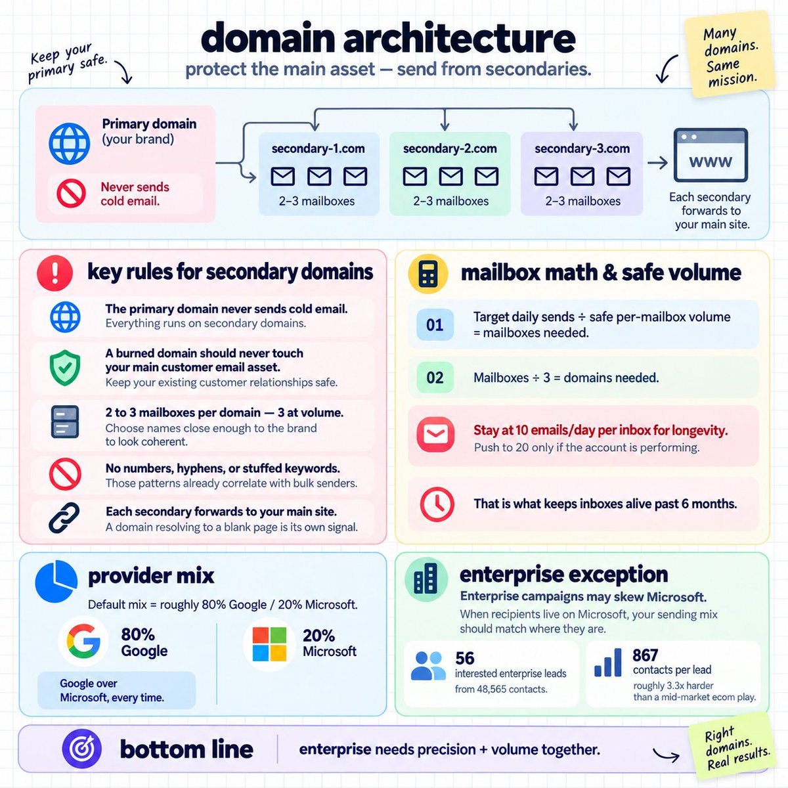
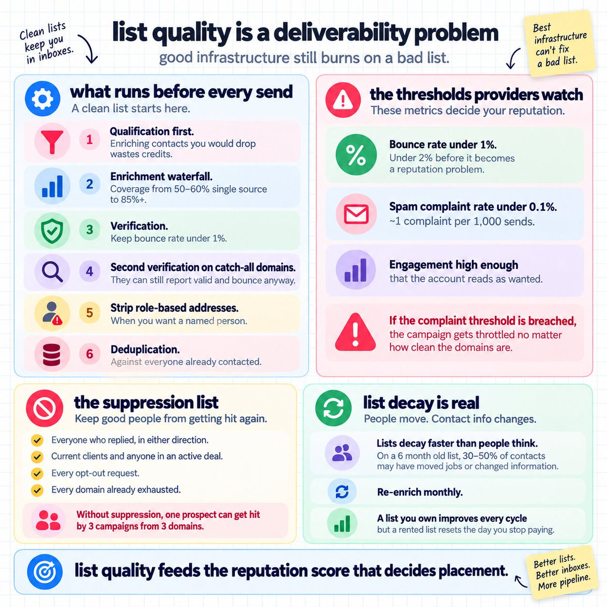
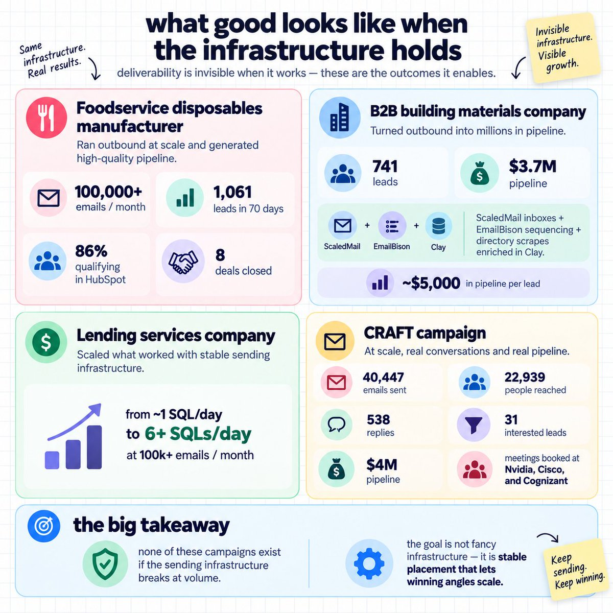

# How We Mastered Cold Email Deliverability... (FULL COURSE)
> Source: https://x.com/coldemailchris/status/2102464856423284995
> Author: Christian (@coldemailchris)
> Posted: Tue Sep 22 18:27:38 +0000 2026
> Captured: 2026-10-15T09:02:28+00:00
> Stats at capture: 37,354 views · 105 likes · 7 replies · 9 reposts · 267 bookmarks · 1 quotes

## Post

https://x.com/i/article/2091566410262626304

## Article: How We Mastered Cold Email Deliverability... (FULL COURSE)

10,000,000+ cold emails sent across 100+ B2B brands, producing 30,000+ leads and $70M+ in pipeline.

None of it works if the message lands in spam.

Deliverability is the layer everything else sits on.

Your offer, your list, and your copy are all downstream of whether a receiving server accepts the message.

This is the full course.

---

### What changed, and what it actually means:

The enforcement landscape tightened across every major provider.

Google moved from spam foldering non compliant bulk mail to rejecting it at the SMTP level in November 2025.

Permanent 5xx errors, which means the message never lands anywhere.

Microsoft retired basic authentication for SMTP in March 2026.

Yahoo escalated to active blocks in April 2025.

The nuance that gets missed.

Google's bulk sender enforcement targets personal Gmail accounts at 5,000+ sends a day.

Google Workspace addresses sit outside the direct rule, which is where most B2B cold email lands.

So it was never the extinction event the deliverability blogs sold.

What it confirms is direction.

Every provider is moving the same way, and the grace period ended.

Authentication that was optional in 2023 now decides whether you deliver.

---

### Authentication, record by record:

3 DNS records govern whether a receiving server trusts your mail.

SPF lists which servers are allowed to send on behalf of your domain.

It lives as a TXT record on the root domain.

One SPF record per domain, and exceeding 10 DNS lookups inside it causes a permanent error that fails every check.

If you use multiple sending services, flatten the record instead of chaining includes.

DKIM attaches a cryptographic signature to every message, verified against a public key published in your DNS.

It proves the message was not altered in transit.

It lives at a selector subdomain, meaning selector._domainkey.yourdomain.com.

Use 2048 bit keys.

DMARC tells receiving servers what to do when SPF or DKIM fails, and where to send the reports.

It lives at _dmarc.yourdomain.com.

The policy value is p=none, p=quarantine, or p=reject.

Set DMARC to none while you ramp.

A strict policy on a domain with no sending history creates failures before you have the reputation to absorb them.

How to verify before you send:

- Send a test to a Gmail address, open it, and view the original

- Confirm SPF, DKIM, and DMARC all show PASS

- Run the domain through a DNS checker to confirm no lookup limit breach

- Check the sending IP against the major blacklists

Do this on every domain before it enters rotation, and again monthly.

One misconfigured record silently kills that domain's placement for the life of the campaign, and you will read it as a copy problem.

At 167 domains, configuring 3 records each by hand is a week of work before a single email exists, which is why we provision through ScaledMail.

---

### Domain architecture:

The primary domain never sends cold email.

Everything runs on secondaries, so a burned domain never touches the asset your existing customers email.

The structure:

- 2 to 3 mailboxes per domain, with 3 being the ratio at volume

- Names close enough to the brand that a curious prospect finds something coherent

- No numbers, hyphens, or stuffed keywords, since those patterns already correlate with bulk senders

- Each secondary forwarding to your main site, because a domain resolving to a blank page is its own signal

Work the domain count backwards from your target.

Target daily sends ÷ safe per-mailbox volume = mailboxes needed.

Mailboxes ÷ 3 = domains needed.

The per-mailbox number is lower than the industry default.

Stay at 10 emails a day per inbox for longevity.

Push to 20 only if the account is performing.

That is the number that keeps inboxes alive past the 6 month mark.

Provider mix: Google over Microsoft, every time.

Roughly 80% Google and 20% Microsoft as a default.

The documented exception is enterprise.

For an enterprise focused B2B team targeting billion dollar accounts, we ran Microsoft skewed infrastructure,

because enterprise domains sit on Microsoft and the sending mix has to match where the recipients are.

That campaign produced 56 interested enterprise leads from 48,565 contacts, with conversations opened at Lionsgate and the San Diego Padres.

867 contacts per lead, which is roughly 3.3 times harder than a mid-market ecom play.

Enterprise costs you 3 times the contacts, so you need volume and precision together.

---

### The warmup protocol:

A new mailbox sending at full volume gets flagged inside days.

The exact ramp we run:

- Warmup phase. Start at 5 a day, increase by 1 a day until you hit 20.

- Cold ramp. After warmup, start cold sending at 5 a day and increase by 1 a day.

- Steady state. 10 a day per inbox for longevity, 20 if the numbers justify it.

Stagger the start dates across the batch.

100 mailboxes activating on the same Monday is a pattern regardless of what each one does individually.

Keep warmup traffic running underneath live campaigns permanently.

It generates positive engagement continuously, which offsets what cold sending costs you in reputation.

Stopping it at launch removes the counterweight at the moment you sta;rt needing it.

Pace the sends across working hours with irregular gaps.

Every sequencer defaults to 9am on the hour, which is a pattern before it is a schedule.

---

### The replacement cycle:

Run a 1:1 inbox ratio.

100 sending inboxes plus 100 sitting on warmup reserve.

Rotate monthly.

Replace disconnected inboxes every month.

Correctly configured inboxes still degrade at 6 to 9 months.

A replacement started the day one burns is 3 weeks too late.

Burn stops being a problem once the replacements are already warm.

When a domain burns:

- Pull it from rotation immediately

- Move the mailboxes to a warm replacement domain

- Retire the burned domain instead of trying to rehabilitate it

- Check whether the cause was the domain or the list, since a burned domain often means a list problem that will burn the next one too

---

### List quality is a deliverability problem:

The cleanest infrastructure burns on a bad list.

Bounces, spam complaints, and low engagement all feed the reputation score that decides your placement.

What runs before every send:

- Qualification first, since enriching contacts at companies you were always going to drop burns credits on roughly half the file

- Enrichment through a waterfall, taking coverage from 50 to 60% single source to 85%+

- Verification, keeping bounce rate under 1%

- A second verification pass on catch-all domains, which report as valid and bounce anyway

- Role based addresses stripped where you want a named person

- Deduplication against everyone already contacted

The thresholds a receiving provider actually watches:

- Bounce rate under 1%, and under 2% before it becomes a reputation problem

- Spam complaint rate under 0.1%, which is roughly 1 complaint per 1,000 sends

- Engagement high enough that the account reads as wanted

A campaign breaching the complaint threshold gets throttled regardless of how well the domains are configured.

Then the suppression list, which is a deliverability tool as much as a courtesy:

- Everyone who replied, in either direction

- Current clients and anyone in an active deal

- Every opt-out request

- Every domain already exhausted

Without it, one prospect receives 3 campaigns from 3 of your domains, and that is where complaints come from.

Lists decay faster than people plan for.

On a 6 month old list, 30 to 50% of contacts have moved jobs or have new contact information available.

Re-enrich monthly.

A list you own gets more accurate every cycle but a list you rent resets the day you stop paying.

---

### Campaign settings that affect placement:

- Open tracking off. The pixel damages placement and returns a number you cannot act on.

- Plain text only.

- No links in the first email, which are the strongest spam signal you can attach.

- Spintax across 3 to 5 versions of every line, not only the subject. Filters pattern match on the body.

- Randomised start times.

- Monday to Friday sending.

- Auto replies counted in your stats as a placement gauge.

On that last one.

Auto replies arrive from real inboxes, so a drop in them means you stopped reaching real inboxes.

---

### Monitoring and the failure signals:

Monitoring runs weekly at the individual mailbox level.

What to track:

- Bounce rate per campaign

- Reply rate per mailbox, since silence usually means spam placement

- Blacklist status across every domain

- Seed testing, meaning a handful of test inboxes across Google, Microsoft, and Yahoo receiving your live campaigns

Set the seed accounts up properly, added to the live campaign as normal recipients,

and check weekly for whether the message landed in primary, promotions, or spam.

Any mailbox showing placement issues leaves rotation that day.

Any blacklisted domain gets retired.

Reading the signals, in order of severity:

- Reply rate dropping across every campaign at once is infrastructure, not messaging

- Bounces climbing on a list that verified clean means the data source degraded

- One mailbox at zero replies for a week is almost certainly filtered

- Auto replies disappearing means you stopped reaching real inboxes

The diagnostic order when something breaks: 
- placement first
- then the list
- then the copy.

Rewriting copy while the mail sits in spam produces a month of wasted work and no information.

---

### What good looks like when the infrastructure holds:

Deliverability is invisible when it works, so here is what it enables.

A custom foodservice disposables manufacturer ran 100,000+ emails a month and generated 1,061 leads in 70 days, with 86% qualifying in HubSpot and 8 deals closed.

A B2B building materials company generated 741 leads worth $3.7M in pipeline,

on ScaledMail inboxes with EmailBison sequencing and directory scrapes enriched in Clay.

Roughly $5,000 in pipeline per lead, from testing a handful of angles and then scaling the winner instead of over optimizing.

A lending services company went from roughly 1 SQL a day to 6+ SQLs a day at 100k+ emails a month.

CRAFT sent 40,447 emails to 22,939 people, generating 538 replies and 31 interested leads worth $4M in pipeline, with meetings booked at Nvidia, Cisco, and Cognizant.

None of those campaigns would exist if the sending infrastructure had not held at volume.

---

### What it costs:

The full setup runs around $1,500 a month at 10,000 sends a day.

Against a real B2B ACV, that CAC makes the channel work on arithmetic alone.

At a $45,000 deal it is a rounding error.

At a $2,000 deal with a 10% close rate, the model needs different inputs.

Run the numbers on your own LTV before building any of it.

Deliverability is the layer nobody wants to own and the one that decides everything above it. We handle it end to end.

---

- Christian

If you want an in-house GTM team running this exact deliverability structure in a full outbound system that contacts your entire market every 90 days,

DM me "LIST" or book a call @ [cal.link/chris-article](https://cal.link/chris-article)

30,000+ meetings booked and $70M in pipeline across 100+ B2B companies.

OR, If you're running GTM/outbound yourself, we teach a ton of stuff about GTM and outbound in our community. (Like this article but better)

50+ modules, 3 live calls a week, and direct access to the operators running this at scale.

All going over exactly how to make money/scale with GTM and outbound

Join up @ [gtmu.io](https://gtmu.io/)

## Media

 — Direct article media. Source media: https://pbs.twimg.com/media/HS1ym2fagAA-HuU.jpg
 — Direct article media. Source media: https://pbs.twimg.com/media/HS1uWGQWwAAuLc6.jpg
 — Direct article media. Source media: https://pbs.twimg.com/media/HS1uPQpWYAADcAJ.jpg
 — Direct article media. Source media: https://pbs.twimg.com/media/HS1uswmWMAAIiJt.jpg
 — Direct article media. Source media: https://pbs.twimg.com/media/HS1uRfWXYAACnme.jpg
 — Direct article media. Source media: https://pbs.twimg.com/media/HS1uLf8XgAAFc-U.jpg

## Comments

### BeeReach ([@BeeReach_io](https://x.com/BeeReach_io/status/2102709052325392439)) — 2026-09-23T10:37:59+00:00

@coldemailchris solid breakdown, the DNS checklist alone saves a lot of headaches
### Nathan ([@nthglsn](https://x.com/nthglsn/status/2103470801567556051)) — 2026-09-25T13:04:54+00:00

@coldemailchris Hi @coldemailchris I'm the founder of https://t.co/gMreJNiTyW, would you be interested in a partnership?

## Links

- https://x.com/i/article/2091566410262626304
- https://cal.link/chris-article
- https://gtmu.io/
