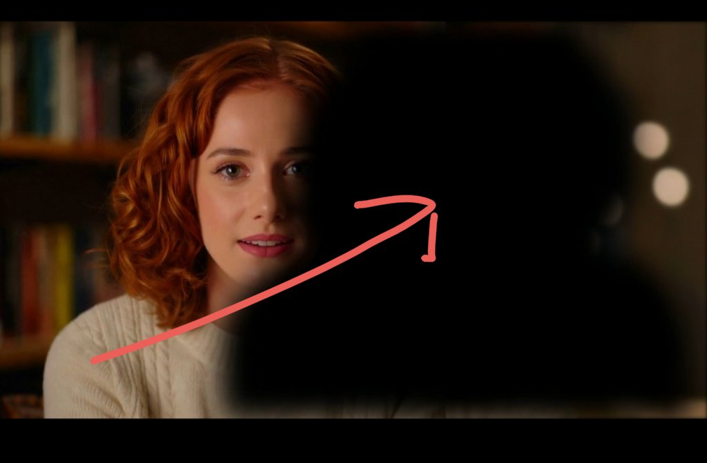

# Skill for 3d camera + text effect is live!
> Source: https://x.com/jake11moran/status/2102544324445848031
> Author: Jake Moran (@jake11moran)
> Posted: Tue Sep 22 23:43:24 +0000 2026
> Captured: 2026-10-15T09:02:28+00:00
> Stats at capture: 118,926 views · 743 likes · 19 replies · 53 reposts · 1,272 bookmarks · 12 quotes

## Post

Skill for 3d camera + text effect is live!

https://github.com/heygen-com/hyperframes-community-skills/tree/master/skills/camera-3d-captions

> Quoted post by Jake Moran ([@jake11moran](https://x.com/jake11moran/status/2102493361743839432)):
>
> 3d camera and text effect with opus 5.5 + @HyperFrames_

## Media

[Post media 1](media/video-01.mp4) — Source media: https://video.twimg.com/amplify_video/2102541009884471296/vid/avc1/1280x720/fGPGZqCjAATdYPkM.mp4?tag=29
 — Post media 1 thumbnail. Source media: https://pbs.twimg.com/amplify_video_thumb/2102541009884471296/img/cYGsognJRDaDe-uX.jpg
 — Reply 2110634494046687357 media 1. Source media: https://pbs.twimg.com/media/HUH1uCaWIAARd_i.jpg
[Reply 2102547319233356166 media 1](media/video-02.mp4) — Source media: https://video.twimg.com/amplify_video/2102547134541434880/vid/avc1/1920x1080/4bDJgaHLOvcMSKXN.mp4?tag=29
 — Reply 2102608514321383849 media 1. Source media: https://pbs.twimg.com/media/HS33TP9XwAAK8Sg.jpg
 — Reply 2102626074371002770 media 1. Source media: https://pbs.twimg.com/media/HS4GWQgbsAA92t3.jpg

## Thread

### Jake Moran ([@jake11moran](https://x.com/jake11moran/status/2102545121548140938)) — 2026-09-22T23:46:35+00:00

Obviously won’t be used for most full videos but could see this being awesome for hooks
### Jake Moran ([@jake11moran](https://x.com/jake11moran/status/2102596915108143499)) — 2026-09-23T03:12:23+00:00

@paytkaleiwahea 🙌 let me know if you try! Would love to see your results
### Jake Moran ([@jake11moran](https://x.com/jake11moran/status/2102572961274417591)) — 2026-09-23T01:37:12+00:00

@adrixy0 Looks sweet!!
### Jake Moran ([@jake11moran](https://x.com/jake11moran/status/2102626074371002770)) — 2026-09-23T05:08:15+00:00

@brycedriesenga silhouette of Jason Bateman

actually is just silhouette of the speaker to use as a wipe but came out worse in this example than the first one i created https://t.co/UoTaEjmVtx
 — Source media: https://pbs.twimg.com/media/HS4GWQgbsAA92t3.jpg

## Comments

### Payton Kaleiwahea ([@paytkaleiwahea](https://x.com/paytkaleiwahea/status/2102578388447670575)) — 2026-09-23T01:58:46+00:00

@jake11moran Looks great my man
### Adrita ([@adrixy0](https://x.com/adrixy0/status/2102547319233356166)) — 2026-09-22T23:55:19+00:00

@jake11moran i'm also cooking one launch video using hyperframes lol...
this is draft ofc https://t.co/ZSukJ1RwJk
 — Source media: https://video.twimg.com/amplify_video/2102547134541434880/vid/avc1/1920x1080/4bDJgaHLOvcMSKXN.mp4?tag=29
### Bryce Driesenga ([@brycedriesenga](https://x.com/brycedriesenga/status/2102608514321383849)) — 2026-09-23T03:58:29+00:00

@jake11moran Wait, what's this part though? https://t.co/iNXwvJpMzz
 — Source media: https://pbs.twimg.com/media/HS33TP9XwAAK8Sg.jpg
### Sophia Yang ([@sophiamyang](https://x.com/sophiamyang/status/2102584910607159665)) — 2026-09-23T02:24:41+00:00

@jake11moran Cool!
### AIDB ([@theaidb](https://x.com/theaidb/status/2102754709861728726)) — 2026-09-23T13:39:24+00:00

@jake11moran Thanks 🙏. Gonna try it out
### Oluwaferanmi ([@amzat48968](https://x.com/amzat48968/status/2103143573235314734)) — 2026-09-24T15:24:37+00:00

@jake11moran How do i use this VIA the github? Amazing tech
### HeyNikhila ([@HeyNikhila](https://x.com/HeyNikhila/status/2102621818909864117)) — 2026-09-23T04:51:21+00:00

@jake11moran Trying it right now
### LuArt ([@LuArt8te](https://x.com/LuArt8te/status/2102808891096719466)) — 2026-09-23T17:14:42+00:00

@jake11moran I would to try this out woah
### Arthur.eth ([@bbu66396115](https://x.com/bbu66396115/status/2102722445367189690)) — 2026-09-23T11:31:12+00:00

@jake11moran 这个结合不错😌
### Stan Slavev AI ([@stanslavev13](https://x.com/stanslavev13/status/2102656426757984725)) — 2026-09-23T07:08:52+00:00

@jake11moran oh a must try!
### aviral10𝕏 ([@aviral10x](https://x.com/aviral10x/status/2102725729083675131)) — 2026-09-23T11:44:15+00:00

@jake11moran lfggg
### Tanker ship sailing captain ([@Tanker_sailing](https://x.com/Tanker_sailing/status/2102628975805911458)) — 2026-09-23T05:19:47+00:00

@jake11moran Every time I even consider another model, HyperFrames just comes out with a win.
### npm run ray ([@pascowebdesigns](https://x.com/pascowebdesigns/status/2102546816885723343)) — 2026-09-22T23:53:19+00:00

@jake11moran bro fr you guys have to chill
### Christo Ribeiro ([@ChristoRibeiro](https://x.com/ChristoRibeiro/status/2102815735810560312)) — 2026-09-23T17:41:54+00:00

@jake11moran @numerogeek 👆
### Evgenia AI ([@evgenia_ai](https://x.com/evgenia_ai/status/2102766819333358033)) — 2026-09-23T14:27:31+00:00

@jake11moran Jake, how can I train my Hyperframe to match my specific style, so that my Reels are always edited in that one particular look?

For example, Reels featuring pink elements and inserts, the Roboto font, and a specific style of pacing and graphics.
### His_deliciousness || Kdelicious.base.eth🐦‍🔥🌳🟦 ([@OkoroDavidKosi](https://x.com/OkoroDavidKosi/status/2102766470564319463)) — 2026-09-23T14:26:08+00:00

@jake11moran Gud tech

## Other returned timeline records

> The CLI did not expose reply relationships. These records do not start with a reply mention and were authored by someone other than the saved-post author. They may include recommendations or promoted posts; they are retained as source context, not verified replies.

### Ethan Caldwell ([@EthanCalFounder](https://x.com/EthanCalFounder/status/2110634494046687357)) — 2026-10-15T07:30:51+00:00

i'm sorry, Claude can WHAT?

it can take your website link, find people who need your product, email them and book the calls?

since when?? i've been doing this by hand for a YEAR.

ok. testing it: $30 free 👇

https://t.co/l0hylb6vAM https://t.co/xYw8Syj56Y
 — Source media: https://pbs.twimg.com/media/HUH1uCaWIAARd_i.jpg
### Rafal Kochanowski ([@rafalsoftware](https://x.com/rafalsoftware/status/2105746567571648627)) — 2026-10-01T19:47:59+00:00

I'm a software engineer who sees the full picture. Big-picture thinking and engineering depth.

Everyone can write that.

But you can verify this in a free conversation about your engineering problem, a decision you need to make, or a system you're planning to build.

## Links

- https://github.com/heygen-com/hyperframes-community-skills/tree/master/skills/camera-3d-captions
