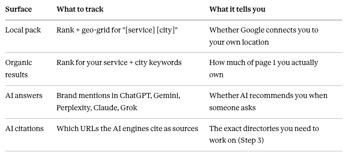
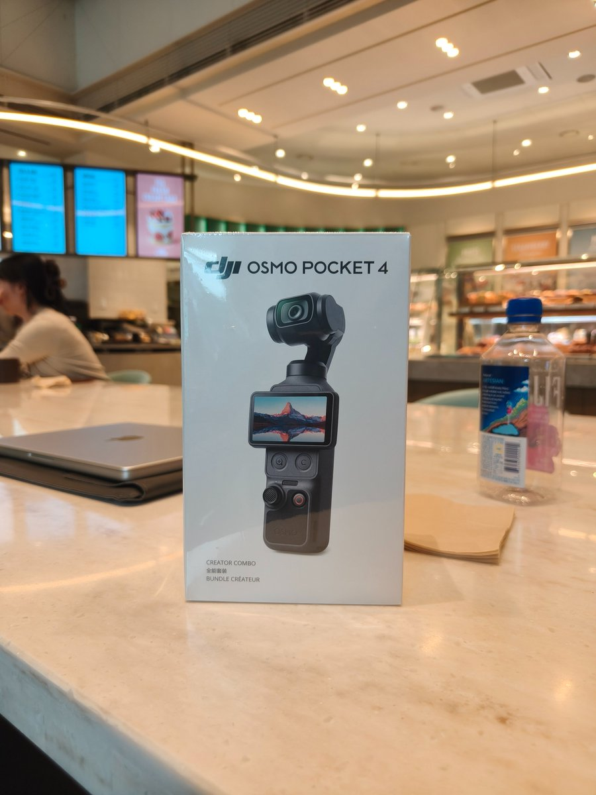
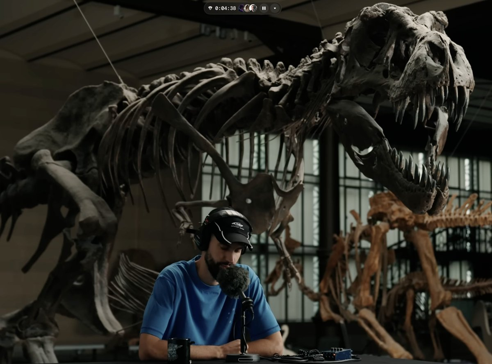

# local seo masterclass for 2026, enjoy :)
> Source: https://x.com/NicholasDulait/status/2102672086854484006
> Author: Nicholas Dulait (@NicholasDulait)
> Posted: 2026-09-23T08:11:05+00:00
> Captured: 2026-10-15T09:02:28+00:00
> Stats at capture: 24,429 views · 51 likes · 6 replies · 3 reposts · 202 bookmarks · 1 quotes

## Post

https://x.com/i/article/2102667421370707968

## Article: local seo masterclass for 2026, enjoy :)

Local SEO in 2026 is broken for most people: 
↳ 700 reviews, still stuck on page 2 of the map 
↳ Invisible in ChatGPT 
↳ Citations and blog posts that bring zero calls

Local visibility now happens on four surfaces at once:

- the map pack

- organic results

- AI answers

- the directories AI engines pull their answers from

Most strategies only work on the first one.

The steps below run in a specific order. The order is the method. Each step feeds the next one.

First, the case that makes the point.

Oh and if you're looking for a tool that will fix your local SEO:

You can [try ChatSEO](https://chatseo.app), the SEO agent for local SEO (🎁 7 days free)

For the sake of this masterclass, let's take a dentist.

Here's why, and how to fix it.

### Step 1: Benchmark four search surfaces before you touch anything

The instinct when you open a new site is to start fixing. Don't. Not even the obvious mistake you just spotted.

Take a snapshot first. If you fix things before you measure, you can never prove what worked. That matters for your own learning, and it matters ten times more if this is a client paying you a retainer.

And the snapshot can't be "where do we rank on Google". For local, you track four surfaces:

Then install the three basics: Google Search Console, Google Analytics 4, and call tracking. For a local business, a call is the conversion. If you don't track calls, you're flying blind on the one metric the owner cares about.

The organic side of the snapshot is the easy part: connect Search Console and GA4 to ChatSEO and your baseline (queries, pages, clicks, positions) is there before you change a single line. That's your "before" for every fix that follows.

For the dentist, the benchmark showed:

- #20 in the local pack, with a geo-grid weak across Ballwin itself

- Decent organic rankings, with competitors ahead on several engines

- Visible in 4 AI platforms (Gemini, Perplexity, Claude, Grok), but not in ChatGPT, the one with the most users

- A clear list of third-party sites being cited in AI answers for local dentists

That last line becomes your to-do list later. Keep it.

### Step 2: Fix the Google Business Profile first, because it's the fastest lever you have

Here's the mistake. The practice is located in Ballwin. It serves Ballwin. But the profile was optimized for Chesterfield, the neighboring city.

So Google had a practice in Ballwin telling it, in effect, "I'm about Chesterfield". Result: #20 at home.

The fix takes seconds. Point the profile at the city where you actually are.

Nobody should promise results in SEO. But this pattern shows up again and again, and fixing it alone often moves a profile 5 to 10 spots in the map pack. Same for the primary category: the wrong category is the other one-second fix that moves rankings. Here the category (Dentist) was already right, so location was the whole problem.

Why it's so powerful: Google's local ranking comes down to relevance, distance and prominence. This practice already had prominence (700 reviews). It was losing on relevance to its own city. You don't need more reviews when the signal pointing Google at the right city is broken.

After the fix, the GBP routine is simple:

- Keep driving Google reviews, consistently, not in bursts

- Add more visual depth: photos of the office, the team, the equipment

- Recheck location and category every time someone touches the profile

That's it. Most people overcomplicate the GBP. Get the location and category right, then feed it reviews.

### Step 3: Find the 4 to 7 directories that AI engines actually cite

This is where the playbook breaks from how local SEO worked for a decade.

The old way: build citations in bulk. Submit to 100+ directories, tick the box, move on. Honestly, it barely mattered.

Citations matter again. But not as a volume game.

AI engines answer "best dentist in Ballwin" by retrieving pages and citing them. Go back to the AI citations data from Step 1 and look at which third-party sites appear. For this dentist, four came up:

- HealthGrades

- Delta Dental (the insurer's dentist directory)

- Yelp

- ADA.org

That's the list. Not 150 directories. Four.

Across most local industries, 4 to 7 citation sources actually show up. The rest are probably not worth your time at all.

This also means your citation list is different for every niche. A plumber's list won't include HealthGrades. A lawyer's will include sites a dentist never needs. You don't guess it. You read it off the AI citations.

### Step 4: Do SEO on those directories, not just on your website

Being listed on HealthGrades isn't enough. You need to rank inside HealthGrades.

Search the directory for dentists in the area and the practice is buried far down the list. So when an AI engine retrieves that page, it sees other brands first.

Three moves to fix it.

1. Consider the sponsored slots. The HealthGrades results page had 3 sponsored listings at the top. AI engines don't care whether a listing is paid. They see the brands at the top of the page and weigh them because they're the most retrievable. If the directory is a top citation in your niche, a sponsored slot might be one of the cheapest AI visibility plays available.

2. Split your review effort 90/10. 90% of your review requests go to Google. The other 10% go to these secondary review surfaces. That's how you climb inside the directory and give AI engines fresh signals from a source they already trust.

3. Rewrite the profile like a web page. The practice's HealthGrades profile was thin. Strip out the directory boilerplate and you were left with roughly one sentence about what the practice does.

Treat it exactly like a page on your site:

- Get the topics and entities that should be covered for your target (e.g. "cosmetic dentist Ballwin") from the pages already ranking for it

- Generate a full draft, around 500 words as a starting point

- If the platform has a character limit, compress it to 150 or 300 words while keeping the key topics

- Make sure each service you offer (veneers, implants, Invisalign) is covered naturally

In ChatSEO, that's one message: ask it to analyze the top results for your keyword and write the profile around what they cover, then ask for the 300-word version. You paste it into the directory yourself.

Bonus: a well-optimized directory profile can rank in Google's organic results on its own. That's one more slot on page 1 that belongs to you, even though you don't own the domain.

Then repeat for every directory on your list. Optimize your website, then optimize your profiles.

### Step 5: Audit your brand's footprint for inconsistencies

AI engines build their picture of your business from everything written about it online. If that picture is contradictory, you lose trust and visibility.

One prompt in ChatGPT, using a reasoning model with web search, can scan the internet for inconsistencies about a business.

For this practice, it found something no rank tracker would: the practice had changed hands. The current dentist took it over, and the web was still full of the previous dentist's info. Old names, old details, scattered across directories and profiles.

That's a massive to-do list from one prompt. Clean it up source by source, starting with the sites that appear in AI answers or on page 1.

You can use Deep Research too, but a reasoning model with web search gets you a comparable report in a fraction of the time.

Here's the prompt:

> Search the web for every mention of [Business Name], [address] and [phone number]. List every inconsistency you find in business name, address, phone, hours, practitioner or owner name, services and website URL, across directories, review sites, social profiles, maps and news. For each one, give the source URL, what it says, the correct value, and a priority (high if the source appears in AI answers or on Google page 1). Flag anything linked to a previous owner, old address or old phone number.

### Step 6: Clean up the technical and on-page basics

Run a crawl and plug in GSC and GA4 if you have access. This site wasn't in bad shape. Two issues stood out, and they're the same two you'll find on most local sites.

Over-optimized title tags. The site had titles like "Dental Bonding in Ballwin, Missouri", which is fine. Then it had variations stacking the city, the state abbreviation and the ZIP code.

The rule: one clean version. "Dental Bonding in Ballwin, MO | Practice Name", or the dentist's name instead of the practice name. That's it.

The reasoning: LLMs and Google both understand that "Ballwin, Missouri", "Ballwin MO" and the ZIP code refer to the same place. Stuffing all three adds nothing, and it probably hurts you more than it helps.

Boilerplate meta descriptions. Many pages shared the same generic meta description. In 2026 there's no excuse for that: every page can have a unique description in minutes.

One rule most people miss: don't put your phone number in the title or meta description. If the searcher can grab your number from the snippet, they don't click. Organic CTR feeds rankings, so a snippet that kills clicks costs you positions too.

Important: this only applies to traditional organic results. On your Google Business Profile, the phone number obviously stays.

This is the step nobody should do by hand anymore. With ChatSEO connected to Search Console and your WordPress or Shopify site, you ask it to find the stuffed titles and duplicate metas, review the rewrites, approve, and they're live. For a 40-page local site, that's minutes instead of an afternoon.

### Step 7: Build one page per service + city, and optimize it properly

The practice already had the right structure: dedicated pages like "Invisalign in Ballwin, Missouri". Service plus core location. Keep that structure.

The problem was the optimization of those pages. The homepage, for example, had too many words and was aggressive without being well optimized.

What a good local page looks like:

- A word count within the median range of the competitors ranking for that keyword. Not double. Not half.

- All the critical topics and entities covered for that service in that location

- Optimized for one primary topic and one location

The workflow: look at what ranks for "cosmetic dentist Ballwin Missouri", list what those pages cover and how long they are, then write a page that matches the range and fills the gaps. ChatSEO runs that SERP analysis for you, drafts the page, and publishes it to your CMS once you've checked it. Design still needs a human pass.

Priority order: your main service pages first, then every secondary service. Only after that do you move to content.

### Step 8: Write local content, not national content

This is the mistake almost every local blog makes.

The practice's blog had articles like "How long do dental implants last?". That's a national question. Thousands of sites answer it, AI answers it directly, and it does nothing for a practice that only serves Ballwin.

The rule: every piece of content should build relevance for your location and your expertise. Not general topics.

What that looks like in practice: statistics-driven, local linkbait. Content built on Ballwin-specific data that local news, bloggers and organizations would want to cite. Some ideas will be good, some won't. But ideas are no longer the bottleneck. Execution is.

The prompt, which works in ChatGPT or directly in ChatSEO (where it also sees the queries your site already gets impressions for):

> I run [business type] in [city, state]. Give me 15 content ideas built on local data I can collect or compile myself (a local survey, public records, price comparisons across the area, local rankings, seasonal trends). Each idea must be specific to [city], something local media, bloggers and organizations would want to reference. For each: the headline, the data source, and 3 local sites likely to link to it.

### Step 9: Prospect local links in one prompt

The last piece is off-site. Local links build local topical authority, the signal that says "this business belongs to Ballwin".

The point here is speed: one well-written prompt produces a full list of city-specific link prospects in about 4 minutes. Work that used to take a full day of manual prospecting.

The prompt:

> Find link opportunities for a [business type] in [city, state]. Include local news sites, chambers of commerce and business associations, local events open to sponsors, schools and sports clubs, local bloggers and podcasts, "best of [city]" lists, nonprofits, and complementary businesses. For each: name, URL, why they would link, and the exact angle to pitch.

Then you do the part AI can't: reach out, sponsor, show up.

### Why the order matters

Recap the sequence:

1. Benchmark four surfaces (so you can prove every gain)

1. Fix GBP location and category (fastest lever, biggest jump)

1. Find the 4 to 7 directories AI cites (your citation list comes from data, not a template)

1. Rank inside those directories (sponsored slots, 90/10 reviews, rewritten profiles)

1. Clean up brand inconsistencies (so AI engines get one coherent story)

1. Fix titles and metas (no ZIP stuffing, no phone numbers)

1. Build and optimize service + city pages (service pages before any blog post)

1. Write local, data-driven content (never generic national topics)

1. Build local links (topical authority tied to your city)

It runs from cheapest and fastest to slowest and most compounding. Steps 1 to 4 can move rankings within weeks. Steps 7 to 9 are what keep you there when competitors wake up.

And steps 3 and 4 only exist because you tracked AI citations in step 1. Skip the benchmark and you'd be back to submitting to 150 directories.

### The honest caveats

A few things worth saying before the replies do.

This is one site. It's a live teardown, not a case study with results. The 5 to 10 spot lift from the location fix is a pattern seen across many campaigns, not a measured outcome on this practice.

CTR as a ranking factor. Google denied using clicks for years. Its own testimony in the 2023 US antitrust trial described a system called NavBoost that uses click data. Directionally it holds, but don't treat it as settled science.

"AI engines don't care if a listing is sponsored." Plausible, since they retrieve the page as it's rendered. There's no hard data proving it yet. Test it on one directory before you spend money on all of them.

The directory list is niche-specific. HealthGrades and Delta Dental are dentist answers. Pull your own list from AI citations in your niche.

### Where the time actually goes

Run this on one local business and you'll see the split. The GBP fix takes seconds. The directories and links take judgment and outreach. The on-site work (baseline, titles, metas, service pages, content ideas) takes the most hours, and it's the most repetitive.

if you're looking for a tool that will fix your local SEO:

You can [try ChatSEO](https://chatseo.app/), the SEO agent for local SEO (🎁 7 days free)

## Media

 — Direct article media. Source media: https://pbs.twimg.com/media/HS4wOAhXQAA8TJC.jpg
 — Direct article media. Source media: https://pbs.twimg.com/media/HS4vSFIXEAAo_ya.png
 — Reply 2110634494046687357 media 1. Source media: https://pbs.twimg.com/media/HUH1uCaWIAARd_i.jpg
 — Reply 2110393935470453144 media 1. Source media: https://pbs.twimg.com/media/HUmgB-absAErZIj.jpg
 — Reply 2110507421278126316 media 1. Source media: https://pbs.twimg.com/media/HUoGkYwbwAAvPEI.jpg
[Reply 2110486949383254510 media 1](media/video-01.mp4) — Source media: https://video.twimg.com/amplify_video/2110486855040778241/vid/avc1/576x814/TJi8mNBrMrrPb717.mp4?tag=29

## Comments

### Robin | Poker x AI ([@RobinHill85](https://x.com/RobinHill85/status/2102740115424444737)) — 2026-09-23T12:41:25+00:00

@NicholasDulait Benchmarking AI citation sources first surfaces the real leverage points, so later fixes actually move the pack
### BeeReach ([@BeeReach_io](https://x.com/BeeReach_io/status/2102783221146472727)) — 2026-09-23T15:32:42+00:00

@NicholasDulait starting with a full benchmark of map, organic, ai and directories lets you see the actual gaps before any changes
### Alpi T. ([@tothalpar1](https://x.com/tothalpar1/status/2102688416093680002)) — 2026-09-23T09:15:59+00:00

@NicholasDulait The fourth surface is the one most audits skip. For a dentist, one stale directory listing with old hours can contradict a clean GBP and the AI answer picks up the wrong one. In the benchmark step, how do you decide which directories to check for a given city and niche?

## Other returned timeline records

> The CLI did not expose reply relationships. These records do not start with a reply mention and were authored by someone other than the saved-post author. They may include recommendations or promoted posts; they are retained as source context, not verified replies.

### Ethan Caldwell ([@EthanCalFounder](https://x.com/EthanCalFounder/status/2110634494046687357)) — 2026-10-15T07:30:51+00:00

i'm sorry, Claude can WHAT?

it can take your website link, find people who need your product, email them and book the calls?

since when?? i've been doing this by hand for a YEAR.

ok. testing it: $30 free 👇

https://t.co/l0hylb6vAM https://t.co/xYw8Syj56Y
 — Source media: https://pbs.twimg.com/media/HUH1uCaWIAARd_i.jpg
### Le Dev ULTIME 🍜 ([@ledevultime](https://x.com/ledevultime/status/2110393935470453144)) — 2026-10-14T15:34:58+00:00

Est-ce le moment de faire des vlogs ULTIME ? https://t.co/ob6gs7Npsa
 — Source media: https://pbs.twimg.com/media/HUmgB-absAErZIj.jpg
### N. ([@Nlacombe_](https://x.com/Nlacombe_/status/2110507421278126316)) — 2026-10-14T23:05:55+00:00

I'll say yes to the next podcast, but only if this is the scene behind us. https://t.co/nATEv6DJfy
 — Source media: https://pbs.twimg.com/media/HUoGkYwbwAAvPEI.jpg
### Gratin 🥔☢️ ([@mat_augmente](https://x.com/mat_augmente/status/2110462740192243901)) — 2026-10-14T20:08:22+00:00

Divise par 4 sois normal
### La Twitchance ([@LaTwitchance](https://x.com/LaTwitchance/status/2110486949383254510)) — 2026-10-14T21:44:34+00:00

Squeezie paie SYLVAIN pour une OP de sa boisson « CIAO ENERGY » et il l’a démolit..

Le visage de Squeezie. 😭 https://t.co/GMkAFhR10P
 — Source media: https://video.twimg.com/amplify_video/2110486855040778241/vid/avc1/576x814/TJi8mNBrMrrPb717.mp4?tag=29

## Links

- https://x.com/i/article/2102667421370707968
- https://chatseo.app
- https://chatseo.app/
