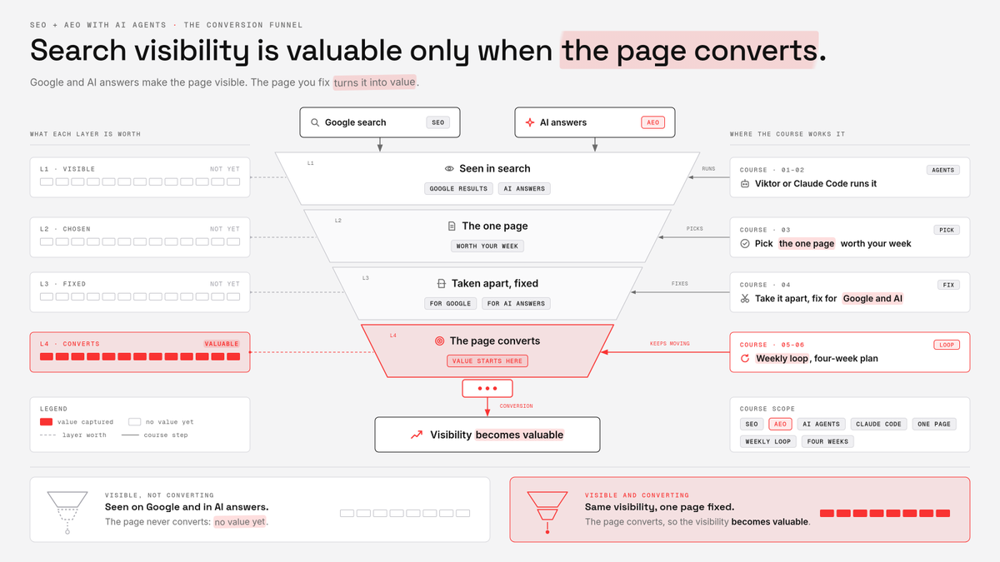
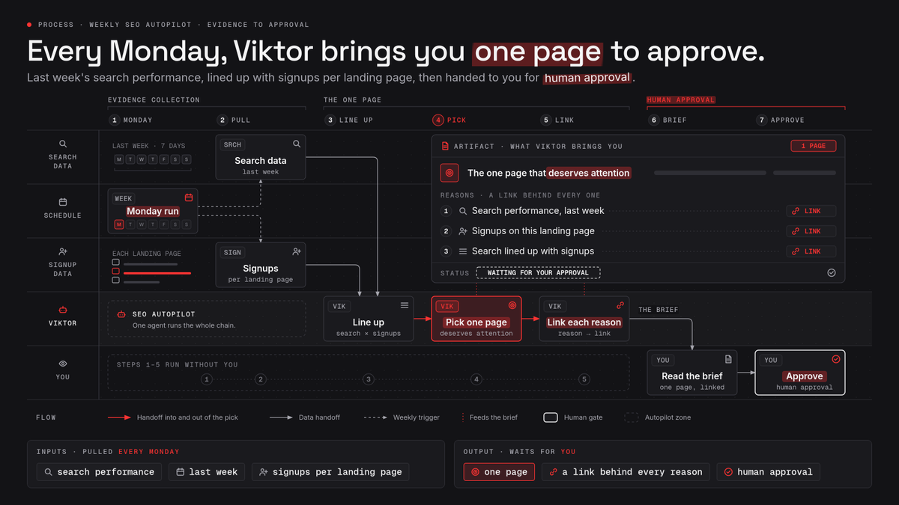
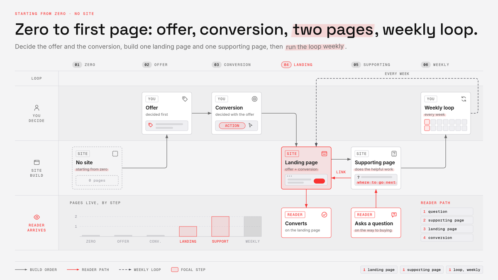
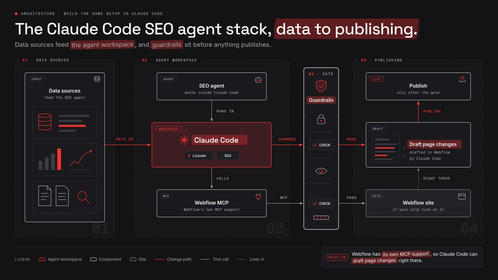
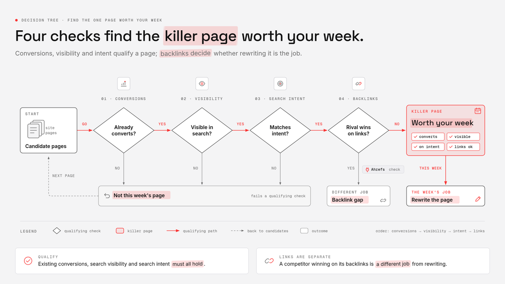
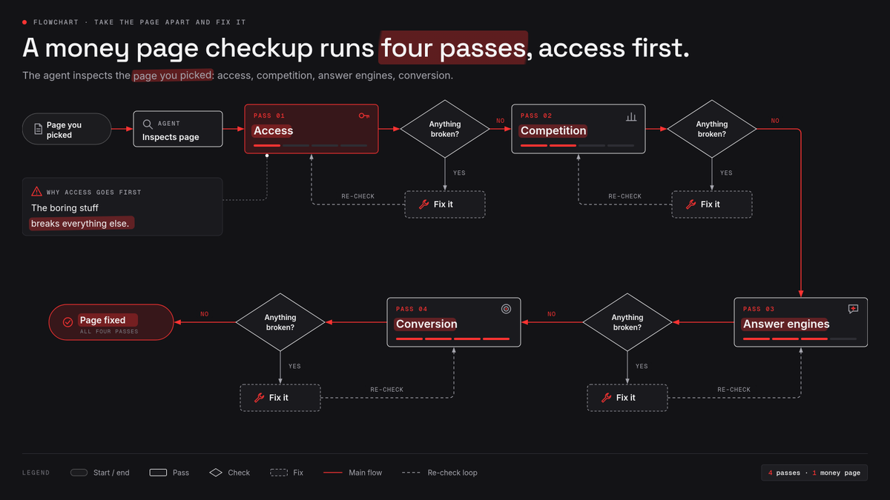
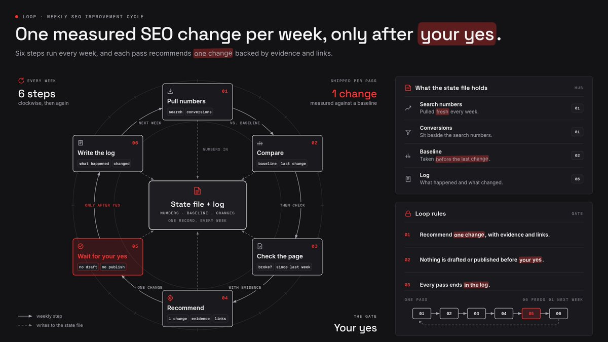
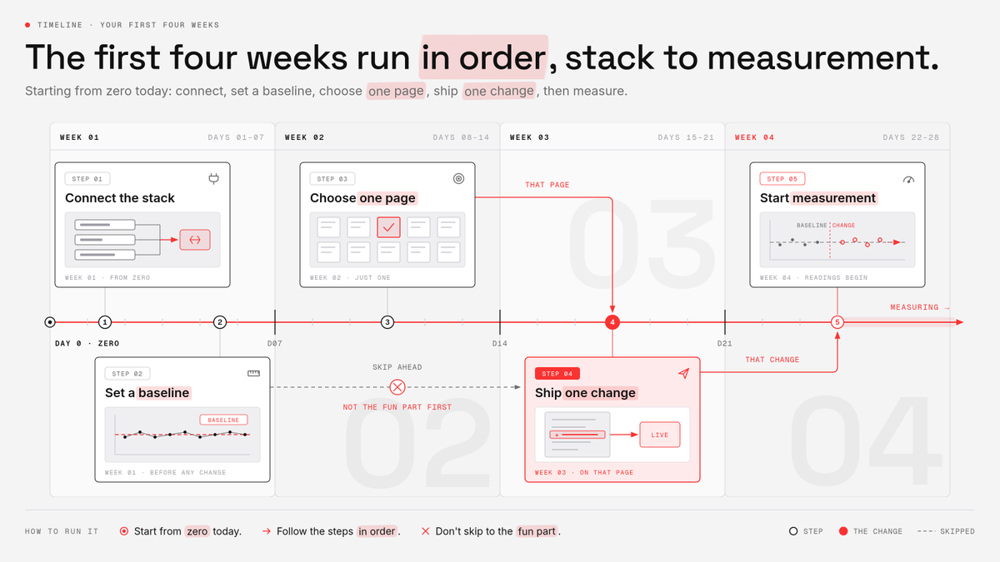

# How to automate SEO with Opus 5.5 (Full Course)
> Source: https://x.com/EXM7777/status/2102758425386172842
> Author: Machina (@EXM7777)
> Posted: 2026-09-23T13:54:10+00:00
> Captured: 2026-10-15T09:02:28+00:00
> Stats at capture: 872,610 views · 1,486 likes · 38 replies · 95 reposts · 5,947 bookmarks · 30 quotes

## Post

https://x.com/i/article/2102758417706405888

## Article: How to automate SEO with Opus 5.5 (Full Course)

I'm going to walk you through the SEO & AEO setup i run with AI agents, from the lazy autopilot version to the full Claude Code build on Opus 5.5, step by step...

because search changed shape a while ago, and now your pages have to win two games at once: the blue links on Google and the answers ChatGPT or AI Mode hand back to someone who never clicks anything

and before we touch a single tool, you need to hear the one rule that decides whether any of this is worth your time

a lot of people chase shiny numbers in Google Search Console, more impressions, higher positions, a nicer curve to screenshot... and none of it counts if the pages that rank don't convert

so if your pages have no clear next step, no signup, no booked call, no checkout, fix that first, because every hour you put into this article after that is wasted until they do

here's what we'll cover, in the order you'd actually build it:

- the easy route where one employee runs the whole loop for you

- a zero-to-first-page path if you don't have a site yet

- the same setup built by hand inside Claude Code

- how to pick the one page worth your week

- how to take that page apart and fix it for Google and AI answers

- the weekly loop that keeps it all moving

- a four-week plan so you're not staring at a blank folder

### start with the easy route using Viktor

i'll be straight with you, the Claude Code version later in this article is fun to build, but plenty of you don't want to build anything, you want SEO handled while you run the business

that's where Viktor fits, because it's an AI employee that lives inside your Slack and does the work there, so your whole team sees what it's doing and can jump in

you connect your tools once, most of them with one click, a few with an API key, and Viktor takes care of the login side and starts working right away with no webhooks and no Zapier chains to babysit

for SEO, the connections i'd plug in first are these:

- Google Search Console, so it can read how your pages perform in search

- DataForSEO, for keyword data, live rankings and competitor domains

- Ahrefs, for backlinks and the sites linking to your competitors

- Wordpress/Webflow, if your site lives there, so it can edit page titles, descriptions and schema

- PostHog, so it can see signups and funnels, which is the part everyone forgets

that last one is why this setup works for me

once Viktor can see your search numbers AND your conversion data in the same conversation, it stops recommending pages that bring traffic nobody pays for

then you give it a recurring job, in normal words, like you'd brief a new hire

something like every Monday, pull last week's search performance, line it up with signups per landing page, and bring me the one page that deserves attention, with a link behind every reason

you can get $100 in free credits at [viktor.com](https://ref.viktor.com/machina-x-4)

### starting from zero with no site

quick detour for anyone reading this with no website and no SEO behind them yet, because everything after this section assumes you already have pages to work on

the goal here is small on purpose, one page that sells one thing to one kind of buyer, plus one page that sends people to it

so before you open any builder, write down what you sell and what a conversion means for you, whether that's a signup, a booked call or a purchase

that line becomes the first thing your agent reads later, so it's worth getting right now

then pick one problem your customer already has, and one search topic around it that someone would type right before they'd pay to fix it

a topic people search out of curiosity brings visitors who leave, and a topic people search when they're ready to act brings buyers, so go with the second one

next, put up the simplest site you can in Webflow or WordPress, with your offer, a way to reach you, and nothing fancy - use Claude Code to build it

(the design can stay simple for a while, nobody converts because of a gradient)

on that site, you start with exactly two pages:

- one focused landing page built around that topic and your offer

- one useful supporting page that answers a close question

the landing page gets one clear next step near the top, the same signup, call or checkout you wrote down at the start

the supporting page does the helpful work, answering a question people ask on the way to buying, then links to the landing page so the reader knows where to go next

once both pages are live, you're at the same starting line as everyone else in this guide, and Search Console, DataForSEO, Firecrawl and PostHog get plugged in with the Claude Code build right below

from there, your two pages are the only candidates the weekly loop has to judge, which makes your first month simpler than it is for someone sitting on a pile of old posts

### building our setup in Claude Code

the setup is one folder on your computer, and that folder is the whole brain of your SEO agent, so it's worth getting it right

inside it, i keep three files that the agent reads every single run:

- a brief that explains the business, the offer, who buys and what counts as a conversion

- a state file that holds the current baseline numbers for each page you're working on

- a running log where every run adds a new entry and never deletes an old one

the brief is the file you'll edit the most, because the agent only judges a page as well as it understands what the page is supposed to sell

the log is the one that saves you later, because three weeks from now you won't remember why you changed a title, and the agent won't either unless it wrote it down

then come the tool connections, and i'll keep this to the ones that earn their place

Google Search Console is first, and to reach it from an agent you need a Google account with access to your site, a project in the Google API console and OAuth credentials

it sounds scary, but it takes one sitting and you only do it once

DataForSEO comes next, and it's the tool i lean on most for search data inside an agent, because it's built to be called from code

through it you get keyword volumes, the live top pages for any query, and even what Google's AI Mode shows for a keyword

before you point the agent at it, use their sandbox, which returns fake data in the exact same shape as the real thing and doesn't charge you a cent, so your agent learns the format before it touches your budget

Ahrefs is optional, and i'd only add its API if you already pay for it, because you'll mostly use it to see backlinks and which sites link to competitors instead of you

Parallel is the web search layer, and it's what the agent uses when it needs to look something up outside your own tools, like where your topic gets discussed or what a competitor claims on their pricing page

Firecrawl handles reading pages, because you give it a URL and it crawls the site, deals with JavaScript and sitemaps, and hands back clean text the model can actually read

and for conversions, i use PostHog, whichever the site already has, as long as the conversion is tracked on purpose with a named event instead of whatever the tool picked up by itself

you can wire each of these in as an MCP server or as a small script the agent calls, depending on what the tool offers

Claude Code supports hooks, which are small rules that run before a tool is used, and you can set one that forces the agent to ask you before anything that publishes, edits a live page or submits a URL

for the recurring runs, use a scheduled task where you pick the instructions, the folder, the model and the schedule, and each run opens as a fresh session you can review

i pick Opus 5.5 there, because this whole loop lives or dies on judgment calls about which page deserves your week, and that's where i want the strongest model i have (also cheaper than you'd expect)

keep that task in the permission mode that stops and waits when it hits something it isn't allowed to do, because that pause is your approval step

the cloud routines are handy too, but they run on their own without stopping for approval, so give them read-only access and never hand them the keys to publish

### find the one page worth your week

this is where the conversion rule turns into actual work, because the agent's first job is to find ONE page where better rankings would turn into more money

i know it's tempting to audit the whole site on day one, but a sitewide audit hands you a pile of small problems and no idea which one pays, so we go narrow

the agent opens Search Console first and pulls every page with its impressions, clicks and average position over the last few weeks

then it pulls conversions per landing page from PostHog, and lines them up next to the search numbers, page by page

what you're looking for is a page that already converts the visitors it gets and already shows up in search, but sits just low enough that most searchers never see it

i call that the killer page, because it's the one place where a ranking bump flows straight into signups instead of into a prettier chart

a page with tons of impressions and zero conversions is a trap, and the agent should flag it as one instead of recommending it

once you have two or three candidates, DataForSEO checks the queries behind each page, how many people search them, and who's ranking at the top right now

then the agent looks at the live search page for the main query, because the numbers alone lie all the time

if the top spots are all how-to guides and your candidate is a pricing page, the query wants something different from what you sell, and no amount of tuning will fix that mismatch

so every candidate gets one of three calls from the agent, keep it, keep it once you fix one condition, or drop it

and whatever it decides, it has to explain the call with links to the pages it looked at

if you have Ahrefs connected, this is also the moment to check backlinks, since sometimes a competitor wins on the strength of the sites linking to them, and that's a different job from rewriting the page

a few warnings about Search Console data before you trust it:

- the numbers land two or three days late, so today is always missing

- when you break data down by page and query at once, some rows get dropped

- AI Overview appearances can make average position look better than reality

i'd also tell the agent to pull the data one day at a time and store it in the state file, because that avoids the quota walls and gives you a clean history to compare against later

by the end of this step, you should have one page, one main query, and a short written reason for why that page is the bet

### take the page apart and fix it

now the agent inspects the page you picked, and i like to think of it as a full checkup in four passes, starting with the boring stuff that breaks everything else

first, can Google even reach it, which means Googlebot isn't blocked, the page returns a normal status code, and there's real text on it that can be indexed

Search Console's URL Inspection tool and Page Indexing report answer that in a minute

and if your site leans on JavaScript, have the agent compare what Firecrawl sees after rendering with what the raw page ships

then speed, and for that i run the PageSpeed Insights API on the page, mobile first, and only care about the failures that are big enough to hurt a real visitor

speed and access carry over to AI answers too, because Google says a page has to be crawlable, indexed and eligible for a snippet before it can show up as a link inside AI features

second pass is the competition, and here the agent does what you'd do by hand if you had an empty afternoon

DataForSEO pulls the top ten pages for the main query, Firecrawl scrapes each of those pages in full, and Opus 5.5 reads them side by side with yours

reading the full page is the point, because an agent guessing at what a competitor wrote will invent things, and an agent reading the actual page won't

what you want back is a short list of what the winners cover that you don't, questions they answer that you skip, and anything your page says better than all of them

the rule i give the agent is that every claim in its report comes with the URL it came from, and if some data is missing, it says the data is missing instead of filling the hole with a guess

this is the difference between an audit that looks impressive and one you can act on, because the second you ask where a finding came from, a guessed audit falls apart

third pass is the answer engines, and i'll keep it grounded because this is where the made-up advice piles up

Google says there's no special trick for AI Overviews or AI Mode, the normal SEO basics still apply, and it even tells you not to bother with things like llms.txt files

schema is a good example of hype outrunning evidence, since Ahrefs ran a large matched test adding schema to pages and saw no meaningful jump in AI citations across Google and ChatGPT

so i treat schema as something you add when the page fits a rich result, and never as an AEO shortcut

the changes that make sense for AI answers are about how the page reads:

- answer the question in the first line under each heading

- make each heading match the way people ask the question

- write each section so it makes sense read on its own

- keep your business details the same everywhere they appear online

that last point is bigger than it looks, because AI answers pull heavily from third-party sites like Reddit, YouTube, forums and industry publications, so what others say about you counts as much as your own page

this is where Parallel earns its spot, since the agent uses it to search for where your topic and your brand get discussed

what comes back is a list of places where your details are wrong, and threads where you're missing from a conversation you should be in

to check whether AI answers already cite you, DataForSEO can show what AI Mode returns for your query

Bing Webmaster Tools goes one step further with an AI Performance report listing which of your pages get cited in AI answers

fourth pass is the one this whole article hangs on, the path from the page to the conversion

the agent reads the page like a buyer would and checks whether there's one obvious next step, whether it shows up early enough, and whether the page actually answers the doubts someone has right before they sign up

then it checks the tracking, because if the signup isn't recorded as its own named event, you'll never know whether any of the SEO work paid off

internal links go here too, because the agent spots the pages on your own site that already get traffic and suggests where a link to the money page belongs

at the end of the four passes, the agent writes everything into one report in the folder, ranks the fixes, and recommends ONE change to make first

### run the loop every week

this is the part that turns a one-off audit into a system, and it's also where agents get dangerous if you let them react to everything

the loop i run is short, and the agent repeats it every week on the schedule you set up earlier:

1. pull fresh search numbers and conversions into the state file

1. compare them with the baseline from before the last change

1. check whether anything on the page broke since last week

1. recommend one change with the evidence and the links behind it

1. wait for your yes before drafting or publishing anything

1. write what happened and what changed into the log

one change at a time sounds slow

it is, on purpose, because if you change the title, the intro and the internal links in the same week, you'll never know which one did the work

the agent should also know that small ranking wiggles are normal, since Google itself says positions move around all the time and sometimes come back on their own

so i tell it to ignore anything that moves for less than a couple of weeks, and to never touch a page that's already doing well unless there's a strong reason

some changes show up in a few days and others take months

which is why the log earns its keep, since the agent needs to know how long ago each change went live before it judges anything

and when it does judge, it looks at two things together, the search side and the business side

a page that climbed in search and brought zero extra signups goes in the log as a miss

and a page that stayed flat in rankings but converted better after a clearer call to action goes in as a win, no debate

the same caution applies to AI citations, because Bing says its citation trends can't be tied to one specific change, and a model update on their side can move numbers you had nothing to do with

i also keep the agent's instructions frozen during a test, since changing the prompt mid-experiment makes this week's check incomparable with last week's

when you approve a change, the agent drafts it, in Wordpress, Webflow or wherever your site lives, and you do the final read before it goes live

that last read is where your taste comes in, because the agent is great at finding what's wrong and much worse at knowing what your brand would never say

### your first four weeks

here's how i'd lay out the first month if you were starting from zero today, and i'd follow it in order instead of skipping to the fun part

in week one, you connect everything and set the baseline

that means Search Console, DataForSEO, Firecrawl, Parallel and your conversion tracking, plus Ahrefs if you already have it, with spend limits and approval rules set before the first real run

you write the brief, confirm your signup or sale is tracked as a named event, and let the agent pull a few weeks of history into the state file

if you're going the Viktor route, week one is just connecting the same tools there and giving it the recurring job

in week two, the agent finds the money page and runs the four-pass checkup on it

you read the report, push back on anything that doesn't have a source, and agree on the one change you'll make first

week three is shipping week

the agent drafts the change, you review it, you publish it yourself, and the log records the date and exactly what moved

in week four, you set up the recurring loop and start measuring

the scheduled task or the Viktor job runs every week from now on, and you give the change a few more weeks before calling it a win or a miss

after that, you pick the next change on the same page or the next money page, and the system keeps going with you making one decision a week instead of doing all the digging yourself

this is the whole setup i use, and none of it needs you to be an SEO expert, it needs you to admit which pages make money and which ones just look good

for the autopilot version, Viktor runs this for you inside Slack or Teams with your approval on every sensitive move

if you want to build it yourself, open Claude Code, make the folder, and write the brief tonight

and whatever you pick, make the pages convert before you ask for a single extra visitor

thank you Viktor for sponsoring this guide, you can get $100 in free credits at [viktor.com](https://viktor.com)

## Media

 — Direct article media. Source media: https://pbs.twimg.com/media/HS5_mtsaMAA2zTd.jpg
 — Direct article media. Source media: https://pbs.twimg.com/media/HS5_ndEbIAAzV6E.png
 — Direct article media. Source media: https://pbs.twimg.com/media/HS5_ouCbsAEfBR8.png
 — Direct article media. Source media: https://pbs.twimg.com/media/HS5_nuLasAAAJE-.jpg
 — Direct article media. Source media: https://pbs.twimg.com/media/HS5_oefawAEvGMQ.jpg
 — Direct article media. Source media: https://pbs.twimg.com/media/HS5_m6JaEAAHmyH.png
 — Direct article media. Source media: https://pbs.twimg.com/media/HS5_oNQbsAAoqY8.png
 — Direct article media. Source media: https://pbs.twimg.com/media/HS5_n8lbwAAlj-l.png
 — Direct article media. Source media: https://pbs.twimg.com/media/HS5_nLIaoAAk8E2.png
[Reply 2102775326891757677 media 1](media/animation-01.mp4) — Source media: https://video.twimg.com/tweet_video/HS6PA30XYAAR21c.mp4
 — Reply 2110634494046687357 media 1. Source media: https://pbs.twimg.com/media/HUH1uCaWIAARd_i.jpg
[Reply 2102759162509762784 media 1](media/animation-02.mp4) — Source media: https://video.twimg.com/tweet_video/HS6AUGNW8AAb_hD.mp4
 — Reply 2108255434125840740 media 1. Source media: https://pbs.twimg.com/media/HUIG-PMWEAEl_Iz.jpg

## Thread

### Machina ([@EXM7777](https://x.com/EXM7777/status/2102759544506208669)) — 2026-09-23T13:58:37+00:00

@VibeMarketer_ lmao

## Comments

### J.B. ([@VibeMarketer_](https://x.com/VibeMarketer_/status/2102759009040404489)) — 2026-09-23T13:56:29+00:00

@EXM7777 gained 1 million site links just by READING this
### vas ([@vasuman](https://x.com/vasuman/status/2102775326891757677)) — 2026-09-23T15:01:20+00:00

@EXM7777 https://t.co/7fI9aYXmYh
 — Source media: https://video.twimg.com/tweet_video/HS6PA30XYAAR21c.mp4
### Pounds ([@pounddz](https://x.com/pounddz/status/2102765624917471497)) — 2026-09-23T14:22:47+00:00

@EXM7777 @eptwts Now this is sauce man appreciate it
### Tom ([@tomcrawshaw01](https://x.com/tomcrawshaw01/status/2102786367885320579)) — 2026-09-23T15:45:12+00:00

@EXM7777 My guy already rinsing opus 5.5, wouldn’t expect anything less
### Farea ([@FareaNFts](https://x.com/FareaNFts/status/2102998005725184353)) — 2026-09-24T05:46:11+00:00

@EXM7777 machina dropped another banger
### RDeni ([@rostikdeni](https://x.com/rostikdeni/status/2102798533199814899)) — 2026-09-23T16:33:33+00:00

@EXM7777 amazing article for FREE

thanks Machina
### Harry Tandy ([@HarryTandy](https://x.com/HarryTandy/status/2102824034459079062)) — 2026-09-23T18:14:53+00:00

@EXM7777 Traffic means nothing without a conversion path.
### Richard Guerre ([@RichardGuerre_](https://x.com/RichardGuerre_/status/2102804236400775530)) — 2026-09-23T16:56:12+00:00

@EXM7777 @grok is it genuinely a good article or is it just selling viktor? this feels intentionally long that you have to give it to an agent
### Joey ([@morelifejoey](https://x.com/morelifejoey/status/2102793452207624393)) — 2026-09-23T16:13:21+00:00

@EXM7777 So now we automated "SEO" based on mostly inaccurate data (dataforseo and ahrefs) and get shitty results lol but let's use viktor for it he might safe us.
### anml ([@_anmlfrm](https://x.com/_anmlfrm/status/2102863716924743847)) — 2026-09-23T20:52:34+00:00

@EXM7777 so your first name is Viktor ✍️
### anml ([@_anmlfrm](https://x.com/_anmlfrm/status/2102863980922626478)) — 2026-09-23T20:53:37+00:00

@EXM7777 @grok give me prompt to do this in claude code without viktor
### Kevin ([@XDKevin100](https://x.com/XDKevin100/status/2103067815762604142)) — 2026-09-24T10:23:35+00:00

@EXM7777 I’m gonna create a skill out of this. Thank you
### Ky ([@ky_markets](https://x.com/ky_markets/status/2103046251143127204)) — 2026-09-24T08:57:53+00:00

@EXM7777 Banger
### Ori Mannheim ([@ItsOriMane](https://x.com/ItsOriMane/status/2102793706994880608)) — 2026-09-23T16:14:22+00:00

@EXM7777 another banger...
### Miko ([@Mho_23](https://x.com/Mho_23/status/2102876666045567383)) — 2026-09-23T21:44:01+00:00

@EXM7777 no way this is free
### MAX ([@maxxmalist](https://x.com/maxxmalist/status/2102759162509762784)) — 2026-09-23T13:57:06+00:00

@EXM7777 https://t.co/9brQtx1q1D
 — Source media: https://video.twimg.com/tweet_video/HS6AUGNW8AAb_hD.mp4
### Buzz ([@BuzzMalx](https://x.com/BuzzMalx/status/2102786808270512560)) — 2026-09-23T15:46:57+00:00

@EXM7777 can't believe this is absolutely free 

great article man!
### Apollon Foivos Bakis ([@ApFoivosBakis](https://x.com/ApFoivosBakis/status/2103075853924262288)) — 2026-09-24T10:55:31+00:00

@EXM7777 Really useful breakdown.
### Leverra ([@LeverraX](https://x.com/LeverraX/status/2103223126234370223)) — 2026-09-24T20:40:43+00:00

@EXM7777 Would love to see a follow-up in a month with the actual traffic results. Especially for a small site starting from zero.
### Nik ([@NikChainAi](https://x.com/NikChainAi/status/2102841619011846631)) — 2026-09-23T19:24:45+00:00

@EXM7777 Impressions without conversions is just a prettier screenshot.
### BeeReach ([@BeeReach_io](https://x.com/BeeReach_io/status/2102786700594618618)) — 2026-09-23T15:46:31+00:00

@EXM7777 nice point on linking search data to actual signups, that’s what keeps the loop honest. how do you handle noise in the conversion events?
### ThinkGPT ([@thethinkgpt](https://x.com/thethinkgpt/status/2103052070446305407)) — 2026-09-24T09:21:01+00:00

@EXM7777 https://t.co/mKLWQPKNga
### Stellan ([@Stellan79](https://x.com/Stellan79/status/2102866096256663645)) — 2026-09-23T21:02:01+00:00

@EXM7777 @grok is this Ai content?
### Phiϕrien ([@philorien_](https://x.com/philorien_/status/2102942011305365615)) — 2026-09-24T02:03:40+00:00

@EXM7777 The loop contradicts itself. It says to ship one change per week, then admits some changes take months to show and says to wait a few weeks before judging. If you ship a new change every week, each one gets mixed into the last, and you're back to not knowing which change did it
### Zaki Aziz ([@zakiaziz](https://x.com/zakiaziz/status/2102823014018740732)) — 2026-09-23T18:10:49+00:00

@EXM7777 How did you generate the diagrams in this article?
### Solo Firm AI Guy | Investor ® ([@Bijan_Automates](https://x.com/Bijan_Automates/status/2102934911162146926)) — 2026-09-24T01:35:28+00:00

@EXM7777 Tell me more
### The DevOps Guy ([@justdevopsguy](https://x.com/justdevopsguy/status/2102998137967399155)) — 2026-09-24T05:46:42+00:00

@EXM7777 promo wrapper around mostly good process
### Pranav Malvawala ([@pranavmalvawala](https://x.com/pranavmalvawala/status/2102990703181926676)) — 2026-09-24T05:17:09+00:00

@EXM7777 Gosh! What a long article
### Mitansh ([@mitansh_j07](https://x.com/mitansh_j07/status/2102764324188229767)) — 2026-09-23T14:17:37+00:00

@EXM7777 an seo plus aeo path through claude code is a very usable lesson.
the opus 5.5 agent setup is the part i want to sit with 💻
### bubuy ᵍᵐ ([@_mnibubuy](https://x.com/_mnibubuy/status/2103025720511598647)) — 2026-09-24T07:36:18+00:00

@EXM7777 @grok is all of this even worth it if you only have a 1-page landing website?

## Other returned timeline records

> The CLI did not expose reply relationships. These records do not start with a reply mention and were authored by someone other than the saved-post author. They may include recommendations or promoted posts; they are retained as source context, not verified replies.

### Ethan Caldwell ([@EthanCalFounder](https://x.com/EthanCalFounder/status/2110634494046687357)) — 2026-10-15T07:30:51+00:00

i'm sorry, Claude can WHAT?

it can take your website link, find people who need your product, email them and book the calls?

since when?? i've been doing this by hand for a YEAR.

ok. testing it: $30 free 👇

https://t.co/l0hylb6vAM https://t.co/xYw8Syj56Y
 — Source media: https://pbs.twimg.com/media/HUH1uCaWIAARd_i.jpg
### Rafal Kochanowski ([@rafalsoftware](https://x.com/rafalsoftware/status/2105746567571648627)) — 2026-10-01T19:47:59+00:00

I'm a software engineer who sees the full picture. Big-picture thinking and engineering depth.

Everyone can write that.

But you can verify this in a free conversation about your engineering problem, a decision you need to make, or a system you're planning to build.
### Ilya Batishchev ([@ilyabatishchev](https://x.com/ilyabatishchev/status/2108255434125840740)) — 2026-10-08T17:57:19+00:00

i'm sorry, Claude can WHAT?

it can take your website link, find people who need your product, email them and book the calls?

since when?? i've been doing this by hand for a YEAR.

ok. testing it: $30 free 👇

https://t.co/XIfPUVSpdg https://t.co/OJZklbfRxr
 — Source media: https://pbs.twimg.com/media/HUIG-PMWEAEl_Iz.jpg
### Atlas ([@Atlas3DAI](https://x.com/Atlas3DAI/status/2090814619275436444)) — 2026-08-21T14:53:45+00:00

A prompt goes in. A skeleton comes out, IK-ready.

Most text-to-3D stops at a static mesh. Atlas keeps going: standardized T-pose, rig, weights, so the character is animatable the day it is generated.

Try Atlas today
### ferlinux ([@ferlinux](https://x.com/ferlinux/status/2095775916869767477)) — 2026-09-04T07:28:10+00:00

Atelier claimed a building for $5 and has already received 184 visits.

Cost per visit: $0.027.
Average Meta traffic CPC: $0.70.

That’s around 26× cheaper—and its place on Claim Avenue is still there after the campaign ends. 👀

## Links

- https://x.com/i/article/2102758417706405888
- https://viktor.com
- https://ref.viktor.com/machina-x-4
