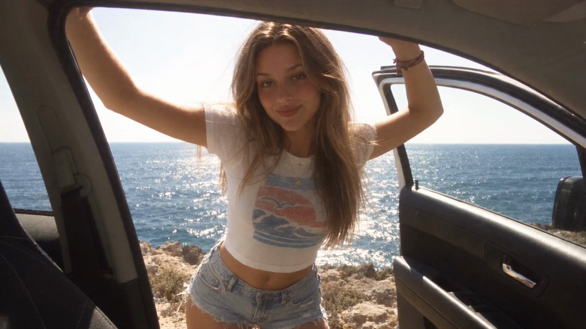
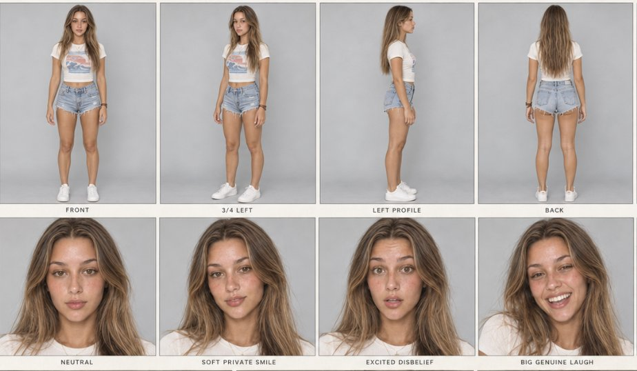
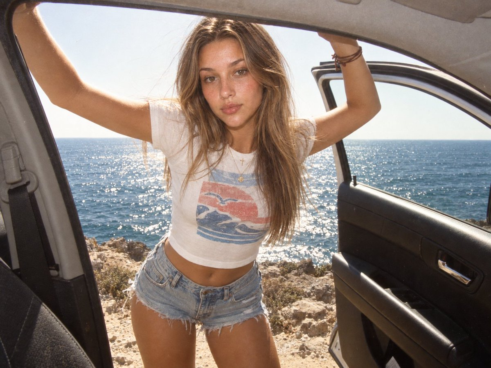
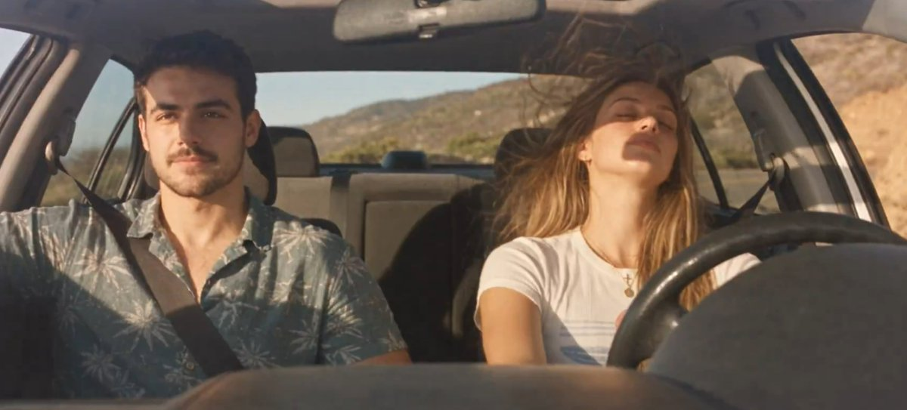
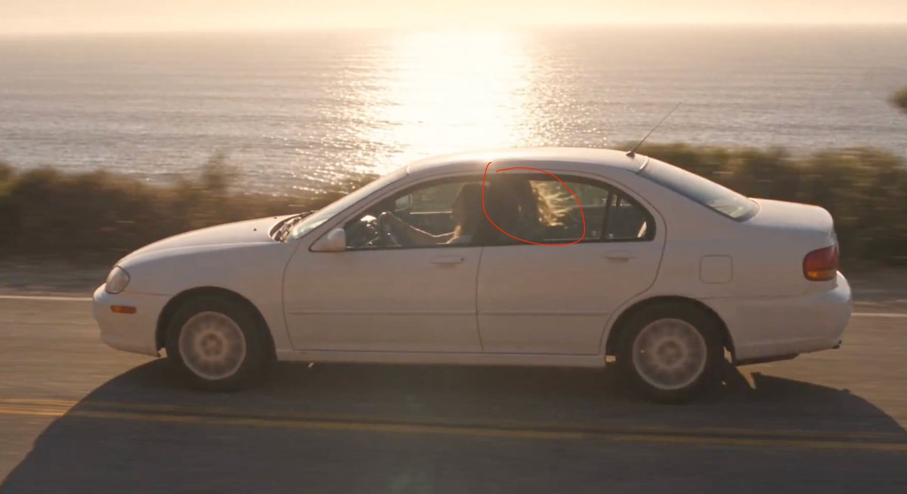
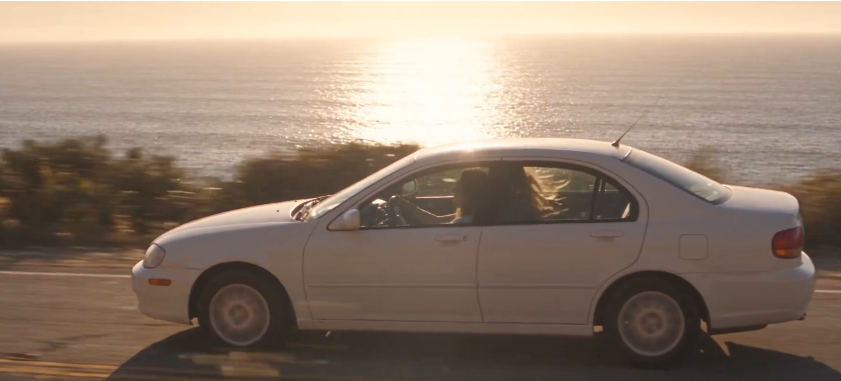

# omg…that i made this with Claude Opus 5.5 and Seedance 2.5
> Source: https://x.com/abxxai/status/2102775755646337530
> Author: Abdul Shakoor (@abxxai)
> Posted: 2026-09-23T15:03:02+00:00
> Captured: 2026-10-15T09:02:28+00:00
> Stats at capture: 267,197 views · 1,691 likes · 98 replies · 124 reposts · 3,926 bookmarks · 9 quotes

## Post

omg…that i made this with Claude Opus 5.5 and Seedance 2.5

nobody is teaching you the actual workflow behind these AI realistic videos.. so here it is,

full breakdown, every prompt included 👇

## Media

[Post media 1](media/video-01.mp4) — Source media: https://video.twimg.com/amplify_video/2102775711664893952/vid/avc1/1280x720/dLEIO5A7eVSoXOAo.mp4?tag=16
 — Post media 1 thumbnail. Source media: https://pbs.twimg.com/amplify_video_thumb/2102775711664893952/img/X9WoHPsndM8Da-oV.jpg
 — Reply 2102775797509722602 media 1. Source media: https://pbs.twimg.com/media/HS6PccwaYAAVZuC.jpg
 — Reply 2102775814437925228 media 1. Source media: https://pbs.twimg.com/media/HS6PdX6bkAAaFAV.jpg
 — Reply 2110634494046687357 media 1. Source media: https://pbs.twimg.com/media/HUH1uCaWIAARd_i.jpg
[Reply 2102799989781201221 media 1](media/animation-01.mp4) — Source media: https://video.twimg.com/tweet_video/HS6lb-saAAA_oaX.mp4
 — Reply 2102778401241313448 media 1. Source media: https://pbs.twimg.com/media/HS6RudGXkAAw2E-.jpg
 — Reply 2102941838101672269 media 1. Source media: https://pbs.twimg.com/media/HS8makDXwAEc0H-.jpg
 — Reply 2102855756429062604 media 1. Source media: https://pbs.twimg.com/media/HS7YEUbWYAAWHeg.png
 — Reply 2108255434125840740 media 1. Source media: https://pbs.twimg.com/media/HUIG-PMWEAEl_Iz.jpg

## Thread

### Abdul Shakoor ([@abxxai](https://x.com/abxxai/status/2102775767499460991)) — 2026-09-23T15:03:05+00:00

1/ Claude Opus 5.5 is the director

i didn't write a single prompt myself..

i gave Opus 5.5 one idea

plus a few screenshots of the style i liked

it wrote everything.. character sheet, start frames, camera moves, emotions, dialogue timing, sound, even the music
### Abdul Shakoor ([@abxxai](https://x.com/abxxai/status/2102775779600060509)) — 2026-09-23T15:03:08+00:00

2/ the trick with Opus 5.5

don't ask it for "a realistic video"

tell it WHO is holding the camera, WHERE they're sitting and HOW they move

it turned "my friend is filming from the back seat" into micro shake, late reactions, autofocus hunting and exposure shifts

that one sentence is why it doesn't look like AI
### Abdul Shakoor ([@abxxai](https://x.com/abxxai/status/2102775797509722602)) — 2026-09-23T15:03:12+00:00

3/ women character sheet, GPT Image 2.5 made

Prompt:

Create ONE master character + frame reference sheet for the woman in <<<image_1>>>. She must be the exact same person in every panel: same face, bone structure, brown eyes, freckles across nose and cheeks, natural full lips, long sun-streaked light-brown hair parted in the middle with caramel highlights and loose flyaways. Same thin gold chain with small cross pendant, brown cord bracelets on right wrist, faded cropped white baby tee with pale blue and coral sun-and-waves print, light-wash frayed denim cutoff shorts. Identity is locked, no drift between panels.

<<<image_2>>> and <<<image_3>>> are STYLE ONLY: copy their early-2000s compact camera home-video grade, not their person, not their text overlays.

LAYOUT: one wide 16:9 sheet on a warm off-white paper background, thin grey panel borders, small clean black labels under each panel in a simple sans-serif. Three rows.

ROW 1 — TURNAROUND (neutral studio, soft even daylight, plain light-grey backdrop, full body, relaxed standing A-pose, arms slightly away from body, bare feet or white sneakers):
FRONT / 3/4 LEFT / LEFT PROFILE / BACK / RIGHT PROFILE / 3/4 RIGHT
Clean true-to-life color here so wardrobe and proportions read clearly. Consistent height and scale across all six.

ROW 2 — FACE + DETAIL (tight head-and-shoulders close-ups, same soft daylight, real skin with pores, freckles, peach fuzz, slight sheen, no retouching):
NEUTRAL / SOFT PRIVATE SMILE / EXCITED DISBELIEF (brows up, eyes wide) / BIG GENUINE LAUGH (teeth showing, cheeks lifted) / PLAYFUL "I TOLD YOU" (head tilt, closed-mouth smile) / DETAIL PANEL split in four: eye macro, necklace and cross pendant, cord bracelets on wrist, tee print and denim fray.

REALISM EVERYWHERE: real skin texture, natural asymmetry, individual hair strands and flyaways, real fabric creases, correct hands with five fingers, no beauty filter, no plastic skin, no CGI look.

Sheet title top-left in small caps: "CHARACTER + FRAME SHEET". No other text beyond the panel labels. No watermark, no logos, no captions from the style references, no extra people.
 — Source media: https://pbs.twimg.com/media/HS6PccwaYAAVZuC.jpg
### Abdul Shakoor ([@abxxai](https://x.com/abxxai/status/2102775814437925228)) — 2026-09-23T15:03:16+00:00

4/ the start frame, GPT Image 2.5 made

the old footage look is NOT a filter.. Opus wrote it into the prompt:

Promtp:

Use the uploaded character sheet as the strict identity reference. Keep her exact face, bone structure, brown eyes, light freckles across nose and cheeks, natural full lips, and long straight light-brown hair with sun-kissed caramel highlights parted in the middle. Keep the thin gold chain necklace with the small cross pendant.

SCENE: A candid photo taken from inside a parked silver sedan, looking out through the open rear passenger door. The door frame, the grey fabric headliner, the black door panel with its chrome handle, and part of the seat belt frame the shot on both sides. She stands just outside the open door on a rocky clifftop road above the ocean, both arms raised, one hand gripping the top of the door frame and the other resting on the roof edge, leaning slightly toward the camera. Relaxed, unposed, calm expression, looking straight into the lens.

WARDROBE: Fitted cropped white cotton baby tee with a faded, sun-washed vintage graphic print in pale blue and coral red, slightly worn and soft. Light-wash low-rise denim cutoff shorts with frayed hems. Thin brown leather cord bracelets on one wrist. Hair slightly messy and windblown, a few strands across her face.

BACKGROUND: Deep blue Mediterranean sea filling the frame behind her, sparkling sun glints on the water, a flat horizon line at chest height, pale hazy sky, dark rocks and sandy stones at the cliff edge below.

LIGHT: Harsh direct midday summer sun, bright and slightly overexposed. Sun-warmed skin with a natural sheen and slight glow on the cheeks and nose, soft shadows under the chin, a faint reflection of light off the white car interior.

CAMERA AND LOOK: Early 2000s point-and-shoot film photo, 35mm film, 28mm wide lens with slight barrel distortion at the edges, shot from chest height inside the car. Warm, faded, sun-bleached color grade, lifted blacks, low contrast, creamy highlights that gently blow out in the sky, slightly yellowed whites, soft halation around bright edges, fine visible film grain, a touch of softness and imperfect focus. Looks like a real candid snapshot from a summer road trip, not a studio shot.

REALISM: Real skin texture with visible pores and freckles, no retouching, no plastic skin, natural flyaway hairs, real fabric wrinkles on the tee, real dust and wear on the car interior.

Aspect ratio 4:3. No text, no watermark, no logos.
 — Source media: https://pbs.twimg.com/media/HS6PdX6bkAAaFAV.jpg
### Abdul Shakoor ([@abxxai](https://x.com/abxxai/status/2102775827939336264)) — 2026-09-23T15:03:19+00:00

5/ scene 1, Seedance 2.5

Prompt:

=== REFERENCES ===

<<<image_2>>> is the exact START FRAME and master reference for the scene, car, location, framing, light and film grade. Frame one must match it pixel for pixel: camera inside a parked white sedan looking out through the open front passenger door, grey fabric headliner along the top, grey seat belt and B-pillar at screen-left, the open door with black panel and chrome handle at screen-right, rocky dry clifftop, glittering deep-blue sea, flat horizon, hazy pale bright sky, harsh midday sun.

<<<image_1>>> is the IDENTITY LOCK for the woman. She must be this exact person in every frame: same face and bone structure, warm brown eyes, freckles across nose and cheeks, soft flush on cheeks, natural full lips, long sun-streaked light-brown hair with caramel highlights, middle part, loose flyaways. Jewelry: thin gold chain with a small cross pendant and a small round gold coin pendant; brown multi-strand cord bracelets on her left wrist. Wardrobe: faded cropped white baby tee with a vintage print (pale blue stripe band, coral-red sun disc with a small seagull, blue waves), light-wash frayed denim cutoff shorts. Use the sheet's expression panels (Soft Private Smile, Excited Disbelief, Big Genuine Laugh, Playful "I Told You") as her emotional range. Identity, hair, jewelry and wardrobe never change or morph.

=== CAMERA LOCK (MOST IMPORTANT) ===

One continuous 10-second take, 1080p. Zero cuts, zero camera switches, zero time jumps.

ONE camera angle and ONE framing for the entire clip, exactly the composition of <<<image_2>>>. The camera does NOT rotate, pan, tilt, zoom, dolly, reframe or change position at any moment. The headliner, B-pillar, seat belt, open door, horizon line and sea stay in the same place in the frame from first frame to last. Only the woman moves inside this fixed frame.

The camera is held by a friend sitting in the driver's side of the car, filming through the open passenger door on a 2003-era compact digital camera held steady at chest height. The only camera motion is subtle human handheld life: gentle breathing sway, faint micro-tremor, a few millimeters of drift. Never jerky, never stabilized-smooth, never a deliberate move.

=== 0.0-3.0s: STANDING, FIRST LINE ===

Frame one is identical to <<<image_2>>>. She hangs from the door frame and roof edge with both arms raised, leaning slightly toward the lens, calm direct gaze. Half a second of stillness, looking into the lens. Then a slow private smile starts at one corner of her mouth, like she has been dying to tell someone this.

A small audible breath, then she speaks, soft and warm, relaxed American English, slightly raspy, intimate, like telling her best friend a secret:

"I've been testing out the new Opus 5.5 model..."

(pronounce "Opus five point five")

On "testing out": eyebrows lift slightly, eyes brighten and widen a touch. On "Opus 5.5": a tiny proud head tilt, quick glance down and back to the lens. Eyes glossy and alive, one natural blink.

Sea breeze pushes loose strands across her face, the tee flutters, sun glitter shimmers on the water.

=== 3.0-5.0s: SITTING DOWN INTO THE FRONT SEAT (SAME FRAME) ===

Still smiling, she lowers her arms from the door frame, turns slightly and sits down sideways onto the front passenger seat, right in front of the lens, one hand on the seat edge for balance. She swings her legs in and settles, then turns her upper body toward the camera. Her head and shoulders now sit lower and closer in the same fixed frame, face near the center, with the open door, sea and sky still visible behind her exactly where they were.

Hair falls forward as she sits, then swings back. Tee and denim crease naturally, pendants swing and settle, the seat gives under her weight with a soft creak.

The camera does not follow her. It stays locked on the same angle. Autofocus alone reacts: a brief half-second hunt as she moves closer, one pulse, then it locks crisp on her eyes. Exposure dips slightly as her face moves into the shaded interior light, then settles.

She tucks her hair behind her ear with her fingertips, glances down, lets out a small breathless laugh, then lifts her eyes straight back into the lens.

=== 5.0-8.5s: SEATED, THE PAYOFF LINE ===

Seated, close to the lens, turned toward it, she leans in slightly, voice lower and slower, almost a confession, then building:

"...and the shit you can do with it is absolutely insane."

Emotion arc:

"and the shit you can do with it" — Excited Disbelief: slow side-to-side head shake, eyes narrowing slightly, lips pressing between words like she still can't believe it.

A tiny inhale beat.

"is absolutely insane" — her face opens into the Big Genuine Laugh: brows lift, eyes widen and sparkle, cheeks rise, teeth visible, a real laugh breaks on the last word. Her free hand lifts in one loose open-palm gesture near her collarbone and drops.

Lived, not performed. Real warmth, real excitement, soul in the eyes. Natural blinks, tiny eye drifts off lens and back, breath visible in chest and shoulders. Exact lip-sync with natural mouth shapes and tongue movement. Camera stays on the same angle; only the faint handheld breathing sway continues, with a tiny extra bob on her laugh as if the friend laughed too.

=== 8.5-10.0s: THE HOLD ===

The laugh settles into Playful "I Told You": soft closed-mouth smile, head tilted, one shoulder lifting in a small shrug. One slow blink, a quiet laugh through the nose, she bites her lower lip to hold back the smile. A breeze through the open door moves a few strands across her cheek; she leaves them. Same fixed angle to the last frame. End on her warm face mid-smile.

=== FILM LOOK (MATCH <<<image_2>>>) ===

Early-2000s compact camera home footage. Warm, faded, sun-bleached palette; slightly yellowed whites; lifted milky blacks; low contrast; soft creamy highlights clipping and blooming in the sky and sea; gentle halation glow around bright edges and her hair; fine organic grain and light sensor noise in the shadows; slight overall softness with sharp eyes; mild barrel distortion at the frame edges; subtle chromatic fringing on high-contrast edges; faint highlight smear on the brightest sea glints. Harsh direct sun outside, soft warm bounce light on her face once seated inside the car, warm rim light from the open door catching her hair. Nostalgic summer road-trip memory.

=== REALISM ===

Real skin: pores, freckles, sun sheen on nose and cheekbones, slight flush, faint under-eye texture, peach fuzz glowing in backlight, natural asymmetry. No retouching, no smoothing, no beauty filter. Real hair physics with individual strands and flyaways. Fabric wrinkles, denim fray threads moving. Jewelry catches light as she moves. Five fingers on every hand, correct anatomy.

=== AUDIO ===

On-camera built-in mic only. Her voice clear and natural, a little outdoor air while standing, warmer, closer and more intimate once seated. Small breaths before lines, soft laughs, a seat creak and fabric rustle as she sits, steady sea breeze, faint distant waves, a hint of wind buffeting the mic. No music.

=== NEGATIVES ===

No camera rotation, no pan, no tilt, no zoom, no reframing, no angle change, no scene change. No cuts, no jump cuts, no slow motion, no speed ramps, no gimbal smoothness, no dolly or crane moves. Camera never visible, no selfie arm. No extra people. No face, hand, jewelry, tee print or clothing morphing. No plastic skin, no lip-sync drift, no frozen face between lines, no anatomy errors, no duplicate fingers. No on-screen text, captions, date stamps, logos or watermarks. No lens flare. Film look consistent from first to last frame.
### Abdul Shakoor ([@abxxai](https://x.com/abxxai/status/2102775841042387352)) — 2026-09-23T15:03:22+00:00

6/ Scene 2 Seedance 2.5

Prompt:

=== REFERENCES ===

<<<image_2>>> is the exact START FRAME: aerial view of the winding coastal cliff road, the older white 2000s sedan driving along it, dry golden hillside at left, green coastal scrub, sandy beach, rocks and rolling white surf at right, beach houses and palms on the far hills, sun low over the sea with a glittering sun path. Frame one matches it pixel for pixel.

<<<image_1>>> is the master reference for the car interior, both identities, wardrobe and interior light. Woman: long sun-streaked light-brown hair, freckles, brown eyes, thin gold chain with small cross and coin pendant, brown cord bracelets on her left wrist, white baby tee with a coral sun, seagull and blue waves print, seat belt across her chest, passenger seat. Man: short dark brown hair, tanned olive skin, short full beard and mustache, faded teal-blue palm-leaf print shirt open at the collar, light-wash jeans, silver watch, driving. Dark grey fabric headliner, small sunroof, black door panels, grey seats, simple older dashboard. The white sedan is the same car in every shot. Identities, wardrobe and car never change or morph.

=== FORMAT ===

10 seconds, 1080p, six shots cut on the drum hits of the music, like a real summer road-trip film shot by a friend with a drone and a handheld camera. Every shot has real camera life: natural sway, small corrections, organic motion, never CGI-smooth.

=== SHOT 1 — 0.0-2.0s: AERIAL FOLLOW ===

Starts exactly on <<<image_2>>>. The drone glides forward and slowly descends behind the white sedan as it cruises along the curve. Wheels turning, soft shadow sliding over cracked asphalt and the faded double yellow line. Waves roll in and break along the beach, the sun path shimmers, scrub sways in the sea wind. Slight real drone float and drift, a soft flare passing as the angle shifts.

=== SHOT 2 — 2.0-3.5s: SIDE TRACKING ===

Cut on the beat. Camera shooting from a second car driving alongside, level with the sedan, sea side of the road. The white sedan fills the middle of the frame in clean profile, wheels spinning, tiny road bumps rocking the body. Through its open windows her hair is flying out. Foreground scrub whips past as a blur, the sea and sun glitter slide behind. Gentle handheld bounce from the camera car.

=== SHOT 3 — 3.5-5.0s: LOW FRONT PASS ===

Cut on the beat. Camera low at the road edge, just above the asphalt, facing oncoming traffic. The sedan comes around the curve toward the lens, headlights off, windshield catching a streak of sun, and rushes past close on the left. Dust and road grit kick up, the camera shakes slightly from the air push, motion blur on the body and wheels. Cliffs and sea behind.

=== SHOT 4 — 5.0-6.5s: INTERIOR FROM THE FRONT ===

Cut on the beat. Camera mounted low on the dashboard facing back through the windshield area toward both of them, a little dust and a soft reflection on the glass edge. Both in frame side by side: him at the wheel on the left of frame, calm, eyes on the road, one arm on the open window; her on the right, head resting back, eyes half-closed, hair blowing across her face. Sun patches slide across them as the road curves, sky and sunroof light filling their faces. Car vibration gives a subtle constant micro-shake.

=== SHOT 5 — 6.5-8.0s: INTERIOR FROM THE BACK SEAT ===

Cut on the beat. Handheld from the middle of the back seat, between the two headrests, looking forward through the windshield. The winding coastal road and the bright sea ahead, the dashboard, his hand on the wheel and the silver watch, his eyes glancing up in the rear-view mirror. Her hair streams back toward the lens in the wind. She reaches over and rests her hand on his forearm on the gear shift, cord bracelets catching the light. The camera rocks gently with the road.

=== SHOT 6 — 8.0-10.0s: PASSENGER CLOSE, THE LINE ===

Cut on the beat to the framing of <<<image_1>>>: camera close to her on the passenger side, wide lens, looking across toward him. Window down, hair whipping across her face in real strands. She turns to the lens, pushes the hair aside, a slow warm smile breaks, and she says softly, relaxed American English, a little breathy over the wind:

"Told you... it has no limits."

Exact lip-sync, natural mouth shapes. He glances over at her with a small amused smile, then back to the road. She holds the smile, eyes sparkling, a soft laugh through the nose, hair crossing her cheek. End on her face mid-smile, the sea bright in the window behind.

=== LIGHT AND LOOK ===

Exteriors: warm low afternoon sun, glittering sea, soft haze on the far hills, long car shadow. Interiors: match <<<image_1>>>: clear natural afternoon daylight, true blue sea and pale blue sky through the windows, direct sun landing as soft warm patches on faces and arms with natural shadows, cabin in cool shade, soft sunroof light. Overall a natural cinematic 35mm travel-film feel with a light vintage touch: gentle contrast, soft natural saturation, real skin tones, very light fine grain, slight softness at the edges, mild wide-angle distortion inside the car. Color stays consistent across all six shots, no heavy yellow tint, no sepia.

=== REALISM ===

Real skin on both: pores, freckles, light sheen, peach fuzz, beard texture, natural asymmetry, no retouching. Real hair physics in strong wind. Real asphalt cracks, dust and grit. Real ocean motion and foam. Fabric creases, seat belt twist, dust on the dashboard, a faint smudge on the windshield. Correct hands with five fingers. Car proportions, color and interior identical in every shot.

=== MUSIC AND SOUND ===

Warm, hazy indie surf-rock track around 96 BPM: a lazy reverb-soaked electric guitar line, soft brushed drums, mellow bass, nostalgic summer mood, no vocals. Every cut lands exactly on a drum hit. Under the music: soft wind and distant waves on the aerial; engine hum and wind rush on the side tracking; a loud whoosh, tire roar and gravel crunch on the low pass; inside the car, wind buffeting through the open windows, road hum and tire noise. On Shot 6 the music dips slightly so her line sits clear and close, then swells back under her smile to the end.

=== NEGATIVES ===

No text, captions, subtitles, logos, badges, license plate text or watermarks. No extra people. No other cars except the implied camera car, which is never visible. No face, hand, jewelry, shirt print or car morphing. No plastic skin, no lip-sync drift, no anatomy errors, no duplicate fingers. No slow motion, no speed ramps, no CGI-smooth camera, no warping road or water. Car color and model identical in every shot.
### Abdul Shakoor ([@abxxai](https://x.com/abxxai/status/2102775853012910407)) — 2026-09-23T15:03:25+00:00

I hope you've found this thread helpful.

Follow me @abxxai for more.

Like & Repost the post to help others:
### Abdul Shakoor ([@abxxai](https://x.com/abxxai/status/2103069907151880236)) — 2026-09-24T10:31:53+00:00

@PixVerse would love to try PixVerse w/ this workflow too 👀
### Abdul Shakoor ([@abxxai](https://x.com/abxxai/status/2102789883744096504)) — 2026-09-23T15:59:10+00:00

@MO_IAI thanks. MO
### Abdul Shakoor ([@abxxai](https://x.com/abxxai/status/2103070390587453838)) — 2026-09-24T10:33:48+00:00

@Just_sharon7 I care way more about what changed between attempts than the shiny final clip :)
### Abdul Shakoor ([@abxxai](https://x.com/abxxai/status/2102779677823922331)) — 2026-09-23T15:18:37+00:00

@itsnathanhirsch Appreciate you checking it out, Nathan. Curious if the workflow gives you any ideas.
### Abdul Shakoor ([@abxxai](https://x.com/abxxai/status/2103070315475870144)) — 2026-09-24T10:33:31+00:00

@socialwithaayan fr bro, Seedance is moving suspiciously fast 👀
### Abdul Shakoor ([@abxxai](https://x.com/abxxai/status/2103069772372169093)) — 2026-09-24T10:31:21+00:00

@Alfred_Denes Thanks
### Abdul Shakoor ([@abxxai](https://x.com/abxxai/status/2103070052111331483)) — 2026-09-24T10:32:28+00:00

@churvikv I love how fast you can test whether an idea actually has legs :)
### Abdul Shakoor ([@abxxai](https://x.com/abxxai/status/2102801369195479370)) — 2026-09-23T16:44:49+00:00

@JaceSullignf1l 😂
### Abdul Shakoor ([@abxxai](https://x.com/abxxai/status/2102779218157535659)) — 2026-09-23T15:16:48+00:00

@actalix She’s just vibing in peace 😌
### Abdul Shakoor ([@abxxai](https://x.com/abxxai/status/2103071597171294212)) — 2026-09-24T10:38:36+00:00

@DavidThack77483 🧐
### Abdul Shakoor ([@abxxai](https://x.com/abxxai/status/2103071246300905566)) — 2026-09-24T10:37:12+00:00

@Beliy_95 Means a lot
### Abdul Shakoor ([@abxxai](https://x.com/abxxai/status/2103072024700887130)) — 2026-09-24T10:40:18+00:00

@rortega_xAI her hairs are too long😁
### Abdul Shakoor ([@abxxai](https://x.com/abxxai/status/2102779827095015449)) — 2026-09-23T15:19:13+00:00

@itsthedonhashim True, lighting consistency is one of the hardest parts to keep realistic in AI videos.
### Abdul Shakoor ([@abxxai](https://x.com/abxxai/status/2103069521502486905)) — 2026-09-24T10:30:21+00:00

@Viniai_ one-shot prompt culture has done enough damage loool :)
### Abdul Shakoor ([@abxxai](https://x.com/abxxai/status/2102838481609441486)) — 2026-09-23T19:12:17+00:00

@zinitoh 😊
### Abdul Shakoor ([@abxxai](https://x.com/abxxai/status/2103071083419353259)) — 2026-09-24T10:36:34+00:00

@Alano522 I had to rerun the motion shots a few times before one felt natural :)
### Abdul Shakoor ([@abxxai](https://x.com/abxxai/status/2103070611354620301)) — 2026-09-24T10:34:41+00:00

@NWPSWigan Lmaoo this workflow has gone too far now 😂
### Abdul Shakoor ([@abxxai](https://x.com/abxxai/status/2103071541177278784)) — 2026-09-24T10:38:23+00:00

@andrei_karabach MCP
### Abdul Shakoor ([@abxxai](https://x.com/abxxai/status/2103071125957984332)) — 2026-09-24T10:36:44+00:00

@Creator_arti11 Yup

## Comments

### PixVerse ([@PixVerse](https://x.com/PixVerse/status/2102837665200579004)) — 2026-09-23T19:09:02+00:00

@abxxai Opus writing the recipe and Seedance on PixVerse plating it — filthy clean.
### MO ([@MO_IAI](https://x.com/MO_IAI/status/2102789606802649523)) — 2026-09-23T15:58:04+00:00

@abxxai So amazing work my friend
### Sharon Riley ([@Just_sharon7](https://x.com/Just_sharon7/status/2102783622759768253)) — 2026-09-23T15:34:18+00:00

@abxxai The workflow breakdown makes this really valuable content
### Nathan Hirsch ([@itsnathanhirsch](https://x.com/itsnathanhirsch/status/2102778936174444864)) — 2026-09-23T15:15:40+00:00

@abxxai The quality of this is insane. Thanks for sharing the workflow!
### Muhammad Ayan ([@socialwithaayan](https://x.com/socialwithaayan/status/2102782087669620857)) — 2026-09-23T15:28:12+00:00

@abxxai seedance is getting dangerous 👀
### AD ([@Alfred_Denes](https://x.com/Alfred_Denes/status/2102789992154099825)) — 2026-09-23T15:59:36+00:00

@abxxai So amazing!
### Viki ([@churvikv](https://x.com/churvikv/status/2102796840663908665)) — 2026-09-23T16:26:49+00:00

@abxxai A very powerful thing - now ideas can be brought to fruition much faster.
### Jace Sulligan ([@JaceSullignf1l](https://x.com/JaceSullignf1l/status/2102799989781201221)) — 2026-09-23T16:39:20+00:00

@abxxai Sleeping and driving is dangerous, kids! https://t.co/tBPbECGVdP
 — Source media: https://video.twimg.com/tweet_video/HS6lb-saAAA_oaX.mp4
### SB ([@actalix](https://x.com/actalix/status/2102778401241313448)) — 2026-09-23T15:13:33+00:00

@abxxai She should not be sleeping!... https://t.co/0rbPd6ltIg
 — Source media: https://pbs.twimg.com/media/HS6RudGXkAAw2E-.jpg
### David Thackeray ([@davethacker305](https://x.com/davethacker305/status/2102941838101672269)) — 2026-09-24T02:02:59+00:00

@abxxai LMAO, not that realistic https://t.co/HaEJS564wB
 — Source media: https://pbs.twimg.com/media/HS8makDXwAEc0H-.jpg
### Beliy ([@Beliy_95](https://x.com/Beliy_95/status/2102804317057241184)) — 2026-09-23T16:56:32+00:00

@abxxai It looks like a movie, not AI. Wow, great work.
### Ryan Ortega ([@rortega_xAI](https://x.com/rortega_xAI/status/2102855756429062604)) — 2026-09-23T20:20:56+00:00

@abxxai all that hair in the backseat... https://t.co/Co4IDbVJPs
 — Source media: https://pbs.twimg.com/media/HS7YEUbWYAAWHeg.png
### Hussain Hashim | Building SundayBack ([@itsthedonhashim](https://x.com/itsthedonhashim/status/2102778046478725553)) — 2026-09-23T15:12:08+00:00

@abxxai @abxxai gotta watch out for lighting consistency. Small changes can break the realism, especially in AI-generated videos.
### Vini ([@Viniai_](https://x.com/Viniai_/status/2102925910634823777)) — 2026-09-24T00:59:42+00:00

@abxxai Full prompt breakdowns are worth more than the output.
### Zino🦝 ([@zinitoh](https://x.com/zinitoh/status/2102836222053810312)) — 2026-09-23T19:03:18+00:00

@abxxai Looks like something out fo a movie
### Alano ([@Alano522](https://x.com/Alano522/status/2103025661036417190)) — 2026-09-24T07:36:04+00:00

@abxxai How many generations did you usually have to run in Seedance before getting one that didn't glitch on the motion?
### North ([@NWPSWigan](https://x.com/NWPSWigan/status/2103046438423015660)) — 2026-09-24T08:58:38+00:00

@abxxai i taught this workflow to my friend and he thinks he's not single anymore...
### Andrei ([@andrei_karabach](https://x.com/andrei_karabach/status/2102858136931709183)) — 2026-09-23T20:30:23+00:00

@abxxai how do u use Seedance 2.5, direct api access ? MCP?
### AI Creater ([@Creator_arti11](https://x.com/Creator_arti11/status/2102888461154017367)) — 2026-09-23T22:30:53+00:00

@abxxai Seedance is going so fast
### Dangcing Chan ([@DangcingAI](https://x.com/DangcingAI/status/2102947181208703110)) — 2026-09-24T02:24:13+00:00

@abxxai how do you handle consistency across shots

## Other returned timeline records

> The CLI did not expose reply relationships. These records do not start with a reply mention and were authored by someone other than the saved-post author. They may include recommendations or promoted posts; they are retained as source context, not verified replies.

### Ethan Caldwell ([@EthanCalFounder](https://x.com/EthanCalFounder/status/2110634494046687357)) — 2026-10-15T07:30:51+00:00

i'm sorry, Claude can WHAT?

it can take your website link, find people who need your product, email them and book the calls?

since when?? i've been doing this by hand for a YEAR.

ok. testing it: $30 free 👇

https://t.co/l0hylb6vAM https://t.co/xYw8Syj56Y
 — Source media: https://pbs.twimg.com/media/HUH1uCaWIAARd_i.jpg
### Rafal Kochanowski ([@rafalsoftware](https://x.com/rafalsoftware/status/2105746567571648627)) — 2026-10-01T19:47:59+00:00

I'm a software engineer who sees the full picture. Big-picture thinking and engineering depth.

Everyone can write that.

But you can verify this in a free conversation about your engineering problem, a decision you need to make, or a system you're planning to build.
### Ilya Batishchev ([@ilyabatishchev](https://x.com/ilyabatishchev/status/2108255434125840740)) — 2026-10-08T17:57:19+00:00

i'm sorry, Claude can WHAT?

it can take your website link, find people who need your product, email them and book the calls?

since when?? i've been doing this by hand for a YEAR.

ok. testing it: $30 free 👇

https://t.co/XIfPUVSpdg https://t.co/OJZklbfRxr
 — Source media: https://pbs.twimg.com/media/HUIG-PMWEAEl_Iz.jpg
