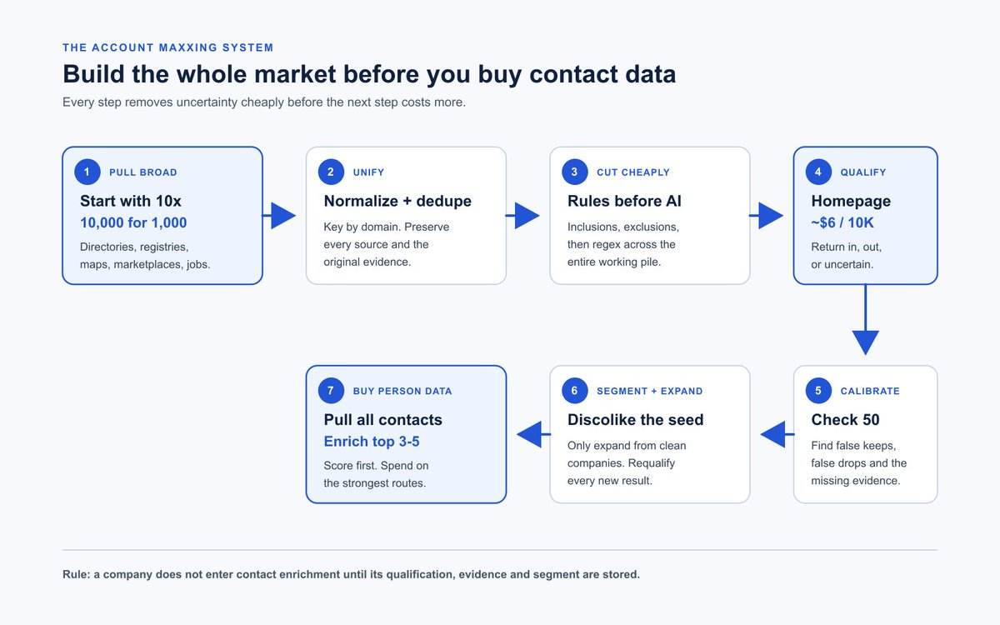
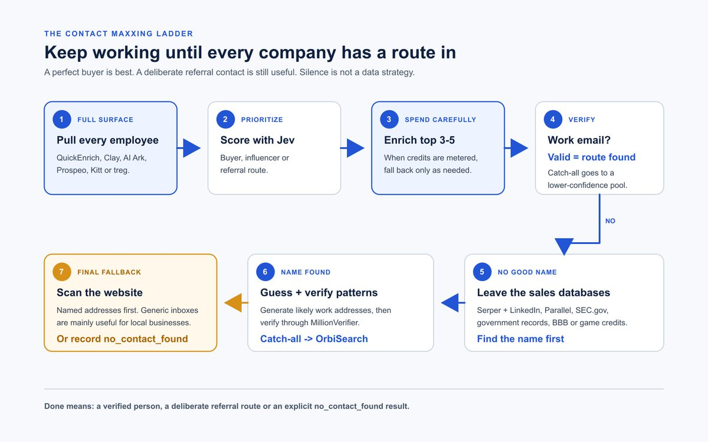
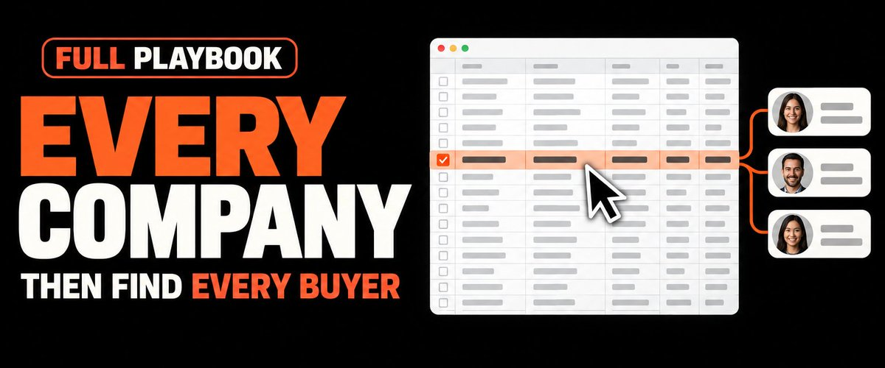

# POV: you realize one of the systems behind a $726,000 outbound motion is sitting in this Article for free.
> Source: https://x.com/MitchellKeller_/status/2102833386947793355
> Author: Mitchell Keller (@MitchellKeller_)
> Posted: 2026-09-23T18:52:02+00:00
> Captured: 2026-10-15T09:02:28+00:00
> Stats at capture: 2,657 views · 12 likes · 2 replies · 2 reposts · 25 bookmarks · 0 quotes

## Post

POV: you realize one of the systems behind a $726,000 outbound motion is sitting in this Article for free.

I can't believe this is free.

> Quoted post by Mitchell Keller ([@MitchellKeller_](https://x.com/MitchellKeller_/status/2102077622444494910)):
>
> https://x.com/i/article/2102077615947517955

## Quoted article: The Complete Guide To Finding Every Company and Contact in a Market

Pulling every employee title we could find at Devolver Digital expanded our available gaming-market contact universe by roughly 20%.

The extra contacts came from titles a normal search would never include.

That is the problem with most market lists. They only contain the companies and people somebody already thought to search for.

I want every company that could plausibly qualify under my criteria. Then I want every realistic person who could buy, influence the purchase, or point me to the person who can.

The obscure companies usually receive less outbound. In my experience, that makes them more likely to convert.

This is how I would build that market from scratch.

### Build the Company Map Before You Buy Contact Data

There are two jobs:

1. Account-list maxxing: find every plausible company, remove noise and prove why each surviving company belongs.

1. Contact-list maxxing: find the best buyer, the adjacent influencers and at least one fallback route inside every qualified company.

If I need 1,000 usable companies, I start with at least 10,000.

I collect the widest credible company universe first. Then I run cheap rules, qualify the uncertain companies, split the survivors into useful segments and expand again from the clean seed.

Only then do I pay to find people.



The order matters because company decisions are cheap and contact enrichment is not.

In the current workflow, homepage-level company qualification costs about $6 per 10,000 companies. That makes it sensible to decide whether a company belongs before buying person data inside it.

### Account Maxxing: Find Every Company That Could Qualify

Pull Every Source Before You Start Filtering

Directories already know about companies your favorite contact database may miss.

Depending on the market, I would pull from:

- Industry directories

- StoreLeads and other vertical databases

- Google Maps

- Government and licensing registries

- SEC.gov filings

- Trade associations

- Marketplaces and app stores

- Review sites

- Conference exhibitors and sponsors

- Job boards and hiring pages

- Technology-specific directories

- LinkedIn company search

Each source sees a different part of the market. Combining them is how obscure companies show up.

For ecommerce, that might mean pulling the full relevant StoreLeads surface instead of beginning with one narrow category. For a licensed trade, the government registry may be better than any sales database. For local businesses, Google Maps may expose locations that never built a proper LinkedIn page.

Keep the raw source and source URL for every record.

Merge the Mess Into One Defensible Company Record

Normalize the domain and use it as the company key. Preserve every source that contributed to the row. Let later sources fill blanks, but do not let them silently overwrite a stronger value you already trust.

Parents, subsidiaries, brands, franchises and locations should communicate through related SQL tables or another relational model. Collapse true duplicates. Preserve a separate selling entity when it has its own buyer, operating identity or inbox.

Use QuickEnrich to fill obvious gaps such as missing domains. A completed field is not proof that the company qualifies. If you cannot identify a working homepage, leave the company unresolved.

A useful company record contains:

- Company name and normalized domain

- Homepage and original source URLs

- Every source that produced the company

- Raw category and description

- Geography when available

- Homepage title and stored page text

- Technology or platform hints

- Inclusion and exclusion hits

- Observed signals

- Regex result

- Qualification status and a literal reason

- Segment ID

- Seed or expansion source

- A `do_not_enrich_contacts` flag

Do not put a guessed person or email into this record. People come later.

Start With 10x the Companies You Need

If the finished campaign needs 1,000 companies, keep at least 10,000 in the working pile before cutting.

That 10x rule is not a promised qualification rate. It gives you enough room for:

- True exclusions

- Bad or missing domains

- Regex failures

- Homepage decisions

- Signal-based segments

- Requalification after expansion

Starting narrow feels efficient. It also hides the companies you did not know how to name.

Let 10 Known-Good Companies Teach You the Rules

Take 10 companies you already know are good.

Read their websites and LinkedIn descriptions. Have AI propose the words, phrases and observable patterns they share. Treat those as hypotheses.

Write broad inclusions first. A company stays in the working pile if any of the inclusion rules are true.

Then add exclusions for obvious noise. For an ecommerce market, that could mean agencies, consultants, coupon sites, job boards, blogs without stores, competitors and companies you already contacted.

Use industries mainly as exclusions when keyword rules still leave obvious junk. Industry categories are blunt. A good company may describe itself under a category you would never think to include.

Inclusions that start too tight remove the weird companies you collected 10x coverage to find.

Use Regex Before You Pay for AI

Regex and deterministic rules should answer simple questions before you pay for a model decision.

The exact patterns depend on the market, but the shape looks like this:

- Drop a company when the title or URL clearly identifies an agency and no qualifying product signal exists.

- Drop known directory, link-in-bio or parked-domain hosts you do not sell to.

- Flag commerce markers such as `shopify`, `woocommerce`, `bigcommerce` or `/products/`.

- Flag a careers page when hiring matters to the offer.

- Flag active Meta ads when advertising activity may become a segment.

Run these checks across the entire pile. Send only the companies that still look possible to the model.

Qualify Companies With Evidence Databases Miss

Some companies cannot be qualified from a category or description.

If you sell into manufacturers, satellite imagery may tell you more than the website. Facility footprint, parking-lot size, loading docks, vehicle counts, equipment, permits and physical locations can reveal operating scale.

Technology can expose another hidden market.

`https://crt.name/v1/search?apex=slack.com` returns certificate-listed Slack subdomains. Remove Slack infrastructure and generic system hosts, extract candidate workspace names, map them to company domains and run those companies through the normal qualification process.

A hostname is a lead, not proof. It may be old, inactive or unrelated to a company you can sell to.

Historical job postings can also reveal technology use when direct detection fails.

People can lead you back to companies. If a CFD engineer is a strong sign that a company fits your offer, find CFD engineers first and reverse them into a company list. Rare titles can expose qualified accounts hidden by industry filters.

Give AI an Honest `Uncertain` Option

Give the model:

- Homepage text

- Broad inclusion rules

- Specific exclusions

- Hard qualifiers

- The ten known-good examples

Allow three labels: `in`, `out` and `uncertain`.

Demand a literal reason for every decision.

The roughly $6 per 10,000 figure applies to homepage-level company qualification in the current workflow. It does not include contact enrichment or an unlimited crawl.

If the homepage is inconclusive, use the sitemap to select only the pages likely to settle the decision, such as products, services, collections, industries, customers or about pages. Record the evidence URL.

Keep `uncertain` as a real status. Do not force the company into the market so the spreadsheet looks finished.

Test 50 Decisions Before You Scale

Manually inspect 50 decisions and label each one:

- True keep

- True drop

- False keep

- False drop

- Uncertain

Calculate accuracy as correct decisions divided by 50.

Review the three model buckets separately:

- Sample `model_in` companies and ask how many you would actually contact.

- Sample `model_out` companies and look for qualified businesses the rules removed.

- Sample `uncertain` companies and record the missing evidence that prevented a decision.

If false drops are high, loosen an inclusion or remove an exclusion. If false keeps are high, add one specific exclusion. Do not change both sides at once because you will not know which change helped.

For every miss, write one positive pattern that should have kept the company or one anti-pattern that should have removed it. Change one rule, rerun the sample and measure it again.

The number 50 is a practical starting point, not a universal benchmark. Increase it when the errors still look random.

Segment Only When the Message Changes

Run hard qualifiers first. A company that fails a non-negotiable condition stays out regardless of its score.

Then score the survivors using criteria from the ten known-good companies. Company size may change those weights. A manufacturer may require facility size and certifications. A software company may care more about technology, headcount and hiring.

Create a separate segment when an observable signal changes how you can honestly approach the company.

Useful signals might include:

- Running Meta ads

- Producing UGC

- Hiring for a team your product supports

- Using UGC in ads but not on product pages

Save the evidence on the company. If the signal would not change the problem, message or offer, leave it inside the parent segment.

Use Discolike Only After the Seed Is Clean

Feed qualified companies into Discolike only after the seed is clean.

Every similar company must pass the same inclusion, exclusion, regex and homepage rules. Similarity proposes the company. Your qualification system decides whether it belongs.

Keep the original source history when Discolike returns a company you already have. Add an expansion flag instead of duplicating the row.

A company may leave the `do_not_enrich_contacts` state only when it has:

- A passing qualification status

- A segment ID

- A stored qualification reason

- At least one observed signal, or a written reason the parent segment needs no extra signal

That completes the account side.

### Contact Maxxing: Find a Route Into Every Qualified Company

A qualified company is not useful until you have a route to a person.

The route does not always begin with the perfect title. Sometimes it begins with the founder. Sometimes it begins with an employee whose job in the sequence is to reply, "You need to speak with Sarah."

Pull Everyone, Then Score Who Matters

Use QuickEnrich to pull the broadest available employee surface for every qualified account. Keep the name, title, LinkedIn URL, location, employment confidence and source.

Then have Jev score the contacts.

This is a useful starting model, not a universal truth:

- 40 points for functional relevance to the problem

- 25 points for authority to buy or influence

- 15 points for seniority that makes sense at this company size

- 10 points for location or market relevance

- 10 points for confidence that the title and employment are current

Hard exclusions sit outside the score. A person who left the company or works in the wrong geography does not become useful because the remaining math looks good.

Keep the tiers simple:

- Tier 1: likely buyer

- Tier 2: adjacent buyer or meaningful influencer

- Tier 3: referral contact who can point you to the right person

Highest-score contacts get email enrichment first. When providers are metered, enrich the top 3-5 contacts per company and fall back only when the stronger contacts fail.

The ideal record has a verified work email and a LinkedIn profile.

Mine Weird Titles Before You Search Standard Ones

Pick 2-3 favorite companies in the market and pull every employee title you can find. Have Jev cluster and score the titles.

This catches roles your standard search never considered.

The gaming industry is full of unusual titles. Pulling the complete Devolver Digital employee and title surface expanded our available gaming-market contact universe by roughly 20%.

The same technique can expand the account list. A rare title such as CFD engineer can become the starting point for discovering new qualified companies.

Use Unlimited Data to Protect Metered Credits

Keep at least one unlimited-data source underneath the waterfall.

QuickEnrich currently offers unlimited enrichment through its $99 web-app plan. Its API has separate credit limits, so unlimited web access does not mean unlimited automation.

The stack can include:

- Clay for tables, scoring and waterfall logic

- QuickEnrich for the broad employee surface

- AI Ark or Prospeo for more person and email coverage

- Kitt AI for email finding and verification

- treg when you want one key that can call several providers without buying each subscription separately

Use the broad or unlimited source to decide who matters. Spend credits on the top 3-5 contacts.

Leave Sales Databases When the Sales Databases Go Blank

When normal providers return nobody useful, switch to name discovery.

Use Serper Boolean searches with LinkedIn as the site filter. Search the company name alongside the likely function, title family or owner language.

Use Parallel for deeper or exact research. As a last resort, AI Overview searches may surface a full name through government databases, licensing records, SEC.gov or BBB.org.

We used to scrape names from video-game credits, match them to studios and publishers, then push those names into the same contact process.

Useful data does not have to begin inside a sales tool.

Guess Email Patterns Only After You Know the Person

Once you have a full name and domain, generate likely work-email patterns and verify them through MillionVerifier.

Our Clayforge worker tries these first:

1. `first.last@domain.com`

1. `flast@domain.com`

1. `first@domain.com`

1. `firstlast@domain.com`

1. `first_last@domain.com`

1. `f.last@domain.com`

1. `firstl@domain.com`

1. `lastf@domain.com`

1. `last@domain.com`

1. `last.first@domain.com`

It normalizes names and domains, removes duplicates and skips addresses already tried. Ten checks is the default. It can test up to 40 patterns for harder cases.

The worker stops when MillionVerifier returns a valid or catch-all result.

Treat catch-all as lower confidence. Send those addresses to OrbiSearch when you need stronger evidence.

Make the Company Website Your Final Fallback

If you still have no person, scan the company website with regex for exposed addresses such as:

- `sales@`

- `partnerships@`

- `office@`

- `info@`

- Named addresses on team, contact, legal or about pages

Generic inboxes are risky outside local or physical businesses. A local owner may read `info@` directly. At a large company, the same address may disappear into an unowned queue.

Preserve the address, label the risk and let the user decide whether it is worth contacting.



### Store Enough Evidence to Reproduce Every Decision

The company object needs enough evidence to reproduce the qualification decision:

```json
{
  "company_name": "",
  "domain": "",
  "homepage_url": "",
  "sources": ["directory", "quickenrich", "discolike"],
  "inclusion_hits": [],
  "exclusion_hits": [],
  "hard_qualifiers": {"passed": true, "failures": []},
  "account_score": 0,
  "account_score_reason": "",
  "regex_status": "pass|fail|skip",
  "qualification_status": "unreviewed|auto_in|auto_out|model_in|model_out|uncertain",
  "qualification_reason": "",
  "observed_signals": [],
  "segment_id": null,
  "seed_or_expansion": "seed|discolike|other",
  "do_not_enrich_contacts": true
}
```

The contact object needs enough information to explain why that person was selected:

```json
{
  "company_domain": "",
  "full_name": "",
  "title": "",
  "linkedin_url": "",
  "contact_score": 0,
  "tier": "tier_1|tier_2|tier_3|generic",
  "score_reason": "",
  "email": "",
  "email_pattern": "",
  "email_status": "valid|catch_all|invalid|unknown|not_found|no_contact_found",
  "verification_provider": "",
  "contact_source": "quickenrich|clay|ai_ark|prospeo|kitt|treg|serper|parallel|government|bbb|game_credits|website",
  "is_referral_contact": false
}
```

An account is contact-maxed when you have exhausted the employee pull, title expansion, scored enrichment, name search, email-pattern verification, catch-all handling and website fallback.

If nothing survives, record `no_contact_found`. Do not remove the company from the market map because contact discovery failed.

### Give Claude Code the Entire Workflow

```text
Build the widest defensible map of this market from the company files and URLs I provide.

I will give you:
- The market and offer
- The number of usable companies required
- Hard qualifiers
- Ten known-good companies
- Draft inclusion and exclusion rules
- Market-specific regex patterns
- Directory files or URLs

Account rules:
- Keep at least 10x the required company count before cutting.
- Normalize and consolidate sources by domain. Preserve source history.
- Use QuickEnrich to fill missing fields, not to prove qualification.
- Apply inclusions, exclusions and regex before model qualification.
- Apply hard qualifiers before scoring.
- Use homepage evidence first. If the homepage is inconclusive, inspect only relevant sitemap pages and save the evidence URL.
- Return in, out and uncertain. Never force an uncertain decision.
- Manually check 50 classifications before scaling and report correct decisions divided by 50.
- For every miss, propose one positive pattern or anti-pattern. Change one rule per test.
- Create a segment only when an observed signal changes the honest message or offer.
- Seed Discolike with qualified companies only and requalify every result.
- Keep do_not_enrich_contacts true until qualification and segmentation are complete.

Contact rules:
- Pull the broad employee surface for qualified accounts.
- Score contacts using my criteria and company context.
- Enrich the top 3-5 contacts first when providers are metered.
- Expand unusual titles from 2-3 ideal companies.
- If databases fail, search names through Serper, Parallel, government sources, SEC.gov and BBB.org.
- Generate and verify likely email patterns only after a name and company domain are known.
- Separate catch-all addresses into a lower-confidence pool.
- Use website email regex only as the final fallback.
- Record no_contact_found when every route is exhausted.

Never invent counts, qualification rates, email statuses or results.

Return:
- Company JSONL
- Contact JSONL
- Counts of in, out and uncertain companies
- Account-score and contact-score distributions
- Proposed segments with the evidence behind each
- A separate unresolved list
```

### Start With 50 Companies, Then Scale What Holds Up

Take 50 companies from your current list and write down exactly why each one belongs or does not.

Every decision you cannot explain becomes the next rule to fix.

Once those rules hold up, expand the company universe. Then keep working the contact fallbacks until every qualified company has a verified person, a deliberate referral route or an explicit `no_contact_found` result.

## Media

[Post media 1](media/animation-01.mp4) — Source media: https://video.twimg.com/tweet_video/HS7D0V5bcAAKHW9.mp4
 — Post media 1 thumbnail. Source media: https://pbs.twimg.com/tweet_video_thumb/HS7D0V5bcAAKHW9.jpg
 — Quoted article media. Source media: https://pbs.twimg.com/media/HSwUcoaaEAAWJva.jpg
 — Quoted article media. Source media: https://pbs.twimg.com/media/HSwUczNaEAMsQrN.jpg
 — Quoted article media. Source media: https://pbs.twimg.com/media/HSwUc9IbcAE5y7M.jpg

## Thread

### Mitchell Keller ([@MitchellKeller_](https://x.com/MitchellKeller_/status/2102898457484861673)) — 2026-09-23T23:10:36+00:00

If you want to learn cold email for free you should watch my youtube: https://t.co/iHB0tAWmjU

## Links

- https://x.com/i/article/2102077615947517955
