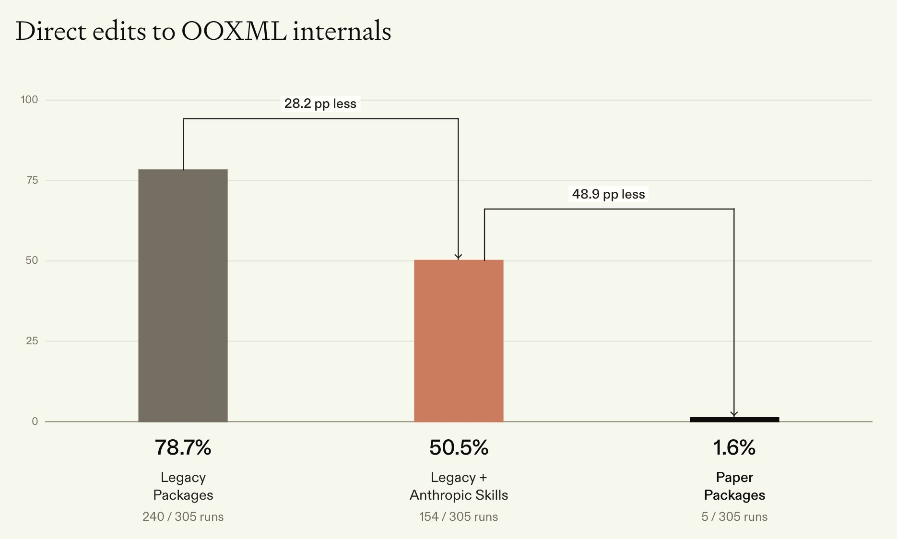
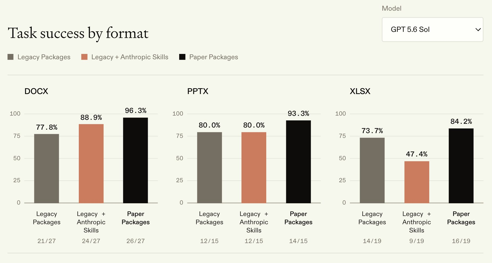
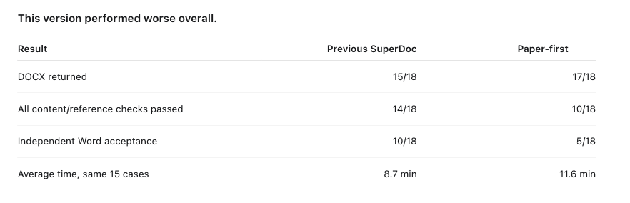
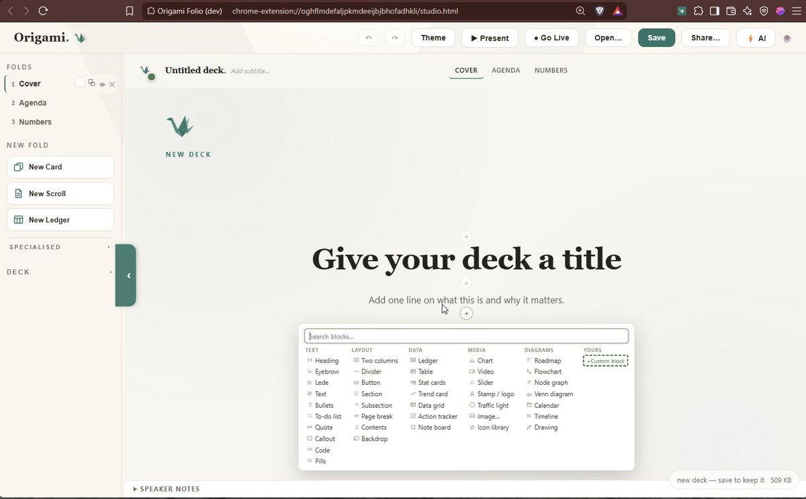

# Agents are using legacy Python packages to edit Word, Excel, and PowerPoint files, hitting API gaps, dropping into raw OOXML, and creating silent corruptions.
> Source: https://x.com/bertgodel/status/2102852926121427304
> Author: Daanish Khazi (@bertgodel)
> Posted: 2026-09-23T20:09:41+00:00
> Captured: 2026-10-15T09:02:28+00:00
> Stats at capture: 77,302 views · 783 likes · 42 replies · 53 reposts · 994 bookmarks · 16 quotes

## Post

Agents are using legacy Python packages to edit Word, Excel, and PowerPoint files, hitting API gaps, dropping into raw OOXML, and creating silent corruptions. 

We fix that today with OSS Paper Office:

## Media

 — Post media 1. Source media: https://pbs.twimg.com/media/HS7U7G2b0AEb96n.jpg?name=orig
 — Post media 2. Source media: https://pbs.twimg.com/media/HS7U_PFasAA5ns2.jpg?name=orig
 — Reply 2103143090785546397 media 1. Source media: https://pbs.twimg.com/media/HS_dPm9WYAABJXX.png
 — Reply 2110634494046687357 media 1. Source media: https://pbs.twimg.com/media/HUH1uCaWIAARd_i.jpg
 — Reply 2108255434125840740 media 1. Source media: https://pbs.twimg.com/media/HUIG-PMWEAEl_Iz.jpg
 — Reply 2102897876653298079 media 1. Source media: https://pbs.twimg.com/media/HS7-SoCXMAE5bI8.jpg

## Thread

### Daanish Khazi ([@bertgodel](https://x.com/bertgodel/status/2102852927719407689)) — 2026-09-23T20:09:41+00:00

Full blog here:

https://t.co/xYLwmSKun2
### Daanish Khazi ([@bertgodel](https://x.com/bertgodel/status/2102852929476755780)) — 2026-09-23T20:09:42+00:00

Paper Office Repos:

https://t.co/TMo8r9dDay
https://t.co/Ps3eFFCiuS
https://t.co/iJvhzksiAc
### Daanish Khazi ([@bertgodel](https://x.com/bertgodel/status/2102956381355786539)) — 2026-09-24T03:00:47+00:00

If you're trying out the packages feel free to use this skills to prime your agent (packages aren't yet in distribution)

https://t.co/ePxy3e5BSi
### Daanish Khazi ([@bertgodel](https://x.com/bertgodel/status/2103143916195479616)) — 2026-09-24T15:25:58+00:00

@matt503ea5sf9z5 Thank you Matt! Would love to learn more about the evals here and see how we can improve
### Daanish Khazi ([@bertgodel](https://x.com/bertgodel/status/2102928281624518774)) — 2026-09-24T01:09:07+00:00

@ShankarDS hahah lmk if it helps!

## Comments

### Matt ([@matt503ea5sf9z5](https://x.com/matt503ea5sf9z5/status/2103143090785546397)) — 2026-09-24T15:22:42+00:00

@bertgodel Feedback: Paper seems much worse than Superdoc API. Appears better until you do visual word review and paper introduces harder-to repair formatting and visual problems. https://t.co/PWMCtqgH2w
 — Source media: https://pbs.twimg.com/media/HS_dPm9WYAABJXX.png
### Shanks ([@ShankarDS](https://x.com/ShankarDS/status/2102927842174763437)) — 2026-09-24T01:07:22+00:00

@bertgodel bro just put me out of a job with all the XML handling prompts i wrote
### eimen ([@eimen0](https://x.com/eimen0/status/2102870316837904619)) — 2026-09-23T21:18:47+00:00

@bertgodel @joeybesgen Excited to test
### Luke Button ([@lukebbutton](https://x.com/lukebbutton/status/2102864577667137716)) — 2026-09-23T20:55:59+00:00

@bertgodel excited to try!
### Keiji Kanazawa ([@gojira](https://x.com/gojira/status/2102989276397150385)) — 2026-09-24T05:11:29+00:00

@bertgodel @paperinstr Ooh this is amazing. Will need to try it!
### ken ([@aquariusacquah](https://x.com/aquariusacquah/status/2105814965852709325)) — 2026-10-02T00:19:46+00:00

@bertgodel It's crazy how bad models are at editing docs natively
### Maxim Karoubi ([@MaximKaroubi](https://x.com/MaximKaroubi/status/2102854669634854913)) — 2026-09-23T20:16:37+00:00

@bertgodel really impressive results
### Datta Kaligotla ([@Dattakaligotla](https://x.com/Dattakaligotla/status/2102854111519772736)) — 2026-09-23T20:14:23+00:00

@bertgodel phenomenal team
### Arjun Lalwani ([@arjunlalwani](https://x.com/arjunlalwani/status/2102946646598279485)) — 2026-09-24T02:22:06+00:00

@bertgodel Congrats!! This is awesome
### Kristian ([@gen3ralist](https://x.com/gen3ralist/status/2102965219794272527)) — 2026-09-24T03:35:54+00:00

@bertgodel Wow this is huge
### Pat Woozey ([@patwoozey](https://x.com/patwoozey/status/2102920561689321573)) — 2026-09-24T00:38:26+00:00

@bertgodel Yes! Thank you, it's been missing for so long and this is exactly the week I needed this
### Jake Thomson ([@Jakethomsonn13](https://x.com/Jakethomsonn13/status/2104667653319327872)) — 2026-09-28T20:20:46+00:00

@bertgodel There are whole companies running through these spreadsheets. What’s the most complicated workbook you’ve put this through so far?
### Vikramaditya Shekhar ([@HereAndShekhar](https://x.com/HereAndShekhar/status/2103012768559644978)) — 2026-09-24T06:44:50+00:00

@bertgodel Looks promising - will give it a spin!
### Partho Sen ([@sen_partho50106](https://x.com/sen_partho50106/status/2103033291825910248)) — 2026-09-24T08:06:23+00:00

@bertgodel This is much needed lol!
### Kala ([@kalapowered](https://x.com/kalapowered/status/2103195079330390432)) — 2026-09-24T18:49:17+00:00

@bertgodel Word at least had the decency to say it "found unreadable content" when we broke a docx by hand
### Greg Glazewski ([@Greg_GL_87](https://x.com/Greg_GL_87/status/2103051786386821397)) — 2026-09-24T09:19:53+00:00

@bertgodel xlsx getting worse with the anthropic skills than with none is a weird result
### Bewinxed ([@Bewinxed](https://x.com/Bewinxed/status/2102978349593465051)) — 2026-09-24T04:28:04+00:00

@bertgodel Can it manipulate macros and power pivot stuff? Power query?
### leovoloshin ([@leov](https://x.com/leov/status/2102969392027873560)) — 2026-09-24T03:52:28+00:00

@bertgodel Google Docs?
### Anupreet Choudhary ([@anupreet_iit](https://x.com/anupreet_iit/status/2102967321451200689)) — 2026-09-24T03:44:15+00:00

@bertgodel Does it handle ppt to pdf conversions?
### Marc Simanovici ([@MarcSimanovici](https://x.com/MarcSimanovici/status/2102982379564318770)) — 2026-09-24T04:44:05+00:00

@bertgodel Someone had to tackle this finally ! 
Will try it, thanks
### Matias ([@Bolmercl](https://x.com/Bolmercl/status/2102868091277287882)) — 2026-09-23T21:09:57+00:00

@bertgodel With this can agents fix Docs broken formating of images? with mouse sometimes MS Docx it's impossible
### Annalise Krueger ([@annalisekrueg](https://x.com/annalisekrueg/status/2102864019828937020)) — 2026-09-23T20:53:46+00:00

@bertgodel 🔥🔥🔥
### Riley.txt ([@RileyFinch13](https://x.com/RileyFinch13/status/2102886379709768089)) — 2026-09-23T22:22:37+00:00

@bertgodel Model Overhang is the opportunity - let's fucking go gents!
### Samuel Spitz ([@samuel_spitz](https://x.com/samuel_spitz/status/2102866621522227660)) — 2026-09-23T21:04:06+00:00

@bertgodel This is cool
### Sobhan Nejad ([@sobhan_nejad](https://x.com/sobhan_nejad/status/2102883686677131285)) — 2026-09-23T22:11:55+00:00

@bertgodel lesgooo
### conner ([@connerchyung](https://x.com/connerchyung/status/2103573553316495600)) — 2026-09-25T19:53:12+00:00

@bertgodel lfg
### Rohan Bansal ([@polyphilz](https://x.com/polyphilz/status/2102868069983088910)) — 2026-09-23T21:09:51+00:00

@bertgodel gdp growth incoming, congrats yall!
### manav ([@manavsinghkohli](https://x.com/manavsinghkohli/status/2102856129042927703)) — 2026-09-23T20:22:24+00:00

@bertgodel 🔥
### Kash ([@_kashrocks](https://x.com/_kashrocks/status/2102863238979534985)) — 2026-09-23T20:50:40+00:00

@bertgodel this is insane
### Tejal Reddy ([@tejalreddy](https://x.com/tejalreddy/status/2102871722751848873)) — 2026-09-23T21:24:22+00:00

@bertgodel super cool
### Eric Sen ([@EricSen2015](https://x.com/EricSen2015/status/2102861359251956103)) — 2026-09-23T20:43:11+00:00

@bertgodel great stuff!
### Passing By Pixels ([@PassingPixels](https://x.com/PassingPixels/status/2102897876653298079)) — 2026-09-23T23:08:18+00:00

@bertgodel Or just have a chrome extension do them all for you instead https://t.co/MaRZBEUp1H https://t.co/HCHOIwKM5O
 — Source media: https://pbs.twimg.com/media/HS7-SoCXMAE5bI8.jpg
### ShadowAguy ([@shadowaguy](https://x.com/shadowaguy/status/2102883802628640797)) — 2026-09-23T22:12:22+00:00

@bertgodel The real danger is that OOXML corruption often passes basic XML validators. An agent might not know it lied until the CFO opens the file.
### Nick Launches AI Agents ([@nicklaunchesai](https://x.com/nicklaunchesai/status/2103097344707502112)) — 2026-09-24T12:20:55+00:00

@bertgodel Silent OOXML corruption is worse than a loud crash
### Matyas Stoch ([@matyasstoch](https://x.com/matyasstoch/status/2102970085145034912)) — 2026-09-24T03:55:14+00:00

@bertgodel Office products in the big 26?
### Vaibhav ([@vaibhav_pandey](https://x.com/vaibhav_pandey/status/2102993330212831649)) — 2026-09-24T05:27:36+00:00

@bertgodel Ohh this is really useful - excited to try out :) all the best
### Jonas Hertner ([@jonashertner](https://x.com/jonashertner/status/2103004045938184698)) — 2026-09-24T06:10:11+00:00

@bertgodel rediscovering latex
### Denver Blevins ([@denver_grace3](https://x.com/denver_grace3/status/2102969106941329863)) — 2026-09-24T03:51:21+00:00

@bertgodel 🧠🧠🧠
### Daniel Ochoa ([@danielochoa94](https://x.com/danielochoa94/status/2102936920082763987)) — 2026-09-24T01:43:27+00:00

@bertgodel Awesome work! python-pptx has some serious gaps. We've been tackling the same problem and built an alternative: https://t.co/i23uAnLVcf

## Other returned timeline records

> The CLI did not expose reply relationships. These records do not start with a reply mention and were authored by someone other than the saved-post author. They may include recommendations or promoted posts; they are retained as source context, not verified replies.

### Ethan Caldwell ([@EthanCalFounder](https://x.com/EthanCalFounder/status/2110634494046687357)) — 2026-10-15T07:30:51+00:00

i'm sorry, Claude can WHAT?

it can take your website link, find people who need your product, email them and book the calls?

since when?? i've been doing this by hand for a YEAR.

ok. testing it: $30 free 👇

https://t.co/l0hylb6vAM https://t.co/xYw8Syj56Y
 — Source media: https://pbs.twimg.com/media/HUH1uCaWIAARd_i.jpg
### Rafal Kochanowski ([@rafalsoftware](https://x.com/rafalsoftware/status/2105746567571648627)) — 2026-10-01T19:47:59+00:00

I'm a software engineer who sees the full picture. Big-picture thinking and engineering depth.

Everyone can write that.

But you can verify this in a free conversation about your engineering problem, a decision you need to make, or a system you're planning to build.
### Ilya Batishchev ([@ilyabatishchev](https://x.com/ilyabatishchev/status/2108255434125840740)) — 2026-10-08T17:57:19+00:00

i'm sorry, Claude can WHAT?

it can take your website link, find people who need your product, email them and book the calls?

since when?? i've been doing this by hand for a YEAR.

ok. testing it: $30 free 👇

https://t.co/XIfPUVSpdg https://t.co/OJZklbfRxr
 — Source media: https://pbs.twimg.com/media/HUIG-PMWEAEl_Iz.jpg
### Atlas ([@Atlas3DAI](https://x.com/Atlas3DAI/status/2090814619275436444)) — 2026-08-21T14:53:45+00:00

A prompt goes in. A skeleton comes out, IK-ready.

Most text-to-3D stops at a static mesh. Atlas keeps going: standardized T-pose, rig, weights, so the character is animatable the day it is generated.

Try Atlas today
### ferlinux ([@ferlinux](https://x.com/ferlinux/status/2095775916869767477)) — 2026-09-04T07:28:10+00:00

Atelier claimed a building for $5 and has already received 184 visits.

Cost per visit: $0.027.
Average Meta traffic CPC: $0.70.

That’s around 26× cheaper—and its place on Claim Avenue is still there after the campaign ends. 👀
