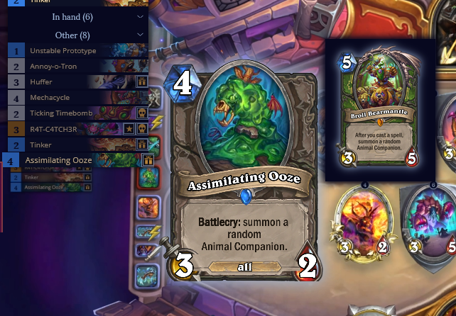

# Trending repository of the day 📈
> Source: https://x.com/trending_repos/status/2103094238430761101
> Author: Trending GitHub Repositories (@trending_repos)
> Posted: Thu Sep 24 12:08:34 +0000 2026
> Captured: 2026-10-15T09:02:28+00:00
> Stats at capture: 19,563 views · 203 likes · 3 replies · 15 reposts · 271 bookmarks · 1 quotes

## Post

Trending repository of the day 📈

hindsight

Hindsight: Agent Memory That Learns

Last 24h: 1,607 ⭐
Total: 26,931 ⭐️
https://github.com/vectorize-io/hindsight

## Media

 — Reply 2110278672791777732 media 1. Source media: https://pbs.twimg.com/media/HUk25vmWAAIVFLj.png
 — Reply 2110309882226233617 media 1. Source media: https://pbs.twimg.com/media/HUlToxkXEAEoyAa.jpg
 — Reply 2110363599139176698 media 1. Source media: https://pbs.twimg.com/media/HUmEcKkWgAAgmFW.jpg

## Comments

### Brad Trnavsky ([@bmtrnavsky](https://x.com/bmtrnavsky/status/2103267365714526355)) — 2026-09-24T23:36:31+00:00

@trending_repos I love hindsight. I’ve been on it a long time and the longer you use it the better it gets.
### Sael ([@0xsael](https://x.com/0xsael/status/2106334109794787835)) — 2026-10-03T10:42:40+00:00

@trending_repos learning agents are great until the memory bloat hits, how does it handle the noise over time?

## Other returned timeline records

> The CLI did not expose reply relationships. These records do not start with a reply mention and were authored by someone other than the saved-post author. They may include recommendations or promoted posts; they are retained as source context, not verified replies.

### 0xMarioNawfal ([@RoundtableSpace](https://x.com/RoundtableSpace/status/2110517256966775241)) — 2026-10-14T23:45:00+00:00

Anthropic has published code-modernization, an official Claude Code plugin for updating legacy codebases.

→ It targets systems such as COBOL, legacy Java, C++, .NET Framework and monolithic web apps
→ It extracts business rules with file and line citations and produces a modernization plan for human approval
→ Its transform command writes characterization tests before rewriting code, then checks the new code for equivalent behavior
→ It installs with /plugin install code-modernization@claude-plugins-official

Repo: https://t.co/pNriont3p6
### Firestone HS ([@Firestone_HS](https://x.com/Firestone_HS/status/2110278672791777732)) — 2026-10-14T07:56:57+00:00

Something cool that shipped with Firestone for Assemble cards: if you mouse over such a card in the tracker, it will show you the final card, and not the base one.

This will also be available on Twitch once the new update to the Firestone Twitch Extension is approved. https://t.co/ub2A3tlAkm
 — Source media: https://pbs.twimg.com/media/HUk25vmWAAIVFLj.png
### imik ([@imik_plays](https://x.com/imik_plays/status/2110309882226233617)) — 2026-10-14T10:00:58+00:00

o7 https://t.co/eGvYPpex0g
 — Source media: https://pbs.twimg.com/media/HUlToxkXEAEoyAa.jpg
### Михайло LEBED #russiaIsATerroristState ([@lebed93_hs](https://x.com/lebed93_hs/status/2110363599139176698)) — 2026-10-14T13:34:25+00:00

New Tavern Brawl: 

6-0
AAECAe2dCAaE6Qfn+Qfb+ge3gAi+gQjziQgM1+kHuO0HkvcHm/cHi/oH+/sHh/wH+PwHnf8H6YII+4kIp5IIAAA=

5-3
AAECAfCdCALi+gfziQgO1+kH/O4H6PEHgfYHjPYH6fkH4foH4/oH5PoH3PsH0f0H+4kI/IkIp5IIAAA= https://t.co/URNc0zopyV
 — Source media: https://pbs.twimg.com/media/HUmEcKkWgAAgmFW.jpg

## Links

- https://github.com/vectorize-io/hindsight
