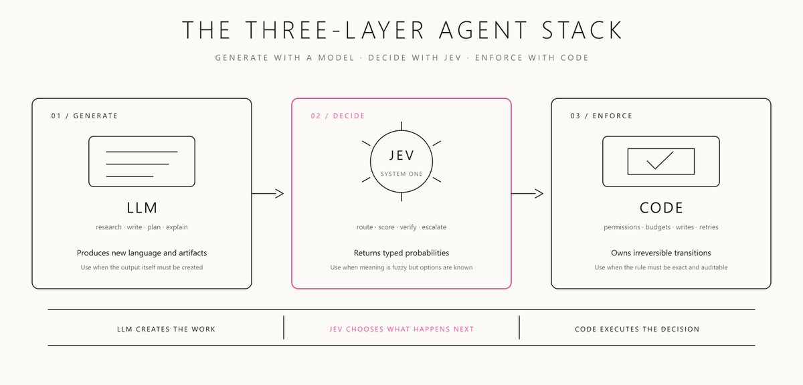
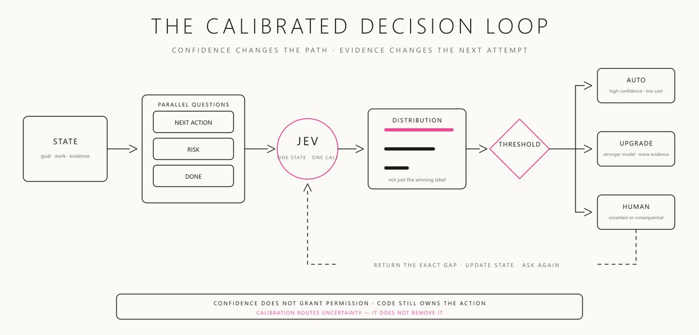
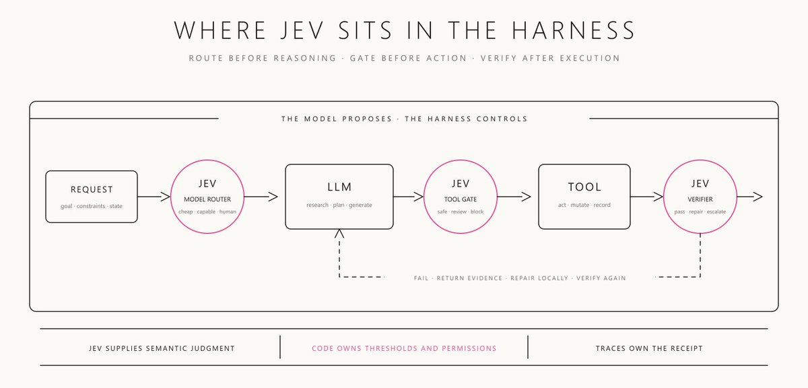
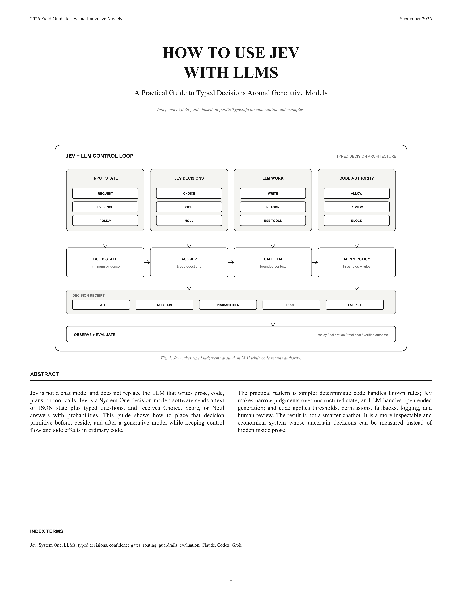
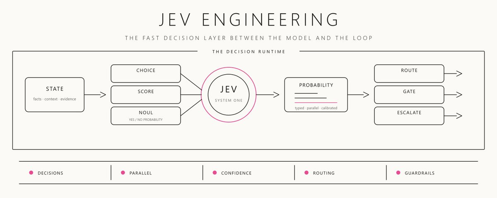

# Jev Founder, Diogo Almeida, just released a 12-page PDF on how to use Jev with LLMs
> Source: https://x.com/0xwhrrari/status/2103157617715491278
> Author: rari (@0xwhrrari)
> Posted: Thu Sep 24 16:20:25 +0000 2026
> Captured: 2026-10-15T09:02:28+00:00
> Stats at capture: 345,552 views · 2,280 likes · 63 replies · 304 reposts · 4,721 bookmarks · 25 quotes

## Post

Jev Founder, Diogo Almeida, just released a 12-page PDF on how to use Jev with LLMs

It is more useful than most paid AI courses:

this is a 10-step blueprint on how to build a faster, cheaper and more controllable AI system around Claude, Codex, Grok or any other LLM:

step 1 → split the responsibilities: the LLM generates, Jev makes bounded semantic decisions and deterministic code keeps authority

step 2 → build the state: give Jev the current request, relevant evidence, policy and proposed action instead of sending the entire conversation

step 3 → choose the right primitive: Choice selects a route, Score evaluates an ordered rubric and Noul returns the probability that a statement is true

step 4 → replace giant evaluation prompts with atomic questions: intent, urgency, evidence, risk and scope become separate typed decisions

step 5 → put Jev before the LLM: select the context, tools, provider and workflow before paying for an expensive generative call

step 6 → give the LLM a bounded job: once Jev selects the route, the model receives only the instructions, files and tools required for that branch

step 7 → put Jev after the LLM: check whether the result answers the request, uses sufficient evidence and stays inside the permitted scope

step 8 → route by confidence: high-confidence low-risk cases proceed automatically, uncertain cases request more context and consequential actions go to review

step 9 → batch independent decisions: ask multiple Choice, Score and Noul questions over one shared state instead of creating another LLM call for every judgment

step 10 → record the complete decision receipt: state version, question, probabilities, selected route, model, latency, outcome and human override

most AI courses teach you how to write a bigger prompt

this 12-page guide teaches you how to build the control system around every prompt

the result: smaller contexts, fewer unnecessary LLM calls, safer tool execution and decisions you can actually inspect, test and improve

Send this PDF and the original Jev article to Claude Code or Codex and start rebuilding one expensive LLM decision at a time ↓

> Quoted post by rari ([@0xwhrrari](https://x.com/0xwhrrari/status/2102020016539324501)):
>
> Most AI agents waste tokens on decisions that never needed text
>
> Jev turns routing, scoring, and verification into a fast decision layer
>
> I broke down the architecture most agent builders are still missing ↓ https://x.com/i/article/2101963175180582912

## Quoted article: Jev Engineering: Stop Using LLMs for Every Decision

The fast decision layer that makes AI agents cheaper, faster, and easier to control

Most AI agents are built around one expensive assumption

Every intelligent decision needs another LLM call

Which worker should act next

Is this source relevant

Is the result safe to publish

Does the task look finished

Should the system retry, escalate, or stop

None of those decisions require a paragraph

Yet most agent stacks still ask a generative model to reason in prose, emit JSON, wait for a parser, and hope the schema survives

That is not intelligence architecture

It is a chatbot being used as a switch statement

Jev changes the primitive

It does not generate text

It reads the current state of a system, evaluates typed questions, and returns probabilities that software can act on directly

> The gains aren’t free: Jev can't generate text
> 
> Diogo Almeida, TypeSafe AI's founder

That limitation is the entire point

When a model gives up open-ended strings, it can become a much faster and more composable decision layer inside code

[Embedded post](https://x.com/i/status/2099925682726002904)

The important launch is not another model

It is a new division of labor inside an agent

```
LLM   creates the work
JEV   decides what happens next
CODE  executes and enforces the decision
```

This article is about how to engineer that split properly

> I publish practical breakdowns of AI agents, workflows, and production systems on Substack [Join the newsletter here](https://whrrari.substack.com/subscribe?next=https%3A%2F%2Fsubstack.com%2F%40whrrari%2Fnotes&utm_source=profile-page&utm_medium=web&utm_campaign=substack_profile&just_signed_up=true)

---

## The expensive mistake inside most agents

An agent loop looks simple from the outside

```
goal -> model -> tool -> observation -> model -> tool -> result

```

But zoom in and you find dozens of small judgments hidden between the large actions

```
Is the request clear enough
Which tool should run
Which model should receive this task
Which source should survive retrieval
Is the tool call risky
Did the action actually work
Is the evidence strong enough to stop
```

The usual response is to send every question back to the same frontier LLM

That creates four problems

### Latency compounds

One extra model call does not feel expensive

Twenty sequential calls do

An agent can spend more time deciding whether to continue than doing the work itself

### Cost moves into invisible branches

The final answer may be short

The internal routing, scoring, checking, and retry decisions can consume most of the token budget

### Strings create integration work

The model returns prose or JSON

Your code validates it, repairs it, retries it, or quietly accepts a malformed edge case

### Confidence is improvised

An LLM can say it is 95% confident

That number is usually another generated token, not a calibrated operating signal

The deeper problem is architectural

Generation and decision-making have been collapsed into the same call

Jev engineering begins by separating them

---

## Jev is not a smaller chatbot

TypeSafe calls Jev its first System One Model

The interface is closer to a frontier-intelligence function than a conversation

```
INPUT
current state + typed questions

OUTPUT
typed answers + probability distributions
```

Jev does not draft the email

It can decide which queue should receive the email

It does not write the research report

It can score whether the collected evidence is sufficient

It does not execute the shell command

It can estimate whether the proposed command requires approval

It does not explain itself in a long chain of thought

It returns a constrained answer your code already knows how to handle

TypeSafe built the model around a training method it calls Reinforcement Learning for Calibrated Decisions, or RLCD

The goal is not prettier language

The goal is decision quality plus useful uncertainty

TypeSafe reports end-to-end latency of roughly 70–500ms for Jev-shaped queries and pricing of $0.042 per million input tokens, with no metered output-token cost

Its larger speed and cost claims come from favorable workflow evaluations and should be treated as ceilings, not promises for every application

That nuance matters

Jev is valuable even when it is not 200x faster

The deeper win is that a decision becomes an explicit, typed, testable component

[Embedded post](https://x.com/i/status/2099944756931596454)

---

## The three-layer agent stack



The cleanest architecture has three different owners

```
GENERATE  ->  LLM
DECIDE    ->  JEV
ENFORCE   ->  CODE
```

### The LLM generates

Use a generative model when the output itself must be created

- Research

- Writing

- Planning

- Code

- Explanations

- Open-ended synthesis

### Jev decides

Use Jev when the meaning is fuzzy but the possible answer shape is known

- Route to one worker

- Score against a rubric

- Estimate yes or no

- Choose whether to retry

- Select whether to escalate

### Code enforces

Use deterministic code when the rule must be exact

- Permissions

- Budgets

- Retry limits

- Account access

- Database writes

- Publishing

- Deletion

- Money movement

This creates a useful rule

> If the system must create language, use an LLM
> 
> If it must interpret meaning and choose from known outcomes, use Jev
> 
> If it must obey an exact invariant, use code

The most dangerous mistake is to let a confidence score become permission

Jev can recommend an action

Only the harness should authorize it

---

## Jev has three decision primitives

Jev keeps the interface deliberately small

The three primitives are enough to build most semantic branches inside an agent

### Choice

Use Choice when exactly one option should win

```python
from typesafe_sdk import Choice

next_worker = Choice(
    instructions="Which worker should act next?",
    criteria={
        "research": "Important evidence is still missing",
        "write": "Enough evidence exists to draft the answer",
        "review": "The request is unclear, complete, or consequential",
        "none": "No listed worker is appropriate",
    },
)
```

The result includes the selected option, a probability distribution over the options, and confidence

Do not design a closed menu when reality is open

If the options might be incomplete, include 'none', 'other', or 'escalate'

Otherwise probability mass is forced onto the least-wrong answer

### Score

Use Score when the decision lives on an ordered rubric

```python
from typesafe_sdk import Score

evidence_quality = Score(
    instructions="How well does the evidence support the requested conclusion?",
    criteria=[
        "No direct support",
        "Partial support with important gaps",
        "Strong support from multiple independent sources",
    ],
)
```

The output can fall between levels

That does not turn an ordinal rubric into an exact measurement

A score of 1.6 is not "80% good"

It is a position between descriptions you defined

### Noul

Use Noul for a yes-or-no probability

```python
from typesafe_sdk import Noul

requires_approval = Noul(
    instructions=(
        "Would executing the proposed action publish, purchase, delete, "
        "change permissions, or represent the user externally?"
    ),
)
```

A result near 1.0 means likely yes

A result near 0.0 means likely no

A result near 0.5 means the model cannot distinguish confidently

It does not mean medium approval risk

If you need low, medium, and high risk, use Score

---

## The question is part of the program

Many builders will treat Jev questions like casual prompts

That wastes the entire advantage

A production question is a decision contract

It defines what evidence matters, which outcomes exist, and how the result enters code

```
DECISION CONTRACT

state fields
question instructions
option descriptions or rubric
fallback outcome
confidence thresholds
allowed action
escalation path
version
```

One subtle detail matters immediately

Jev does not learn the task from your internal question ID

Calling a field safe_to_publish does not instruct the model what safe means

The actual rule must appear in the instructions and criteria

```python
# weak
"safe_to_publish": Noul(
    instructions="Is this safe?"
)

# stronger
"safe_to_publish": Noul(
    instructions=(
        "Does the draft contain only verified claims with citations, avoid "
        "private information, and require no unresolved legal or financial approval?"
    )
)

```

The key name helps your code

The instructions help the model

Confusing the two creates invisible bugs

---

## State engineering matters more than prompt decoration

Jev can only judge the state you provide

Do not send a giant conversation and expect the model to reconstruct your workflow

Give it the compact evidence required for the decision

```python
state = {
    "goal": "Prepare a cited briefing on three new agent tools",
    "constraints": {
        "publish": False,
        "deadline": "09:00 UTC",
        "max_sources": 12,
    },
    "completed_work": {
        "sources_collected": 7,
        "draft_exists": True,
        "fact_check_complete": False,
    },
    "evidence": [
        {"id": "s1", "kind": "official_docs", "supports": ["pricing"]},
        {"id": "s2", "kind": "launch_post", "supports": ["availability"]},
    ],
    "available_workers": ["research", "write", "fact_check", "review"],
}
```

Good state is separated by function

```
GOAL          what success means
FACTS         what the system knows
ARTIFACTS     what already exists
EVIDENCE      what supports the next judgment
CONSTRAINTS   what the system may not cross
OPTIONS       what can happen now
```

Bad state mixes claims, instructions, old attempts, and irrelevant history into one text blob

The model may still return a valid type

It can still choose the wrong valid option

This is the most important correction to the “zero hallucination” headline

Jev cannot break the declared output schema

It can still be semantically wrong

Type safety removes one failure class

It does not remove the need for evidence, thresholds, tests, and review

---

## Ask independent questions in parallel

Most agent decisions are evaluated sequentially because LLM generation is sequential

Jev is designed to evaluate multiple typed questions against the same state in one request

```python
client = TypeSafeClient(model="jev-latest")

response = client.system_one(
    state=state,
    questions={
        "next_worker": Choice(
            instructions="Which available worker should act next?",
            criteria={
                "research": "Evidence gaps remain",
                "write": "Evidence is sufficient for drafting",
                "fact_check": "A draft exists but claims need verification",
                "review": "The work is complete, unclear, or consequential",
            },
        ),
        "urgency": Score(
            instructions="How urgent is the request?",
            criteria=[
                "No time pressure",
                "Time-sensitive but can wait",
                "Immediate business impact",
            ],
        ),
        "requires_approval": Noul(
            instructions="Would the next action create an external side effect?"
        ),
    },
)

```

The three questions inspect one snapshot of reality

That makes the decision record easier to understand

```json
{
  "state_version": "run_184:step_7",
  "next_worker": "fact_check",
  "next_worker_confidence": 0.91,
  "urgency_score": 1.24,
  "approval_probability": 0.82
}
```

Parallel does not mean dependent

One question cannot consume another question's fresh answer inside the same call

If the second decision depends on a search result, perform the search first, update state, then ask again

The boundary is simple

```
SAME EVIDENCE     -> ask together
NEW EVIDENCE      -> update state first
```

---

## Confidence is a routing signal



Most systems flatten probability into a label too early

```
0.51 -> YES
0.99 -> YES
```

Those answers should not receive the same authority

The probability distribution should change the route

```python
def route_decision(choice, confidence, consequence):
    if consequence == "irreversible":
        return "human_review"

    if confidence >= 0.90 and consequence == "low":
        return choice

    if confidence >= 0.70:
        return "collect_more_evidence"

    return "human_review"
```

This creates three operating zones

### High confidence, low consequence

Automate the branch

Examples: choose a worker, sort an internal queue, rank a shortlist

### Medium confidence

Improve the state

Fetch another source

Ask a stronger model

Run a deterministic check

Narrow the options

### Low confidence or high consequence

Escalate

Do not make the system repeat the same uncertain decision with the same evidence

Confidence without a different next action is decoration

Calibration only becomes useful when the harness routes uncertainty somewhere

---

## Jev belongs inside the harness



The best Jev integrations do not put the model at the center of everything

They place small decision nodes at expensive or risky transitions

### Before the model: route the task

```
simple classification  -> Jev or code
routine drafting       -> fast LLM
ambiguous research     -> stronger LLM
high-stakes request    -> human review
```

The router should know the models currently available, their capabilities, and the cost or latency budget

Do not hard-code yesterday's model menu into a permanent prompt

### Before the tool: gate the action

The LLM proposes a tool call

Jev classifies its semantic risk

Code decides whether the action can proceed

```python
decision = classify_tool_call(proposed_call)

if decision == "allow":
    execute(proposed_call)
elif decision == "review":
    queue_for_human(proposed_call)
else:
    block(proposed_call)
```

Jev does not receive the authority to publish, purchase, delete, or change permissions

It only supplies judgment to the policy engine

### After the tool: verify the outcome

A successful HTTP response is not proof that the goal was achieved

The verifier should inspect new evidence

```
ACTION
create the report

EVIDENCE
file exists
required sections exist
claims have citations
output path is correct

DECISION
pass / repair / escalate
```

The builder and verifier should not share a vague feeling of completion

They should share an artifact and a rubric

### Around retrieval: filter and rank context

Embeddings find things that are topically close

They do not always identify evidence that is decision-relevant

A useful retrieval pipeline is

```
cheap deterministic filter
        ↓
embedding shortlist
        ↓
Jev relevance score
        ↓
small evidence packet
        ↓
generative model
```

The generative model receives less noise

The trace shows why each item survived

---

## Rebuild the menu after every action

One of the strongest patterns appears in browser agents

The available actions change after every click

The decision layer should choose from what exists now, not from a static list written before the run

```python
controls = observe_current_page()

criteria = {
    control.id: control.semantic_description
    for control in controls
    if control.is_visible and control.is_enabled
}

question = Choice(
    instructions="Which available control best advances the current goal?",
    criteria={**criteria, "stop": "The goal is complete or no safe action exists"},
)
```

This pattern generalizes beyond browsers

Workers come online and go offline

Sources become stale

Budgets shrink

Files appear

Permissions change

Queues fill

A decision model choosing from a stale menu is not making a bad inference

It is operating on an invalid graph

For very large option sets, pre-filter obvious mismatches in code

Then score the survivors

Then make one explicit Choice

Use Jev for semantic ambiguity

Do not make it rediscover facts your program already knows

---

## What Jev should not do

New tools are usually overused before they are understood

Jev has clear boundaries

### Do not use it to generate the artifact

If you need an explanation, email, plan, program, or report, use an LLM

Jev returns decisions, not prose

### Do not use it for exact rules

```python
# use code
if attempts >= 3:
    stop()

if spend_usd > budget_usd:
    block()
```

Semantic judgment should not replace arithmetic, date comparison, exact strings, allowlists, or permission checks

### Do not ask it to invent unknown values

Jev can choose from declared possibilities

It is not an extraction engine for arbitrary names, URLs, IDs, or numbers that are absent from the schema

### Do not hide a multi-step plan inside one label

If a decision requires new evidence, run the tool that creates the evidence

Then ask the next question

### Do not confuse type safety with truth

Jev can guarantee that the answer matches the declared type

It cannot guarantee that the chosen valid answer is correct

The system still needs evaluation

---

## The production rollout

Do not replace every decision at once

Start with one high-volume, low-consequence branch where the correct answer can be labeled later

```
GOOD FIRST DECISION
route an internal support ticket

BAD FIRST DECISION
approve a payment with no human review
```

### Step 1: define the contract

Write the state fields, options, criteria, fallback, threshold, and allowed action before integrating the model

### Step 2: build a representative set

Include normal examples, ambiguous cases, missing evidence, adversarial language, and cases where no option fits

### Step 3: run in shadow mode

Let the existing production path make the real decision

Log what Jev would have chosen

```json
{
  "decision_contract": "ticket-router@3",
  "state_hash": "b476...",
  "jev_model": "jev-latest",
  "answer": "technical",
  "confidence": 0.87,
  "production_answer": "technical",
  "human_label": null,
  "action_taken": false
}

```

### Step 4: plot accuracy against confidence

Do not ask only whether the average answer is correct

Ask whether high-confidence answers are actually more reliable than low-confidence answers in your workload

That determines where automation is safe

### Step 5: automate one branch

Start with the safest outcome

Keep uncertain, rare, or consequential cases behind the existing review path

### Step 6: monitor drift

Your options, users, tools, and language change

Version the decision contract separately from application code

```
router@1  broad options
router@2  adds none-of-the-above
router@3  separates billing from account access
```

A semantic decision is production logic

Treat changes like code changes

Review them

Test them

Roll them back when necessary

---

## Failure modes that look like model problems

### The state contains conclusions instead of evidence

```
BAD
the research is probably enough

BETTER
7 sources collected · 3 official · pricing verified · security claim unresolved
```

The model should judge the evidence

It should not inherit the previous agent's confidence as a fact

### The menu has no escape hatch

The answer is forced into one of several wrong options

Add other, none, stop, or review

### One threshold controls every consequence

Routing an internal note and publishing a public statement should not share an automation threshold

Thresholds belong to the action class, not only the model output

### The option list is stale

The selected worker is unavailable

The chosen button disappeared

The cited source changed

Rebuild the choice set from live state

### The same state is retried

Nothing new was learned

The model is asked again anyway

Retries should spend new evidence, not just more tokens

### The decision has no receipt

The system stores only the winning label

Keep the contract version, state reference, full distribution, threshold, route, and resulting action

### The policy lives inside the classifier

The question says what should be allowed

The code blindly executes the answer

This turns probabilistic judgment into unbounded authority

The safe order is

```
JEV JUDGES
CODE CHECKS POLICY
TOOL EXECUTES
TRACE RECORDS
```

---

## The Jev engineering playbook

Use this sequence for the first integration

```
01  Map the agent loop
02  Mark every hidden yes / no / route / score decision
03  Keep exact rules in code
04  Keep open-ended creation in the LLM
05  Choose one repeated semantic decision for Jev
06  Define state, rubric, options, and escape hatch
07  Ask independent questions in parallel
08  Route confidence into auto / improve / human paths
09  Run shadow mode and measure calibration
10  Automate the safest branch first
```

Then expand one boundary at a time

```
FIRST
internal routing

THEN
retrieval filtering
completion verification
model selection
low-risk tool gating

LATER
consequential actions with explicit policy and approval

```

The point is not to maximize the number of Jev calls

It is to remove expensive generative calls from places where generation was never needed

---

## The economics are downstream

TypeSafe's published price makes the decision itself extremely cheap

But cost per call is not the metric that matters

Cost per completed task is

A cheap router that sends a worker down the wrong branch can create more cost than it saves

A fast verifier that passes weak work can create more latency later

Track the whole system

```
decision latency
decision cost
branch accuracy
downstream tool cost
recovery cost
human review rate
completed-task rate
```

This is where Jev engineering becomes more important than Jev itself

The model provides a new primitive

The graph decides where that primitive sits

The loop decides what happens after uncertainty

The harness decides what the system is allowed to do

The trace tells you whether the architecture worked

---

## The Jev launch checklist

Before a Jev decision controls a production branch, ask

```
[ ] Is this truly a semantic decision rather than generation or an exact rule
[ ] Is the state compact, current, and evidence-based
[ ] Are the instructions explicit instead of hidden in the question ID
[ ] Does every Choice include an escape hatch when the menu may be incomplete
[ ] Are Score levels ordered descriptions rather than fake measurements
[ ] Is a Noul probability interpreted as yes / no uncertainty
[ ] Are independent questions batched against the same state
[ ] Are dependent questions separated by a state update
[ ] Does confidence change the route
[ ] Are thresholds specific to the consequence of the action
[ ] Does code retain authority over permissions, budgets, and side effects
[ ] Is the decision contract versioned
[ ] Is the full distribution logged with the resulting action
[ ] Has the decision run in shadow mode on representative examples
[ ] Can the system escalate when no safe option exists
[ ] Does every retry add new evidence

```

If several answers are no, the system is not ready for more automation

It is ready for a better decision contract

---

## The real shift

Jev is not a replacement for the LLM

It is a missing layer beside it

```
LLM
turns context into new work

JEV
turns state into typed judgment

CODE
turns judgment into controlled action
```

Most builders will continue asking one expensive model to generate, classify, route, verify, authorize, and explain

Their agents will spend frontier-model time on decisions that never needed a sentence

The better stack is smaller and more explicit

Use the LLM where open-ended intelligence creates value

Use Jev where software needs a fast semantic branch

Use code where the rule cannot be negotiable

That is Jev engineering

Not a smarter prompt

A better boundary between intelligence and execution

---

## If you read this far

-> Subscribe to my [Substack](https://whrrari.substack.com/subscribe?next=https%3A%2F%2Fsubstack.com%2F%40whrrari%2Fnotes&utm_source=profile-page&utm_medium=web&utm_campaign=substack_profile&just_signed_up=true)

-> Join my [Telegram](https://t.me/+qqS3Qn-x1305ZmUy)

-> Bookmark this article before you add another LLM call to your agent loop

-> Follow [@0xwhrrari](https://x.com/@0xwhrrari)

## Media

 — Post media 1. Source media: https://pbs.twimg.com/media/HS_jpUUW8AAOsx3.png?name=orig
 — Quoted article media. Source media: https://pbs.twimg.com/media/HSus9ooXIAAeQoV.jpg
 — Quoted article media. Source media: https://pbs.twimg.com/media/HSuuQMoX0AAeQAM.jpg
 — Quoted article media. Source media: https://pbs.twimg.com/media/HSuwaWOXgAAcF7R.jpg
 — Quoted article media. Source media: https://pbs.twimg.com/media/HSuww4RXYAEw6iU.jpg
 — Reply 2103651217746575598 media 1. Source media: https://pbs.twimg.com/media/HTGroafacAAzi0Q.jpg
[Reply 2103833077822726359 media 1](media/animation-01.mp4) — Source media: https://video.twimg.com/tweet_video/HTJRBuQXcAA1axV.mp4
[Reply 2103368082768929163 media 1](media/video-01.mp4) — Source media: https://video.twimg.com/amplify_video/2103233862515953664/vid/avc1/1080x1080/3q06Lbez7GvtfyBM.mp4?tag=29

## Thread

### rari ([@0xwhrrari](https://x.com/0xwhrrari/status/2103157623571022184)) — 2026-09-24T16:20:26+00:00

https://t.co/E5Ub5UotnV
### rari ([@0xwhrrari](https://x.com/0xwhrrari/status/2103159548236488855)) — 2026-09-24T16:28:05+00:00

@slash1sol for real insane
### rari ([@0xwhrrari](https://x.com/0xwhrrari/status/2103159441709556123)) — 2026-09-24T16:27:40+00:00

@rewind02 alpha alpha
### rari ([@0xwhrrari](https://x.com/0xwhrrari/status/2103176364488622084)) — 2026-09-24T17:34:55+00:00

@catmanyau capable contractor is the perfect framing freedom inside the brief authority outside it
### rari ([@0xwhrrari](https://x.com/0xwhrrari/status/2103176380691181766)) — 2026-09-24T17:34:58+00:00

@antonybuilds being able to explain the route is the real upgrade lower cost is just the bonus
### rari ([@0xwhrrari](https://x.com/0xwhrrari/status/2103159520663138315)) — 2026-09-24T16:27:59+00:00

@elune0x thanks serrr
### rari ([@0xwhrrari](https://x.com/0xwhrrari/status/2103176344641417638)) — 2026-09-24T17:34:50+00:00

@itsthedonhashim same a clean iteration log turns debugging from guessing into tracing
### rari ([@0xwhrrari](https://x.com/0xwhrrari/status/2103176289024872553)) — 2026-09-24T17:34:37+00:00

@zer0point_eth i found it through the jev use cases pdf not sure if the full sheet is on his account
### rari ([@0xwhrrari](https://x.com/0xwhrrari/status/2103176325972234570)) — 2026-09-24T17:34:45+00:00

@dreyk0o0 glad it helped the sequence makes the harness much easier to understand
### rari ([@0xwhrrari](https://x.com/0xwhrrari/status/2103159500027158686)) — 2026-09-24T16:27:54+00:00

@reiraxbt ai god 🤔🤔🤔
### rari ([@0xwhrrari](https://x.com/0xwhrrari/status/2103161743744577805)) — 2026-09-24T16:36:49+00:00

@kaorixbt imo codex > claude
### rari ([@0xwhrrari](https://x.com/0xwhrrari/status/2103176305608995170)) — 2026-09-24T17:34:41+00:00

@Slonski_rt that separation is the whole architecture in one line

## Comments

### slash1s ([@slash1sol](https://x.com/slash1sol/status/2103158004908482640)) — 2026-09-24T16:21:57+00:00

@0xwhrrari insane alpha here
### rewind ([@rewind02](https://x.com/rewind02/status/2103158872374730871)) — 2026-09-24T16:25:24+00:00

@0xwhrrari Saving this PDF
### catman ([@catmanyau](https://x.com/catmanyau/status/2103174386924613970)) — 2026-09-24T17:27:03+00:00

@0xwhrrari Treat the model like a capable contractor: give it a bounded brief, keep authority in deterministic code, and log decisions so you can audit the work.
### elune ([@elune0x](https://x.com/elune0x/status/2103158402071617863)) — 2026-09-24T16:23:32+00:00

@0xwhrrari best guide ive ever seen 
thanks rari
### Hussain Hashim | Building SundayBack ([@itsthedonhashim](https://x.com/itsthedonhashim/status/2103172660293177837)) — 2026-09-24T17:20:11+00:00

@0xwhrrari @0xwhrrari super underrated step: keep a clear log of iterations. saved me tons of time debugging!
### Zero ([@zer0point_eth](https://x.com/zer0point_eth/status/2103168869611286738)) — 2026-09-24T17:05:08+00:00

@0xwhrrari id he post this cheat sheet on his account?
### DreykØ ([@dreyk0o0](https://x.com/dreyk0o0/status/2103175423085465749)) — 2026-09-24T17:31:10+00:00

@0xwhrrari Great 10 steps here, thanks
### reira ([@reiraxbt](https://x.com/reiraxbt/status/2103158940997738556)) — 2026-09-24T16:25:40+00:00

@0xwhrrari ten steps to become ai god heh
### akari ([@akarixbt](https://x.com/akarixbt/status/2103161062325706966)) — 2026-09-24T16:34:06+00:00

@0xwhrrari codex with jev or claude with jev
final question
### Slonski ([@Slonski_rt](https://x.com/Slonski_rt/status/2103168874543972553)) — 2026-09-24T17:05:09+00:00

@0xwhrrari llm generates, jev decides, code keeps authority
### Charles Dong ([@chardon_cs](https://x.com/chardon_cs/status/2103651217746575598)) — 2026-09-26T01:01:48+00:00

@0xwhrrari I believe this "paper" is written by yourself.

I can't find it on arxiv. and why is it on google drive? https://t.co/Xr694zv3GI
 — Source media: https://pbs.twimg.com/media/HTGroafacAAzi0Q.jpg
### Alex’s AI Tool Notes ([@travis649411644](https://x.com/travis649411644/status/2103301313652306004)) — 2026-09-25T01:51:25+00:00

@0xwhrrari 12页PDF比大部分付费课有用不假。但'更快更便宜更可控'这种三重承诺，讲真得看你在什么负载下测的。有没有人真跑过他们的benchmark，还是全靠作者自测？
### Erwin ([@ErwinWu000](https://x.com/ErwinWu000/status/2103301007996547255)) — 2026-09-25T01:50:12+00:00

@0xwhrrari 我一直在思考如何做到AI即决策，为的是让Jev替换掉传统的硬编码状态机

这份文件告诉了我怎么让Jev配合LLM做决策👉🏻行动👉🏻检查，它覆盖的范围很广！
### christian_taillon ([@christian_tail](https://x.com/christian_tail/status/2103220781581033578)) — 2026-09-24T20:31:24+00:00

@0xwhrrari Too many people are going to shove this 12 page PDF into claude and crack the build whip.
### Traduki ([@realTraduki](https://x.com/realTraduki/status/2103833077822726359)) — 2026-09-26T13:04:27+00:00

@0xwhrrari yeah. I muted you for this one.

why don't you link to this pdf?
guess we know why. https://t.co/9K45Vk9cm5
 — Source media: https://video.twimg.com/tweet_video/HTJRBuQXcAA1axV.mp4
### Eugene Shvarts ([@mathfax](https://x.com/mathfax/status/2103340053674275032)) — 2026-09-25T04:25:21+00:00

@0xwhrrari > written by Diogo
You just uh, decided to wake up today and tell lies on the internet?
### rahat ([@Rahatcodes](https://x.com/Rahatcodes/status/2103526009706364995)) — 2026-09-25T16:44:16+00:00

@0xwhrrari Starting to build some demos based on these 

Here i used Jev to classify and help route actions for a live call center

Jev makes a judgement every time the user speaks, some code is executed, could be a scriot a guardrail etc, and only then a voice agent speaks/takes action
### Mustafa Ergisi ([@mustafaergisi](https://x.com/mustafaergisi/status/2103368082768929163)) — 2026-09-25T06:16:44+00:00

@0xwhrrari Here's a concrete one from the guide's pattern: Jev picks the tables, the LLM writes the SQL. 56 tables → top 4, one call. https://t.co/06VXOKENBC
 — Source media: https://video.twimg.com/amplify_video/2103233862515953664/vid/avc1/1080x1080/3q06Lbez7GvtfyBM.mp4?tag=29
### palehonk ([@palehonk](https://x.com/palehonk/status/2103202246791958996)) — 2026-09-24T19:17:45+00:00

@0xwhrrari insane man fkn insane
### Latent Node ([@latent_node](https://x.com/latent_node/status/2103303716086616555)) — 2026-09-25T02:00:58+00:00

@0xwhrrari The Jev blueprint runs on meraGPT's Decider 1 too. TypeSafe's SDK just needs a base URL swap, so you can follow all 12 pages without waiting for Jev access. https://t.co/kt4Iuh7IWR
### unfair.so intern ([@unfairintern](https://x.com/unfairintern/status/2103184895606669596)) — 2026-09-24T18:08:49+00:00

@0xwhrrari Nice resource. For the data side of LLM agents, TinyFish's Data Partners Alliance is worth reading: https://t.co/NafbdhIx2V
### Crio Songo ([@shuizhuyu](https://x.com/shuizhuyu/status/2103523008912793783)) — 2026-09-25T16:32:21+00:00

@0xwhrrari This practical free guide is way better than those overpriced bad courses, really valuable.
### expemilly ([@expemillyweb3](https://x.com/expemillyweb3/status/2103242349157736498)) — 2026-09-24T21:57:07+00:00

@0xwhrrari where do you find such info?
### Flows Without Fluff ([@bekaleks](https://x.com/bekaleks/status/2103493650139463999)) — 2026-09-25T14:35:41+00:00

@0xwhrrari PDF saying a decision layer around any LLM. fine. but '12 pages' isn't the benchmark. did anyone run it end to end and measure?
### PKM and Agentic Brain Collection ([@be_logistical](https://x.com/be_logistical/status/2103217590780989592)) — 2026-09-24T20:18:44+00:00

@0xwhrrari Link to the Almieda pdf?
### PDF4WCAG ([@PDF4WCAG](https://x.com/PDF4WCAG/status/2103356616485781953)) — 2026-09-25T05:31:10+00:00

@0xwhrrari https://t.co/QJi7mCo5Au
### Sophia l ([@pedromarcio5](https://x.com/pedromarcio5/status/2103234503200080202)) — 2026-09-24T21:25:56+00:00

@0xwhrrari built 3 claude agents with jev last week, cut latency 40%, one still whispered my name like it knew me
### Neel ([@neel_sh_](https://x.com/neel_sh_/status/2103883702380175669)) — 2026-09-26T16:25:37+00:00

@0xwhrrari 12 pages and free?? ok
### Callum Pierce ([@CallumP1erce](https://x.com/CallumP1erce/status/2104259610253361495)) — 2026-09-27T17:19:20+00:00

@0xwhrrari This is such a weird comparison: X high versus high versus max versus max.
### allebee ([@alibiserikbay](https://x.com/alibiserikbay/status/2103379012525699153)) — 2026-09-25T07:00:10+00:00

@0xwhrrari To try the typed-decision steps locally: JevK5 v0.3 serves `noul`, `choice` and `score` at a TypeSafe-style `/v1/systemone` endpoint. Apache-2.0 4B and 9B weights are open. Real-world parity with Jev has not been measured. Code and examples: https://t.co/ptWXuOimhT
### Kartic ([@thelittlebearo](https://x.com/thelittlebearo/status/2103479144608862403)) — 2026-09-25T13:38:03+00:00

@0xwhrrari Can confirm , took this PDF and built a harness with it. RRSI regularization (leakage critic, pruner, noise floor) + LocalJev/Qwen 8B. Batch preflight/postflight cut latency 3-10x. Noul = 100% above 0.85. Receipts + outcomes = feedback loop.
### BeyondBull ([@BeyondBoba](https://x.com/BeyondBoba/status/2103430998893514848)) — 2026-09-25T10:26:44+00:00

@0xwhrrari Good one for developers here 👇
### ✊🏿✊🏾✊🏽✊🏼BLalwaysMattr‼️ ([@BLalwaysMattr](https://x.com/BLalwaysMattr/status/2103322812148789678)) — 2026-09-25T03:16:50+00:00

@0xwhrrari 👀


## Other returned timeline records

> The CLI did not expose reply relationships. These records do not start with a reply mention and were authored by someone other than the saved-post author. They may include recommendations or promoted posts; they are retained as source context, not verified replies.

### Starlink ([@Starlink](https://x.com/Starlink/status/2099964624644776310)) — 2026-09-15T20:52:36+00:00

Get fast, reliable home internet for seamless streaming, working from home, gaming, and more across multiple devices.

Order online in minutes.
### Antony | building AI agents ([@antonybuilds](https://x.com/antonybuilds/status/2103165993971564662)) — 2026-09-24T16:53:42+00:00

the "stop using an LLM for every decision" part is the whole game. i rewrote my agent around that and the model calls dropped hard, most of the work is now plain filters that decide before anything expensive runs. cheaper was the side effect, the real win was being able to tell why it did something
### Starlink ([@Starlink](https://x.com/Starlink/status/2068115197718593741)) — 2026-06-19T23:34:21+00:00

Get connected with fast, reliable internet for streaming, video calls, online gaming and more.

Order online in minutes.
### Coherence ([@CoherenceBase](https://x.com/CoherenceBase/status/2110445970504974443)) — 2026-10-14T19:01:44+00:00

Your second brain is only as good as what you put in it.

Coherence captures while you read: highlight any page or PDF, add notes, save it with one click. Then search by meaning and ask your library anything, with answers that cite your sources.

## Links

- https://x.com/i/article/2101963175180582912
- https://x.com/@0xwhrrari
- https://whrrari.substack.com/subscribe?next=https%3A%2F%2Fsubstack.com%2F%40whrrari%2Fnotes&utm_source=profile-page&utm_medium=web&utm_campaign=substack_profile&just_signed_up=true
- https://t.me/+qqS3Qn-x1305ZmUy
