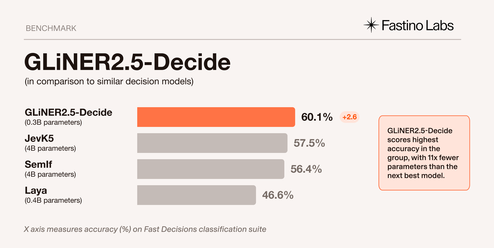
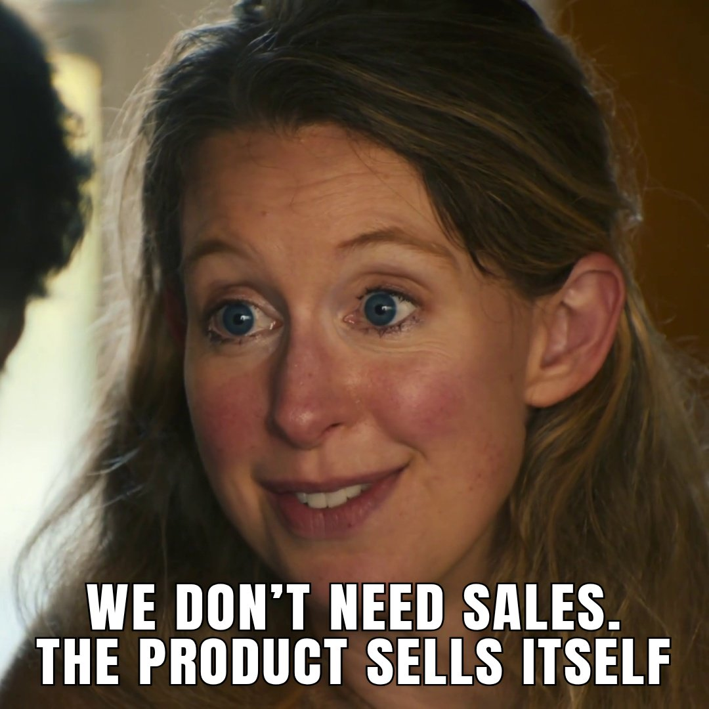
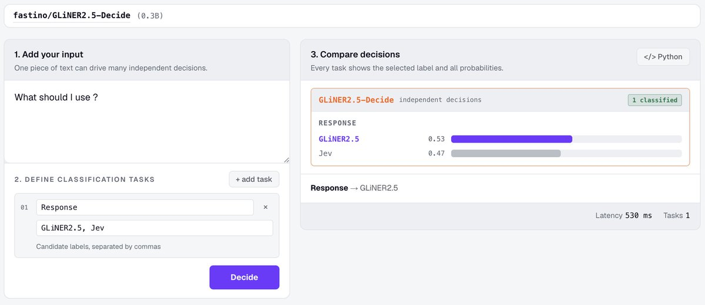
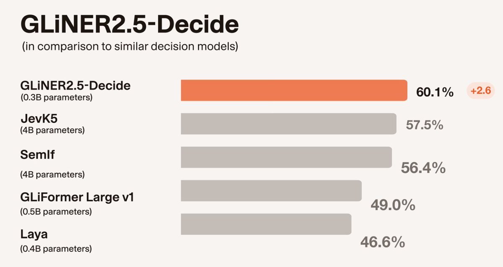
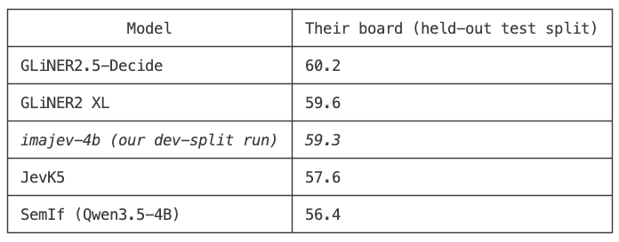

# Introducing GLiNER2.5-Decide, our new 340M parameter open weight, encoder-based decision model.
> Source: https://x.com/fastinoAI/status/2103188985292157353
> Author: Fastino Labs (@fastinoAI)
> Posted: Thu Sep 24 18:25:04 +0000 2026
> Captured: 2026-10-15T09:02:28+00:00
> Stats at capture: 162,489 views · 1,407 likes · 83 replies · 162 reposts · 1,452 bookmarks · 46 quotes

## Post

Introducing GLiNER2.5-Decide, our new 340M parameter open weight, encoder-based decision model.

GLiNER2.5-Decide is built for fast, deterministic classification. The model evaluates a set of user-defined typed questions and rules, and jointly decodes their answers, returning structured decisions with probability distributions and confidence scores.

We evaluated the model’s performance on Fast Decisions, an unseen, internally generated classification suite based on 17 datasets testing real-world use cases across routing, triage, classification, sentiment, and content understanding.

Measured against similar decision models, GLiNER2.5-Decide leads in 9 of the 17 datasets, achieving the highest average score:

- GLiNER2.5-Decide: 60.1%
- SemIf: 56.4%
- JevK5: 57.5%
- Laya: 46.6%

This performance makes the model a strong fit for use cases like tool calling, model routing, browser and computer use, and LLM-as-a-judge.

GLiNER2.5-Decide’s lightweight encoder architecture makes it easy to fine-tune the model for specific tasks, while being efficient enough to run locally on consumer-grade CPUs or in air-gapped environments, giving users greater control over where their data goes and where the model runs.

To make building and experimenting with GLiNER2.5-Decide as easy as possible, we're also offering hosted inference. You can now use our API to run inference and fine-tune GLiNER models on specialized tasks right inside your own coding agent: http://agent.fastino.ai

As with previous models, we’re also releasing the model weights on @huggingface under the Apache 2.0 license: https://huggingface.co/fastino/GLiNER2.5-Decide

## Media

 — Post media 1. Source media: https://pbs.twimg.com/media/HTADqQ_acAAEN42.png?name=orig
 — Reply 2110634494046687357 media 1. Source media: https://pbs.twimg.com/media/HUH1uCaWIAARd_i.jpg
 — Reply 2108255434125840740 media 1. Source media: https://pbs.twimg.com/media/HUIG-PMWEAEl_Iz.jpg
 — Reply 2103225775084478468 media 1. Source media: https://pbs.twimg.com/media/HTAopbqWQAA4jEd.jpg
 — Reply 2103229005663207842 media 1. Source media: https://pbs.twimg.com/media/HTAroKOaUAEIpU_.jpg
 — Reply 2103207178010341521 media 1. Source media: https://pbs.twimg.com/media/HTAXRtnasAAmUl-.png

## Thread

### Fastino Labs ([@fastinoAI](https://x.com/fastinoAI/status/2103188987812929692)) — 2026-09-24T18:25:04+00:00

Read the model launch blog: https://t.co/fKecQyWtQ6  
View the classification suite: https://t.co/ewk26NC436
### Fastino Labs ([@fastinoAI](https://x.com/fastinoAI/status/2103235695120933375)) — 2026-09-24T21:30:40+00:00

@tylerangert This model is fine-tuned on GLiNER2!
### Fastino Labs ([@fastinoAI](https://x.com/fastinoAI/status/2103895218366173396)) — 2026-09-26T17:11:23+00:00

@johnennis 🙌
### Fastino Labs ([@fastinoAI](https://x.com/fastinoAI/status/2103212061018947752)) — 2026-09-24T19:56:45+00:00

@AlekVectis That's why we had to share it!
### Fastino Labs ([@fastinoAI](https://x.com/fastinoAI/status/2103225569639010555)) — 2026-09-24T20:50:26+00:00

@fair_value_ish Please share what you come up with!
### Fastino Labs ([@fastinoAI](https://x.com/fastinoAI/status/2103211648991547576)) — 2026-09-24T19:55:07+00:00

@AG_1698 So do we 😁
### Fastino Labs ([@fastinoAI](https://x.com/fastinoAI/status/2103240265653969122)) — 2026-09-24T21:48:50+00:00

@InventorBlack We would love to see your results!
### Fastino Labs ([@fastinoAI](https://x.com/fastinoAI/status/2103211351963578712)) — 2026-09-24T19:53:56+00:00

@ZQ_Dev It's already out! https://t.co/kEKD2rs8Oo
### Fastino Labs ([@fastinoAI](https://x.com/fastinoAI/status/2103240022619267404)) — 2026-09-24T21:47:52+00:00

@marwancsw8 Not yet 🫢
### Fastino Labs ([@fastinoAI](https://x.com/fastinoAI/status/2103558397471891577)) — 2026-09-25T18:52:58+00:00

@johnasjeong We always try to make our models multilingual 😊
### Fastino Labs ([@fastinoAI](https://x.com/fastinoAI/status/2103559271741018390)) — 2026-09-25T18:56:27+00:00

@matheinated Awesome! Feel free to share your results 🙌
### Fastino Labs ([@fastinoAI](https://x.com/fastinoAI/status/2103253345863680152)) — 2026-09-24T22:40:48+00:00

@mont_py 4096 words!
### Fastino Labs ([@fastinoAI](https://x.com/fastinoAI/status/2103558798187315463)) — 2026-09-25T18:54:34+00:00

@traceendpoint Here's our GitHub repo: https://t.co/NbVil5oFAx
### Fastino Labs ([@fastinoAI](https://x.com/fastinoAI/status/2103495974283001883)) — 2026-09-25T14:44:55+00:00

@JordanEnrico 4096 tokens 😊
### Fastino Labs ([@fastinoAI](https://x.com/fastinoAI/status/2103497018077499416)) — 2026-09-25T14:49:04+00:00

@EmircanErkulX We offer inference for this model on our platform! https://t.co/qSv0KAiMXg

## Comments

### Tyler Angert ([@tylerangert](https://x.com/tylerangert/status/2103233774528196739)) — 2026-09-24T21:23:02+00:00

@fastinoAI Was this fine tuned on top of 2.5 / 2.5 multi or is it an entirely different model?
### John Ennis ([@johnennis](https://x.com/johnennis/status/2103801172620628148)) — 2026-09-26T10:57:40+00:00

@fastinoAI This is a huge contribution, thank you!
### Alek ([@AlekVectis](https://x.com/AlekVectis/status/2103208915752153271)) — 2026-09-24T19:44:15+00:00

@fastinoAI 60.1% across 17 datasets is wild
### hardcoded value ([@hardcoded_value](https://x.com/hardcoded_value/status/2103220359290110111)) — 2026-09-24T20:29:44+00:00

@fastinoAI Can't wait to try this out! Looks like a banger release.
### Adithya Giridharan ([@AG_1698](https://x.com/AG_1698/status/2103197602875687263)) — 2026-09-24T18:59:18+00:00

@fastinoAI i love gliner !!
### InventorBlack ([@InventorBlack](https://x.com/InventorBlack/status/2103237953791410569)) — 2026-09-24T21:39:39+00:00

@fastinoAI Excited to test this for my use cases versus Jev!
### zq_dev ([@ZQ_Dev](https://x.com/ZQ_Dev/status/2103210852426113477)) — 2026-09-24T19:51:57+00:00

@fastinoAI any plans for a multilingual version?
### extracsw ([@marwancsw8](https://x.com/marwancsw8/status/2103231390577791369)) — 2026-09-24T21:13:34+00:00

@fastinoAI Does it support vision?
### Yohan Jeong ([@johnasjeong](https://x.com/johnasjeong/status/2103526449408065561)) — 2026-09-25T16:46:01+00:00

@fastinoAI Thank you for supporting korean!!!
### Silvia Onofrei ([@matheinated](https://x.com/matheinated/status/2103540753544982800)) — 2026-09-25T17:42:52+00:00

@fastinoAI The local CPU section is especially interesting for clinical text. I'm looking forward to test it.
### Monty ([@mont_py](https://x.com/mont_py/status/2103251153601409276)) — 2026-09-24T22:32:06+00:00

@fastinoAI whats the size of context window?
### sean ([@seanmrnda](https://x.com/seanmrnda/status/2103287820475629794)) — 2026-09-25T00:57:48+00:00

@fastinoAI context length?
### Trace Endpoint ([@traceendpoint](https://x.com/traceendpoint/status/2103500065243529384)) — 2026-09-25T15:01:11+00:00

@fastinoAI 340M params, encoder-based, open weights. The interesting number here isn't the size — it's 'deterministic'. If the same typed question set always decodes the same way, that's a verifier you can actually pin in a harness. Everything else I've tested drifts on rerun. Repo?
### Jordan ([@JordanEnrico](https://x.com/JordanEnrico/status/2103380555274596661)) — 2026-09-25T07:06:17+00:00

@fastinoAI Any clue about the context length?
### Emircan ERKUL ([@EmircanErkulX](https://x.com/EmircanErkulX/status/2103449501843468484)) — 2026-09-25T11:40:16+00:00

@fastinoAI Are there any Inference Providers for this? So... i have to have a server then...
### urchade ([@urchadeDS](https://x.com/urchadeDS/status/2103225775084478468)) — 2026-09-24T20:51:15+00:00

@fastinoAI Jev or GLiNER2.5-Decide ? https://t.co/EeWbQRneCH
 — Source media: https://pbs.twimg.com/media/HTAopbqWQAA4jEd.jpg
### George Maloney ([@george_onx](https://x.com/george_onx/status/2103229005663207842)) — 2026-09-24T21:04:05+00:00

@fastinoAI The gap was pretty shocking https://t.co/Wjtst2SfqY
 — Source media: https://pbs.twimg.com/media/HTAroKOaUAEIpU_.jpg
### Daniel Bourke ([@mrdbourke](https://x.com/mrdbourke/status/2103302666185224380)) — 2026-09-25T01:56:47+00:00

@fastinoAI Awesome release!
### owen ([@owengretzinger](https://x.com/owengretzinger/status/2103532385161609597)) — 2026-09-25T17:09:37+00:00

@fastinoAI congrats!
### 安叫兽|Bird🕊️ 🔶 BNB ([@ajs6888](https://x.com/ajs6888/status/2103211689193906217)) — 2026-09-24T19:55:17+00:00

@fastinoAI 想看看规则互相打架时会怎么判。
### Mohit Garg ([@mohitt_garg](https://x.com/mohitt_garg/status/2103207178010341521)) — 2026-09-24T19:37:21+00:00

@fastinoAI Great work team..
I just ran the dev split on my imajev-4B model and it got a score of 59.3 on your bench (fastino/fast-decisions).

Maybe you can run it on your entire bench as well from this..

https://t.co/Yz9jWeXpTE
https://t.co/ssHpdwgRh6 https://t.co/kFtLzWdOKc
 — Source media: https://pbs.twimg.com/media/HTAXRtnasAAmUl-.png
### khaled ([@eltokh7](https://x.com/eltokh7/status/2103204842781175914)) — 2026-09-24T19:28:04+00:00

@fastinoAI will support it in https://t.co/SklZ35oRlY
### Humberto Figuera ([@hfiguera](https://x.com/hfiguera/status/2103211670550327627)) — 2026-09-24T19:55:12+00:00

@fastinoAI @vanstriendaniel 👏👏👏 great job guys!
### xC001x ([@xC001x](https://x.com/xC001x/status/2103364060943446208)) — 2026-09-25T06:00:45+00:00

@fastinoAI Do you also have a notebook on how to fine-tune it, for example, on medical text (e.g., patient medical dossiers)?
### Ali Umar ([@AliUmar2023498](https://x.com/AliUmar2023498/status/2103316284519952810)) — 2026-09-25T02:50:54+00:00

@fastinoAI @grok hiw is this any better than jev? And can it be run locally on my system and what will be its system requirements
### Joilson Rabelo ([@jrabell0](https://x.com/jrabell0/status/2103216381600665876)) — 2026-09-24T20:13:55+00:00

@fastinoAI Any probability of hallucinating?
### Douglas Lopes ([@DougLopesReal](https://x.com/DougLopesReal/status/2103216217985097821)) — 2026-09-24T20:13:16+00:00

@fastinoAI Only one question, is it muti language?
### David Jayatillake ✝️ ([@DSJayatillake](https://x.com/DSJayatillake/status/2103226131763851356)) — 2026-09-24T20:52:40+00:00

@fastinoAI @grok what's the context window
### Andrea Baccega ([@andrea_baccega](https://x.com/andrea_baccega/status/2103249712262304118)) — 2026-09-24T22:26:22+00:00

@fastinoAI Thanks for this.... It might be my fault but replicating your own inputs in hugging faces, give me the documented result back only 60% ish of the time
### Aron Brand ([@aron_brand](https://x.com/aron_brand/status/2103581830561910790)) — 2026-09-25T20:26:05+00:00

@fastinoAI How does it compare to TypeSafe’s hosted Jev ?

## Other returned timeline records

> The CLI did not expose reply relationships. These records do not start with a reply mention and were authored by someone other than the saved-post author. They may include recommendations or promoted posts; they are retained as source context, not verified replies.

### Ethan Caldwell ([@EthanCalFounder](https://x.com/EthanCalFounder/status/2110634494046687357)) — 2026-10-15T07:30:51+00:00

i'm sorry, Claude can WHAT?

it can take your website link, find people who need your product, email them and book the calls?

since when?? i've been doing this by hand for a YEAR.

ok. testing it: $30 free 👇

https://t.co/l0hylb6vAM https://t.co/xYw8Syj56Y
 — Source media: https://pbs.twimg.com/media/HUH1uCaWIAARd_i.jpg
### Rafal Kochanowski ([@rafalsoftware](https://x.com/rafalsoftware/status/2105746567571648627)) — 2026-10-01T19:47:59+00:00

I'm a software engineer who sees the full picture. Big-picture thinking and engineering depth.

Everyone can write that.

But you can verify this in a free conversation about your engineering problem, a decision you need to make, or a system you're planning to build.
### Ilya Batishchev ([@ilyabatishchev](https://x.com/ilyabatishchev/status/2108255434125840740)) — 2026-10-08T17:57:19+00:00

i'm sorry, Claude can WHAT?

it can take your website link, find people who need your product, email them and book the calls?

since when?? i've been doing this by hand for a YEAR.

ok. testing it: $30 free 👇

https://t.co/XIfPUVSpdg https://t.co/OJZklbfRxr
 — Source media: https://pbs.twimg.com/media/HUIG-PMWEAEl_Iz.jpg
### Atlas ([@Atlas3DAI](https://x.com/Atlas3DAI/status/2090814619275436444)) — 2026-08-21T14:53:45+00:00

A prompt goes in. A skeleton comes out, IK-ready.

Most text-to-3D stops at a static mesh. Atlas keeps going: standardized T-pose, rig, weights, so the character is animatable the day it is generated.

Try Atlas today

## Links

- http://agent.fastino.ai
- https://huggingface.co/fastino/GLiNER2.5-Decide
