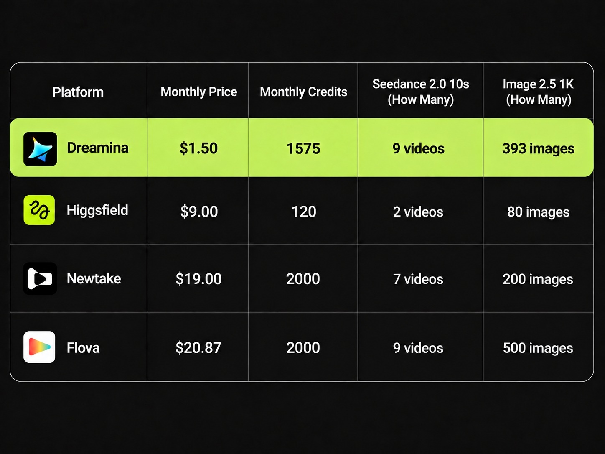
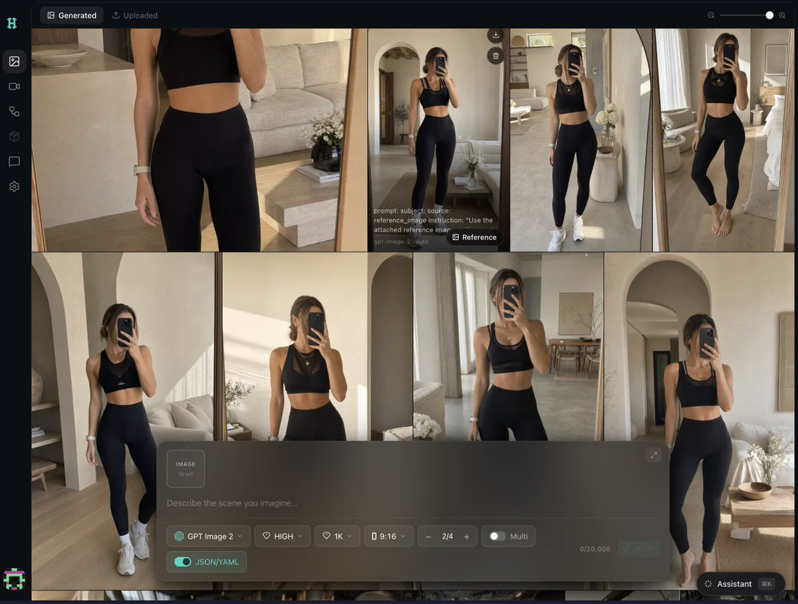

# People are still paying $20+ for AI video tools while this exists.
> Source: https://x.com/EyeingAI/status/2103193222029951413
> Author: EyeingAI (@EyeingAI)
> Posted: Thu Sep 24 18:41:54 +0000 2026
> Captured: 2026-10-15T09:02:28+00:00
> Stats at capture: 16,388 views · 122 likes · 14 replies · 15 reposts · 127 bookmarks · 1 quotes

## Post

People are still paying $20+ for AI video tools while this exists.

Dreamina Basic is currently $1.50/month.

It was the cheapest option in the comparison I checked, and you still get access to the Seedance lineup.

Here’s how to grab it + the catch 👇

## Media

 — Post media 1. Source media: https://pbs.twimg.com/media/HTALFxnaAAASwDQ.jpg?name=orig
[Reply 2103193275368923198 media 1](media/video-01.mp4) — Source media: https://video.twimg.com/amplify_video/2103193235669848065/vid/avc1/1994x1080/wU8lwtoFEGkkVp7n.mp4?tag=16
[Reply 2103193316334743694 media 1](media/video-02.mp4) — Source media: https://video.twimg.com/amplify_video/2103193288513933312/vid/avc1/1920x1080/F3iKSU_KeYBwX1VW.mp4?tag=16
 — Reply 2103193336840650876 media 1. Source media: https://pbs.twimg.com/media/HTALMR6bgAEpMIK.jpg
 — Reply 2110634494046687357 media 1. Source media: https://pbs.twimg.com/media/HUH1uCaWIAARd_i.jpg
[Reply 2110360787780800611 media 1](media/video-03.mp4) — Source media: https://video.twimg.com/amplify_video/2110360533803130880/vid/avc1/1920x1080/_DLwKSObAdxQxi2h.mp4?tag=29
[Reply 2110390355812295018 media 1](media/video-04.mp4) — Source media: https://video.twimg.com/amplify_video/2110390052278640640/vid/avc1/1920x1080/z6u2TlVh2WEcCksH.mp4?tag=29
 — Reply 2110277136644772258 media 1. Source media: https://pbs.twimg.com/media/HUk13iFXMAA1ZML.jpg
[Reply 2110342352665473156 media 1](media/video-05.mp4) — Source media: https://video.twimg.com/amplify_video/2110341167745282048/vid/avc1/1920x1080/m0kAWre8eLhiSKiF.mp4?tag=29

## Thread

### EyeingAI ([@EyeingAI](https://x.com/EyeingAI/status/2103193275368923198)) — 2026-09-24T18:42:06+00:00

Getting it is stupidly simple:

Go to Dreamina → Sign up → Membership → Monthly → Basic.

That’s the $1.50 plan.

The whole process takes less than a minute once you know where to click. https://t.co/SVULYefzJs
 — Source media: https://video.twimg.com/amplify_video/2103193235669848065/vid/avc1/1994x1080/wU8lwtoFEGkkVp7n.mp4?tag=16
### EyeingAI ([@EyeingAI](https://x.com/EyeingAI/status/2103193316334743694)) — 2026-09-24T18:42:16+00:00

And this is not some tiny trial plan.

The $1.50 gets you Dreamina Basic for a full month, with access to the Seedance lineup, including Seedance 2.5.

For AI video at this price, that’s kinda ridiculous.

#AIcreator https://t.co/RpnYMXzGSG
 — Source media: https://video.twimg.com/amplify_video/2103193288513933312/vid/avc1/1920x1080/F3iKSU_KeYBwX1VW.mp4?tag=16
### EyeingAI ([@EyeingAI](https://x.com/EyeingAI/status/2103193336840650876)) — 2026-09-24T18:42:21+00:00

One catch:

The $1.50 deal is only available in Japan, Korea, UK, France, Germany, Italy, Spain, Mexico, Brazil, US, Canada & Australia.

And it has to be your first-ever Dreamina payment.

If you don’t see the price, that’s probably why.

→ https://t.co/0UUPvoRMvu

#Dreamina #DreaminaPartner #AIFilmmaking
 — Source media: https://pbs.twimg.com/media/HTALMR6bgAEpMIK.jpg
### EyeingAI ([@EyeingAI](https://x.com/EyeingAI/status/2103193349914230958)) — 2026-09-24T18:42:24+00:00

Done!

If this thread helped you,

👉 Repost it to help someone else.
👉 Follow @EyeingAI – I break down AI every day.

## Comments

### Awa K. Penn ([@TawohAwa](https://x.com/TawohAwa/status/2103228360159822165)) — 2026-09-24T21:01:31+00:00

@EyeingAI AI video pricing is getting interesting
### Nelly; ([@nrqa__](https://x.com/nrqa__/status/2103423440531440122)) — 2026-09-25T09:56:42+00:00

@EyeingAI Seedance access at that price sounds interesting
### Nelly; ([@nrqa__](https://x.com/nrqa__/status/2103241196667900198)) — 2026-09-24T21:52:32+00:00

@EyeingAI Dreamina is making AI video experimentation ridiculously accessible
### Gina Acosta ([@ginacostag_](https://x.com/ginacostag_/status/2103207916727644437)) — 2026-09-24T19:40:17+00:00

@EyeingAI Dreamina is a must try 💯💯
### Andrew Bolis ([@AndrewBolis](https://x.com/AndrewBolis/status/2103475503273554414)) — 2026-09-25T13:23:35+00:00

@EyeingAI Less than a minute setup sounds pretty painless.
### Tania Sahai ([@Tan_SahAI](https://x.com/Tan_SahAI/status/2103200117931245688)) — 2026-09-24T19:09:18+00:00

@EyeingAI That price made me look twice!
### Vrutin Tarunchandra ([@Vrutin](https://x.com/Vrutin/status/2103471766064554404)) — 2026-09-25T13:08:44+00:00

@EyeingAI Thanks just grabbed it
### AI Spirit ([@alooBharta](https://x.com/alooBharta/status/2103194941568721239)) — 2026-09-24T18:48:44+00:00

@EyeingAI Kinda hard to ignore
### Dipti Sharma ([@Diptish09](https://x.com/Diptish09/status/2103357776470933976)) — 2026-09-25T05:35:47+00:00

@EyeingAI The price difference alone makes this worth checking out.
### Mushfiq Sajib ([@heysajib](https://x.com/heysajib/status/2103200343740027355)) — 2026-09-24T19:10:12+00:00

@EyeingAI The regional restriction is easy to miss, so calling it out makes this deal much clearer.
### Rakin ([@RakinKh](https://x.com/RakinKh/status/2103214166928728089)) — 2026-09-24T20:05:07+00:00

@EyeingAI https://t.co/cp6t9QQPYX
### BLACKBOX / WHITEBOX ([@Crypt0N1hang](https://x.com/Crypt0N1hang/status/2103338277524906094)) — 2026-09-25T04:18:18+00:00

@EyeingAI What bout seed dance 2.5

## Other returned timeline records

> The CLI did not expose reply relationships. These records do not start with a reply mention and were authored by someone other than the saved-post author. They may include recommendations or promoted posts; they are retained as source context, not verified replies.

### Ethan Caldwell ([@EthanCalFounder](https://x.com/EthanCalFounder/status/2110634494046687357)) — 2026-10-15T07:30:51+00:00

i'm sorry, Claude can WHAT?

it can take your website link, find people who need your product, email them and book the calls?

since when?? i've been doing this by hand for a YEAR.

ok. testing it: $30 free 👇

https://t.co/l0hylb6vAM https://t.co/xYw8Syj56Y
 — Source media: https://pbs.twimg.com/media/HUH1uCaWIAARd_i.jpg
### Rafal Kochanowski ([@rafalsoftware](https://x.com/rafalsoftware/status/2105746567571648627)) — 2026-10-01T19:47:59+00:00

I'm a software engineer who sees the full picture. Big-picture thinking and engineering depth.

Everyone can write that.

But you can verify this in a free conversation about your engineering problem, a decision you need to make, or a system you're planning to build.
### Mirelo ([@MireloAI](https://x.com/MireloAI/status/2110360787780800611)) — 2026-10-14T13:23:15+00:00

AI Videos finally sound real.

Introducing Mirelo SFX 2.0.

It watches your video, cuts the music you never prompted, keeps the dialogue, and builds a full sound design synced to the action and consistent across any length clips.

You’ve made it look right. We’ll make it sound right.

Live today through our API, on @runwayml  and @fal.

Other platforms coming soon. (Thread)
 — Source media: https://video.twimg.com/amplify_video/2110360533803130880/vid/avc1/1920x1080/_DLwKSObAdxQxi2h.mp4?tag=29
### Ori Silver ([@OriSilver](https://x.com/OriSilver/status/2110390355812295018)) — 2026-10-14T15:20:44+00:00

Claude doing motion graphic to create VOX style explainer is such old news... 

Only now tools try to "sell" you their agent that does it

Don't fall for it, it is free

Guys it is free 👇 https://t.co/GAlTTEO8GU
 — Source media: https://video.twimg.com/amplify_video/2110390052278640640/vid/avc1/1920x1080/z6u2TlVh2WEcCksH.mp4?tag=29
### Ramzi B. ([@SDDFounder](https://x.com/SDDFounder/status/2110277136644772258)) — 2026-10-14T07:50:51+00:00

You better use this open source one :

https://t.co/pZPyXvXVpX https://t.co/i5XMhwizvw
 — Source media: https://pbs.twimg.com/media/HUk13iFXMAA1ZML.jpg
### Emm | scenario.com ([@emmanuel_2m](https://x.com/emmanuel_2m/status/2110342352665473156)) — 2026-10-14T12:09:59+00:00

We just open-sourced an entire 3D team for Blender.

Introducing the Scenario plugin.

Use it inside Blender, or let Claude Code run it through MCP.

📁/scenario-plugin
┃
┣ 📁 Concept Artist
┃ ┣ 📁 Concept Art From a Prompt
┃ ┗ 📁 References From Your Viewport
┃
┣ 📁 3D Artist
┃ ┣ 📁 Meshes From Text or a Photo
┃ ┗ 📁 Retexture or Remesh the Selected Mesh
┃
┣ 📁 Animator
┃ ┣ 📁 Rig the Selected Character
┃ ┗ 📁 Motion From Text
┃
┣ 📁 Surfacing Artist
┃ ┣ 📁 PBR Materials Onto Any Slot
┃ ┗ 📁 Maps From a Photo
┃
┣ 📁 Layout Artist
┃ ┣ 📁 Greybox From a Description
┃ ┗ 📁 360 Worlds and Skies
┃
┣ 📁 Camera Operator
┃ ┣ 📁 Camera Path From a Sentence
┃ ┗ 📁 Orbits, Dollies, Cranes and Flyovers
┃
┣ 📁 Render Artist
┃ ┣ 📁 Viewport to Finished Still
┃ ┗ 📁 Playblast to Finished Shot
┃
┗ 📁 Sound Designer
┣ 📁 Music, Voice and SFX
┗ 📁 Dropped on Your Sequencer

Comment "BLENDER" and I'll send you the GitHub repo.
 — Source media: https://video.twimg.com/amplify_video/2110341167745282048/vid/avc1/1920x1080/m0kAWre8eLhiSKiF.mp4?tag=29
