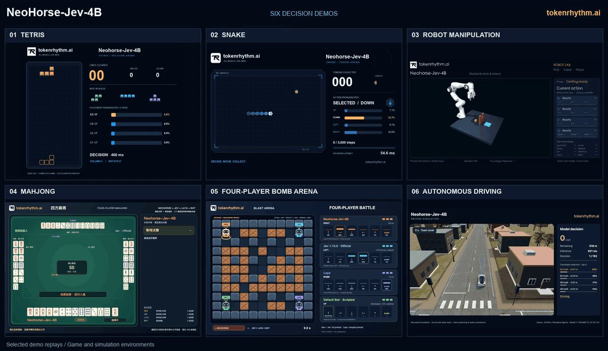

# NeoHorse-Jev-4B is now open—a compact model built to turn application states directly into structured decisions and probabilities.
> Source: https://x.com/ModelScope2022/status/2103332624907260156
> Author: ModelScope (@ModelScope2022)
> Posted: 2026-09-25T03:55:50+00:00
> Captured: 2026-10-15T09:02:28+00:00
> Stats at capture: 20,056 views · 355 likes · 22 replies · 41 reposts · 328 bookmarks · 4 quotes

## Post

NeoHorse-Jev-4B is now open—a compact model built to turn application states directly into structured decisions and probabilities.
🤖 https://modelscope.ai/collections/TokenRhythm/NeoHorse-Jev

🏆 Scores 77.70 across six text decision benchmark groups, ranking first among the four open-weight models with complete results in the comparison.
⚡ Prefill-only inference avoids autoregressive answer generation and supports three decision primitives: Choice for action selection, Noul for yes/no judgment, and Score for ordered ratings.
🎮 The same interface can power request routing, tool selection, workflow control, games, robot manipulation, and autonomous-driving simulations.
🖼️ Supports text inputs or a single image combined with text, returning normalized probabilities that applications can use directly.
🛠️ Deploy locally through vLLM, SGLang, Python, CLI, or HTTP. Apache 2.0.

## Media

[Post media 1](media/video-01.mp4) — Source media: https://video.twimg.com/ext_tw_video/2103332603973476352/pu/vid/avc1/1200x694/b13BMF-6Eet-j-hC.mp4?tag=12
 — Post media 1 thumbnail. Source media: https://pbs.twimg.com/ext_tw_video_thumb/2103332603973476352/pu/img/S0dBAw77TkiYU4DS.jpg
 — Reply 2110634494046687357 media 1. Source media: https://pbs.twimg.com/media/HUH1uCaWIAARd_i.jpg

## Comments

### Sophia AI & Tool Expert ([@SophiaAiExpert](https://x.com/SophiaAiExpert/status/2104068024894476672)) — 2026-09-27T04:38:03+00:00

@ModelScope2022 Incredible release  77.70 and #1 among open weights with direct decision probabilities is huge!
### Tom Bielecki ([@tombielecki](https://x.com/tombielecki/status/2103531012139725034)) — 2026-09-25T17:04:09+00:00

@ModelScope2022 Known state or inferred state?
### 安叫兽|Bird🕊️ 🔶 BNB ([@ajs6888](https://x.com/ajs6888/status/2103359918321643728)) — 2026-09-25T05:44:17+00:00

@ModelScope2022 不生成答案直接做选择，想看看复杂状态下稳不稳
### Alek ([@AlekVectis](https://x.com/AlekVectis/status/2103336993732346112)) — 2026-09-25T04:13:12+00:00

@ModelScope2022 77.70 across six decision groups is a useful receipt
### Aapakari ([@aapakari](https://x.com/aapakari/status/2103371293550580171)) — 2026-09-25T06:29:29+00:00

@ModelScope2022 Nice, normalized probabilities straight out would simplify app logic a lot.
### Zara Tech & Tools ([@AskZaratech](https://x.com/AskZaratech/status/2104327957762211863)) — 2026-09-27T21:50:56+00:00

@ModelScope2022 impressive compact model for decision tasks
### RAZA | AI EXPLORER ([@razaaitech](https://x.com/razaaitech/status/2103599593472610493)) — 2026-09-25T21:36:40+00:00

@ModelScope2022 This is seriously impressive. Compact, practical, and built for real-world decision-making.
### 大大土拨鼠 ([@large_marmota](https://x.com/large_marmota/status/2103356440618394010)) — 2026-09-25T05:30:28+00:00

@ModelScope2022 4B 直接映射应用状态→结构化决策/概率，77.70 六项决策基准挺适合端侧 agent。想看的是：校准（calibration）会不会漂、长尾状态覆盖，以及和更大 backbone 在 tool-schema drift 下的差距。开源权重有没有报过温度/频率惩罚对决策分布的影响？
### Pandoras Parabox ([@JonOneOfficial](https://x.com/JonOneOfficial/status/2103468403818188835)) — 2026-09-25T12:55:22+00:00

@ModelScope2022 This sounds very interesting. Might you be able to make it run in llama?
### _alphashark_ ([@_alphashark_](https://x.com/_alphashark_/status/2104811657902125147)) — 2026-09-29T05:52:59+00:00

@ModelScope2022 Skipping generation is fine if the answer's just a label from a fixed list. Once a tool call needs free-form arguments, that stops holding.
I'd keep a normal generating model for filling those in and use NeoHorse-Jev-4B only to pick the tool.
### Danilo Ramírez ([@danonino_rmz](https://x.com/danonino_rmz/status/2103404139073917075)) — 2026-09-25T08:40:00+00:00

@ModelScope2022 @grok diferencia con respecto a Jev de typesafe
### Zehua Pei ([@jarvis_pei](https://x.com/jarvis_pei/status/2104457586804432991)) — 2026-09-28T06:26:02+00:00

@ModelScope2022 Thanks for featuring NeoHorse-Jev! We’d love to hear what people build with it, especially for tool selection and agent workflow control.
### Zehua Pei ([@jarvis_pei](https://x.com/jarvis_pei/status/2104422902066229279)) — 2026-09-28T04:08:12+00:00

@ModelScope2022 Thanks for featuring NeoHorse-Jev and supporting the release! Excited to see what the community builds with it 🐎
### ShadowAguy ([@shadowaguy](https://x.com/shadowaguy/status/2103333824402960654)) — 2026-09-25T04:00:36+00:00

@ModelScope2022 Cool!
### pottrauschen ([@pottrauschen](https://x.com/pottrauschen/status/2103450080468451428)) — 2026-09-25T11:42:34+00:00

@ModelScope2022 The shape matters even on small open models. I rebuilt the Jev form on a local Qwen 4B (one letter A to D, one token, temperature 0, argmax) against a JSON prompt on the same model and the same frozen e-mail pairs: 19 to 5 for the letter, p = 0.007. Prefill-only is the right bet.
### Latent Node ([@latent_node](https://x.com/latent_node/status/2103358549317636287)) — 2026-09-25T05:38:51+00:00

@ModelScope2022 Good to see open weights for local serving. For teams that want it hosted, meraGPT's Decider 1 answers the same three primitives on the System One API at $0.03 per 1M input. The open typed-decisions benchmark would be a useful extra check for NeoHorse: https://t.co/kt4Iuh7IWR
### Aria Tech ([@Ariaaiexpert](https://x.com/Ariaaiexpert/status/2103749326757642634)) — 2026-09-26T07:31:39+00:00

@ModelScope2022 Impressive efficiency and strong benchmark results great to see it open sourced
### hexmint ✌️ ([@hexmint](https://x.com/hexmint/status/2103526631088558194)) — 2026-09-25T16:46:45+00:00

@ModelScope2022 None of these, absolutely none of these need a system one model to run
### Tony Tong | Founder | Ancient Systems x AI ([@tonytonggg](https://x.com/tonytonggg/status/2103407684586467705)) — 2026-09-25T08:54:06+00:00

@ModelScope2022 77.70 is a fair public ranking, and I still use those.

But I don't trust it for my case until I've run the model against my own code and formed an intuitive read of how it behaves.

For routing, a general score can't know my requests.
### Duong Van Dinh ([@dinhdva](https://x.com/dinhdva/status/2103356019347013702)) — 2026-09-25T05:28:48+00:00

@ModelScope2022 Amazing

## Other returned timeline records

> The CLI did not expose reply relationships. These records do not start with a reply mention and were authored by someone other than the saved-post author. They may include recommendations or promoted posts; they are retained as source context, not verified replies.

### Ethan Caldwell ([@EthanCalFounder](https://x.com/EthanCalFounder/status/2110634494046687357)) — 2026-10-15T07:30:51+00:00

i'm sorry, Claude can WHAT?

it can take your website link, find people who need your product, email them and book the calls?

since when?? i've been doing this by hand for a YEAR.

ok. testing it: $30 free 👇

https://t.co/l0hylb6vAM https://t.co/xYw8Syj56Y
 — Source media: https://pbs.twimg.com/media/HUH1uCaWIAARd_i.jpg
### Rafal Kochanowski ([@rafalsoftware](https://x.com/rafalsoftware/status/2105746567571648627)) — 2026-10-01T19:47:59+00:00

I'm a software engineer who sees the full picture. Big-picture thinking and engineering depth.

Everyone can write that.

But you can verify this in a free conversation about your engineering problem, a decision you need to make, or a system you're planning to build.

## Links

- https://modelscope.ai/collections/TokenRhythm/NeoHorse-Jev
