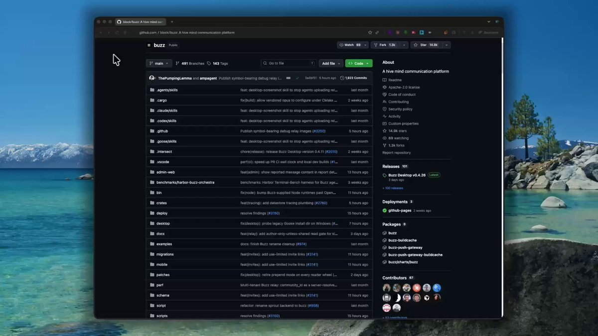

# ESTO ES UNA LOCURA
> Source: https://x.com/nicos_ai/status/2103484990352765393
> Author: Nico (@nicos_ai)
> Posted: 2026-09-25T14:01:17+00:00
> Captured: 2026-10-15T09:02:28+00:00
> Stats at capture: 143,237 views · 1,457 likes · 33 replies · 196 reposts · 2,935 bookmarks · 5 quotes

## Post

ESTO ES UNA LOCURA

Jack Dorsey (ex-CEO de Twitter) acaba de lanzar gratis un framework completo para crear un negocio gestionado al 100% por agentes de IA.

Ya supera las 29.000 estrellas en GitHub.

Cómo configurarlo (5min):

1. Clona el repositorio.
2. Despliega tu propio servidor: canales, búsqueda, Git y automatizaciones funcionan desde ahí.
3. Añade tu agente a un canal como si fuera un compañero más, define sus permisos y deja que el equipo colabore con él en tiempo real.

Guárdate este post, vas a querer volver a él.

Enlace al repositorio abajo👇

## Media

[Post media 1](media/video-01.mp4) — Source media: https://video.twimg.com/amplify_video/2103484915283075073/vid/avc1/1280x720/tSl2LydOfGu1XGHQ.mp4?tag=29
 — Post media 1 thumbnail. Source media: https://pbs.twimg.com/amplify_video_thumb/2103484915283075073/img/ekgwIeenAq5dHmr8.jpg
 — Reply 2110634494046687357 media 1. Source media: https://pbs.twimg.com/media/HUH1uCaWIAARd_i.jpg
 — Reply 2108255434125840740 media 1. Source media: https://pbs.twimg.com/media/HUIG-PMWEAEl_Iz.jpg

## Thread

### Nico ([@nicos_ai](https://x.com/nicos_ai/status/2103484995096433144)) — 2026-09-25T14:01:18+00:00

https://t.co/BZIjVX6q8W
### Nico ([@nicos_ai](https://x.com/nicos_ai/status/2103490647286305084)) — 2026-09-25T14:23:45+00:00

@silvanrec +1
### Nico ([@nicos_ai](https://x.com/nicos_ai/status/2103490488619663788)) — 2026-09-25T14:23:08+00:00

@MikuBTC @igus_ai solo con quitarte unas cuantas tareas repetitivas ya merece la pena
### Nico ([@nicos_ai](https://x.com/nicos_ai/status/2103490681406943574)) — 2026-09-25T14:23:54+00:00

@S0N_IA_ dale caña!!
### Nico ([@nicos_ai](https://x.com/nicos_ai/status/2103490450900627873)) — 2026-09-25T14:22:59+00:00

@igus_ai @Nozelcode Para eso estamos🤝
### Nico ([@nicos_ai](https://x.com/nicos_ai/status/2103490337528574409)) — 2026-09-25T14:22:32+00:00

@Nozelcode si lo pruebas ya me contarás qué montarías con él
### Nico ([@nicos_ai](https://x.com/nicos_ai/status/2103490364040692033)) — 2026-09-25T14:22:38+00:00

@angeldot_ @MikuBTC sí, poder adaptarlo a tu forma de trabajar le da mucho más recorrido
### Nico ([@nicos_ai](https://x.com/nicos_ai/status/2103490521322934632)) — 2026-09-25T14:23:15+00:00

@fltraciones y puedes probar la idea sin tener que montar una estructura enorme de entrada
### Nico ([@nicos_ai](https://x.com/nicos_ai/status/2103490558945628614)) — 2026-09-25T14:23:24+00:00

@animals_random_ @Nozelcode me gustaría ver eso también, con los fallos y las correcciones incluidos

## Comments

### silvan ([@silvanrec](https://x.com/silvanrec/status/2103490277457453295)) — 2026-09-25T14:22:17+00:00

@nicos_ai justo este tipo de proyectos son los que me gusta ver en github
### Miku ([@MikuBTC](https://x.com/MikuBTC/status/2103486934018666791)) — 2026-09-25T14:09:00+00:00

@nicos_ai @igus_ai esto con una buena configuración puede ahorrar bastante trabajo
### ethan ([@ethanorbe](https://x.com/ethanorbe/status/2103490395313414394)) — 2026-09-25T14:22:45+00:00

@nicos_ai vale, este sí me ha dado curiosidad por probarlo
### gus ([@igus_ai](https://x.com/igus_ai/status/2103486456060612808)) — 2026-09-25T14:07:06+00:00

@nicos_ai @Nozelcode gracias por compartir el repo, luego le echo un ojo
### roman ([@Nozelcode](https://x.com/Nozelcode/status/2103485982662361383)) — 2026-09-25T14:05:13+00:00

@nicos_ai esto me lo guardo para verlo con calma el finde
### angel ([@angeldot_](https://x.com/angeldot_/status/2103487032320213394)) — 2026-09-25T14:09:24+00:00

@nicos_ai @MikuBTC ojalá más proyectos así, abiertos y con margen para adaptarlos a lo que necesitas
### filtraciones gaming ([@fltraciones](https://x.com/fltraciones/status/2103486349894365236)) — 2026-09-25T14:06:41+00:00

@nicos_ai cada vez hay menos distancia entre tener una idea y ponerse a construirla
### marronald ([@animals_random_](https://x.com/animals_random_/status/2103486217920913610)) — 2026-09-25T14:06:09+00:00

@nicos_ai @Nozelcode estaría guapo ver un negocio pequeño montado con esto desde cero
### GARLOTIC ([@garlotic](https://x.com/garlotic/status/2103490307031777359)) — 2026-09-25T14:22:24+00:00

@nicos_ai me interesa más ver cómo colaboran entre ellos que tener otro chatbot suelto
### daemon. ([@daemondot_](https://x.com/daemondot_/status/2103491951198900637)) — 2026-09-25T14:28:56+00:00

@nicos_ai lo de tener al agente como uno más del equipo me parece muy buena idea
### robert. ([@robrtcode](https://x.com/robrtcode/status/2103491916641825146)) — 2026-09-25T14:28:48+00:00

@nicos_ai empezar con una tarea pequeña y ampliar desde ahí suena bastante bien
### dubbersAU ([@dubbersau](https://x.com/dubbersau/status/2103749569326788985)) — 2026-09-26T07:32:37+00:00

@nicos_ai Buzz has been around for a few months
### jonsnowgay ([@targaryengoat](https://x.com/targaryengoat/status/2103491971415220247)) — 2026-09-25T14:29:01+00:00

@nicos_ai entré por lo de dorsey y ahora quiero montarme uno jajaja
### Crio Songo ([@shuizhuyu](https://x.com/shuizhuyu/status/2103680609319281135)) — 2026-09-26T02:58:36+00:00

@nicos_ai 前推特CEO做的AI托管业务框架配置这么简单，星涨得这么快已经说明含金量了，我赶紧存下来试试。
### zo. ([@zoemdza](https://x.com/zoemdza/status/2103490363164160158)) — 2026-09-25T14:22:38+00:00

@nicos_ai tiene buena pinta para automatizar las tareas que nadie quiere hacer
### a11r ([@0xa11r](https://x.com/0xa11r/status/2103834692998852963)) — 2026-09-26T13:10:52+00:00

@nicos_ai C'est pas nouveau et ce n' est pas ce que prétend ton tweet.. clickbait
### Miguel Ángel Sabio | Negocios e IA ([@MaSabio1984](https://x.com/MaSabio1984/status/2104190679895433398)) — 2026-09-27T12:45:26+00:00

@nicos_ai Lo de gestionar una empresa con agentes de IA tiene un pequeño detalle: el 100% de la responsabilidad sigue siendo tuya.

Yo empezaría por los permisos, los límites de gasto y un botón de parada.

Mi tarjeta ya ha financiado suficientes experimentos de autonomía artificial.
### Proximity #WiFi #MKT ([@mobilereality](https://x.com/mobilereality/status/2103763924843741675)) — 2026-09-26T08:29:40+00:00

@nicos_ai Y qué diferencia tiene esto de utilizar Grok Bot?
### Maximiliano Rodríguez ([@maxirodr_](https://x.com/maxirodr_/status/2103937433335173222)) — 2026-09-26T19:59:08+00:00

@nicos_ai Configurarlo lleva 5 minutos. Lo caro viene después. Mis agentes ya publicaron 1.091 posts solos y el laburo nunca fue que hagan cosas: fue enseñarles cuándo no hacerlas. Un negocio 100% agentes sin eso es un negocio 100% sin frenos.
### WAGMİ 100x💎 ([@gemsnper](https://x.com/gemsnper/status/2103573661152321627)) — 2026-09-25T19:53:37+00:00

@nicos_ai el verdadero alpha no es el framework, es quién controla las keys.

imagina estos agentes con wallets propias, permisos de firma y presupuesto autónomo... ahí crypto deja de ser un casino y se vuelve la capa de pago de la IA.

¿o crees de verdad que van a usar Visa?
### luci. ([@inmaxera](https://x.com/inmaxera/status/2103486040208232482)) — 2026-09-25T14:05:27+00:00

@nicos_ai Epic
### Hussain Hashim | Building SundayBack ([@itsthedonhashim](https://x.com/itsthedonhashim/status/2103543809670013417)) — 2026-09-25T17:55:00+00:00

@nicos_ai @nicos_ai watch out for server load balancing. AI agents can hit performance snags if one channel gets overloaded.
### David PF BCN ([@D4V1DBCN](https://x.com/D4V1DBCN/status/2103748680192848163)) — 2026-09-26T07:29:05+00:00

@nicos_ai @grok explicame un caso práctico
### ZaiZai ([@ZaiZai923297](https://x.com/ZaiZai923297/status/2103487114650538318)) — 2026-09-25T14:09:43+00:00

@nicos_ai #Fauci has sold your life and your child's  health to the   devilish #CCP

 https://t.co/BKfr0esL0B
### YOalphabet & AI ([@YOalphabet](https://x.com/YOalphabet/status/2105205547616075779)) — 2026-09-30T07:58:10+00:00

@nicos_ai https://t.co/wu7gCzeePT
### YOalphabet & AI ([@YOalphabet](https://x.com/YOalphabet/status/2103731169049108509)) — 2026-09-26T06:19:30+00:00

@nicos_ai https://t.co/wu7gCzeePT
### brabra_101 ([@brabra_111](https://x.com/brabra_111/status/2105199684709163210)) — 2026-09-30T07:34:52+00:00

@nicos_ai Le projet block/buzz est une alternative décentralisée à Slack et GitHub qui intègre des agents d'IA comme des utilisateurs à part entière dotés d'identités et de permissions spécifiques. L'outil ne gère pas une entreprise de manière autonome et nécessite 👇
### Bruno Rodrigo ([@BruInoff](https://x.com/BruInoff/status/2103533416243208247)) — 2026-09-25T17:13:42+00:00

@nicos_ai @grok explica

## Other returned timeline records

> The CLI did not expose reply relationships. These records do not start with a reply mention and were authored by someone other than the saved-post author. They may include recommendations or promoted posts; they are retained as source context, not verified replies.

### Ethan Caldwell ([@EthanCalFounder](https://x.com/EthanCalFounder/status/2110634494046687357)) — 2026-10-15T07:30:51+00:00

i'm sorry, Claude can WHAT?

it can take your website link, find people who need your product, email them and book the calls?

since when?? i've been doing this by hand for a YEAR.

ok. testing it: $30 free 👇

https://t.co/l0hylb6vAM https://t.co/xYw8Syj56Y
 — Source media: https://pbs.twimg.com/media/HUH1uCaWIAARd_i.jpg
### Rafal Kochanowski ([@rafalsoftware](https://x.com/rafalsoftware/status/2105746567571648627)) — 2026-10-01T19:47:59+00:00

I'm a software engineer who sees the full picture. Big-picture thinking and engineering depth.

Everyone can write that.

But you can verify this in a free conversation about your engineering problem, a decision you need to make, or a system you're planning to build.
### Ilya Batishchev ([@ilyabatishchev](https://x.com/ilyabatishchev/status/2108255434125840740)) — 2026-10-08T17:57:19+00:00

i'm sorry, Claude can WHAT?

it can take your website link, find people who need your product, email them and book the calls?

since when?? i've been doing this by hand for a YEAR.

ok. testing it: $30 free 👇

https://t.co/XIfPUVSpdg https://t.co/OJZklbfRxr
 — Source media: https://pbs.twimg.com/media/HUIG-PMWEAEl_Iz.jpg
### Miguel Ángel Sabio | Negocios e IA ([@MaSabio1984](https://x.com/MaSabio1984/status/2103525617207546018)) — 2026-09-25T16:42:43+00:00

Lo interesante no es que puedas crear una empresa gestionada al 100 % por agentes.

De hecho, Buzz ni siquiera promete eso.

Lo interesante es que humanos y agentes puedan trabajar en el mismo entorno, con permisos, flujos de trabajo y trazabilidad.

Porque montar un equipo de agentes empieza a ser relativamente sencillo.

Conseguir que no se estorben, no tomen decisiones equivocadas y sepan cuándo necesitan intervención humana es otra historia.

El organigrama ya lo tenemos.

Ahora falta que la empresa funcione.
### Atlas ([@Atlas3DAI](https://x.com/Atlas3DAI/status/2090814619275436444)) — 2026-08-21T14:53:45+00:00

A prompt goes in. A skeleton comes out, IK-ready.

Most text-to-3D stops at a static mesh. Atlas keeps going: standardized T-pose, rig, weights, so the character is animatable the day it is generated.

Try Atlas today
