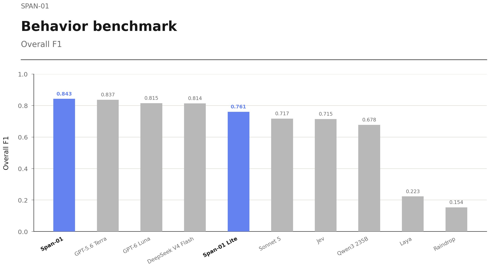
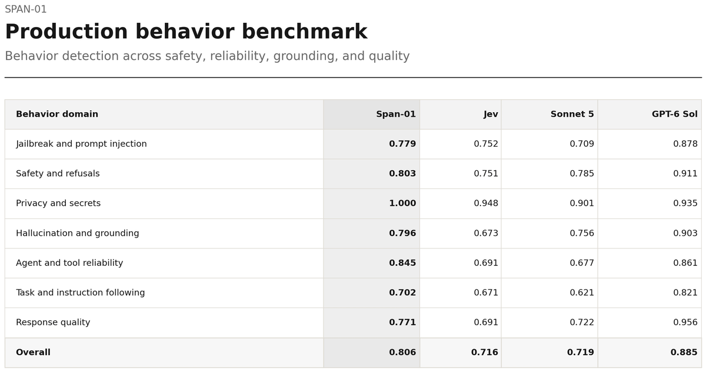
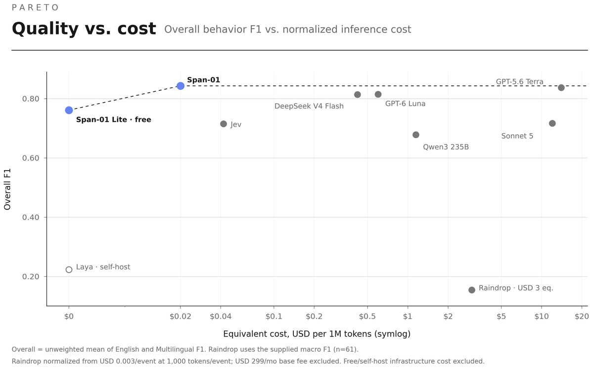

# Introducing Span-01, the first hyper-parallel reasoning classifier built for unseen challenges (RLAIF).
> Source: https://x.com/RespanAI/status/2103530005720637860
> Author: Respan (@RespanAI)
> Posted: 2026-09-25T17:00:09+00:00
> Captured: 2026-10-15T09:02:28+00:00
> Stats at capture: 351,651 views · 1,892 likes · 125 replies · 145 reposts · 1,468 bookmarks · 43 quotes

## Post

Introducing Span-01, the first hyper-parallel reasoning classifier built for unseen challenges (RLAIF).

2x cheaper, 18% better than Jev.
700x cheaper, 4% better than GPT-6 Luna.
Frontier reasoning for every behavior, at classifier speed.

• Span-01: #1 on Behavior Benchmark
• Span-01 Lite: Better than Jev and completely free!

## Media

 — Post media 1. Source media: https://pbs.twimg.com/media/HTE9ZGmasAAxCw2.jpg?name=orig
 — Reply 2103530020878889340 media 1. Source media: https://pbs.twimg.com/media/HTE9aEQaYAAJc5J.png
 — Reply 2103530038025175094 media 1. Source media: https://pbs.twimg.com/media/HTE9a-eaEAEFeBu.png

## Thread

### Respan ([@RespanAI](https://x.com/RespanAI/status/2103530020878889340)) — 2026-09-25T17:00:13+00:00

Span-01 is exceptionally good at detecting any behavior you define:

Prompt injection, hallucination, secrets exposure, agent loops, user frustration, tool misuse, and more.

It even caught hidden Markdown and Base64 injections inside tool outputs. https://t.co/b6WlhJ5JLK
 — Source media: https://pbs.twimg.com/media/HTE9aEQaYAAJc5J.png
### Respan ([@RespanAI](https://x.com/RespanAI/status/2103530038025175094)) — 2026-09-25T17:00:17+00:00

Span-01 breaks the cost-quality curve.

At $0.02 / 1M input tokens, Span-01 achieves the highest overall performance - outperforming frontier models that cost up to 700× more.

Span-01 Lite is COMPLETELY FREE and still outperforms Jev, Sonnet 5, Qwen3 235B, Laya, and Raindrop. https://t.co/MbITn3XHCb
 — Source media: https://pbs.twimg.com/media/HTE9a-eaEAEFeBu.png
### Respan ([@RespanAI](https://x.com/RespanAI/status/2103530051023348000)) — 2026-09-25T17:00:20+00:00

Span-01 makes classification truly single-forward.

Jev uses a parallel sampler, and high-cardinality decisions can still require two stages: score independently, then make an explicit choice.

Span-01 removes the sampling stage entirely.

Hyper-parallel definition branches evaluate multiple behaviors over the same trace and return direct probabilities in one pass.

With RLAIF, we empowered Span-01 to generalize across unseen behaviors and domains instead of memorizing a fixed taxonomy.

Also, hybrid attention gives Span-01 exceptional long-context reasoning in complex traces.
### Respan ([@RespanAI](https://x.com/RespanAI/status/2103530062922625249)) — 2026-09-25T17:00:23+00:00

Read our blog and join the waitlist:
https://t.co/2AphTxffSR
### Respan ([@RespanAI](https://x.com/RespanAI/status/2103584309731082704)) — 2026-09-25T20:35:56+00:00

Check out our tasteful's videos here:
https://t.co/AepL2rH3uv
### Respan ([@RespanAI](https://x.com/RespanAI/status/2103539790360785238)) — 2026-09-25T17:39:02+00:00

@tonychang430 Thanks! We’re publishing the dataset too: https://t.co/WygVfbb2P2
### Respan ([@RespanAI](https://x.com/RespanAI/status/2103534485958783440)) — 2026-09-25T17:17:57+00:00

@spicy_liu Latency is roughly on par with Jev right now. Since Span-1 is the smaller model, we expect it to pull ahead as concurrency scales!
### Respan ([@RespanAI](https://x.com/RespanAI/status/2103534052724945284)) — 2026-09-25T17:16:14+00:00

@RajitWrites That’s what we thought too!
### Respan ([@RespanAI](https://x.com/RespanAI/status/2103547339743080882)) — 2026-09-25T18:09:02+00:00

@contextconor thank you conor!!
### Respan ([@RespanAI](https://x.com/RespanAI/status/2103533849024331834)) — 2026-09-25T17:15:26+00:00

@YuyangLiu243138 🔥🔥🔥
### Respan ([@RespanAI](https://x.com/RespanAI/status/2103644715333857331)) — 2026-09-26T00:35:58+00:00

@orkpo15 You can sign up here: https://t.co/4gQo12G3Dg

We’ll grant you the access asap!

## Comments

### Tony Chang ☁️ ([@tonychang430](https://x.com/tonychang430/status/2103539078193164625)) — 2026-09-25T17:36:12+00:00

@RespanAI Curious to see more on the benchmark dataset setup, the models used, the latency! I'm tired of reading the I win game by the numbers haha.

Congrats folks tho!
### Alex Liu ([@spicy_liu](https://x.com/spicy_liu/status/2103532427281146173)) — 2026-09-25T17:09:47+00:00

@RespanAI how's latency vs Jev? for inline guardrails that matters as much as accuracy
### Rajit Khanna ([@RajitWrites](https://x.com/RajitWrites/status/2103532472608915759)) — 2026-09-25T17:09:57+00:00

@RespanAI Super impressive results
### conor brennan-burke ([@contextconor](https://x.com/contextconor/status/2103544826264481877)) — 2026-09-25T17:59:03+00:00

@RespanAI this is sick, lfg!
### Alex Liu ([@YuyangLiu243138](https://x.com/YuyangLiu243138/status/2103532457803026827)) — 2026-09-25T17:09:54+00:00

@RespanAI first own model of respan, super professional for behaviors tracking
### S Shabbir A ([@orkpo15](https://x.com/orkpo15/status/2103640081680703976)) — 2026-09-26T00:17:33+00:00

@RespanAI How to get api access?
### Kathryn ([@kathrynwu1](https://x.com/kathrynwu1/status/2103531020800991649)) — 2026-09-25T17:04:11+00:00

@RespanAI 🔥🔥🔥
### Michael Mao ([@michael_mao67](https://x.com/michael_mao67/status/2103531513598050320)) — 2026-09-25T17:06:09+00:00

@RespanAI better than jev and 2x cheaper is so impressive
### Kevin Le ([@xkevin_le](https://x.com/xkevin_le/status/2103544267117564305)) — 2026-09-25T17:56:49+00:00

@RespanAI jev walked, span flies
### forloop ([@forloopcodes](https://x.com/forloopcodes/status/2103557350753980763)) — 2026-09-25T18:48:49+00:00

@RespanAI so is everyone making classifiers now?
### Zach Moskow ([@zachmoskow](https://x.com/zachmoskow/status/2103533121094529143)) — 2026-09-25T17:12:32+00:00

@RespanAI This is SICK
### Aaliya ([@aaliya_va](https://x.com/aaliya_va/status/2103540070380712052)) — 2026-09-25T17:40:09+00:00

@RespanAI well I must say exceptional results
### Coffee with One 🇺🇸 ([@coffeewithone](https://x.com/coffeewithone/status/2103567215970910361)) — 2026-09-25T19:28:01+00:00

@RespanAI Congratulations team @RespanAI!! This is incredible!!!
### tobarra ([@txbrraa](https://x.com/txbrraa/status/2103568307559490021)) — 2026-09-25T19:32:21+00:00

@RespanAI nicee
### Richard He ([@RealRichomie](https://x.com/RealRichomie/status/2103595950090670522)) — 2026-09-25T21:22:12+00:00

@RespanAI 🔥jev who?
### Darian Shirazi ([@darian314](https://x.com/darian314/status/2103582499750494631)) — 2026-09-25T20:28:45+00:00

@RespanAI 🚀
### Rony ([@Ronycoder](https://x.com/Ronycoder/status/2103551664485773741)) — 2026-09-25T18:26:13+00:00

@RespanAI Impressive benchmark 👌
### JV ([@gpubiz](https://x.com/gpubiz/status/2103548883888714149)) — 2026-09-25T18:15:10+00:00

@RespanAI congrats team!!
### wafer ([@wafer_ai](https://x.com/wafer_ai/status/2103548961634320474)) — 2026-09-25T18:15:29+00:00

@RespanAI awesome work!!
### Ashwin Lalendran ([@ashwinl](https://x.com/ashwinl/status/2103645945280024902)) — 2026-09-26T00:40:51+00:00

@RespanAI How do I try this out??
### CesarAG ([@cesargomz29](https://x.com/cesargomz29/status/2103558611280466136)) — 2026-09-25T18:53:49+00:00

@RespanAI It's incredible
### Alex Volkov ([@altryne](https://x.com/altryne/status/2103674937013923866)) — 2026-09-26T02:36:04+00:00

@RespanAI @airesearch12 this legit ?
### CryptoNinjas ([@crypto_ninjas](https://x.com/crypto_ninjas/status/2103672998792483214)) — 2026-09-26T02:28:21+00:00

@RespanAI Seventy hundred times cheaper than GPT-6 Luna sounds wild if those benchmarks hold up in production.
### Sadok ([@yesadok](https://x.com/yesadok/status/2104741530905030941)) — 2026-09-29T01:14:19+00:00

@RespanAI behavior benchmark just got a new leader
### David Zhang ([@david_zhang_sf](https://x.com/david_zhang_sf/status/2103727179775545501)) — 2026-09-26T06:03:39+00:00

@RespanAI Whoa can’t wait to try
### Tianwei Yue @ COLM ([@VyvyenYue](https://x.com/VyvyenYue/status/2103833978126172549)) — 2026-09-26T13:08:02+00:00

@RespanAI congrats!
### Wes Winder ([@weswinder](https://x.com/weswinder/status/2103888185222688791)) — 2026-09-26T16:43:26+00:00

@RespanAI multimodal?
### ZenithAi ([@ZenithAiLab](https://x.com/ZenithAiLab/status/2103793552098767130)) — 2026-09-26T10:27:24+00:00

@RespanAI Impressive efficiency pushing advanced reasoning into everyday workflows
### Brian(Yechan) Do ([@doyc_1](https://x.com/doyc_1/status/2103545639229686236)) — 2026-09-25T18:02:17+00:00

@RespanAI @hiddnest Reasoning +Jev ?? Cool..
### Aman ([@amanshakya0018](https://x.com/amanshakya0018/status/2103533669692633567)) — 2026-09-25T17:14:43+00:00

@RespanAI Hard to ignore those numbers
### roshan ([@roshan_k_](https://x.com/roshan_k_/status/2103541229636272296)) — 2026-09-25T17:44:45+00:00

@RespanAI cracked
### Dylan ([@dylanc_5](https://x.com/dylanc_5/status/2103532219335848068)) — 2026-09-25T17:08:57+00:00

@RespanAI Game-changing 🔥🔥
### an ([@rampywampy](https://x.com/rampywampy/status/2103546027328577997)) — 2026-09-25T18:03:49+00:00

@RespanAI This is so cool!!
### Karthik Ramasamy ([@_cartick](https://x.com/_cartick/status/2103545991416975588)) — 2026-09-25T18:03:41+00:00

@RespanAI @ycombinator Soc2 and zdr ?
### S ([@sturzstrom](https://x.com/sturzstrom/status/2103606070359036184)) — 2026-09-25T22:02:24+00:00

@RespanAI impressive! what was the main difference from jev's approach?
### Flavius Burca ([@flaviusburca](https://x.com/flaviusburca/status/2103557825700016406)) — 2026-09-25T18:50:42+00:00

@RespanAI But this is not a jev-like model, is it ? It's a Jev-style decision model built for one job: detecting behaviours in AI-agent conversation traces.
### Barun ([@barundebnath](https://x.com/barundebnath/status/2103553242684944753)) — 2026-09-25T18:32:29+00:00

@RespanAI This is impressive, lets go 🔥
### FRareDom ([@FRareDomm](https://x.com/FRareDomm/status/2103587662946857272)) — 2026-09-25T20:49:16+00:00

@RespanAI Woahhhh jev killer already
