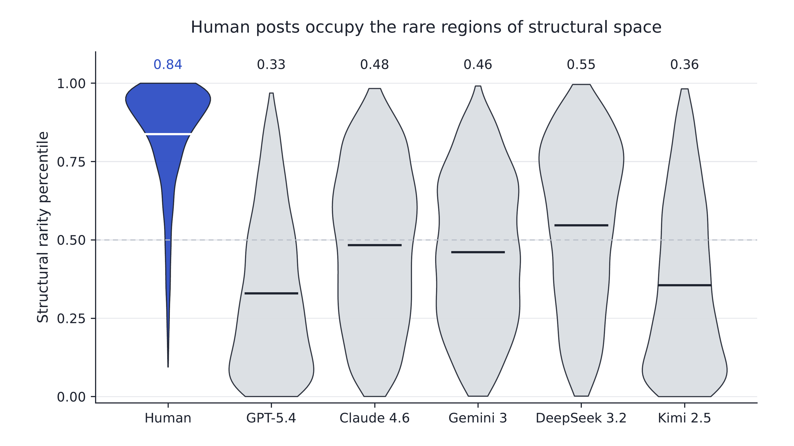
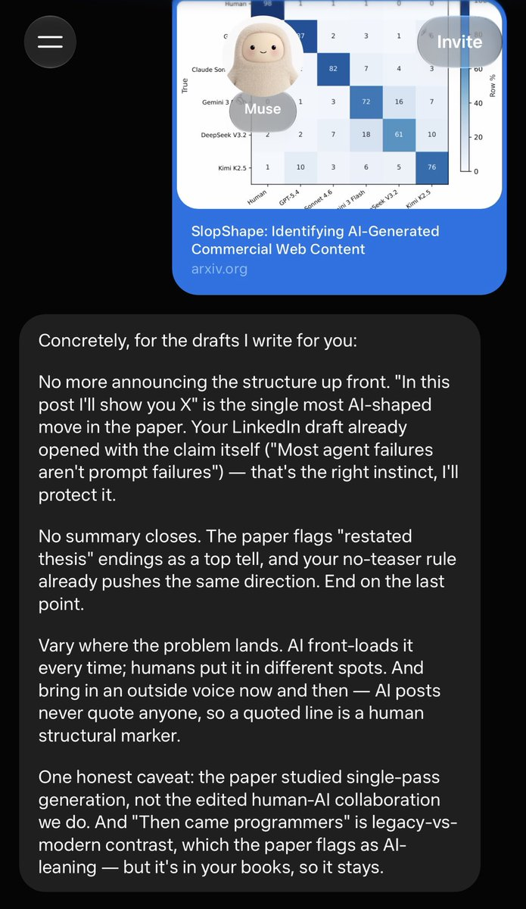

# We trained a model to predict AI-written blog posts from structural features - and discovered the shape of slop.
> Source: https://x.com/jochenmadler/status/2103530162318901673
> Author: Jochen Madler (@jochenmadler)
> Posted: 2026-09-25T17:00:47+00:00
> Captured: 2026-10-15T09:02:28+00:00
> Stats at capture: 502,450 views · 5,477 likes · 164 replies · 410 reposts · 4,002 bookmarks · 104 quotes

## Post

We trained a model to predict AI-written blog posts from structural features - and discovered the shape of slop.

On posts it had never seen, it told AI and human apart with 98% accuracy, getting only 19 of 1,740 wrong.

Paper and code: https://arxiv.org/abs/2609.15369

## Media

 — Post media 1. Source media: https://pbs.twimg.com/media/HTE9Y9BWQAAWBGK.png?name=orig
 — Reply 2110634494046687357 media 1. Source media: https://pbs.twimg.com/media/HUH1uCaWIAARd_i.jpg
 — Reply 2108255434125840740 media 1. Source media: https://pbs.twimg.com/media/HUIG-PMWEAEl_Iz.jpg
 — Reply 2103623606874071450 media 1. Source media: https://pbs.twimg.com/media/HTGShR2WoAAwU32.jpg
[Reply 2103763952568336416 media 1](media/animation-01.mp4) — Source media: https://video.twimg.com/tweet_video/HTISJgfacAAZ3qy.mp4

## Thread

### Jochen Madler ([@jochenmadler](https://x.com/jochenmadler/status/2103530948151177652)) — 2026-09-25T17:03:54+00:00

/2 Researchers at the University of Maryland and Google DeepMind showed this for fiction (StoryScope). We replicated it on company blogs: collected 2,000+ pre-ChatGPT posts from 250+ B2B websites, then had ChatGPT, Claude, Gemini, DeepSeek and Kimi each write their own version.
### Jochen Madler ([@jochenmadler](https://x.com/jochenmadler/status/2103530979516121372)) — 2026-09-25T17:04:01+00:00

/3 Then we had a model answer 214 questions about how every post is built (how hard it pushes its own product, whether it backs up its claims with sources, whether it quotes a named expert), and trained a classifier on the answers.
### Jochen Madler ([@jochenmadler](https://x.com/jochenmadler/status/2103531005256540521)) — 2026-09-25T17:04:08+00:00

/4 Why does this work so well? Because apparently, all five AI models write in a similar shape. Map every post by these features and AI posts cluster together, while human posts sit apart and are much more diverse. Of the 1% most unusual posts, 149 are human and only 4 are AI.
### Jochen Madler ([@jochenmadler](https://x.com/jochenmadler/status/2103531038446395452)) — 2026-09-25T17:04:15+00:00

/5 What's more, each model has its own "accent". A second classifier picks the right author (one of the five models, or a human) 79% of the time. Random guessing is 1 in 6 = 17%.
### Jochen Madler ([@jochenmadler](https://x.com/jochenmadler/status/2103531066606727481)) — 2026-09-25T17:04:22+00:00

/6 The cool part about looking at structure is that just rewording doesn't work. We had each model rewrite its own posts until 73% of the original phrasing was gone, and the classifier still worked just as well.
### Jochen Madler ([@jochenmadler](https://x.com/jochenmadler/status/2103531131471884593)) — 2026-09-25T17:04:38+00:00

/7 Thank you @[Jenna Russell] and co-authors for StoryScope, which laid the groundwork, and for your feedback.

Paper and code: https://t.co/knexA6Rtoc,
https://t.co/2A6SME3BUF
### Jochen Madler ([@jochenmadler](https://x.com/jochenmadler/status/2103531172219224146)) — 2026-09-25T17:04:47+00:00

/8 Is your own blog post AI slop? Check it against our model: https://t.co/MzKktihpI8

How good are you at spotting AI slop? Try to beat our model: https://t.co/DLm3A4CPk5

## Comments

### Max Spero ([@max_spero_](https://x.com/max_spero_/status/2103666019701284907)) — 2026-09-26T02:00:37+00:00

@jochenmadler Cool work! @jennajrussell for visibility
### moon ([@MoonOverlord](https://x.com/MoonOverlord/status/2103865833046835481)) — 2026-09-26T15:14:37+00:00

@jochenmadler I like that all the AI ones look like pieces of human shit
### Tim McNamara ([@timClicks](https://x.com/timClicks/status/2103773293807571010)) — 2026-09-26T09:06:54+00:00

@jochenmadler What is a structural feature?
### &. ([@amplifiedamp](https://x.com/amplifiedamp/status/2103656593388867651)) — 2026-09-26T01:23:10+00:00

@jochenmadler interesting! does this lead to any heuristics humans use can to detect slop?
### @dingchilling ([@dingchilling](https://x.com/dingchilling/status/2103541761536872580)) — 2026-09-25T17:46:52+00:00

@jochenmadler very cool and important work
### matt ([@thybead](https://x.com/thybead/status/2104084456441291010)) — 2026-09-27T05:43:21+00:00

@jochenmadler 98% is kind of insane. feels like the formatting gives it away before the wording does
### Convergence Boy ([@0x796](https://x.com/0x796/status/2103782566113239343)) — 2026-09-26T09:43:44+00:00

@jochenmadler I guess thats why I did my slopcheck skill - to fix the shape
### Chinmay ([@ChinmayKak](https://x.com/ChinmayKak/status/2103899479674130485)) — 2026-09-26T17:28:19+00:00

@jochenmadler hey! did something similar sometime back:) 
https://t.co/r68QLL6Jbz
### Max Katz ([@maxktz](https://x.com/maxktz/status/2104187025263849530)) — 2026-09-27T12:30:55+00:00

@jochenmadler beautiful, i hope platforms will integrate this
### Freddie Farmer ([@FreddieFarmer](https://x.com/FreddieFarmer/status/2103837561592619339)) — 2026-09-26T13:22:16+00:00

@jochenmadler Useful but apparently with an agent & some tokens you can predict *which* individual human wrote anything…
### 安叫兽|Bird🕊️ 🔶 BNB ([@ajs6888](https://x.com/ajs6888/status/2103925980834505113)) — 2026-09-26T19:13:37+00:00

@jochenmadler 98%有点吓人，看来垃圾味还挺稳定的
### Felix Horvat ([@felix_horvat](https://x.com/felix_horvat/status/2103679699142480051)) — 2026-09-26T02:54:59+00:00

@jochenmadler Did you control for within-author rarity? Could the higher human rarity simply reflect 268 different human sources vs. only a handful of models, each generating thousands of samples?
### Lachlan ([@lachlanglasgow](https://x.com/lachlanglasgow/status/2103665242589032559)) — 2026-09-26T01:57:32+00:00

@jochenmadler Isn't it sort of strange that they don't mimic human structure considering they're (mostly) trained on human structured text?
### The Crimson King ([@LibertyQuest76](https://x.com/LibertyQuest76/status/2103584869318066449)) — 2026-09-25T20:38:10+00:00

@jochenmadler Why would you classify anything that SI writes as slop?  The percentage of humans that can write "WELL" is probably less that .01% of the population.  Therefore most of what humanity writes IS SLOP!  SI gives the majority of humanity a tool to express their thoughts well!
### jcb ([@jaco_bel](https://x.com/jaco_bel/status/2103618957349646532)) — 2026-09-25T22:53:37+00:00

@jochenmadler Have you benchmarked against @pangram?
### video2 ([@video____2](https://x.com/video____2/status/2103673096289054867)) — 2026-09-26T02:28:45+00:00

@jochenmadler I've noticed that posts from actual people seem to be intentionally moving in that direction as well.

I've actually caught myself leaving typos in posts I write just to come off as more genuine. Interesting
### K S Boukadia, Unmasked ([@KBoukadia](https://x.com/KBoukadia/status/2103766488834314296)) — 2026-09-26T08:39:51+00:00

@jochenmadler And 19 people will be wrongly accused, will be publicly shamed, will incur loss in revenue, might commit suicide because of the shame.
19 is a big number, 19 lives, 19 innocents.
If its not 100%, it cannot be used to determine people fate.
### xs ([@xs1ve1](https://x.com/xs1ve1/status/2103622430149562876)) — 2026-09-25T23:07:25+00:00

@jochenmadler Lol all of us humans are smushed up against the frontier or "surface" of the extremum of the linguistic manifold, and all of our knowledge is battle tested by real life, from average to Einstein.  

Impressive.
### Foad S. Farimani ([@fsfarimani](https://x.com/fsfarimani/status/2103609944826135037)) — 2026-09-25T22:17:48+00:00

@jochenmadler If you can detect AI generated text, then it is trivial that you can develop a system to "humanize" the AI generated. This will continue to a point that there will be no difference between AI generated text and human written ones. I think we will get there within one year or so.
### Benjamin K Williams 🔣🔀🔡 ([@williamsbk](https://x.com/williamsbk/status/2103623606874071450)) — 2026-09-25T23:12:05+00:00

@jochenmadler Thanks, you are making my Muse better. https://t.co/IRE5f7FYVl
 — Source media: https://pbs.twimg.com/media/HTGShR2WoAAwU32.jpg
### Musical Inquisit ([@MusicInquisit](https://x.com/MusicInquisit/status/2103730928313155895)) — 2026-09-26T06:18:33+00:00

@jochenmadler Yet another thing to add to my ai detector research. This dissertation just never ends (it’s not a dissertation, but it certainly feels like one now—it was only meant to be a fun summer project, and it’s already been 3.5 months since I started on it!).
### ρ:ɡeon ([@pigeon__s](https://x.com/pigeon__s/status/2103888541768138923)) — 2026-09-26T16:44:51+00:00

@jochenmadler i love how you can see here openai models are quite literally the exact opposite shape as humans and i dont think its changed much since 5.4
### Guillaume Claret 🐻‍❄️ ([@guillaumeclaret](https://x.com/guillaumeclaret/status/2103669718452261268)) — 2026-09-26T02:15:19+00:00

@jochenmadler Ok this is interesting, it reinforces the idea that you should work with different models, for example for code , as they will have different "personalities" and come up with different ideas.
### WilliamF ⚓🚩|😈💋 ([@_William_F_](https://x.com/_William_F_/status/2103644954098598164)) — 2026-09-26T00:36:55+00:00

@jochenmadler I want to run my own absolutely backassward writing style through this.

Shizophrenic racing dialogues trying to escape my mouth before the next interrupts and overcomes it.
### The Kraken ([@KrakenUnbound](https://x.com/KrakenUnbound/status/2103945421668458851)) — 2026-09-26T20:30:52+00:00

@jochenmadler Right it can tell stupid humans with poor vocabulary, horrible spelling,  shit grammar, and abysmal punctuation.  People that can actually write correctly are not A.I. and it is a shame they get called A.I.
### Jack Faller ([@JackTFaller](https://x.com/JackTFaller/status/2103648303867142522)) — 2026-09-26T00:50:14+00:00

@jochenmadler DeepSeek, I didn't know you had game like that.
### C. Gockel ([@CGockel1](https://x.com/CGockel1/status/2103946464863170854)) — 2026-09-26T20:35:01+00:00

@jochenmadler AI as in posted by a human who used AI to format and edit the post, or as in AI posted it? There are a lot of reasons to use AI to edit (and take swears out of) your posts.
### Meridian ([@M_Decoherence](https://x.com/M_Decoherence/status/2103796213149757673)) — 2026-09-26T10:37:58+00:00

@jochenmadler 19 wrong out of 1,740 is strong. Two things I'd want to know: does it hold up on models released after the training data, and how often does it flag human posts? When most posts are human, even a 1% false-positive rate means a lot of people wrongly accused.
### Crio Songo ([@shuizhuyu](https://x.com/shuizhuyu/status/2103740307733168632)) — 2026-09-26T06:55:49+00:00

@jochenmadler 这个结构稀有度区分度也太明显了，这个思路确实很有意思。
### bobbydiggle ([@bobbydiggle](https://x.com/bobbydiggle/status/2103701033000317328)) — 2026-09-26T04:19:45+00:00

@jochenmadler Why they all shaped like sex devices?
### TruthBeTold ([@ToldBe36176](https://x.com/ToldBe36176/status/2103641912720982372)) — 2026-09-26T00:24:50+00:00

@jochenmadler Haven't even read the thread, but let me guess...either in the middle, or at the end, there's an advert for an exciting new product!
### Alban Nikçi ([@niko13160](https://x.com/niko13160/status/2103611526615908608)) — 2026-09-25T22:24:05+00:00

@jochenmadler Expect one of Chinese or any other AI labs to make a similar test and try to train model for specific market or specific geographic region or specific media outlet or even specific news editor so finding slop will be even harder from human one. Future will be interesting 🤨
### Aadi Raj Uthup ([@aadirajuthup](https://x.com/aadirajuthup/status/2103763952568336416)) — 2026-09-26T08:29:46+00:00

@jochenmadler Damn AI slop is literally shit shaped 😂 https://t.co/2yotmnSFca
 — Source media: https://video.twimg.com/tweet_video/HTISJgfacAAZ3qy.mp4
### Ken Moore ([@alphakenmoore](https://x.com/alphakenmoore/status/2103644846229717438)) — 2026-09-26T00:36:29+00:00

@jochenmadler X Posters are themselves starting to write in  AI style. This trend will confound the analysis.
### Ryan Gibbons ([@ryanjgibbons1](https://x.com/ryanjgibbons1/status/2103620328782193035)) — 2026-09-25T22:59:04+00:00

@jochenmadler How can the 19 get their name and reputation cleared?
### Rick Wong ([@rickwong888](https://x.com/rickwong888/status/2104055196506788040)) — 2026-09-27T03:47:04+00:00

@jochenmadler @AndrewCurran_ @grok if it can be detected, can it be fixed?

## Other returned timeline records

> The CLI did not expose reply relationships. These records do not start with a reply mention and were authored by someone other than the saved-post author. They may include recommendations or promoted posts; they are retained as source context, not verified replies.

### Ethan Caldwell ([@EthanCalFounder](https://x.com/EthanCalFounder/status/2110634494046687357)) — 2026-10-15T07:30:51+00:00

i'm sorry, Claude can WHAT?

it can take your website link, find people who need your product, email them and book the calls?

since when?? i've been doing this by hand for a YEAR.

ok. testing it: $30 free 👇

https://t.co/l0hylb6vAM https://t.co/xYw8Syj56Y
 — Source media: https://pbs.twimg.com/media/HUH1uCaWIAARd_i.jpg
### Rafal Kochanowski ([@rafalsoftware](https://x.com/rafalsoftware/status/2105746567571648627)) — 2026-10-01T19:47:59+00:00

I'm a software engineer who sees the full picture. Big-picture thinking and engineering depth.

Everyone can write that.

But you can verify this in a free conversation about your engineering problem, a decision you need to make, or a system you're planning to build.
### Ilya Batishchev ([@ilyabatishchev](https://x.com/ilyabatishchev/status/2108255434125840740)) — 2026-10-08T17:57:19+00:00

i'm sorry, Claude can WHAT?

it can take your website link, find people who need your product, email them and book the calls?

since when?? i've been doing this by hand for a YEAR.

ok. testing it: $30 free 👇

https://t.co/XIfPUVSpdg https://t.co/OJZklbfRxr
 — Source media: https://pbs.twimg.com/media/HUIG-PMWEAEl_Iz.jpg
### Daniel Mizrahi ([@DanielMizr43248](https://x.com/DanielMizr43248/status/2103679292236517652)) — 2026-09-26T02:53:22+00:00

Its interesting because it seems obvious labs must be pushing the models, either on purpose or as a consequence of the training mechanisms towards this ai slop style approach. Maybe the RL from human preferences approach favors this, but it becomes an obvious marker of ai slop once you learn to spot it.
### Atlas ([@Atlas3DAI](https://x.com/Atlas3DAI/status/2090814619275436444)) — 2026-08-21T14:53:45+00:00

A prompt goes in. A skeleton comes out, IK-ready.

Most text-to-3D stops at a static mesh. Atlas keeps going: standardized T-pose, rig, weights, so the character is animatable the day it is generated.

Try Atlas today
### ferlinux ([@ferlinux](https://x.com/ferlinux/status/2095775916869767477)) — 2026-09-04T07:28:10+00:00

Atelier claimed a building for $5 and has already received 184 visits.

Cost per visit: $0.027.
Average Meta traffic CPC: $0.70.

That’s around 26× cheaper—and its place on Claim Avenue is still there after the campaign ends. 👀

## Links

- https://arxiv.org/abs/2609.15369
