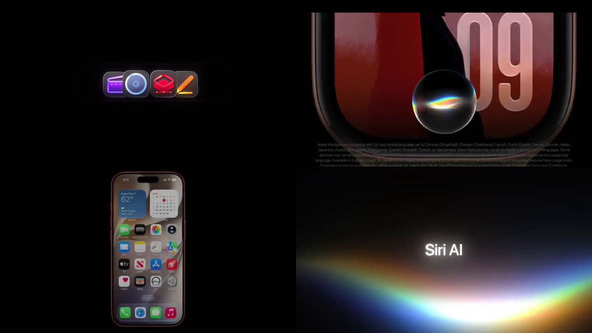
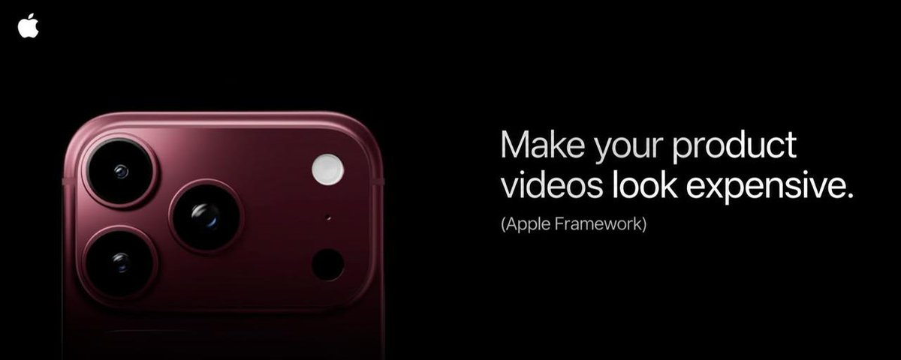
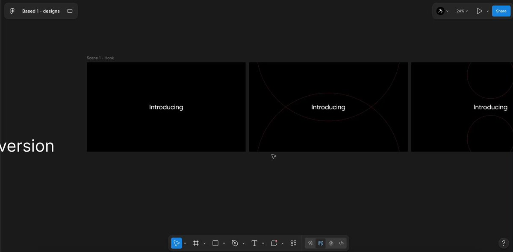
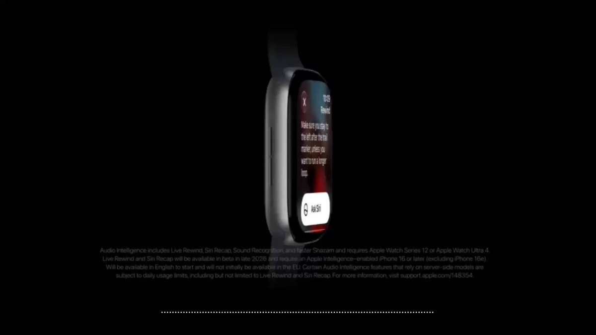
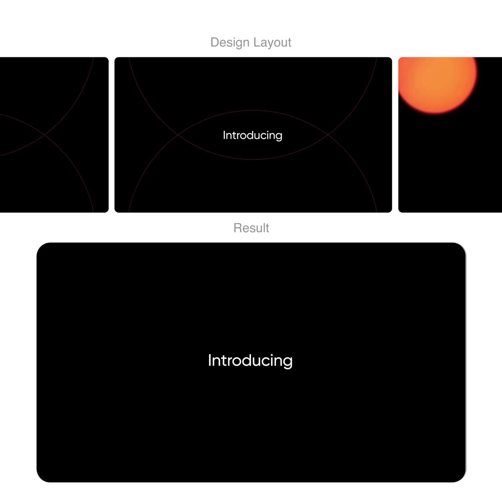
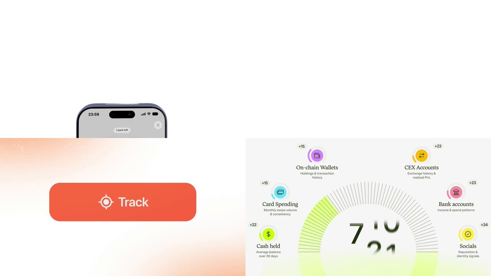

# This guy broke down the science behind Apple's product videos
> Source: https://x.com/amirdzm/status/2103533757588463990
> Author: Amir Dzhambulov (@amirdzm)
> Posted: 2026-09-25T17:15:04+00:00
> Captured: 2026-10-15T09:02:28+00:00
> Stats at capture: 781,553 views · 4,301 likes · 22 replies · 226 reposts · 4,698 bookmarks · 1 quotes

## Post

This guy broke down the science behind Apple's product videos

Apple sue him please....

> Quoted post by leo ([@leomeethewoo](https://x.com/leomeethewoo/status/2103529310208606701)):
>
> https://x.com/i/article/2103118352554344448

## Quoted article: Make your product videos look expensive (Apple Framework)

You've probably seen those videos from Apple. They look f*cking sick

Hi, I'm leo. My team produced over 50 product videos this summer for companies like @TrustWallet @fomo @PrizePicks

Here's some of our recent work:

I've already wrote an article before about Apple videos, it was a bit surface level tbh and it absolutely boomed

https://x.com/leomeethewoo/status/2098032450731720823?s=20

So In this article we'll go more deep and I'll share some of the frameworks my team uses to produce this kind of videos. I've written everything manually without use of AI, I hope you'll like it

### 1. Branding (Premium storytelling)

The strongest brands aren't selling products, they are giving people a way to identify through their choices

The whole world knows apple. Their goal in their videos isn't to make more people know them, it's to make people that are already familiar with brand feel like they are special by using their product aka "premium" feeling

From it comes the whole brand ideology that they use in their videos:

### Intention is everything

Nothing is done on accident

Every choice needs a purpose:

-The font

-Background

-Music

-Color theme

A simple but huge part of having a premium - feeling brand is not doing things that make the brand  feel less premium

And this is where many people fuck up: experiment with too much effects, add unnecessary sound effects and rap music.

Give yourself real rules and guidelines (give yourself 3 colors that you will use for the same type of videos, same backgrounds, similar music choice for certain type of projects)

To the audience it feels like you decided that it should be that way

This is the most important part to understand and the following points will all be based on that

### 2. Design

Like it or not, every great video starts with a great design.

Many people think that to make a great product video they need to hire a skilled motion designer and he will do all the work

Big companies like Apple take this approach completely different. They focus on design first and then anything else.

Their approach is simple - Apple developed a brand design guideline over the years: guidelines for typography, backgrounds and many more

They stick to it from video to video.

Besides that, 10's of the most talented product designers on their team have a great understanding of the apple's style

They follow those key principles:

- One shot = one idea.

- Every scene has space to "Breathe"

- Key objects are in the center of the frame

- The background fits the brand guidelines and never interrupts the key objects

Our approach is same - we have 5 full-time product designers on the team that first storyboard each animation frame by frame in figma to make sure that the final result looks good.

Here's for example how our recent storyboard looked like:

The point here is simple - your video won't look good without a good design. Focus on it first and the rest will follow.

### 3. Animation

When it comes to animating, there are couple of great techniques to make it feel more expensive

1)Smoothness

Smooth out any motion by easing your keyframe graphs and overlapping them

In most cases, linear motion looks more out of place and cheap comparing to the eased motion

2)Dynamic transitions

When one scene smoothly transitions to another, we just think that it belongs there

Avoid direct cuts between scenes unless they are neccesary for the message

3)Adaptive rhytm

The rhytm of a video shouldn't always be linear.

Depending on the part of video, it should speed up, slow down or stay same

### 4. Music choice

You can control the video energy by a sound track

Including the "expensive" "premium" feelings

Start with a BPM choice:

60 – 80 BPM associates with Regal, Cinematic, Heritage vibe

90 – 110 BPM is more Smooth, Cool, Effortless

115-123 BPM feels Elite, Kinetic, Sophisticated

Everything more than that is more drive and hype and can fit well certain projects or destroy others

Then you can experiment with genre, certain types of music will target different audiences and fit different projects.

### 5. Sound design

The cherry on top of every video is great sound design.

Here goes the same psychology  as in the first point

Try to avoid sound effects that do feel important

And after you're done with sound effects listen to everything and ask yourself what feels off

If there's a sound effect that feels too loud, out of place or doesn't help people to stay engaged or understand your product better - remove it

---------------------------------------------------------------------------------

Thanks for reading, follow me for more cool stuff :)

## Media

[Post media 1](media/video-01.mp4) — Source media: https://video.twimg.com/amplify_video/2103533705193222144/vid/avc1/1280x720/097tnsSiY1ZfFTea.mp4?tag=29
 — Post media 1 thumbnail. Source media: https://pbs.twimg.com/amplify_video_thumb/2103533705193222144/img/DNu6WvDcGSbz_Y9l.jpg
 — Quoted article media. Source media: https://pbs.twimg.com/media/HTE5qj0aQAAlIAJ.jpg
[Quoted article video](media/video-02.mp4) — Source media: https://video.twimg.com/amplify_video/2103527016561848320/vid/avc1/1464x720/nYBR7xlgBuu2-eTI.mp4?tag=29
 — Quoted article video thumbnail. Source media: https://pbs.twimg.com/amplify_video_thumb/2103527016561848320/img/7i0bDkU2YYUGCwGe.jpg
[Quoted article video](media/video-03.mp4) — Source media: https://video.twimg.com/amplify_video/2103527016452833281/vid/avc1/1280x720/Jum1MrP_Dz4wbugl.mp4?tag=29
 — Quoted article video thumbnail. Source media: https://pbs.twimg.com/amplify_video_thumb/2103527016452833281/img/hKXDwjZ1cV63DGCy.jpg
[Quoted article video](media/video-04.mp4) — Source media: https://video.twimg.com/amplify_video/2103527016821833728/vid/avc1/1280x720/IyOQeoDKErdYYBnK.mp4?tag=29
 — Quoted article video thumbnail. Source media: https://pbs.twimg.com/amplify_video_thumb/2103527016821833728/img/5z1eq61IBk9iPI14.jpg
 — Quoted article media. Source media: https://pbs.twimg.com/media/HTE6rS5aUAABOLE.jpg
[Quoted article video](media/video-05.mp4) — Source media: https://video.twimg.com/amplify_video/2103527016599597056/vid/avc1/1280x720/1nhjOpKyDKkpwZex.mp4?tag=29
 — Quoted article video thumbnail. Source media: https://pbs.twimg.com/amplify_video_thumb/2103527016599597056/img/5W5f6EFlBiwNI8tC.jpg
[Quoted article video](media/video-06.mp4) — Source media: https://video.twimg.com/amplify_video/2103527016440139776/vid/avc1/720x720/CuD5SAz8xyuOhEg6.mp4?tag=29
 — Quoted article video thumbnail. Source media: https://pbs.twimg.com/amplify_video_thumb/2103527016440139776/img/vITttnjyK_DseMZC.jpg
[Quoted article video](media/video-07.mp4) — Source media: https://video.twimg.com/amplify_video/2103527016419192832/vid/avc1/1280x720/yN1Yx_jiTEiCS64L.mp4?tag=29
 — Quoted article video thumbnail. Source media: https://pbs.twimg.com/amplify_video_thumb/2103527016419192832/img/JlqokUv8FmX5sjMA.jpg
[Quoted article video](media/video-08.mp4) — Source media: https://video.twimg.com/amplify_video/2103527016649867264/vid/avc1/1300x500/72Mgg_SwiCDRD9Z_.mp4?tag=29
 — Quoted article video thumbnail. Source media: https://pbs.twimg.com/amplify_video_thumb/2103527016649867264/img/Z6aW2Pm1A3_PzRbL.jpg
 — Reply 2110634494046687357 media 1. Source media: https://pbs.twimg.com/media/HUH1uCaWIAARd_i.jpg
[Reply 2103861898131427826 media 1](media/animation-01.mp4) — Source media: https://video.twimg.com/tweet_video/HTJrPiCbAAAAA3o.mp4

## Comments

### Ian Zelbo ([@ianzelbo](https://x.com/ianzelbo/status/2103684398164132137)) — 2026-09-26T03:13:39+00:00

@amirdzm Sue him please

“Ease your keyframes” lmao
### Μέγας Λόγος AbSiiird | Bug Ego📖 ([@TwoAbSiiird](https://x.com/TwoAbSiiird/status/2103661269790187532)) — 2026-09-26T01:41:45+00:00

@amirdzm Sue him why?
### tonis ([@totovoto](https://x.com/totovoto/status/2103841199899787282)) — 2026-09-26T13:36:44+00:00

@amirdzm These kind of videos make me nauseaus. I wish they made slower videos with pauses to observe and process the information.
### Saudi Aramco ([@saudiaramcoceo](https://x.com/saudiaramcoceo/status/2104214838490599620)) — 2026-09-27T14:21:26+00:00

@amirdzm look expensive?it is expensive.
### Anthony Darr ([@anthonysdarr](https://x.com/anthonysdarr/status/2104048602343706824)) — 2026-09-27T03:20:52+00:00

@amirdzm What song is that
### by.mixa ([@bym1xa](https://x.com/bym1xa/status/2104240189207945678)) — 2026-09-27T16:02:10+00:00

@amirdzm This is lowkey inspiring bro
### Flowmiv ([@FlowMiv](https://x.com/FlowMiv/status/2103574363211505991)) — 2026-09-25T19:56:25+00:00

@amirdzm Crazy motion
### maista ([@qqmaista](https://x.com/qqmaista/status/2103570513821888570)) — 2026-09-25T19:41:07+00:00

@amirdzm it's extremely rare and valuable when such talented motion designers share their perspectives on these kinds of things 🔥
### Bluddington ([@bluddingtons](https://x.com/bluddingtons/status/2103813868955046383)) — 2026-09-26T11:48:07+00:00

@amirdzm it's still looks not apple
### Kyle Fernandez | Content Marketing ([@kylefedz](https://x.com/kylefedz/status/2103754675053097010)) — 2026-09-26T07:52:55+00:00

@amirdzm Apple's videos work because every shot shows one thing and nothing else competes for your eye. Most brand videos try to show everything and end up showing nothing.
### Breakthekeyboard.com ([@PrathameshT14](https://x.com/PrathameshT14/status/2103861898131427826)) — 2026-09-26T14:58:59+00:00

@amirdzm https://t.co/xBIFAOtfVo
 — Source media: https://video.twimg.com/tweet_video/HTJrPiCbAAAAA3o.mp4
### Ben Blaine ([@benblainex](https://x.com/benblainex/status/2103593881807843701)) — 2026-09-25T21:13:58+00:00

@amirdzm @grok what is the science behind the videos
### GlobalindoTech Est2021 ([@muhfariz899](https://x.com/muhfariz899/status/2103711195937247383)) — 2026-09-26T05:00:08+00:00

@amirdzm Apple Will john get sues Tim Cook in next year. (After One Year in september 2027.)

iPhone 19 Seriez (Bring back vibes!) are by John Ternus’s september 9th, 2027✨
### YOUSEF | Video Editor ([@yousefvisaulz](https://x.com/yousefvisaulz/status/2103624842423718371)) — 2026-09-25T23:17:00+00:00

@amirdzm 🔥❤

## Other returned timeline records

> The CLI did not expose reply relationships. These records do not start with a reply mention and were authored by someone other than the saved-post author. They may include recommendations or promoted posts; they are retained as source context, not verified replies.

### Ethan Caldwell ([@EthanCalFounder](https://x.com/EthanCalFounder/status/2110634494046687357)) — 2026-10-15T07:30:51+00:00

i'm sorry, Claude can WHAT?

it can take your website link, find people who need your product, email them and book the calls?

since when?? i've been doing this by hand for a YEAR.

ok. testing it: $30 free 👇

https://t.co/l0hylb6vAM https://t.co/xYw8Syj56Y
 — Source media: https://pbs.twimg.com/media/HUH1uCaWIAARd_i.jpg
### Rafal Kochanowski ([@rafalsoftware](https://x.com/rafalsoftware/status/2105746567571648627)) — 2026-10-01T19:47:59+00:00

I'm a software engineer who sees the full picture. Big-picture thinking and engineering depth.

Everyone can write that.

But you can verify this in a free conversation about your engineering problem, a decision you need to make, or a system you're planning to build.

## Links

- https://x.com/i/article/2103118352554344448
